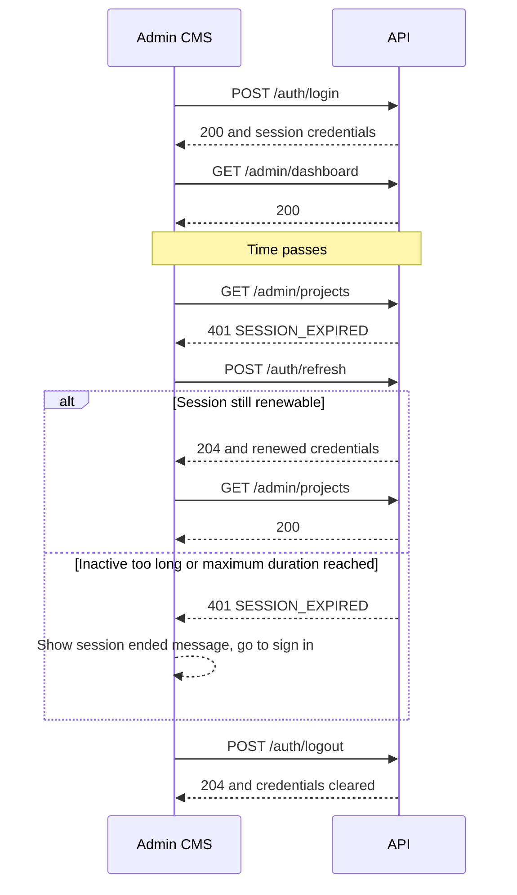
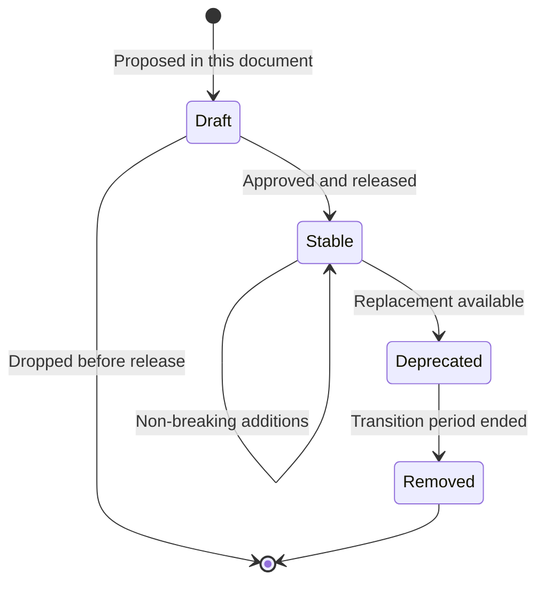
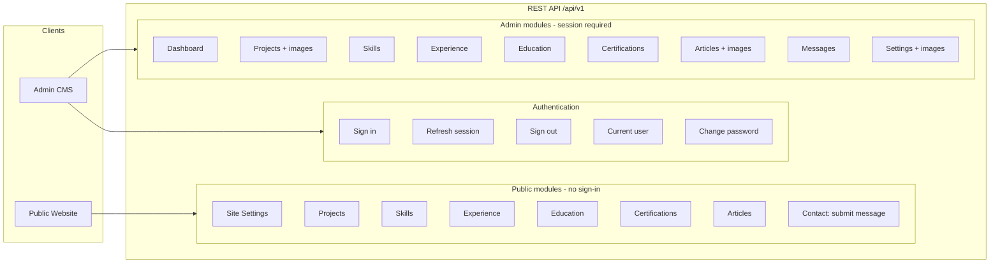

# API Design — Personal Portfolio Platform

## 1. Document Information

| Field             | Value                                                                                                                |
| ----------------- | -------------------------------------------------------------------------------------------------------------------- |
| **Title**         | API Design — Personal Portfolio Platform                                                                             |
| **Version**       | 1.0.0                                                                                                                |
| **Status**        | Draft — Pending Review                                                                                               |
| **Author**        | Muhammad Bux                                                                                                         |
| **Last Updated**  | 2026-10-20                                                                                                           |
| **Current Phase** | Stage 2 — Design: API Design                                                                                         |
| **Depends On**    | `PROBLEM_STATEMENT.md`, `VISION.md`, `SCOPE.md`, `FUNCTIONAL_REQUIREMENTS.md`, `USER_FLOWS.md`, `DATABASE_DESIGN.md` |

---

## 2. Introduction

### 2.1 Purpose

This document is the Version 1 REST API contract. It defines every endpoint, the data each one accepts and returns, how errors are reported, and who may call it. It describes behavior only. It contains no implementation, no code, and no infrastructure decisions.

### 2.2 Why API contracts matter

- The public website and the Admin CMS are separate clients of one backend. They can be built independently only if both agree on the contract first.
- A contract makes requirements testable at the boundary: a requirement is met when the endpoint behaves as stated here.
- Early agreement on error formats, visibility, and validation prevents inconsistent behavior across modules.
- A written contract is a reviewable record of engineering discipline, which is part of what this project sets out to demonstrate.

### 2.3 Relationship with previous documents

| Document                     | What This API Takes From It                                                                                                       |
| ---------------------------- | --------------------------------------------------------------------------------------------------------------------------------- |
| `SCOPE.md`                   | The list of modules and the exclusions. No endpoint exists for anything out of scope.                                             |
| `FUNCTIONAL_REQUIREMENTS.md` | Behavior, validation, error handling, and business rules (FR, BR).                                                                |
| `USER_FLOWS.md`              | The sequence of steps each endpoint must support.                                                                                 |
| `DATABASE_DESIGN.md`         | Resources, field names, required fields, visibility, and lifecycle rules. API field names match the field names in that document. |

Section 22 lists where the brief for this document, or an earlier document, needed interpretation. Where an endpoint would have introduced functionality outside the approved scope, it was **not** added, and the conflict is recorded there with a proposed update to the earlier document.

### 2.4 Reading this document

- All URLs are relative to the base path `/api/v1`.
- `{id}` is an opaque identifier assigned by the system. `{publicAddressName}` is the readable public name of a published project or article.
- "Public" means no sign-in is required. "Admin" means a signed-in Admin session is required.
- Endpoint tables use the shorthand error sets defined in Section 13.4: **CP**, **CA**, **CW**, **CI**.

---

## 3. API Design Principles

| #     | Principle                          | Meaning for This API                                                                                                                                                                            |
| ----- | ---------------------------------- | ----------------------------------------------------------------------------------------------------------------------------------------------------------------------------------------------- |
| AP-1  | **RESTful design**                 | Resources are nouns. HTTP methods express the action. Status codes express the outcome.                                                                                                         |
| AP-2  | **Resource-oriented URLs**         | Collections are plural nouns (`/projects`). The one exception is `/experience`, where a plural is unnatural. Entities map to resources as shown in Section 4.2.                                 |
| AP-3  | **Consistent naming**              | URL segments are lower case and hyphenated. JSON fields use lower camel case and match `DATABASE_DESIGN.md` exactly.                                                                            |
| AP-4  | **Predictable responses**          | Every response uses one of a small set of shapes (Section 8).                                                                                                                                   |
| AP-5  | **Stateless requests**             | Each request carries everything needed to process it. The server keeps no conversation state between requests. The Admin session is carried by credentials the browser sends with each request. |
| AP-6  | **Safe methods stay safe**         | `GET` never changes data.                                                                                                                                                                       |
| AP-7  | **Idempotent where expected**      | Repeating `PUT`, `PATCH`, or `DELETE` with the same input leaves the same end state.                                                                                                            |
| AP-8  | **Separation of public and admin** | Public endpoints return only public fields. Admin endpoints live under `/admin` and return full records. The two are never mixed in one endpoint.                                               |
| AP-9  | **Explicit state changes**         | Publishing and unpublishing are explicit operations. They are not a side effect of editing.                                                                                                     |
| AP-10 | **Strict input**                   | Unknown fields and read-only fields in a request are rejected, not silently ignored.                                                                                                            |
| AP-11 | **Clear errors**                   | Every error has a stable machine code and a plain-language message (Section 13).                                                                                                                |
| AP-12 | **Minimum surface**                | An endpoint exists only if an approved requirement needs it. Each endpoint traces to a requirement (Section 21).                                                                                |
| AP-13 | **Versioned from the start**       | The version is part of the path (Section 14).                                                                                                                                                   |
| AP-14 | **One format**                     | JSON in and out, except image upload, which uses a multipart form.                                                                                                                              |

### 3.1 HTTP method usage

| Method   | Use                                                                                              | Body         | Idempotent    |
| -------- | ------------------------------------------------------------------------------------------------ | ------------ | ------------- |
| `GET`    | Read a resource or collection                                                                    | None         | Yes           |
| `POST`   | Create a resource, or perform a non-idempotent action (sign in, submit message, upload an image) | JSON or form | No            |
| `PUT`    | Replace a state or a single-slot resource (publication state, a single image, password)          | JSON or form | Yes           |
| `PATCH`  | Change some fields of a resource. Omitted fields are unchanged                                   | JSON         | Yes           |
| `DELETE` | Remove a resource                                                                                | None         | Yes in effect |

### 3.2 Data conventions

| Topic                      | Convention                                                                                    |
| -------------------------- | --------------------------------------------------------------------------------------------- |
| Timestamps                 | ISO 8601, UTC, for example `2026-10-20T09:30:00Z`                                             |
| Calendar dates             | `YYYY-MM-DD`. Month and year are used for display, as set out in `DATABASE_DESIGN.md`         |
| Empty optional values      | Returned as `null`. Empty lists are returned as `[]`. Placeholder text is never used (DV-018) |
| Clearing an optional value | Send `null` in a `PATCH`                                                                      |
| Text                       | Leading and trailing spaces are removed before validation (DV-019)                            |
| Identifiers                | Opaque strings. Clients never interpret them                                                  |
| Booleans                   | `true` or `false` only                                                                        |
| Language                   | Messages are in English                                                                       |

---

## 4. API Overview

### 4.1 Modules

| Module             | Public/Admin                                               | Purpose                                                                                |
| ------------------ | ---------------------------------------------------------- | -------------------------------------------------------------------------------------- |
| **Authentication** | Public (sign-in, session refresh), Admin (everything else) | Admin sign-in, session refresh, sign-out, current user, password change                |
| **Site Settings**  | Public (read), Admin (read, update, images)                | General portfolio information for Home, About, footer, Contact, and search and sharing |
| **Projects**       | Public (read), Admin (full management)                     | Portfolio projects                                                                     |
| **Skills**         | Public (read), Admin (full management)                     | Technical skills by category                                                           |
| **Experience**     | Public (read), Admin (full management)                     | Professional history                                                                   |
| **Education**      | Public (read), Admin (full management)                     | Academic history                                                                       |
| **Certifications** | Public (read), Admin (full management)                     | Credentials                                                                            |
| **Blog**           | Public (read), Admin (full management)                     | Technical articles. Exposed as the `articles` resource                                 |
| **Messages**       | Public (submit), Admin (review and manage)                 | Visitor messages from the Contact area                                                 |
| **Dashboard**      | Admin                                                      | Overview of content and messages                                                       |

### 4.2 Entity to resource mapping

| Entity (`DATABASE_DESIGN.md`) | Public Resource           | Admin Resource                        |
| ----------------------------- | ------------------------- | ------------------------------------- |
| User                          | None                      | `/auth/*` (session and password only) |
| Project                       | `/projects`               | `/admin/projects`                     |
| Skill                         | `/skills`                 | `/admin/skills`                       |
| Experience                    | `/experience`             | `/admin/experience`                   |
| Education                     | `/education`              | `/admin/education`                    |
| Certification                 | `/certifications`         | `/admin/certifications`               |
| Blog                          | `/articles`               | `/admin/articles`                     |
| Message                       | `/messages` (create only) | `/admin/messages`                     |
| Setting                       | `/settings`               | `/admin/settings`                     |

### 4.3 Endpoint count

| Area           | Endpoints |
| -------------- | --------- |
| Authentication | 5         |
| Public         | 10        |
| Admin          | 55        |
| **Total**      | **70**    |

### 4.4 Deliberately not provided in Version 1

No endpoint exists for the following, because `SCOPE.md` or `FUNCTIONAL_REQUIREMENTS.md` excludes or defers them.

| Not Provided                                                            | Reason                                               |
| ----------------------------------------------------------------------- | ---------------------------------------------------- |
| Visitor registration, accounts, or sign-in                              | FR-AUTH-010, SCOPE Section 5                         |
| Admin account creation, password recovery                               | FR-AUTH-010, decision D-5                            |
| Text search over content                                                | Search is deferred (SCOPE Section 6). See Section 10 |
| Comments, ratings, or any visitor-generated content other than messages | BR-014, FR-BLOG-007                                  |
| Sending replies, notifications, or alerts                               | FR-MSG-005, decision D-1                             |
| Analytics, newsletter, testimonials, résumé generation                  | SCOPE Section 6                                      |
| Restoring removed records, change history                               | BR-004                                               |
| Reordering records by hand                                              | BR-007 fixes display order                           |
| Bulk operations, import, export                                         | Not required by any requirement                      |
| Sitemap or other search-engine feeds                                    | Not an API concern. See Section 22, K-11             |

---

## 5. Authentication APIs

The Admin session is established by sign-in and carried by secure credentials that the server sets and the browser returns on each request. The contract has these consequences for clients:

- Credentials are never placed in request bodies, response bodies, or URLs.
- Browser clients must send credentials with every request to `/admin/*` and `/auth/*`.
- The mechanism, including expiry times, is defined in later phases. Clients rely only on the behavior below.

### 5.1 Session behavior

| Situation                                                                                  | API Behavior                                                                                                                                                                                                        |
| ------------------------------------------------------------------------------------------ | ------------------------------------------------------------------------------------------------------------------------------------------------------------------------------------------------------------------- |
| No credentials presented to an admin endpoint                                              | `401 UNAUTHENTICATED`                                                                                                                                                                                               |
| Credentials presented but no longer valid (inactivity, maximum duration reached, or ended) | `401 SESSION_EXPIRED`                                                                                                                                                                                               |
| Client receives `SESSION_EXPIRED` on any admin request                                     | Calls **AUTH-02** once. If it succeeds, repeat the original request. If it returns `SESSION_EXPIRED`, the session is over. The client shows the session-ended message (FR-AUTH-006) and sends the Admin to sign in. |
| After sign-out                                                                             | Management endpoints return `UNAUTHENTICATED` until the next sign-in (FR-AUTH-007)                                                                                                                                  |



### 5.2 Endpoint catalog

| ID      | Method and URL       | Purpose                                 | Auth                | Request                                | Success                                   | Errors                                                               | Notes                                                                        |
| ------- | -------------------- | --------------------------------------- | ------------------- | -------------------------------------- | ----------------------------------------- | -------------------------------------------------------------------- | ---------------------------------------------------------------------------- |
| AUTH-01 | `POST /auth/login`   | Sign in the Admin                       | Public              | Body: `email`, `password`              | `200` Item (user) and session credentials | CP, CW, `401 INVALID_CREDENTIALS`, `429 SIGN_IN_TEMPORARILY_BLOCKED` | FR-AUTH-002 to 004. One general failure message for any wrong credential.    |
| AUTH-02 | `POST /auth/refresh` | Renew the session without a new sign-in | Session credentials | None                                   | `204`, renewed credentials                | CP, `401 SESSION_EXPIRED`                                            | FR-AUTH-005. Fails once the inactivity limit or maximum duration is reached. |
| AUTH-03 | `POST /auth/logout`  | End the session                         | Public              | None                                   | `204`, credentials cleared                | CP                                                                   | FR-AUTH-007. Always succeeds, even if no session exists.                     |
| AUTH-04 | `GET /auth/me`       | Return the signed-in Admin              | Admin               | None                                   | `200` Item (user)                         | CA                                                                   | Lets the Admin CMS check whether a session is active.                        |
| AUTH-05 | `PUT /auth/password` | Change the Admin's password             | Admin               | Body: `currentPassword`, `newPassword` | `204`                                     | CA, CW, `422 VALIDATION_FAILED`                                      | FR-AUTH-009. See notes below.                                                |

### 5.3 AUTH-01 Login

**Request body**

| Field    | Type   | Required | Rules              |
| -------- | ------ | -------- | ------------------ |
| email    | String | Yes      | Valid email format |
| password | String | Yes      | Not empty          |

```json
{
  "email": "owner@example.com",
  "password": "correct-horse-battery-staple"
}
```

**Success: 200**

```json
{
  "data": {
    "user": {
      "id": "a1b2c3d4e5f6a7b8c9d0e1f2",
      "email": "owner@example.com"
    }
  }
}
```

**Errors**

| Status | Code                          | When                                                                                     |
| ------ | ----------------------------- | ---------------------------------------------------------------------------------------- |
| 401    | `INVALID_CREDENTIALS`         | Email or password is wrong. The message never says which.                                |
| 422    | `VALIDATION_FAILED`           | A field is missing or malformed.                                                         |
| 429    | `SIGN_IN_TEMPORARILY_BLOCKED` | Too many failed attempts. A `Retry-After` header states when to try again (FR-AUTH-004). |

```json
{
  "error": {
    "code": "INVALID_CREDENTIALS",
    "message": "The email or password is incorrect.",
    "requestId": "req_7d1f0c"
  }
}
```

```json
{
  "error": {
    "code": "SIGN_IN_TEMPORARILY_BLOCKED",
    "message": "Too many failed attempts. Please try again later.",
    "retryAfterSeconds": 900,
    "requestId": "req_7d1f0d"
  }
}
```

### 5.4 AUTH-04 Current user

**Success: 200**

```json
{
  "data": {
    "id": "a1b2c3d4e5f6a7b8c9d0e1f2",
    "email": "owner@example.com"
  }
}
```

The response never includes password data, attempt counters, or block information.

### 5.5 AUTH-05 Change password

**Request body**

| Field           | Type   | Required | Rules                                                                      |
| --------------- | ------ | -------- | -------------------------------------------------------------------------- |
| currentPassword | String | Yes      | Must match the existing password                                           |
| newPassword     | String | Yes      | At least 12 characters (FR-VAL-013). Must differ from the current password |

**Validation details used**

| Field             | Detail Code          | Meaning                                                                                         |
| ----------------- | -------------------- | ----------------------------------------------------------------------------------------------- |
| `currentPassword` | `INCORRECT`          | The current password is wrong. A `422` is used, not `401`, because the session itself is valid. |
| `newPassword`     | `PASSWORD_TOO_WEAK`  | Does not meet the strength rule.                                                                |
| `newPassword`     | `PASSWORD_UNCHANGED` | Same as the current password.                                                                   |

**Notes**

- Returns `204` with no body.
- The contract guarantees only that the new password is required at the next sign-in (FR-AUTH-009). Whether the current session continues is an authentication design decision (`DATABASE_DESIGN.md` C-9). Clients must handle `SESSION_EXPIRED` after a password change.

---

## 6. Public APIs

Public endpoints need no sign-in, return only public fields (`DATABASE_DESIGN.md` Section 10), and apply the CP error set. Only published content is ever returned. A draft or removed record behaves exactly as if it does not exist (`404 NOT_FOUND`, FR-SITE-006).

Public responses never include `id`, `status`, `isFeatured`, `createdAt`, `updatedAt`, `assetId`, or any internal field. See Section 22, K-2.

### 6.0 Shared public structure: Image

| Field           | Type           | Description                                                               |
| --------------- | -------------- | ------------------------------------------------------------------------- |
| assetAddress    | String         | Web address of the image                                                  |
| textAlternative | String or null | Description for those who cannot see the image. `null` only if decorative |
| isDecorative    | Boolean        | True if purely decorative                                                 |

Images in a project's `images` list also carry `isCover` (Boolean).

### 6.1 Site Settings (public)

| ID         | Method and URL  | Purpose                                 | Auth   | Request | Success    | Errors | Notes                                                                                                                                                                                                                       |
| ---------- | --------------- | --------------------------------------- | ------ | ------- | ---------- | ------ | --------------------------------------------------------------------------------------------------------------------------------------------------------------------------------------------------------------------------- |
| PUB-SET-01 | `GET /settings` | Return the public portfolio information | Public | None    | `200` Item | CP     | Supplies Home, About, footer, Contact details, and default search and sharing information (FR-HOME-001, FR-ABOUT-001, FR-SITE-002, FR-CONTACT-009, FR-SEO-003, FR-SEO-004). Added to the brief's list. See Section 22, K-4. |

**Response fields**

| Field                  | Type                         | Description                          |
| ---------------------- | ---------------------------- | ------------------------------------ |
| ownerName              | String                       | Owner's name                         |
| headline               | String                       | Professional headline                |
| homeIntroduction       | String or null               | Introduction shown on Home           |
| aboutNarrative         | String or null               | Personal introduction                |
| professionalBackground | String or null               | Professional background              |
| profileImage           | Image or null                | The owner's picture                  |
| availabilityStatement  | String or null               | Current availability                 |
| professionalLinks      | List of `{ label, address }` | Professional profile links           |
| publicContactDetails   | List of `{ label, value }`   | Contact details chosen as public     |
| siteTitle              | String or null               | Default title for search and sharing |
| siteDescription        | String or null               | Default description                  |
| defaultShareImage      | Image or null                | Default sharing image                |

```json
{
  "data": {
    "ownerName": "Alex Morgan",
    "headline": "Full Stack Software Engineer",
    "homeIntroduction": "I build reliable web applications and write about how they are made.",
    "aboutNarrative": "I am a software engineer with a focus on maintainable systems.",
    "professionalBackground": "Five years of building and operating production web applications.",
    "profileImage": {
      "assetAddress": "https://media.example.com/portfolio/alex.jpg",
      "textAlternative": "Portrait of Alex Morgan",
      "isDecorative": false
    },
    "availabilityStatement": "Open to full-time roles from January.",
    "professionalLinks": [
      { "label": "GitHub", "address": "https://github.com/example" },
      { "label": "LinkedIn", "address": "https://www.linkedin.com/in/example" }
    ],
    "publicContactDetails": [{ "label": "Email", "value": "alex@example.com" }],
    "siteTitle": "Alex Morgan, Full Stack Engineer",
    "siteDescription": "Portfolio, projects, and writing by Alex Morgan.",
    "defaultShareImage": null
  }
}
```

### 6.2 Projects (public)

| ID         | Method and URL                      | Purpose                           | Auth   | Request                               | Success          | Errors                            | Notes                                                                                                                                                                           |
| ---------- | ----------------------------------- | --------------------------------- | ------ | ------------------------------------- | ---------------- | --------------------------------- | ------------------------------------------------------------------------------------------------------------------------------------------------------------------------------- |
| PUB-PRJ-01 | `GET /projects`                     | List published projects           | Public | Query: `page`, `pageSize`, `featured` | `200` Collection | CP, `422 INVALID_QUERY_PARAMETER` | Order: featured first, then newest first by first publication date (BR-007). `featured=true` returns only featured projects. Default `pageSize` 12, maximum 50. FR-PROJECT-001. |
| PUB-PRJ-02 | `GET /projects/{publicAddressName}` | Get one published project in full | Public | Path: `publicAddressName`             | `200` Item       | CP, `404 NOT_FOUND`               | FR-PROJECT-002, FR-PROJECT-007.                                                                                                                                                 |

**Home page selection (FR-HOME-003).** The client requests `GET /projects?featured=true`. If the result is empty, it requests `GET /projects` with a small `pageSize` to show the most recently published projects. No dedicated endpoint is provided.

**List item fields**

| Field             | Type           | Description                                 |
| ----------------- | -------------- | ------------------------------------------- |
| publicAddressName | String         | Readable public name, stable once published |
| title             | String         | Project title                               |
| summary           | String         | Short description                           |
| coverImage        | Image          | The project's cover image                   |
| technologies      | List of String | Technologies used                           |

**Detail fields** include every list field plus:

| Field           | Type                           | Description                        |
| --------------- | ------------------------------ | ---------------------------------- |
| problemContext  | String                         | Problem or context                 |
| role            | String                         | The owner's role                   |
| keyDecisions    | String or null                 | Decisions and trade-offs           |
| outcome         | String                         | What was achieved                  |
| liveProjectLink | String or null                 | Web address of the running project |
| sourceCodeLink  | String or null                 | Web address of the source code     |
| periodStart     | Date or null                   | Start of the project               |
| periodEnd       | Date or null                   | End of the project                 |
| images          | List of Image (with `isCover`) | All project images                 |

**Example: list**

```json
{
  "data": [
    {
      "publicAddressName": "inventory-tracker",
      "title": "Inventory Tracker",
      "summary": "Stock management for a small warehouse, replacing spreadsheets.",
      "coverImage": {
        "assetAddress": "https://media.example.com/portfolio/inventory-cover.jpg",
        "textAlternative": "Dashboard showing current stock levels",
        "isDecorative": false
      },
      "technologies": ["TypeScript", "React", "Node.js", "MongoDB"]
    }
  ],
  "meta": {
    "pagination": { "page": 1, "pageSize": 12, "totalItems": 1, "totalPages": 1 }
  }
}
```

**Example: detail**

```json
{
  "data": {
    "publicAddressName": "inventory-tracker",
    "title": "Inventory Tracker",
    "summary": "Stock management for a small warehouse, replacing spreadsheets.",
    "coverImage": {
      "assetAddress": "https://media.example.com/portfolio/inventory-cover.jpg",
      "textAlternative": "Dashboard showing current stock levels",
      "isDecorative": false
    },
    "technologies": ["TypeScript", "React", "Node.js", "MongoDB"],
    "problemContext": "A warehouse tracked stock in shared spreadsheets, causing frequent errors.",
    "role": "Sole developer, responsible for design and delivery.",
    "keyDecisions": "Chose a simple audit trail over full versioning to keep scope small.",
    "outcome": "Stock discrepancies fell sharply within the first quarter.",
    "liveProjectLink": "https://inventory.example.com",
    "sourceCodeLink": "https://github.com/example/inventory-tracker",
    "periodStart": "2025-02-01",
    "periodEnd": "2025-06-30",
    "images": [
      {
        "assetAddress": "https://media.example.com/portfolio/inventory-cover.jpg",
        "textAlternative": "Dashboard showing current stock levels",
        "isDecorative": false,
        "isCover": true
      }
    ]
  }
}
```

### 6.3 Skills (public)

| ID         | Method and URL | Purpose                             | Auth   | Request | Success          | Errors | Notes                                                                                                                                       |
| ---------- | -------------- | ----------------------------------- | ------ | ------- | ---------------- | ------ | ------------------------------------------------------------------------------------------------------------------------------------------- |
| PUB-SKL-01 | `GET /skills`  | List all skills grouped by category | Public | None    | `200` Collection | CP     | Categories alphabetical, skills alphabetical within a category (FR-SKILL-004). Not paginated. Empty categories do not exist (FR-SKILL-002). |

```json
{
  "data": [
    {
      "category": "Languages",
      "skills": [
        { "name": "JavaScript", "level": "expert" },
        { "name": "TypeScript", "level": "advanced" }
      ]
    },
    {
      "category": "Tools",
      "skills": [{ "name": "Git", "level": null }]
    }
  ],
  "meta": { "totalItems": 3 }
}
```

`level` is one of `beginner`, `intermediate`, `advanced`, `expert`, or `null`.

### 6.4 Experience (public)

| ID         | Method and URL    | Purpose                      | Auth   | Request | Success          | Errors | Notes                                                                                                 |
| ---------- | ----------------- | ---------------------------- | ------ | ------- | ---------------- | ------ | ----------------------------------------------------------------------------------------------------- |
| PUB-EXP-01 | `GET /experience` | List professional experience | Public | None    | `200` Collection | CP     | Newest `startDate` first (FR-EXP-001). Not paginated. `isCurrent` is derived from an empty `endDate`. |

```json
{
  "data": [
    {
      "roleTitle": "Software Engineer",
      "organization": "Northwind Systems",
      "location": "Remote",
      "startDate": "2023-03-01",
      "endDate": null,
      "isCurrent": true,
      "summary": "Backend and web development for a logistics platform.",
      "responsibilities": ["Designed order-tracking features", "Maintained deployment pipeline"],
      "achievements": ["Reduced page load time by 40 percent"],
      "technologies": ["Node.js", "TypeScript", "MongoDB"]
    }
  ],
  "meta": { "totalItems": 1 }
}
```

### 6.5 Education (public)

| ID         | Method and URL   | Purpose                | Auth   | Request | Success          | Errors | Notes                                                                                                    |
| ---------- | ---------------- | ---------------------- | ------ | ------- | ---------------- | ------ | -------------------------------------------------------------------------------------------------------- |
| PUB-EDU-01 | `GET /education` | List education records | Public | None    | `200` Collection | CP     | Newest `startDate` first (FR-EDU-001). Not paginated. `isInProgress` is derived from an empty `endDate`. |

```json
{
  "data": [
    {
      "institution": "State University",
      "qualification": "Bachelor of Science",
      "fieldOfStudy": "Computer Science",
      "startDate": "2017-09-01",
      "endDate": "2021-06-30",
      "isInProgress": false,
      "description": "Graduated with honors."
    }
  ],
  "meta": { "totalItems": 1 }
}
```

### 6.6 Certifications (public)

| ID         | Method and URL        | Purpose             | Auth   | Request | Success          | Errors | Notes                                                                                                                                             |
| ---------- | --------------------- | ------------------- | ------ | ------- | ---------------- | ------ | ------------------------------------------------------------------------------------------------------------------------------------------------- |
| PUB-CRT-01 | `GET /certifications` | List certifications | Public | None    | `200` Collection | CP     | Newest `issueDate` first (FR-CERT-001). Not paginated. `isExpired` is derived by the server from `expiryDate` and the current date (FR-CERT-003). |

```json
{
  "data": [
    {
      "name": "Cloud Practitioner",
      "issuingOrganization": "Example Certification Body",
      "issueDate": "2024-05-10",
      "expiryDate": "2027-05-10",
      "isExpired": false,
      "credentialId": "ABC-12345",
      "verificationLink": "https://verify.example.com/ABC-12345"
    }
  ],
  "meta": { "totalItems": 1 }
}
```

### 6.7 Blog (public, `articles` resource)

| ID         | Method and URL                      | Purpose                    | Auth   | Request                   | Success          | Errors                            | Notes                                                                                    |
| ---------- | ----------------------------------- | -------------------------- | ------ | ------------------------- | ---------------- | --------------------------------- | ---------------------------------------------------------------------------------------- |
| PUB-ART-01 | `GET /articles`                     | List published articles    | Public | Query: `page`, `pageSize` | `200` Collection | CP, `422 INVALID_QUERY_PARAMETER` | Newest `publishedAt` first. Default `pageSize` 10, maximum 50. FR-BLOG-001, FR-BLOG-003. |
| PUB-ART-02 | `GET /articles/{publicAddressName}` | Read one published article | Public | Path: `publicAddressName` | `200` Item       | CP, `404 NOT_FOUND`               | FR-BLOG-002, FR-BLOG-004, FR-BLOG-005.                                                   |

**List item fields**

| Field             | Type          | Description                                 |
| ----------------- | ------------- | ------------------------------------------- |
| publicAddressName | String        | Readable public name, stable once published |
| title             | String        | Article title                               |
| summary           | String        | Short description                           |
| coverImage        | Image or null | Optional cover image                        |
| publishedAt       | Timestamp     | When first published                        |

**Detail fields** include every list field plus:

| Field        | Type              | Description                                                                                                                              |
| ------------ | ----------------- | ---------------------------------------------------------------------------------------------------------------------------------------- |
| body         | String            | Formatted article content. See the note below                                                                                            |
| lastEditedAt | Timestamp or null | Present only if the content was changed after first publication. A last-updated date is shown only when this is not `null` (FR-BLOG-002) |

**Note on `body`.** The API treats `body` as one string of formatted content. The format used to represent headings, lists, links, quotations, code excerpts, and images is a Technical Decisions matter (`DATABASE_DESIGN.md` C-13). The server guarantees that stored content is safe to display. See Section 22, OI-1.

```json
{
  "data": [
    {
      "publicAddressName": "designing-for-maintainability",
      "title": "Designing for Maintainability",
      "summary": "What I learned keeping a production application healthy for three years.",
      "coverImage": null,
      "publishedAt": "2026-09-14T08:00:00Z"
    }
  ],
  "meta": {
    "pagination": { "page": 1, "pageSize": 10, "totalItems": 1, "totalPages": 1 }
  }
}
```

### 6.8 Contact (public)

| ID         | Method and URL   | Purpose                       | Auth   | Request                                                     | Success                   | Errors                                                     | Notes                                                                                                |
| ---------- | ---------------- | ----------------------------- | ------ | ----------------------------------------------------------- | ------------------------- | ---------------------------------------------------------- | ---------------------------------------------------------------------------------------------------- |
| PUB-MSG-01 | `POST /messages` | Submit a message to the owner | Public | Body: `senderName`, `senderEmail`, `subject`, `messageText` | `201` Item (confirmation) | CP, CW, `400 SUBMISSION_REJECTED`, `429 TOO_MANY_REQUESTS` | FR-CONTACT-001 to 008. No account needed. Confirmation is returned only after the message is stored. |

**Request body**

| Field       | Type   | Required | Rules                               |
| ----------- | ------ | -------- | ----------------------------------- |
| senderName  | String | Yes      | 2 to 100 characters (FR-VAL-003)    |
| senderEmail | String | Yes      | Valid email format (FR-VAL-002)     |
| subject     | String | No       | Up to 150 characters (FR-VAL-004)   |
| messageText | String | Yes      | 10 to 2,000 characters (FR-VAL-005) |

```json
{
  "senderName": "Jamie Lee",
  "senderEmail": "jamie@example.com",
  "subject": "Project enquiry",
  "messageText": "Hello, I would like to discuss a contract web project."
}
```

**Success: 201**

```json
{
  "data": {
    "received": true
  }
}
```

The response deliberately contains no identifier, because messages are private.

**Errors**

| Status | Code                  | When                                                                                                               |
| ------ | --------------------- | ------------------------------------------------------------------------------------------------------------------ |
| 422    | `VALIDATION_FAILED`   | Missing or invalid field. Each problem is named at its field (FR-CONTACT-002).                                     |
| 400    | `SUBMISSION_REJECTED` | The submission was identified as automated or abusive and was not stored (FR-CONTACT-008). The message is generic. |
| 429    | `TOO_MANY_REQUESTS`   | Too many submissions from one client in a short period.                                                            |
| 503    | `SERVICE_UNAVAILABLE` | The message could not be stored. The client keeps the visitor's text and tells them to retry (FR-CONTACT-004).     |

```json
{
  "error": {
    "code": "VALIDATION_FAILED",
    "message": "Please correct the highlighted fields.",
    "details": [
      {
        "field": "senderEmail",
        "code": "INVALID_FORMAT",
        "message": "Enter a valid email address."
      },
      {
        "field": "messageText",
        "code": "TOO_SHORT",
        "message": "The message must be at least 10 characters."
      }
    ],
    "requestId": "req_91ab33"
  }
}
```

**Duplicate prevention (FR-CONTACT-005).** If an identical submission (same sender email and message text) arrives within a short period after a stored one, the API returns the same `201` response and stores no second message. The period is an initial value of 60 seconds. A visitor who double-submits therefore gets one stored message and one confirmation.

---

## 7. Admin APIs

All admin endpoints require a signed-in Admin session and use the **CA** error set (Section 13.4). Endpoints that receive a JSON body also use **CW**, and endpoints that receive an image use **CI**.

Admin responses return the full record, including `id`, `createdAt`, and `updatedAt`, plus fields the public does not see.

### 7.0 Conventions for admin write operations

| Topic             | Rule                                                                                                                                                                                                               |
| ----------------- | ------------------------------------------------------------------------------------------------------------------------------------------------------------------------------------------------------------------ |
| Create            | `POST` to the collection. Returns `201` with the created record.                                                                                                                                                   |
| Update            | `PATCH` to the record. Provided fields change. Omitted fields do not. `null` clears an optional field. Returns `200` with the updated record.                                                                      |
| Remove            | `DELETE` on the record. Returns `204`. Removal is permanent (BR-004). The confirmation required by BR-009 is a client behavior, not an API step.                                                                   |
| Read-only fields  | `id`, `createdAt`, `updatedAt`, `publicAddressName`, `publishedAt`, `lastEditedAt`, and `status` cannot be set through `POST` or `PATCH`. Sending them gives `422 VALIDATION_FAILED` with detail code `READ_ONLY`. |
| Publication       | Changed only through the `status` endpoints (AP-9).                                                                                                                                                                |
| Public address    | `publicAddressName` is generated by the system from the title, kept unique, and regenerated on title change until the record is first published. After that it never changes (BR-008).                             |
| Change tracking   | Every successful create, update, status change, image change, or removal updates the area's last-changed date for the Dashboard (FR-DASH-003).                                                                     |
| Published records | A change that would leave a published record missing a required-to-publish field is rejected with `422 PUBLISHED_RECORD_INVALID` and the record is not changed (DV-002).                                           |

### 7.1 Dashboard

| ID         | Method and URL         | Purpose                                     | Auth  | Request | Success    | Errors | Notes                                                                                                                                                                                                |
| ---------- | ---------------------- | ------------------------------------------- | ----- | ------- | ---------- | ------ | ---------------------------------------------------------------------------------------------------------------------------------------------------------------------------------------------------- |
| ADM-DSH-01 | `GET /admin/dashboard` | Return the overview of content and messages | Admin | None    | `200` Item | CA     | FR-DASH-001 to 003, FR-DASH-005. Every value is derived at the time of the request. Nothing here is stored separately except the last-changed dates. Added to the brief's list. See Section 22, K-4. |

**Response fields**

| Field           | Type   | Description                                                                                             |
| --------------- | ------ | ------------------------------------------------------------------------------------------------------- |
| contentCounts   | Object | Counts per area. `projects` and `articles` give `total`, `published`, `draft`. Other areas give `total` |
| messages        | Object | `newCount`, and `recent`: most recent messages, newest first, up to 5                                   |
| areaLastChanged | List   | One entry per area: `area` and `lastChangedAt`                                                          |
| pendingDrafts   | List   | Draft projects and articles: `type`, `id`, `title`, `updatedAt`                                         |

```json
{
  "data": {
    "contentCounts": {
      "projects": { "total": 6, "published": 5, "draft": 1 },
      "skills": { "total": 24 },
      "experience": { "total": 3 },
      "education": { "total": 2 },
      "certifications": { "total": 4 },
      "articles": { "total": 8, "published": 7, "draft": 1 }
    },
    "messages": {
      "newCount": 2,
      "recent": [
        {
          "id": "b2c3d4e5f6a7b8c9d0e1f2a3",
          "senderName": "Jamie Lee",
          "subject": "Project enquiry",
          "status": "new",
          "createdAt": "2026-10-19T14:05:00Z"
        }
      ]
    },
    "areaLastChanged": [
      { "area": "projects", "lastChangedAt": "2026-10-12T10:00:00Z" },
      { "area": "skills", "lastChangedAt": "2026-08-30T09:00:00Z" },
      { "area": "experience", "lastChangedAt": "2026-05-02T16:20:00Z" },
      { "area": "education", "lastChangedAt": "2025-11-01T12:00:00Z" },
      { "area": "certifications", "lastChangedAt": "2026-06-18T08:45:00Z" },
      { "area": "blog", "lastChangedAt": "2026-10-01T07:30:00Z" },
      { "area": "settings", "lastChangedAt": "2026-09-21T11:10:00Z" }
    ],
    "pendingDrafts": [
      {
        "type": "article",
        "id": "c3d4e5f6a7b8c9d0e1f2a3b4",
        "title": "Notes on Testing Strategy",
        "updatedAt": "2026-10-10T18:00:00Z"
      }
    ]
  }
}
```

### 7.2 Projects (admin)

| ID         | Method and URL                                 | Purpose                                     | Auth  | Request                                                         | Success                          | Errors                                            | Notes                                                                                                                                                                       |
| ---------- | ---------------------------------------------- | ------------------------------------------- | ----- | --------------------------------------------------------------- | -------------------------------- | ------------------------------------------------- | --------------------------------------------------------------------------------------------------------------------------------------------------------------------------- |
| ADM-PRJ-01 | `GET /admin/projects`                          | List all projects                           | Admin | Query: `page`, `pageSize`                                       | `200` Collection                 | CA, `422 INVALID_QUERY_PARAMETER`                 | Most recently changed first. Each item: `id`, `publicAddressName`, `title`, `status`, `isFeatured`, `updatedAt` (FR-ADMIN-PROJECT-002). Default `pageSize` 20, maximum 100. |
| ADM-PRJ-02 | `POST /admin/projects`                         | Create a project as a draft                 | Admin | Body: project fields (7.2.1)                                    | `201` Item                       | CA, CW                                            | FR-ADMIN-PROJECT-001. Only `title` is required. The new project is always `draft`.                                                                                          |
| ADM-PRJ-03 | `GET /admin/projects/{id}`                     | Get one project in full                     | Admin | Path: `id`                                                      | `200` Item                       | CA, `404 NOT_FOUND`                               | Includes drafts.                                                                                                                                                            |
| ADM-PRJ-04 | `PATCH /admin/projects/{id}`                   | Change a project                            | Admin | Body: any project fields (7.2.1)                                | `200` Item                       | CA, CW, `404`, `422 PUBLISHED_RECORD_INVALID`     | FR-ADMIN-PROJECT-003, FR-ADMIN-PROJECT-006 (`isFeatured`). Images are changed through ADM-PRJ-08 to 10.                                                                     |
| ADM-PRJ-05 | `DELETE /admin/projects/{id}`                  | Remove a project permanently                | Admin | Path: `id`                                                      | `204`                            | CA, `404`                                         | FR-ADMIN-PROJECT-004. Its images stop being publicly available (FR-MEDIA-005).                                                                                              |
| ADM-PRJ-06 | `PUT /admin/projects/{id}/status`              | Publish or unpublish                        | Admin | Body: `status`                                                  | `200` Item                       | CA, CW, `404`, `422 PUBLISH_REQUIREMENTS_NOT_MET` | FR-ADMIN-PROJECT-005. Setting `published` requires BR-005. `publishedAt` is set only on first publication.                                                                  |
| ADM-PRJ-07 | `GET /admin/projects/{id}/preview`             | See a project as visitors will              | Admin | Path: `id`                                                      | `200` Item (public detail shape) | CA, `404`                                         | FR-ADMIN-PROJECT-007. Works for drafts. Never available to visitors.                                                                                                        |
| ADM-PRJ-08 | `POST /admin/projects/{id}/images`             | Add an image                                | Admin | Multipart: `file`, `textAlternative`, `isDecorative`, `isCover` | `201` Item (project)             | CA, CI, `404`, `422 IMAGE_LIMIT_REACHED`          | See 7.10. At most 12 images. If `isCover` is true, it becomes the only cover.                                                                                               |
| ADM-PRJ-09 | `PATCH /admin/projects/{id}/images/{assetId}`  | Change an image's text or cover designation | Admin | Body: `textAlternative`, `isDecorative`, `isCover`              | `200` Item (project)             | CA, CW, `404`, `422 PUBLISHED_RECORD_INVALID`     | Setting `isCover` true clears the previous cover. Clearing the only cover of a published project is rejected.                                                               |
| ADM-PRJ-10 | `DELETE /admin/projects/{id}/images/{assetId}` | Remove an image                             | Admin | None                                                            | `200` Item (project)             | CA, `404`, `422 PUBLISHED_RECORD_INVALID`         | Removing the cover of a published project is rejected. To replace a cover, add the new one with `isCover` true, then remove the old one.                                    |

#### 7.2.1 Project request fields

| Field           | Type           | Required        | Rules                                                  |
| --------------- | -------------- | --------------- | ------------------------------------------------------ |
| title           | String         | Yes (on create) | Up to 150 characters                                   |
| summary         | String or null | To publish      | Up to 300 characters                                   |
| problemContext  | String or null | To publish      | Up to 20,000 characters                                |
| role            | String or null | To publish      | Up to 20,000 characters                                |
| keyDecisions    | String or null | No              | Up to 20,000 characters                                |
| outcome         | String or null | To publish      | Up to 20,000 characters                                |
| technologies    | List of String | No              | At most 30 items, each up to 50 characters. Plain text |
| liveProjectLink | String or null | No              | Complete, valid web address                            |
| sourceCodeLink  | String or null | No              | Complete, valid web address                            |
| periodStart     | Date or null   | No              | Valid date                                             |
| periodEnd       | Date or null   | No              | Valid date. Not before `periodStart`                   |
| isFeatured      | Boolean        | No              | Default `false`                                        |

**Admin project representation** is every field above plus `id`, `publicAddressName`, `status`, `publishedAt`, `images` (each with `assetId`, `assetAddress`, `textAlternative`, `isDecorative`, `isCover`), `createdAt`, and `updatedAt`.

**Example: create (ADM-PRJ-02)**

```json
{
  "title": "Inventory Tracker",
  "summary": "Stock management for a small warehouse, replacing spreadsheets.",
  "technologies": ["TypeScript", "React", "Node.js", "MongoDB"],
  "isFeatured": false
}
```

**Response: 201**

```json
{
  "data": {
    "id": "d4e5f6a7b8c9d0e1f2a3b4c5",
    "publicAddressName": "inventory-tracker",
    "title": "Inventory Tracker",
    "summary": "Stock management for a small warehouse, replacing spreadsheets.",
    "problemContext": null,
    "role": null,
    "keyDecisions": null,
    "outcome": null,
    "technologies": ["TypeScript", "React", "Node.js", "MongoDB"],
    "liveProjectLink": null,
    "sourceCodeLink": null,
    "periodStart": null,
    "periodEnd": null,
    "images": [],
    "status": "draft",
    "isFeatured": false,
    "publishedAt": null,
    "createdAt": "2026-10-20T09:30:00Z",
    "updatedAt": "2026-10-20T09:30:00Z"
  }
}
```

**Example: publish (ADM-PRJ-06) blocked**

Request:

```json
{ "status": "published" }
```

Response: `422`

```json
{
  "error": {
    "code": "PUBLISH_REQUIREMENTS_NOT_MET",
    "message": "This project cannot be published yet. Complete the missing items first.",
    "details": [
      {
        "field": "problemContext",
        "code": "MISSING_FOR_PUBLISH",
        "message": "Describe the problem or context."
      },
      { "field": "role", "code": "MISSING_FOR_PUBLISH", "message": "Describe your role." },
      { "field": "outcome", "code": "MISSING_FOR_PUBLISH", "message": "Describe the outcome." },
      { "field": "images", "code": "MISSING_FOR_PUBLISH", "message": "Add a cover image." }
    ],
    "requestId": "req_c0a4e1"
  }
}
```

### 7.3 Skills (admin)

| ID         | Method and URL              | Purpose         | Auth  | Request            | Success          | Errors                               | Notes                                                                                                                                      |
| ---------- | --------------------------- | --------------- | ----- | ------------------ | ---------------- | ------------------------------------ | ------------------------------------------------------------------------------------------------------------------------------------------ |
| ADM-SKL-01 | `GET /admin/skills`         | List all skills | Admin | None               | `200` Collection | CA                                   | Flat list ordered by category then name (FR-ADMIN-SKILL-005). The client groups it and derives existing categories from it. Not paginated. |
| ADM-SKL-02 | `POST /admin/skills`        | Add a skill     | Admin | Body: skill fields | `201` Item       | CA, CW, `409 DUPLICATE_SKILL`        | FR-ADMIN-SKILL-001. A new category name creates the category.                                                                              |
| ADM-SKL-03 | `GET /admin/skills/{id}`    | Get one skill   | Admin | Path: `id`         | `200` Item       | CA, `404`                            |                                                                                                                                            |
| ADM-SKL-04 | `PATCH /admin/skills/{id}`  | Change a skill  | Admin | Body: skill fields | `200` Item       | CA, CW, `404`, `409 DUPLICATE_SKILL` | FR-ADMIN-SKILL-002. Changing `category` moves the skill.                                                                                   |
| ADM-SKL-05 | `DELETE /admin/skills/{id}` | Remove a skill  | Admin | Path: `id`         | `204`            | CA, `404`                            | FR-ADMIN-SKILL-003.                                                                                                                        |

| Field    | Type           | Required | Rules                                                                                                        |
| -------- | -------------- | -------- | ------------------------------------------------------------------------------------------------------------ |
| name     | String         | Yes      | Up to 100 characters                                                                                         |
| category | String         | Yes      | Up to 50 characters. A value matching an existing category apart from letter case uses the existing spelling |
| level    | String or null | No       | `beginner`, `intermediate`, `advanced`, or `expert`                                                          |

Admin representation adds `id`, `createdAt`, `updatedAt`. The pair `name` and `category` must be unique ignoring letter case and surrounding spaces (DV-008).

```json
{
  "data": {
    "id": "e5f6a7b8c9d0e1f2a3b4c5d6",
    "name": "TypeScript",
    "category": "Languages",
    "level": "advanced",
    "createdAt": "2026-10-20T09:40:00Z",
    "updatedAt": "2026-10-20T09:40:00Z"
  }
}
```

### 7.4 Experience (admin)

| ID         | Method and URL                  | Purpose          | Auth  | Request                 | Success          | Errors        | Notes                                                       |
| ---------- | ------------------------------- | ---------------- | ----- | ----------------------- | ---------------- | ------------- | ----------------------------------------------------------- |
| ADM-EXP-01 | `GET /admin/experience`         | List all entries | Admin | None                    | `200` Collection | CA            | Newest `startDate` first (FR-ADMIN-EXP-005). Not paginated. |
| ADM-EXP-02 | `POST /admin/experience`        | Add an entry     | Admin | Body: experience fields | `201` Item       | CA, CW        | FR-ADMIN-EXP-001.                                           |
| ADM-EXP-03 | `GET /admin/experience/{id}`    | Get one entry    | Admin | Path: `id`              | `200` Item       | CA, `404`     |                                                             |
| ADM-EXP-04 | `PATCH /admin/experience/{id}`  | Change an entry  | Admin | Body: experience fields | `200` Item       | CA, CW, `404` | FR-ADMIN-EXP-002. Setting `endDate` ends a current role.    |
| ADM-EXP-05 | `DELETE /admin/experience/{id}` | Remove an entry  | Admin | Path: `id`              | `204`            | CA, `404`     | FR-ADMIN-EXP-003.                                           |

| Field            | Type           | Required | Rules                                                                       |
| ---------------- | -------------- | -------- | --------------------------------------------------------------------------- |
| roleTitle        | String         | Yes      | Up to 150 characters                                                        |
| organization     | String         | Yes      | Up to 150 characters                                                        |
| location         | String or null | No       | Up to 150 characters                                                        |
| startDate        | Date           | Yes      | Valid date                                                                  |
| endDate          | Date or null   | No       | Valid date. Not before `startDate` (FR-ADMIN-EXP-004). `null` means current |
| summary          | String or null | No       | Up to 20,000 characters                                                     |
| responsibilities | List of String | No       | At most 20 items, each up to 500 characters                                 |
| achievements     | List of String | No       | At most 20 items, each up to 500 characters                                 |
| technologies     | List of String | No       | At most 30 items, each up to 50 characters                                  |

Admin representation adds `id`, `createdAt`, `updatedAt`.

### 7.5 Education (admin)

| ID         | Method and URL                 | Purpose          | Auth  | Request                | Success          | Errors        | Notes                                                       |
| ---------- | ------------------------------ | ---------------- | ----- | ---------------------- | ---------------- | ------------- | ----------------------------------------------------------- |
| ADM-EDU-01 | `GET /admin/education`         | List all records | Admin | None                   | `200` Collection | CA            | Newest `startDate` first (FR-ADMIN-EDU-004). Not paginated. |
| ADM-EDU-02 | `POST /admin/education`        | Add a record     | Admin | Body: education fields | `201` Item       | CA, CW        | FR-ADMIN-EDU-001.                                           |
| ADM-EDU-03 | `GET /admin/education/{id}`    | Get one record   | Admin | Path: `id`             | `200` Item       | CA, `404`     |                                                             |
| ADM-EDU-04 | `PATCH /admin/education/{id}`  | Change a record  | Admin | Body: education fields | `200` Item       | CA, CW, `404` | FR-ADMIN-EDU-002.                                           |
| ADM-EDU-05 | `DELETE /admin/education/{id}` | Remove a record  | Admin | Path: `id`             | `204`            | CA, `404`     | FR-ADMIN-EDU-003.                                           |

| Field         | Type           | Required | Rules                                                        |
| ------------- | -------------- | -------- | ------------------------------------------------------------ |
| institution   | String         | Yes      | Up to 150 characters                                         |
| qualification | String         | Yes      | Up to 150 characters                                         |
| fieldOfStudy  | String         | Yes      | Up to 150 characters                                         |
| startDate     | Date           | Yes      | Valid date                                                   |
| endDate       | Date or null   | No       | Valid date. Not before `startDate`. `null` means in progress |
| description   | String or null | No       | Up to 20,000 characters                                      |

Admin representation adds `id`, `createdAt`, `updatedAt`.

### 7.6 Certifications (admin)

| ID         | Method and URL                      | Purpose                 | Auth  | Request                    | Success          | Errors        | Notes                                                        |
| ---------- | ----------------------------------- | ----------------------- | ----- | -------------------------- | ---------------- | ------------- | ------------------------------------------------------------ |
| ADM-CRT-01 | `GET /admin/certifications`         | List all certifications | Admin | None                       | `200` Collection | CA            | Newest `issueDate` first (FR-ADMIN-CERT-004). Not paginated. |
| ADM-CRT-02 | `POST /admin/certifications`        | Add a certification     | Admin | Body: certification fields | `201` Item       | CA, CW        | FR-ADMIN-CERT-001.                                           |
| ADM-CRT-03 | `GET /admin/certifications/{id}`    | Get one certification   | Admin | Path: `id`                 | `200` Item       | CA, `404`     |                                                              |
| ADM-CRT-04 | `PATCH /admin/certifications/{id}`  | Change a certification  | Admin | Body: certification fields | `200` Item       | CA, CW, `404` | FR-ADMIN-CERT-002. A renewal updates `expiryDate`.           |
| ADM-CRT-05 | `DELETE /admin/certifications/{id}` | Remove a certification  | Admin | Path: `id`                 | `204`            | CA, `404`     | FR-ADMIN-CERT-003.                                           |

| Field               | Type           | Required | Rules                              |
| ------------------- | -------------- | -------- | ---------------------------------- |
| name                | String         | Yes      | Up to 150 characters               |
| issuingOrganization | String         | Yes      | Up to 150 characters               |
| issueDate           | Date           | Yes      | Valid date                         |
| expiryDate          | Date or null   | No       | Valid date. Not before `issueDate` |
| credentialId        | String or null | No       | Up to 150 characters               |
| verificationLink    | String or null | No       | Complete, valid web address        |

Admin representation adds `id`, `createdAt`, `updatedAt`. `isExpired` is not part of the admin representation and is never writable.

### 7.7 Blog (admin, `articles` resource)

| ID         | Method and URL                                      | Purpose                              | Auth  | Request                                              | Success                          | Errors                                            | Notes                                                                                                                                                                                  |
| ---------- | --------------------------------------------------- | ------------------------------------ | ----- | ---------------------------------------------------- | -------------------------------- | ------------------------------------------------- | -------------------------------------------------------------------------------------------------------------------------------------------------------------------------------------- |
| ADM-ART-01 | `GET /admin/articles`                               | List all articles                    | Admin | Query: `page`, `pageSize`                            | `200` Collection                 | CA, `422 INVALID_QUERY_PARAMETER`                 | Most recently changed first. Each item: `id`, `title`, `status`, `publishedAt`, `updatedAt` (FR-ADMIN-BLOG-007). Default `pageSize` 20, maximum 100.                                   |
| ADM-ART-02 | `POST /admin/articles`                              | Create an article as a draft         | Admin | Body: article fields                                 | `201` Item                       | CA, CW                                            | FR-ADMIN-BLOG-001. Only `title` is required. Always `draft`.                                                                                                                           |
| ADM-ART-03 | `GET /admin/articles/{id}`                          | Get one article in full              | Admin | Path: `id`                                           | `200` Item                       | CA, `404`                                         | Includes drafts.                                                                                                                                                                       |
| ADM-ART-04 | `PATCH /admin/articles/{id}`                        | Change an article                    | Admin | Body: article fields                                 | `200` Item                       | CA, CW, `404`, `422 PUBLISHED_RECORD_INVALID`     | FR-ADMIN-BLOG-003. On a published article that has been changed, `lastEditedAt` is set (DATABASE_DESIGN C-8).                                                                          |
| ADM-ART-05 | `DELETE /admin/articles/{id}`                       | Remove an article permanently        | Admin | Path: `id`                                           | `204`                            | CA, `404`                                         | FR-ADMIN-BLOG-004. Cover and body images stop being public.                                                                                                                            |
| ADM-ART-06 | `PUT /admin/articles/{id}/status`                   | Publish or unpublish                 | Admin | Body: `status`                                       | `200` Item                       | CA, CW, `404`, `422 PUBLISH_REQUIREMENTS_NOT_MET` | FR-ADMIN-BLOG-005. Requires `title`, `summary`, `body` (BR-005). `publishedAt` is set on first publication only and kept afterward. A status change alone does not set `lastEditedAt`. |
| ADM-ART-07 | `GET /admin/articles/{id}/preview`                  | See an article as visitors will      | Admin | Path: `id`                                           | `200` Item (public detail shape) | CA, `404`                                         | FR-ADMIN-BLOG-006. Works for drafts.                                                                                                                                                   |
| ADM-ART-08 | `PUT /admin/articles/{id}/cover-image`              | Add or replace the cover image       | Admin | Multipart: `file`, `textAlternative`, `isDecorative` | `200` Item                       | CA, CI, `404`                                     | See 7.10.                                                                                                                                                                              |
| ADM-ART-09 | `PATCH /admin/articles/{id}/cover-image`            | Change the cover image's text        | Admin | Body: `textAlternative`, `isDecorative`              | `200` Item                       | CA, CW, `404`                                     |                                                                                                                                                                                        |
| ADM-ART-10 | `DELETE /admin/articles/{id}/cover-image`           | Remove the cover image               | Admin | None                                                 | `200` Item                       | CA, `404`                                         | The cover is optional, so removal is always allowed.                                                                                                                                   |
| ADM-ART-11 | `POST /admin/articles/{id}/body-images`             | Add an image for use inside the body | Admin | Multipart: `file`, `textAlternative`, `isDecorative` | `201` Item (image reference)     | CA, CI, `404`                                     | Returns the image reference to place in the body. Provisional. See Section 22, OI-1.                                                                                                   |
| ADM-ART-12 | `DELETE /admin/articles/{id}/body-images/{assetId}` | Remove a body image                  | Admin | None                                                 | `204`                            | CA, `404`                                         | Provisional. See OI-1.                                                                                                                                                                 |

#### 7.7.1 Article request fields

| Field   | Type           | Required        | Rules                    |
| ------- | -------------- | --------------- | ------------------------ |
| title   | String         | Yes (on create) | Up to 150 characters     |
| summary | String or null | To publish      | Up to 300 characters     |
| body    | String or null | To publish      | Up to 100,000 characters |

**Admin article representation** is the fields above plus `id`, `publicAddressName`, `coverImage` (with `assetId`, `assetAddress`, `textAlternative`, `isDecorative`, or `null`), `status`, `publishedAt`, `lastEditedAt`, `createdAt`, and `updatedAt`.

```json
{
  "data": {
    "id": "f6a7b8c9d0e1f2a3b4c5d6e7",
    "publicAddressName": "designing-for-maintainability",
    "title": "Designing for Maintainability",
    "summary": "What I learned keeping a production application healthy for three years.",
    "body": "Maintainability is a product decision as much as a technical one...",
    "coverImage": null,
    "status": "published",
    "publishedAt": "2026-09-14T08:00:00Z",
    "lastEditedAt": "2026-10-02T12:15:00Z",
    "createdAt": "2026-09-10T17:00:00Z",
    "updatedAt": "2026-10-02T12:15:00Z"
  }
}
```

### 7.8 Messages (admin)

Messages are created only by visitors (PUB-MSG-01). The Admin cannot create a message and cannot edit its content (DV-015). Only the status can change.

| ID         | Method and URL                | Purpose                      | Auth  | Request                             | Success          | Errors                            | Notes                                                                                                                                                                  |
| ---------- | ----------------------------- | ---------------------------- | ----- | ----------------------------------- | ---------------- | --------------------------------- | ---------------------------------------------------------------------------------------------------------------------------------------------------------------------- |
| ADM-MSG-01 | `GET /admin/messages`         | List messages                | Admin | Query: `page`, `pageSize`, `status` | `200` Collection | CA, `422 INVALID_QUERY_PARAMETER` | Newest first. Each item: `id`, `senderName`, `subject`, `status`, `createdAt` (FR-MSG-001). `status` limits the list (FR-MSG-004). Default `pageSize` 20, maximum 100. |
| ADM-MSG-02 | `GET /admin/messages/{id}`    | Read a message in full       | Admin | Path: `id`                          | `200` Item       | CA, `404`                         | FR-MSG-002. Does **not** change the status. See Section 22, K-5.                                                                                                       |
| ADM-MSG-03 | `PATCH /admin/messages/{id}`  | Change a message's status    | Admin | Body: `status`                      | `200` Item       | CA, CW, `404`                     | FR-MSG-003. Any status may be set from any other. When the Admin opens a `new` message, the client sends `status: read`.                                               |
| ADM-MSG-04 | `DELETE /admin/messages/{id}` | Delete a message permanently | Admin | Path: `id`                          | `204`            | CA, `404`                         | FR-MSG-006. Messages are never removed automatically (FR-MSG-007).                                                                                                     |

**Status values:** `new`, `read`, `replied`, `archived`.

**Full message**

```json
{
  "data": {
    "id": "b2c3d4e5f6a7b8c9d0e1f2a3",
    "senderName": "Jamie Lee",
    "senderEmail": "jamie@example.com",
    "subject": "Project enquiry",
    "messageText": "Hello, I would like to discuss a contract web project.",
    "status": "new",
    "createdAt": "2026-10-19T14:05:00Z",
    "updatedAt": "2026-10-19T14:05:00Z"
  }
}
```

**Change status: request**

```json
{ "status": "replied" }
```

Any field other than `status` in a `PATCH` is rejected as `READ_ONLY`. Replies are sent from the Admin's own email (FR-MSG-005). The API never sends mail.

### 7.9 Settings (admin)

Setting is a single record. It always exists, and the Admin can only read and change it. There is no create or delete endpoint (`DATABASE_DESIGN.md` Section 6.9).

| ID         | Method and URL                               | Purpose                                  | Auth  | Request                                              | Success    | Errors | Notes                                                                                                                            |
| ---------- | -------------------------------------------- | ---------------------------------------- | ----- | ---------------------------------------------------- | ---------- | ------ | -------------------------------------------------------------------------------------------------------------------------------- |
| ADM-SET-01 | `GET /admin/settings`                        | Read the portfolio information           | Admin | None                                                 | `200` Item | CA     | Public fields plus image management fields. Excludes the private change-tracking data, which the Dashboard presents.             |
| ADM-SET-02 | `PATCH /admin/settings`                      | Change the portfolio information         | Admin | Body: settings fields                                | `200` Item | CA, CW | FR-SETTINGS-001, 002, 004 to 006. `ownerName` and `headline` cannot be blank. List fields are replaced as a whole when provided. |
| ADM-SET-03 | `PUT /admin/settings/profile-image`          | Add or replace the profile image         | Admin | Multipart: `file`, `textAlternative`, `isDecorative` | `200` Item | CA, CI | FR-SETTINGS-003. See 7.10.                                                                                                       |
| ADM-SET-04 | `PATCH /admin/settings/profile-image`        | Change the profile image's text          | Admin | Body: `textAlternative`, `isDecorative`              | `200` Item | CA, CW |                                                                                                                                  |
| ADM-SET-05 | `DELETE /admin/settings/profile-image`       | Remove the profile image                 | Admin | None                                                 | `200` Item | CA     |                                                                                                                                  |
| ADM-SET-06 | `PUT /admin/settings/default-share-image`    | Add or replace the default sharing image | Admin | Multipart: `file`, `textAlternative`, `isDecorative` | `200` Item | CA, CI | FR-SEO-004.                                                                                                                      |
| ADM-SET-07 | `PATCH /admin/settings/default-share-image`  | Change the sharing image's text          | Admin | Body: `textAlternative`, `isDecorative`              | `200` Item | CA, CW |                                                                                                                                  |
| ADM-SET-08 | `DELETE /admin/settings/default-share-image` | Remove the default sharing image         | Admin | None                                                 | `200` Item | CA     |                                                                                                                                  |

| Field                  | Type                         | Required | Rules                                                                                |
| ---------------------- | ---------------------------- | -------- | ------------------------------------------------------------------------------------ |
| ownerName              | String                       | Yes      | Not blank. Up to 100 characters                                                      |
| headline               | String                       | Yes      | Not blank. Up to 150 characters                                                      |
| homeIntroduction       | String or null               | No       | Up to 20,000 characters                                                              |
| aboutNarrative         | String or null               | No       | Up to 20,000 characters                                                              |
| professionalBackground | String or null               | No       | Up to 20,000 characters                                                              |
| availabilityStatement  | String or null               | No       | Up to 200 characters                                                                 |
| professionalLinks      | List of `{ label, address }` | No       | `label` up to 50 characters. `address` complete, valid web address. No blank entries |
| publicContactDetails   | List of `{ label, value }`   | No       | `label` up to 50 characters. `value` up to 200 characters. No blank entries          |
| siteTitle              | String or null               | No       | Up to 150 characters                                                                 |
| siteDescription        | String or null               | No       | Up to 300 characters                                                                 |

Admin representation adds `id`, `profileImage` and `defaultShareImage` (each with `assetId`, or `null`), `createdAt`, and `updatedAt`.

### 7.10 Image management contract

Images are held in an external media service. The database holds only the reference and descriptive text. All image endpoints follow one contract.

| Topic              | Rule                                                                                                                                           |
| ------------------ | ---------------------------------------------------------------------------------------------------------------------------------------------- |
| Request type       | `multipart/form-data` for uploads. JSON for changes to descriptive text and cover designation                                                  |
| Upload parts       | `file` (required), `textAlternative`, `isDecorative`, and `isCover` for project images                                                         |
| Accepted types     | JPEG, PNG, WebP (FR-VAL-011)                                                                                                                   |
| Size limit         | 5 MB per image                                                                                                                                 |
| Text alternative   | Required, up to 200 characters, unless `isDecorative` is true (FR-MEDIA-004, DV-013)                                                           |
| Replacing          | A single-slot image (`cover-image`, `profile-image`, `default-share-image`) is replaced by a new `PUT`. Only that item changes (FR-MEDIA-002). |
| Removing           | The reference is removed from the record, and the image stops being publicly available (FR-MEDIA-005)                                          |
| Project images     | At most 12 per project. Exactly one cover on a published project (DV-012)                                                                      |
| `assetId` in paths | Identifies an image within its parent. It must be URL-encoded in paths                                                                         |
| Atomicity          | An upload either attaches the image to the record or fails completely. A failed upload leaves the record unchanged                             |

**Success shape (single-slot image, ADM-ART-08 for example)** returns the parent record with the image populated.

**Success shape (ADM-ART-11)**

```json
{
  "data": {
    "assetId": "portfolio/articles/ab12cd34",
    "assetAddress": "https://media.example.com/portfolio/articles/ab12cd34.png",
    "textAlternative": "Diagram of the request flow",
    "isDecorative": false
  }
}
```

**Image errors**

| Status | Code                        | When                                                                           |
| ------ | --------------------------- | ------------------------------------------------------------------------------ |
| 413    | `IMAGE_TOO_LARGE`           | The file exceeds 5 MB                                                          |
| 415    | `UNSUPPORTED_IMAGE_TYPE`    | The file is not JPEG, PNG, or WebP                                             |
| 422    | `VALIDATION_FAILED`         | Missing text alternative, or the file is missing or unreadable                 |
| 422    | `IMAGE_LIMIT_REACHED`       | A project already has 12 images                                                |
| 503    | `MEDIA_SERVICE_UNAVAILABLE` | The image could not be stored. The record is unchanged and the Admin may retry |

---

## 8. Request and Response Standards

### 8.1 Response shapes

| Shape          | Used For                                            | Form                                   |
| -------------- | --------------------------------------------------- | -------------------------------------- |
| **Item**       | One resource                                        | `{ "data": { ... } }`                  |
| **Collection** | A list                                              | `{ "data": [ ... ], "meta": { ... } }` |
| **No content** | Removal, sign-out, session refresh, password change | `204` with no body                     |
| **Error**      | Any failure                                         | `{ "error": { ... } }`                 |

A response is either success (`data`) or failure (`error`). It is never both.

### 8.2 Standard success response

```json
{
  "data": {
    "id": "e5f6a7b8c9d0e1f2a3b4c5d6",
    "name": "TypeScript",
    "category": "Languages",
    "level": "advanced",
    "createdAt": "2026-10-20T09:40:00Z",
    "updatedAt": "2026-10-20T09:40:00Z"
  }
}
```

### 8.3 Standard error response

| Field           | Type   | Description                                                            |
| --------------- | ------ | ---------------------------------------------------------------------- |
| error.code      | String | Stable machine-readable code. Clients decide behavior from this        |
| error.message   | String | Plain-language message suitable for display to the person (FR-ERR-001) |
| error.details   | List   | Present for validation failures. Each: `field`, `code`, `message`      |
| error.requestId | String | Reference for tracing an error without exposing internals              |

```json
{
  "error": {
    "code": "NOT_FOUND",
    "message": "We could not find what you were looking for.",
    "requestId": "req_5b2e90"
  }
}
```

### 8.4 Validation error

```json
{
  "error": {
    "code": "VALIDATION_FAILED",
    "message": "Please correct the highlighted fields.",
    "details": [
      { "field": "roleTitle", "code": "REQUIRED", "message": "Role title is required." },
      {
        "field": "endDate",
        "code": "END_BEFORE_START",
        "message": "The end date cannot be before the start date."
      },
      {
        "field": "technologies[2]",
        "code": "TOO_LONG",
        "message": "Each technology must be 50 characters or fewer."
      }
    ],
    "requestId": "req_a81d47"
  }
}
```

`field` uses the request field name. List items use an index, such as `technologies[2]`. Nested fields use dots, such as `professionalLinks[0].address`.

**Validation detail codes**

| Code                                      | Meaning                                                |
| ----------------------------------------- | ------------------------------------------------------ |
| `REQUIRED`                                | A required field is missing or blank                   |
| `MISSING_FOR_PUBLISH`                     | A field required to publish is empty                   |
| `TOO_SHORT`, `TOO_LONG`                   | Length outside the allowed range                       |
| `LIST_TOO_LONG`                           | A list has more items than allowed                     |
| `INVALID_FORMAT`                          | Wrong format, such as an email address                 |
| `INVALID_URL`                             | Not a complete, valid web address                      |
| `INVALID_DATE`                            | Not a real date                                        |
| `END_BEFORE_START`                        | An end or expiry date precedes its start or issue date |
| `NOT_ALLOWED_VALUE`                       | Not one of the allowed values                          |
| `READ_ONLY`                               | The field cannot be set by clients                     |
| `UNKNOWN_FIELD`                           | The field is not part of the contract                  |
| `DUPLICATE`                               | The value already exists where it must be unique       |
| `INCORRECT`                               | A supplied current password is wrong                   |
| `PASSWORD_TOO_WEAK`, `PASSWORD_UNCHANGED` | Password rules                                         |

### 8.5 Unauthorized

```json
{
  "error": {
    "code": "UNAUTHENTICATED",
    "message": "Please sign in to continue.",
    "requestId": "req_30fa12"
  }
}
```

```json
{
  "error": {
    "code": "SESSION_EXPIRED",
    "message": "Your session has ended. Please sign in again.",
    "requestId": "req_30fa13"
  }
}
```

### 8.6 Not found

See 8.3. For a draft or removed record on a public endpoint, the response is identical to one for an address that never existed.

### 8.7 Internal error

```json
{
  "error": {
    "code": "INTERNAL_ERROR",
    "message": "Something went wrong on our side. Please try again.",
    "requestId": "req_ff0271"
  }
}
```

Internal errors never reveal technical details (FR-ERR-006).

### 8.8 Request headers

| Header                           | Use                                        |
| -------------------------------- | ------------------------------------------ |
| `Content-Type: application/json` | Required on every request with a JSON body |
| `Accept: application/json`       | Recommended on all requests                |
| `Retry-After` (response)         | Sent with `429` responses                  |

### 8.9 Caching

- Admin and authentication responses are never cached.
- Public responses may be revalidated before reuse, but must not be reused if stale, because a change must be visible on the next visitor load (BR-006).

---

## 9. Pagination Standards

### 9.1 Which lists are paginated

| Endpoint                                                         | Paginated                   | Default `pageSize` | Maximum `pageSize` |
| ---------------------------------------------------------------- | --------------------------- | ------------------ | ------------------ |
| `GET /projects`                                                  | Yes                         | 12                 | 50                 |
| `GET /articles`                                                  | Yes                         | 10                 | 50                 |
| `GET /admin/projects`                                            | Yes                         | 20                 | 100                |
| `GET /admin/articles`                                            | Yes                         | 20                 | 100                |
| `GET /admin/messages`                                            | Yes                         | 20                 | 100                |
| Skills, experience, education, certifications (public and admin) | No. Always returned in full | n/a                | n/a                |

Unpaginated lists represent bounded, small collections. They return `meta.totalItems`.

### 9.2 Query parameters

| Parameter  | Type    | Default      | Rules                          |
| ---------- | ------- | ------------ | ------------------------------ |
| `page`     | Integer | 1            | 1 or greater                   |
| `pageSize` | Integer | Per endpoint | 1 up to the endpoint's maximum |

A value outside these rules returns `422 INVALID_QUERY_PARAMETER`. A `page` beyond the last page returns `200` with an empty `data` list, not an error.

### 9.3 Metadata

| Field                        | Description                              |
| ---------------------------- | ---------------------------------------- |
| `meta.pagination.page`       | Current page                             |
| `meta.pagination.pageSize`   | Items per page used                      |
| `meta.pagination.totalItems` | Total items across all pages             |
| `meta.pagination.totalPages` | Total pages. `0` when there are no items |

```json
{
  "data": [
    {
      "id": "b2c3d4e5f6a7b8c9d0e1f2a3",
      "senderName": "Jamie Lee",
      "subject": "Project enquiry",
      "status": "new",
      "createdAt": "2026-10-19T14:05:00Z"
    }
  ],
  "meta": {
    "pagination": { "page": 1, "pageSize": 20, "totalItems": 37, "totalPages": 2 }
  }
}
```

Ordering is fixed per endpoint (Section 10), so pages are stable between requests when data has not changed.

---

## 10. Filtering and Sorting Standards

### 10.1 Principle

Version 1 supports only the filters that approved requirements need. Sort order is fixed by the requirements and is not chosen by the client.

### 10.2 Supported filters

| Endpoint              | Parameter  | Values                               | Requirement |
| --------------------- | ---------- | ------------------------------------ | ----------- |
| `GET /projects`       | `featured` | `true`                               | FR-HOME-003 |
| `GET /admin/messages` | `status`   | `new`, `read`, `replied`, `archived` | FR-MSG-004  |

An unknown parameter or value returns `422 INVALID_QUERY_PARAMETER`. Unknown parameters are never ignored silently (AP-10).

### 10.3 Fixed sort orders

| Endpoint                                           | Order                                                     |
| -------------------------------------------------- | --------------------------------------------------------- |
| `GET /projects`                                    | Featured first, then first publication date, newest first |
| `GET /articles`                                    | Publication date, newest first                            |
| `GET /skills`, `GET /admin/skills`                 | Category alphabetical, then name alphabetical             |
| `GET /experience`, `GET /admin/experience`         | `startDate`, newest first                                 |
| `GET /education`, `GET /admin/education`           | `startDate`, newest first                                 |
| `GET /certifications`, `GET /admin/certifications` | `issueDate`, newest first                                 |
| `GET /admin/projects`, `GET /admin/articles`       | Most recently changed first                               |
| `GET /admin/messages`                              | Date received, newest first                               |

Ties are broken by a stable rule so pages never overlap.

### 10.4 Not supported in Version 1

| Pattern                                    | Why Not                                                                                                                         |
| ------------------------------------------ | ------------------------------------------------------------------------------------------------------------------------------- |
| **Text search**                            | Search is deferred (`SCOPE.md` Section 6). Adding a search parameter would add deferred functionality. See Section 22, K-1.     |
| **Category filter**                        | Public skills are returned grouped. Admin skills are a small list that clients group themselves. No requirement needs a filter. |
| **Published-status filter on admin lists** | Drafts are surfaced by the Dashboard (FR-DASH-005). No requirement needs a filter.                                              |
| **Date-range filters**                     | No requirement.                                                                                                                 |
| **Client-chosen sorting**                  | Orders are fixed by BR-007 and the requirements above.                                                                          |

### 10.5 Reserved

The parameter names `q`, `sort`, `category`, `from`, and `to` are reserved for possible future use and must not be used for other purposes.

---

## 11. Authentication and Authorization Rules

### 11.1 Endpoint classes

| Class               | Who May Call                              | Endpoints                                                                                                                                                                         |
| ------------------- | ----------------------------------------- | --------------------------------------------------------------------------------------------------------------------------------------------------------------------------------- |
| **Public**          | Anyone                                    | `GET` endpoints under `/settings`, `/projects`, `/skills`, `/experience`, `/education`, `/certifications`, `/articles`. `POST /messages`. `POST /auth/login`. `POST /auth/logout` |
| **Session renewal** | A holder of renewable session credentials | `POST /auth/refresh`                                                                                                                                                              |
| **Admin-only**      | A signed-in Admin                         | Everything under `/admin`. `GET /auth/me`. `PUT /auth/password`                                                                                                                   |

### 11.2 Rules

- There is one role. "Protected" and "admin-only" mean the same thing in Version 1 (`FUNCTIONAL_REQUIREMENTS.md` Section 4).
- Every `/admin` endpoint checks for a valid session before doing anything else. No admin endpoint is reachable without one (FR-AUTH-001).
- `401` means the caller is not signed in or the session has ended. `403 FORBIDDEN` is used only when a request is refused despite a valid session, for example when the request fails the cross-site request check (Section 16).
- Public endpoints never return private data, even when the caller happens to be signed in.
- Public endpoints for drafts return `404`, not `403`, so that a draft's existence is not revealed.
- The management area and its endpoints are not advertised publicly and are excluded from search engines (FR-AUTH-008).
- There is no registration or second account (FR-AUTH-010).

---

## 12. Validation Expectations

| Topic                            | Expected Behavior                                                                                                                                                             |
| -------------------------------- | ----------------------------------------------------------------------------------------------------------------------------------------------------------------------------- |
| **Required fields**              | A missing, empty, or blank required field returns `422` with `REQUIRED` at that field (FR-VAL-001).                                                                           |
| **Invalid data**                 | Wrong format, length, date, address, or allowed value returns `422` with the matching detail code. All problems are reported in one response, not one at a time (FR-VAL-015). |
| **Unknown fields**               | Fields not in the contract return `422` with `UNKNOWN_FIELD`.                                                                                                                 |
| **Read-only fields**             | Sending a server-controlled field returns `422` with `READ_ONLY`.                                                                                                             |
| **Publishing**                   | Publishing a record that lacks required-to-publish fields returns `422 PUBLISH_REQUIREMENTS_NOT_MET`, naming every missing item (FR-ADMIN-PROJECT-005, BR-005).               |
| **Published records stay valid** | An update that would remove a required-to-publish value from a published record returns `422 PUBLISHED_RECORD_INVALID` and changes nothing (DV-002).                          |
| **Duplicate data**               | A duplicate skill returns `409 DUPLICATE_SKILL` (DV-008). Public addresses are generated unique, so clients never cause a conflict.                                           |
| **Missing resources**            | An unknown `id` or `publicAddressName`, or a record the caller may not see, returns `404 NOT_FOUND`.                                                                          |
| **Dates**                        | Must be real calendar dates. End or expiry dates cannot precede their start or issue dates (DV-005).                                                                          |
| **Web addresses**                | Must be complete and valid (DV-006).                                                                                                                                          |
| **Lists**                        | Must stay within their item and length limits (DV-014).                                                                                                                       |
| **Whitespace**                   | Surrounding spaces are removed before checks (DV-019).                                                                                                                        |
| **Malformed requests**           | Invalid JSON returns `400 MALFORMED_REQUEST`. A wrong content type returns `415 UNSUPPORTED_CONTENT_TYPE`. An oversized body returns `413 REQUEST_TOO_LARGE`.                 |
| **Same rules everywhere**        | The same checks apply however a request is sent (FR-VAL-016).                                                                                                                 |
| **Data preserved**               | A rejected request changes nothing.                                                                                                                                           |
| **Message content**              | Visitor text is treated as untrusted data and never as instructions or markup to be run (DATABASE_DESIGN S-5).                                                                |

---

## 13. Error Handling Strategy

### 13.1 Principles

- One error format everywhere (Section 8.3).
- The HTTP status gives the category. The `code` gives the exact cause. The `message` explains in plain language what to do next (FR-ERR-001).
- Errors never reveal internals, stored data, or the existence of private records (FR-ERR-006).
- Failures are never reported as success. In particular, a message submission is confirmed only after it is stored (FR-ERR-002, FR-CONTACT-003).

### 13.2 Status code mapping

| Situation                                          | Status | Code                           |
| -------------------------------------------------- | ------ | ------------------------------ |
| Request succeeded, with data                       | 200    | none                           |
| Resource created                                   | 201    | none                           |
| Success, no data to return                         | 204    | none                           |
| Malformed JSON                                     | 400    | `MALFORMED_REQUEST`            |
| Submission identified as abusive                   | 400    | `SUBMISSION_REJECTED`          |
| Not signed in                                      | 401    | `UNAUTHENTICATED`              |
| Session ended                                      | 401    | `SESSION_EXPIRED`              |
| Wrong sign-in credentials                          | 401    | `INVALID_CREDENTIALS`          |
| Valid session but request refused                  | 403    | `FORBIDDEN`                    |
| Resource, draft, or removed record not found       | 404    | `NOT_FOUND`                    |
| Method not supported on a resource                 | 405    | `METHOD_NOT_ALLOWED`           |
| Conflict with an existing record                   | 409    | `DUPLICATE_SKILL`              |
| Request body too large                             | 413    | `REQUEST_TOO_LARGE`            |
| Image too large                                    | 413    | `IMAGE_TOO_LARGE`              |
| Wrong content type                                 | 415    | `UNSUPPORTED_CONTENT_TYPE`     |
| Unsupported image type                             | 415    | `UNSUPPORTED_IMAGE_TYPE`       |
| Field validation failed                            | 422    | `VALIDATION_FAILED`            |
| Cannot publish, required items missing             | 422    | `PUBLISH_REQUIREMENTS_NOT_MET` |
| Change would invalidate a published record         | 422    | `PUBLISHED_RECORD_INVALID`     |
| Invalid query parameter                            | 422    | `INVALID_QUERY_PARAMETER`      |
| Project image limit reached                        | 422    | `IMAGE_LIMIT_REACHED`          |
| Rate limit exceeded                                | 429    | `TOO_MANY_REQUESTS`            |
| Sign-in temporarily blocked                        | 429    | `SIGN_IN_TEMPORARILY_BLOCKED`  |
| Unexpected failure                                 | 500    | `INTERNAL_ERROR`               |
| Service temporarily unable to complete the request | 503    | `SERVICE_UNAVAILABLE`          |
| Image storage unavailable                          | 503    | `MEDIA_SERVICE_UNAVAILABLE`    |

### 13.3 User-facing messages

Messages are written for the person using the product, not for developers. They state what happened and what to do. Examples: "Please correct the highlighted fields." "Your session has ended. Please sign in again." Clients may show `message` directly or substitute their own wording based on `code`.

### 13.4 Shorthand error sets used in endpoint tables

| Set    | Status and Codes                                                                                              | Applies To                              |
| ------ | ------------------------------------------------------------------------------------------------------------- | --------------------------------------- |
| **CP** | `429 TOO_MANY_REQUESTS`, `500 INTERNAL_ERROR`, `503 SERVICE_UNAVAILABLE`, `405 METHOD_NOT_ALLOWED`            | Every endpoint                          |
| **CA** | CP, `401 UNAUTHENTICATED`, `401 SESSION_EXPIRED`, and `403 FORBIDDEN` on requests that change data            | Every admin endpoint                    |
| **CW** | `400 MALFORMED_REQUEST`, `413 REQUEST_TOO_LARGE`, `415 UNSUPPORTED_CONTENT_TYPE`, `422 VALIDATION_FAILED`     | Every endpoint that accepts a JSON body |
| **CI** | `413 IMAGE_TOO_LARGE`, `415 UNSUPPORTED_IMAGE_TYPE`, `422 VALIDATION_FAILED`, `503 MEDIA_SERVICE_UNAVAILABLE` | Every endpoint that accepts an image    |

---

## 14. API Versioning Strategy

### 14.1 Naming

The major version is the first part of the path: `/api/v1`. Version 1 of the product uses version 1 of the API. Only major versions appear in URLs.

### 14.2 Backward compatibility

**Non-breaking changes** (allowed within a version):

- Adding a new endpoint.
- Adding an optional request field.
- Adding a field to a response.
- Adding a new value to a documented list of codes.

Clients must ignore response fields they do not recognize.

**Breaking changes** (require a new major version):

- Removing or renaming an endpoint or a field.
- Changing a field's type, meaning, or required status.
- Changing the response shape, status codes, or error codes in a way that clients depend on.
- Changing the fixed sort order or pagination behavior.
- Making an optional request field required.

### 14.3 Future evolution

- A new major version runs alongside the old one for a defined transition period.
- The Admin CMS and the public website are both first-party clients, so they can move together. A transition period is still observed, to keep the habit of treating the API as a contract.
- Deprecation is announced in this document and in response headers on affected endpoints before removal (Section 17).
- Candidates for later versions are listed in `SCOPE.md` Section 6. None needs a breaking change if added as new endpoints.

---

## 15. Rate Limiting Considerations

Rate limiting protects the platform from accidental overload and deliberate abuse. Limits are defined conceptually here. Exact values and mechanisms belong to the security and architecture design.

| Area                                | Concern                            | Approach                                                                                   | Indicative Level                                   |
| ----------------------------------- | ---------------------------------- | ------------------------------------------------------------------------------------------ | -------------------------------------------------- |
| **Public read endpoints**           | Scraping, accidental loops         | Generous limits per client. Real visitors never notice them                                | High                                               |
| **Contact submission** (PUB-MSG-01) | Spam and abuse (FR-CONTACT-008)    | Strict limit per client, plus checks for automated submissions                             | Low. For example a handful of submissions per hour |
| **Sign-in** (AUTH-01)               | Guessing credentials (FR-AUTH-004) | Strict per client, combined with a temporary block after repeated failures for the account | Very low for failures                              |
| **Session renewal** (AUTH-02)       | Abuse of renewal                   | Moderate                                                                                   | Moderate                                           |
| **Admin endpoints**                 | Runaway clients                    | Moderate. A single Admin rarely approaches limits                                          | Moderate                                           |
| **Image upload**                    | Storage abuse                      | Lower than other admin endpoints                                                           | Low to moderate                                    |

### 15.1 Behavior when a limit is reached

- The API returns `429` with a `Retry-After` header and the standard error body.
- The message tells the person to wait and try again.
- For contact submissions, the client keeps the visitor's text so nothing is lost (FR-CONTACT-004).
- A rate limit never reveals whether a sign-in account exists.

---

## 16. Security Considerations

Principles at API level. Mechanisms are defined in later phases.

| #     | Principle                                  | How It Applies                                                                                                                                                                                                                                                                         |
| ----- | ------------------------------------------ | -------------------------------------------------------------------------------------------------------------------------------------------------------------------------------------------------------------------------------------------------------------------------------------- |
| SE-1  | **Authentication where appropriate**       | Every `/admin` endpoint requires a valid session (Section 11).                                                                                                                                                                                                                         |
| SE-2  | **Least privilege**                        | Public endpoints return only public fields. Admin endpoints return only what the Admin needs. No endpoint returns more than its purpose requires.                                                                                                                                      |
| SE-3  | **Never expose sensitive data**            | Password data, attempt counters, block times, internal tracking data, and private records never appear in any response except as stated for the Admin. Visitor messages appear only to the Admin.                                                                                      |
| SE-4  | **Validate all input**                     | Every request is checked against Section 12 before anything is stored.                                                                                                                                                                                                                 |
| SE-5  | **Strict input**                           | Unknown and read-only fields are rejected, preventing clients from setting values they should not control.                                                                                                                                                                             |
| SE-6  | **Do not reveal existence**                | Draft and private records return `404` to the public. Sign-in failures are generic.                                                                                                                                                                                                    |
| SE-7  | **Protection against cross-site requests** | Because the session is carried by browser credentials, requests that change data must be protected against cross-site forgery. The mechanism is for the architecture and security design. If it requires a client-supplied value, this document will be updated. See Section 22, K-10. |
| SE-8  | **Secure transport**                       | All API traffic is expected to use encrypted connections only.                                                                                                                                                                                                                         |
| SE-9  | **Safe handling of stored text**           | Visitor messages and article content are untrusted and must be handled so they cannot run as code when displayed.                                                                                                                                                                      |
| SE-10 | **Limited error detail**                   | Errors never contain technical or internal information (FR-ERR-006).                                                                                                                                                                                                                   |
| SE-11 | **Abuse controls**                         | Rate limits and checks on the contact and sign-in endpoints (Section 15).                                                                                                                                                                                                              |
| SE-12 | **Credentials stay out of the contract**   | Credentials are never in URLs, bodies, or logs.                                                                                                                                                                                                                                        |
| SE-13 | **Minimize personal data**                 | Contact submissions collect only what the form asks for. Nothing about the sender is returned to the public.                                                                                                                                                                           |
| SE-14 | **Audit-friendly errors**                  | Each error carries a `requestId` so incidents can be investigated without exposing detail to the person.                                                                                                                                                                               |

---

## 17. API Lifecycle

### 17.1 Stages

| Stage          | Meaning                                      | Rules                                                                                            |
| -------------- | -------------------------------------------- | ------------------------------------------------------------------------------------------------ |
| **Draft**      | Proposed and under review. Not yet relied on | May change freely. Not used by clients                                                           |
| **Stable**     | Approved and in use                          | Changes follow Section 14. Breaking changes need a new major version                             |
| **Deprecated** | Still works, scheduled for removal           | Announced in this document and by response headers. Replacement is named. Removal date is stated |
| **Removed**    | No longer available                          | Returns `404`. Kept in the change history of this document                                       |

### 17.2 Current status

| Area                                          | Stage                                                                                               |
| --------------------------------------------- | --------------------------------------------------------------------------------------------------- |
| All endpoints in this document                | **Draft** until this document is approved. They become **Stable** at the first release of Version 1 |
| Image body endpoints (ADM-ART-11, ADM-ART-12) | **Draft**, remaining so until the open item OI-1 is resolved                                        |

### 17.3 How an endpoint evolves



### 17.4 Change process

1. A proposed change is checked against the earlier planning documents first. If it adds functionality, the Scope Change Policy in `SCOPE.md` Section 14 applies, and the relevant earlier documents are updated before this one.
2. The change is described in this document with a version increase.
3. Clients are updated together with the API during Version 1.

---

## 18. API Module Diagram



The diagram shows only how clients use API modules. It does not show internal structure, which belongs to the Architecture phase.

---

## 19. Out of Scope

This document does not define:

| Excluded                                                                                   | Belongs To                         |
| ------------------------------------------------------------------------------------------ | ---------------------------------- |
| Database schema                                                                            | `DATABASE_DESIGN.md`               |
| Controller and route implementation                                                        | Implementation                     |
| Business logic                                                                             | Architecture and implementation    |
| Service layer                                                                              | Architecture                       |
| Repository layer                                                                           | Architecture                       |
| Infrastructure and hosting                                                                 | Architecture and delivery          |
| Deployment                                                                                 | Delivery phase                     |
| Testing                                                                                    | Delivery phase                     |
| Session and credential mechanism, expiry times, and protection against cross-site requests | Authentication and security design |
| Format of article content                                                                  | Technical Decisions                |
| Where image files are stored and how uploads reach storage                                 | Architecture                       |
| Exact rate limit values                                                                    | Security design                    |

---

## 20. Conclusion

This specification turns the approved requirements, flows, and data design into one contract. Backend developers know exactly what to build: which resources exist, which fields each accepts and returns, what is public and what is private, which errors to report, and which rules to enforce. Frontend developers know exactly what to call and how to react to every outcome, from a successful publish to an expired session. Each side can work from this document without the other.

The contract also fixes the boundary of the platform. Each endpoint traces to a requirement (Section 21). Where a request in the brief would have added deferred or excluded functionality, it was left out and recorded for decision in Section 22. This keeps the API at the size the approved scope justifies.

The next steps are **Architecture Design** and **Technical Decisions**. Those documents must settle the open items recorded here, notably the format of article content, the image upload route, and the session and cross-site protection mechanisms, and then update this document where they change the contract.

---

## 21. Requirement Traceability

| Requirement Area                               | Endpoints                                                           |
| ---------------------------------------------- | ------------------------------------------------------------------- |
| FR-AUTH-001 to 010                             | AUTH-01 to AUTH-05 and the session rules in Sections 5 and 11       |
| FR-HOME, FR-ABOUT, FR-SITE-002, FR-CONTACT-009 | PUB-SET-01, PUB-PRJ-01                                              |
| FR-SKILL                                       | PUB-SKL-01                                                          |
| FR-EXP                                         | PUB-EXP-01                                                          |
| FR-EDU                                         | PUB-EDU-01                                                          |
| FR-CERT                                        | PUB-CRT-01                                                          |
| FR-PROJECT                                     | PUB-PRJ-01, PUB-PRJ-02                                              |
| FR-BLOG                                        | PUB-ART-01, PUB-ART-02                                              |
| FR-CONTACT-001 to 008                          | PUB-MSG-01                                                          |
| FR-SITE-004, FR-SITE-006                       | `404 NOT_FOUND` on public endpoints                                 |
| FR-DASH                                        | ADM-DSH-01                                                          |
| FR-ADMIN-PROJECT                               | ADM-PRJ-01 to ADM-PRJ-10                                            |
| FR-ADMIN-SKILL                                 | ADM-SKL-01 to ADM-SKL-05                                            |
| FR-ADMIN-EXP                                   | ADM-EXP-01 to ADM-EXP-05                                            |
| FR-ADMIN-EDU                                   | ADM-EDU-01 to ADM-EDU-05                                            |
| FR-ADMIN-CERT                                  | ADM-CRT-01 to ADM-CRT-05                                            |
| FR-ADMIN-BLOG                                  | ADM-ART-01 to ADM-ART-12                                            |
| FR-MSG                                         | ADM-MSG-01 to ADM-MSG-04                                            |
| FR-SETTINGS                                    | ADM-SET-01 to ADM-SET-08                                            |
| FR-MEDIA                                       | Section 7.10 and the image endpoints                                |
| FR-ADMIN-GEN-001 to 003, BR-009                | Client behavior. The API supplies clear success and error responses |
| FR-VAL                                         | Sections 7, 12, and the request field tables                        |
| FR-ERR                                         | Sections 8 and 13                                                   |
| FR-SEO-003, 004                                | PUB-SET-01, PUB-PRJ-02, PUB-ART-02 (data only. See K-11)            |
| BR-001 to BR-016                               | Sections 6, 7, and 12                                               |

---

## 22. Alignment with Previous Phases and Open Decisions

No earlier decision was changed. Where an endpoint would have introduced functionality outside the approved scope or requirements, it was **not** added. Each such case is listed with the proposed update to the earlier document, which should be made before this API is changed.

### 22.1 Not added because it would exceed approved scope

| #    | Matter                                                               | What the Brief Suggested                                                         | Why It Was Not Added                                                                                                                                                       | Proposed Action                                                                                                                                                                                                                                   |
| ---- | -------------------------------------------------------------------- | -------------------------------------------------------------------------------- | -------------------------------------------------------------------------------------------------------------------------------------------------------------------------- | ------------------------------------------------------------------------------------------------------------------------------------------------------------------------------------------------------------------------------------------------- |
| K-1  | **Text search**                                                      | Section 10 of the brief lists search as an example filter                        | Search is deferred to Version 2 or later (`SCOPE.md` Section 6). `USER_FLOWS.md` G-2 accepts navigation-only discovery. A search parameter would add the deferred feature. | If wanted in Version 1: update `SCOPE.md` (move Search into Version 1 under the Scope Change Policy), then `FUNCTIONAL_REQUIREMENTS.md`, then `DATABASE_DESIGN.md` (any search-related data), then this document. Parameter name `q` is reserved. |
| K-1b | **Category and published-status filters, and client-chosen sorting** | Section 10 of the brief lists category, status, date, and sort order as examples | No requirement needs them beyond the two filters in 10.2. Fixed orders come from BR-007.                                                                                   | If wanted: update `FUNCTIONAL_REQUIREMENTS.md` first.                                                                                                                                                                                             |

### 22.2 Added because an approved requirement needs it, though the brief did not list it

| #    | Matter                                                               | Reason                                                                                                                                                                                                                                                                         | Update Needed |
| ---- | -------------------------------------------------------------------- | ------------------------------------------------------------------------------------------------------------------------------------------------------------------------------------------------------------------------------------------------------------------------------ | ------------- |
| K-3  | **Change password** (AUTH-05)                                        | FR-AUTH-009 requires it. The brief's list names four authentication endpoints only.                                                                                                                                                                                            | None          |
| K-4  | **Public site settings** (PUB-SET-01) and **Dashboard** (ADM-DSH-01) | The Home, About, footer, Contact, and search and sharing information cannot be shown without public Settings (FR-HOME-001, FR-ABOUT-001, FR-SITE-002, FR-CONTACT-009, FR-SEO-003). The Dashboard is required by FR-DASH-001 to 005. Neither was in the brief's endpoint lists. | None          |
| K-4b | **Image endpoints and preview endpoints**                            | FR-MEDIA-001 to 005 and FR-ADMIN-PROJECT-007 and FR-ADMIN-BLOG-006 require them.                                                                                                                                                                                               | None          |

### 22.3 Interpretations of earlier documents

| #    | Matter                                                                                                                                                            | Treatment                                                                                                                                                                         | Proposed Update                                                                                                                                          |
| ---- | ----------------------------------------------------------------------------------------------------------------------------------------------------------------- | --------------------------------------------------------------------------------------------------------------------------------------------------------------------------------- | -------------------------------------------------------------------------------------------------------------------------------------------------------- |
| K-2  | **Public identifiers.** `DATABASE_DESIGN.md` Section 10.2 marks `id`, `createdAt`, and `updatedAt` as internal. Frontend lists normally need a stable key.        | Public responses omit them, as written. Public projects and articles are identified by `publicAddressName`. Other public lists are fixed-order and can be keyed by position.      | If the frontend needs stable keys, update `DATABASE_DESIGN.md` Section 10.2 to allow opaque identifiers in public responses.                             |
| K-5  | **Marking a message as read.** `DATABASE_DESIGN.md` Section 9 lists "system marks read on opening". A `GET` must not change data (AP-6).                          | `GET /admin/messages/{id}` has no side effect. The client sends `status: read` when the Admin opens a `new` message (ADM-MSG-03). Observable behavior in FR-MSG-002 is unchanged. | Reword `DATABASE_DESIGN.md` Section 9 and FR-MSG-002 to say the status is updated when the Admin opens the message, whether by the system or the client. |
| K-6  | **Abusive submissions.** FR-CONTACT-008 says abusive submissions are not stored. FR-CONTACT-003 says confirmation appears only after storing.                     | An abusive submission returns `400 SUBMISSION_REJECTED`, not a false success, so a visitor wrongly flagged is not misled.                                                         | None                                                                                                                                                     |
| K-7  | **Duplicate submissions.** FR-CONTACT-005 requires one stored message per submit action.                                                                          | Identical submissions within 60 seconds return the same success and store one message. The period is an initial value.                                                            | None                                                                                                                                                     |
| K-8  | **Home page selection.** FR-HOME-003 needs featured projects, falling back to recent ones.                                                                        | Done by the client with `featured=true` and a fallback call. No extra endpoint.                                                                                                   | None                                                                                                                                                     |
| K-9  | **Pagination of public projects.** FR-PROJECT-001 does not require it.                                                                                            | Used for consistency and to bound response size. Default 12.                                                                                                                      | None                                                                                                                                                     |
| K-12 | **Admin list order.** FR-ADMIN-PROJECT-002 and FR-ADMIN-BLOG-007 give no order.                                                                                   | Most recently changed first.                                                                                                                                                      | Confirm.                                                                                                                                                 |
| K-13 | **Derived public fields.** `isCurrent`, `isInProgress`, and `isExpired` are derived values (`DATABASE_DESIGN.md` Section 4.1).                                    | Returned by the server so that display rules live in one place. They are never writable or stored.                                                                                | None                                                                                                                                                     |
| K-14 | **Message "date received".** `DATABASE_DESIGN.md` says `createdAt` serves as the date received.                                                                   | The API uses `createdAt`.                                                                                                                                                         | None                                                                                                                                                     |
| K-15 | **Naming.** The `Blog` entity is a record of one article. The module is called "Blog" in all documents.                                                           | The resource is `articles`. `/experience` is kept singular.                                                                                                                       | None                                                                                                                                                     |
| K-16 | **Unpaginated collections.** `DATABASE_DESIGN.md` limits list sizes inside records but not the number of skills, experience, education, or certification records. | Returned in full. These collections are expected to stay small.                                                                                                                   | If this proves wrong, add pagination under the versioning rules (an additive change if made optional).                                                   |

### 22.4 Open items for the next design phases

| #        | Open Item                                                                                                                                                                                                                                                                              | Why It Matters                                                                                                                                             | Where It Is Decided                                                 |
| -------- | -------------------------------------------------------------------------------------------------------------------------------------------------------------------------------------------------------------------------------------------------------------------------------------- | ---------------------------------------------------------------------------------------------------------------------------------------------------------- | ------------------------------------------------------------------- |
| **OI-1** | **Format of article `body` and how images inside it are referenced.** `DATABASE_DESIGN.md` C-13 left this open, and it is still open.                                                                                                                                                  | Frontend and backend cannot fully work independently on articles until the format is fixed. ADM-ART-11 and ADM-ART-12 are provisional for the same reason. | Technical Decisions, then update Sections 6.7 and 7.7               |
| OI-2     | **Image upload route.** This document assumes the Admin CMS uploads to the API, which stores the image. If the architecture uploads directly to the media service instead, the image endpoints change.                                                                                 | Affects Section 7.10 and all image endpoints.                                                                                                              | Architecture                                                        |
| OI-3     | **Session credentials and expiry times.** This document defines only the observable behavior.                                                                                                                                                                                          | Needed to meet FR-AUTH-005 and the behavior after a password change (`DATABASE_DESIGN.md` C-9).                                                            | Authentication and security design                                  |
| K-10     | **Protection against cross-site requests.** With a browser-carried session, data-changing requests must be protected. The mechanism may require a value supplied by the client.                                                                                                        | May add a required request header to all data-changing admin and auth endpoints.                                                                           | Architecture and security design, then update Sections 8.8 and 16   |
| K-11     | **SEO delivery.** FR-SEO-001, 003, and 004 require search engines to find pages and see page-level titles, descriptions, and sharing previews. The API supplies the data (titles, summaries, images, site defaults), but how this reaches crawlers depends on how pages are delivered. | A JSON API alone does not meet these requirements. No sitemap endpoint was added.                                                                          | Architecture. If an endpoint is later needed, update this document. |
| OI-4     | **Exact limits.** Page sizes, the duplicate-submission period, and rate limits are initial values.                                                                                                                                                                                     | Tuning later is a non-breaking change.                                                                                                                     | Security design and implementation                                  |

### 22.5 Pending decisions from `FUNCTIONAL_REQUIREMENTS.md`

| Decision                              | Effect on This API                                                                                                        |
| ------------------------------------- | ------------------------------------------------------------------------------------------------------------------------- |
| **D-3** Publishing state for projects | If rejected, ADM-PRJ-06 is removed, `status` is dropped from project responses, and drafts no longer exist for projects.  |
| **D-4** Featured projects             | If rejected, `isFeatured` and the `featured` filter are removed. The Home page uses the most recently published projects. |
| **D-5** Password recovery             | No endpoint exists. Adding one would be a new endpoint after the earlier documents are updated.                           |
| **D-6** Downloadable résumé           | No endpoint exists. If approved, Settings would need a file reference, and a public download resource would be added.     |

### 22.6 Consistency confirmed

- Every module in `SCOPE.md` Sections 4.1 to 4.3 has endpoints, and no endpoint exists for anything in `SCOPE.md` Sections 5 or 6.
- Public responses follow the visibility rules in `DATABASE_DESIGN.md` Section 10.
- Field names, limits, and statuses match `DATABASE_DESIGN.md`.
- Requirement coverage is shown in Section 21.
- No code, implementation, folder structure, or schema definitions appear in this document.
