# Architecture Design — Personal Portfolio Platform

## 1. Document Information

| Field | Value |
| --- | --- |
| **Title** | Architecture Design — Personal Portfolio Platform |
| **Version** | 1.0.0 |
| **Status** | Draft — Pending Review |
| **Author** | Muhammad Bux |
| **Last Updated** | 2026-10-20 |
| **Current Phase** | Stage 2 — Design: Architecture Design |
| **Depends On** | `PROBLEM_STATEMENT.md`, `VISION.md`, `SCOPE.md`, `FUNCTIONAL_REQUIREMENTS.md`, `USER_FLOWS.md`, `DATABASE_DESIGN.md`, `API_DESIGN.md` |

---

## 2. Introduction

### 2.1 Purpose

This document describes how the Version 1 platform is organized: its parts, what each part is responsible for, how the parts communicate, and the rules that keep them separate. It is the structural plan that implementation follows. It contains no code, no schemas, no deployment configuration, and no infrastructure setup.

### 2.2 Why architecture matters

- The platform has two clients, one backend, one database, and one external media service. Without agreed boundaries, responsibilities drift between them, and rules such as "drafts are never public" end up enforced in several places, inconsistently.
- The project is meant to demonstrate production engineering. An explicit, reviewable structure is part of that evidence.
- The owner is a single developer with limited time. A simple, consistent structure reduces the cost of every later change.

### 2.3 Relationship with previous documents

| Document | What the Architecture Takes From It |
| --- | --- |
| `SCOPE.md` | The module list, the exclusions, the constraints (solo developer, limited budget, MERN), and the dependencies |
| `FUNCTIONAL_REQUIREMENTS.md` | Behaviors the structure must make possible, including visibility, validation, session, accessibility, and SEO requirements |
| `USER_FLOWS.md` | Journeys the structure must support, including session expiry during editing |
| `DATABASE_DESIGN.md` | The nine entities, embedded structures, and visibility rules the data layer implements |
| `API_DESIGN.md` | The 70-endpoint contract the backend serves and the clients consume |

Several items were left open by `API_DESIGN.md` for this phase: the image upload route (OI-2), protection against cross-site requests (K-10), and how search-engine requirements are met (K-11). This document resolves them (Section 20, ADR-12 to ADR-14). Items that belong to Technical Decisions are marked as such. Section 26 lists every place where the architecture interprets or touches an earlier decision.

This document introduces no feature. Where a structural need could have implied one, it was not added and is recorded in Section 26.

### 2.4 Technology context

The technologies below are fixed by the project brief and are context for this document. Choices among libraries within them belong to Technical Decisions.

| Area | Context |
| --- | --- |
| Client | React, TypeScript, Vite, Tailwind CSS v4, Redux Toolkit, RTK Query, React Hook Form, Zod, Framer Motion |
| Server | Node.js, Express.js, TypeScript |
| Data | MongoDB with Mongoose |
| Session | JWT access credential and refresh credential, carried in httpOnly cookies |
| Media | Cloudinary |
| Repository | One repository with `client/` and `server/` |

---

## 3. Architecture Goals

| # | Goal | Meaning | How the Architecture Serves It |
| --- | --- | --- | --- |
| G-1 | **Maintainability** | A solo developer can understand and change any part quickly | Layers with one job each. One module per entity. Consistent patterns |
| G-2 | **Simplicity** | The simplest structure that meets the requirements | One client application, one deployable server, one origin, no server-side cache, no message queues |
| G-3 | **Separation of concerns** | Presentation, rules, and storage stay apart | Strict layering on the server. Feature-based organization and separate server-state handling on the client |
| G-4 | **Security by structure** | Safety does not depend on remembering to add a check | Default-deny on admin routes. Explicit output allow-lists. One central error and authorization path |
| G-5 | **Testability** | Each layer can be checked without the others | Dependencies point one way and cross layers only through narrow interfaces. External services sit behind gateways |
| G-6 | **Reusability** | Common behavior is written once | Shared UI primitives, shared pipeline middleware, and shared patterns for the nine entity modules |
| G-7 | **Consistency** | The same thing is done the same way everywhere | Common error format, common response shapes, common module template |
| G-8 | **Scalability of content and capability** | Growth does not force a rebuild (Vision O-7) | A new module follows the module template. API growth is additive. Stateless request handling |
| G-9 | **Contract fidelity** | The code matches the approved contract | The API contract is the single source for both sides. Response mappers enforce visibility |
| G-10 | **Operability** | The running system can be understood and diagnosed | Structured logs with request identifiers, fail-fast configuration |

---

## 4. High-Level System Architecture

### 4.1 Components

| Component | Responsibility |
| --- | --- |
| **Public Client** | The public website. Presents the nine content areas to visitors, and sends contact messages. Reads data only through the public API |
| **Admin Client** | The management area. Lets the Admin sign in and manage content, images, messages, and settings. Loaded only when needed |
| **Backend API** | The REST API under `/api/v1`. Applies all business rules, validation, authentication, and authorization, and is the only component that reads or writes the database and media storage |
| **Web Delivery** | The server's role of delivering the client application to browsers. Supplies page-specific information for search engines and sharing, and crawler rules (ADR-14) |
| **Database** | MongoDB, holding the nine entities in `DATABASE_DESIGN.md` |
| **Media Storage** | Cloudinary, holding image files. The database holds only references |

The Public Client and Admin Client are two **areas** of one client application. They share one build, one design system, and one data-access layer, but the Admin area is split off so visitors never download it (ADR-02).

The Backend API and Web Delivery run as one server application on one origin (ADR-03). The browser therefore talks to a single site for pages, data, and sessions.

### 4.2 System diagram

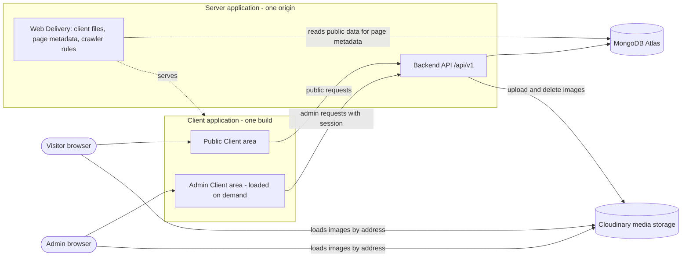

### 4.3 Trust boundaries

| Boundary | Rule |
| --- | --- |
| Browser to server | Everything arriving from a browser is untrusted. It is validated, and authorization is checked on the server regardless of what the client displays |
| Server to database | Only the data layer talks to the database |
| Server to media storage | Only the media gateway talks to media storage. Credentials never reach a browser |
| Public to admin | Separated by route group, authorization, response mapping, and code splitting. A public request can never reach an admin capability |

### 4.4 External dependencies

| Dependency (`SCOPE.md` Section 10) | Architectural Role |
| --- | --- |
| MongoDB Atlas | Hosted storage for all entities |
| Cloudinary | Image storage and delivery |
| Deployment platform | Must run one server application that serves both the client files and the API on one site. The requirements and platform class are in Technical Decisions. The vendor choice belongs to the Delivery phase |
| Domain name | The single site address |
| **Email service** | **Not used.** With no notifications (`FUNCTIONAL_REQUIREMENTS.md` D-1) and replies sent from the Admin's own email, no architectural component sends email. See Section 26, A-15 |

---

## 5. Overall Request Lifecycle

### 5.1 Conceptual flow

A user action passes through the same stages for every request.

| Stage | What Happens | Owner |
| --- | --- | --- |
| 1. Action | A visitor or the Admin acts in the browser | User |
| 2. Client | A feature handles the action, validates form input, and calls the data-access layer | Frontend |
| 3. Transport | The browser sends the request over an encrypted connection to the same site, with session credentials for admin routes | Browser |
| 4. Middleware | Request identification, security headers, rate limiting, body limits, session check, cross-site check | Backend |
| 5. Route and controller | The request is matched to an operation. Input is validated and handed on as plain values | Backend |
| 6. Service | Business rules run: visibility, publishing requirements, uniqueness, derived values | Backend |
| 7. Repository and model | Data is read or written under the entity rules | Backend |
| 8. Database | MongoDB stores or returns records | Data |
| 9. Response mapping | A mapper turns the result into the correct public or admin shape | Backend |
| 10. Client update | The data-access layer stores the result, features re-render, and errors are normalized | Frontend |

### 5.2 Sequence diagram: typical admin write

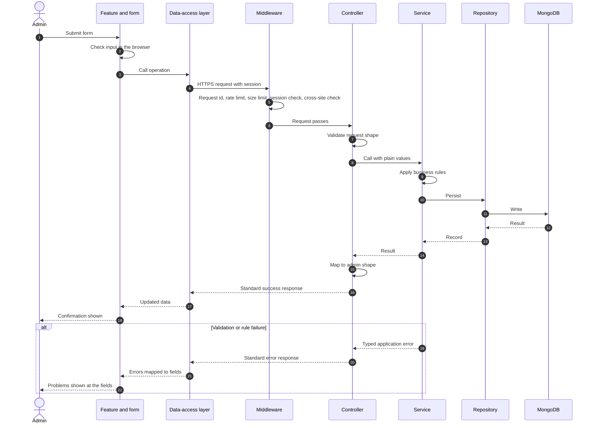

### 5.3 Public read lifecycle

Public reads follow the same path without the session and cross-site checks. Two rules apply specifically:

- The service asks the repository only for published records, so a draft cannot be returned by mistake.
- The controller uses the public response mapper, so only public fields can appear.

---

## 6. Frontend Architecture

### 6.1 Application layers

| Layer | Responsibility | May Depend On |
| --- | --- | --- |
| **Application shell** | Starts the application. Provides the store, data-access setup, routing, global error boundary, and notification area | All layers below |
| **Routing** | Maps addresses to pages. Applies the admin session guard. Loads the Admin area on demand | Features, layouts |
| **Layouts** | The frames pages sit in: public layout, admin layout, sign-in layout | Shared UI |
| **Features** | One unit per content area or function. Each owns its pages, its components, its forms, its form rules, and its slice of the data-access definitions | Shared UI, data access, state, utilities |
| **Shared UI** | Reusable presentation: form fields, buttons, dialogs, tables, pagination, empty states, loading and error states, image display, article content display, animation wrapper | Utilities only |
| **Data access** | One place that talks to the API: request definitions, response typing, error normalization, session renewal | Utilities, configuration |
| **State** | Client-only state (not server data) | Utilities |
| **Utilities** | Pure helpers: date formatting, text helpers, address helpers | Nothing |
| **Configuration** | Build-time public values | Nothing |

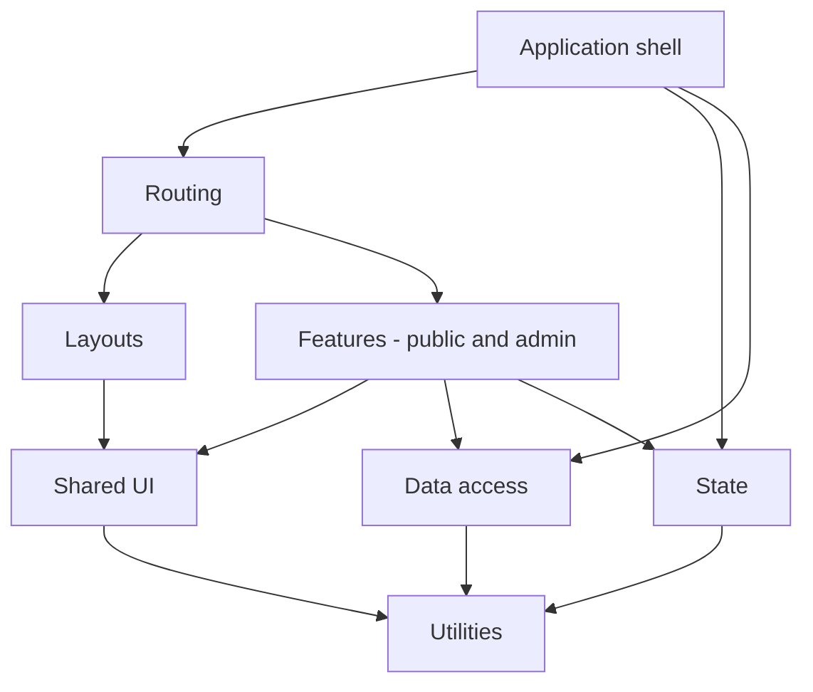

**Dependency rules**

- Dependencies point downward in the diagram. Shared UI never depends on a feature.
- A feature does not depend on another feature's internals. If two features need the same thing, it moves to Shared UI or Utilities.
- Only the data-access layer knows the API's addresses and shapes.

### 6.2 Feature-based organization

Each feature is a self-contained slice for one area of the product.

| Group | Features |
| --- | --- |
| **Public** | Home, About, Skills, Experience, Education, Certifications, Projects (list and detail), Blog (list and article), Contact |
| **Admin** | Sign-in and session, Dashboard, Projects management, Skills management, Experience management, Education management, Certifications management, Articles management, Messages, Settings |

A feature owns:

- its pages and components
- its form definitions and the matching input rules
- its data-access definitions (what it reads and changes, and what each change makes stale)
- its feature-specific types

A new capability follows the same pattern, which keeps the structure predictable (G-8). The exact folder layout belongs to Technical Decisions.

### 6.3 Routing

| Route Group | Pages | Guard | Loading |
| --- | --- | --- | --- |
| **Public** | Home, About, Skills, Experience, Education, Certifications, Projects list, Project detail, Blog list, Article, Contact | None | Included in the main bundle, with each page loaded on demand |
| **Admin sign-in** | Sign-in | Redirects to Dashboard if already signed in | Admin bundle |
| **Admin** | Dashboard, management pages for each module, Settings, password change | Requires a session. Unauthenticated visitors are sent to sign-in | Admin bundle, loaded only when an admin address is opened |
| **Not found** | The not-found page | None | Main bundle |

**Rules**

- Every public area is its own page with its own address. Search and sharing need distinct addresses and titles (FR-SEO-002), and projects and articles need stable addresses (FR-PROJECT-007, FR-BLOG-005). See Section 26, A-7.
- Project and article detail addresses use `publicAddressName`.
- An address for a draft, removed, or unknown record shows the not-found page, and the server returns the matching status (ADR-14).
- The admin area is never linked from public pages (FR-AUTH-008).
- Routing includes a guard for unsaved changes (FR-ADMIN-GEN-002).
- After the Admin signs in, they return to the page they were on, or to the Dashboard (FR-AUTH-006).

### 6.4 Global state

Global client state is limited to things that are not server data.

| State | Why Client-Side |
| --- | --- |
| **Session status** | Whether an Admin session is active, and the current Admin. Derived from the current-user call, and cleared on session end |
| **Notifications** | Success and failure messages after actions (FR-ADMIN-GEN-001) |
| **Pending edit snapshot** | Form content held in memory when a session ends during editing, restored after sign-in (ADR-22) |
| **Unsaved-changes flag** | Whether the current form has unsaved changes |

**Rule:** server data is never copied into global state by hand. It lives in the server-state cache (Section 6.5).

### 6.5 Server state

All data from the API is managed by one cache with defined behavior.

| Topic | Architecture |
| --- | --- |
| **Reads** | Each read is declared once and shared by every feature that needs it |
| **Public freshness** | Public reads are revalidated each time a page is entered, so a change appears on the next visitor load (BR-006, `API_DESIGN.md` 8.9). Cached data is never reused as fresh across page loads |
| **Admin reads** | Always revalidated after a related change |
| **Writes** | Each write declares which cached reads it makes stale, and they are refreshed |
| **Pagination** | Page and page size are part of the identity of a cached read |
| **Errors** | Normalized once into the API's standard error shape, then handed to features |
| **Session renewal** | If any admin request returns `SESSION_EXPIRED`, one renewal attempt is made. Concurrent requests wait for the same attempt. On success the original requests are repeated. On failure the session is ended (Section 9) |
| **Public identifiers** | Public lists have no identifiers (`API_DESIGN.md` K-2). Lists are keyed by `publicAddressName` where it exists, and otherwise by position, since their order is fixed |

### 6.6 Forms

| Topic | Architecture |
| --- | --- |
| **Form handling** | Each form is defined with its fields, defaults, and input rules |
| **Input rules** | Rules mirror the API's field rules (lengths, required, formats, dates) so users get fast feedback. The server is always the authority (Section 11.3) |
| **Server errors** | Errors with `details` are mapped onto fields by field path, including list items such as `technologies[2]` |
| **Publishing** | Publish failures list the missing items next to the relevant fields |
| **Unsaved changes** | A warning appears on leaving a form with changes (FR-ADMIN-GEN-002) |
| **Confirmation** | Removal always passes through a confirmation step (BR-009). The API has none |
| **Duplicate submission** | A form cannot be submitted again while a submission is in progress (FR-CONTACT-005) |
| **Data preservation** | A failed submission leaves entered values in place (FR-ERR-003) |
| **Preview** | Previews use the same display components as the public site, fed with the preview response, so the preview matches what visitors see |

### 6.7 Shared components and layouts

| Item | Role |
| --- | --- |
| **Public layout** | Navigation to all nine areas on every page (FR-SITE-001), footer with the owner's chosen links and details (FR-SITE-002) |
| **Admin layout** | Navigation to every management area, and a sign-out control on every page (FR-AUTH-007) |
| **Form fields** | Visible labels, error text tied to the field, accessible by keyboard (FR-A11Y-006) |
| **Confirm dialog** | One component for every destructive action |
| **Empty state** | One component for areas with no content (FR-SITE-003) |
| **Error and loading states** | One set for pages and for regions, including a friendly failure with retry (FR-ERR-007) |
| **Image display** | Always renders the text alternative, or marks the image as decorative |
| **Article content display** | The single place where article content is turned into display, so content is always handled safely (ADR-14, Section 16) |
| **Pagination control** | Used by project and article lists and by admin lists |
| **Animation wrapper** | The one place animations are applied. It honors the user's reduced-motion preference (FR-A11Y-008) |
| **Not-found page** | Used for unknown addresses and for drafts and removed records (FR-SITE-004) |

### 6.8 Styling and accessibility

- A single set of design tokens (colors, type, spacing) defines the visual language. Components use tokens only, which keeps the appearance consistent (BR-015) and leaves room for later theme work.
- Accessibility is built into the shared components, so features inherit it: focus visibility, labelled fields, heading structure, contrast, and keyboard operation (FR-A11Y-001 to 010).
- Responsive behavior is a property of layouts and shared components. Features do not implement their own breakpoints (FR-RESP-001 to 007).

### 6.9 Utilities

Pure helpers with no knowledge of features: date and period formatting, consistent labels such as "Present", text truncation, and address handling. They contain no business rules.

---

## 7. Backend Architecture

### 7.1 Layered structure

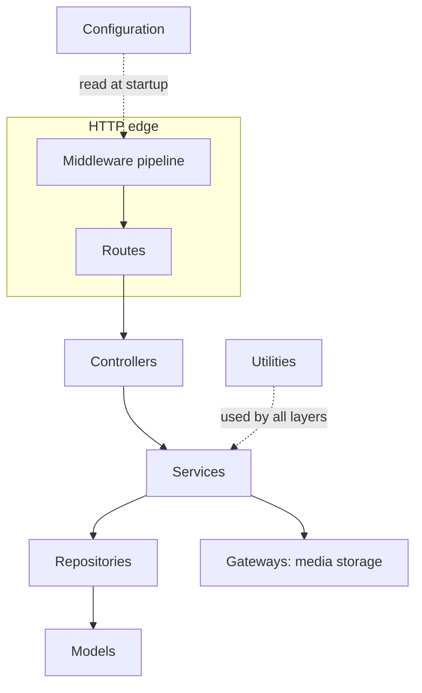

### 7.2 Layer responsibilities

| Layer | Responsibility | Must Not |
| --- | --- | --- |
| **Routes** | Declare which operation each address and method maps to, and which route group (public or admin) it belongs to. Attach the route group's protections | Contain any logic |
| **Controllers** | Translate between the web and the application: read validated input, call one service operation, choose the response mapper, set the status | Contain business rules, touch the database, or call the media gateway |
| **Services** | Hold all business rules: visibility, publishing requirements (BR-005), uniqueness, public address generation, derived values (`isExpired`, `isCurrent`), cover-image rules, message status rules, content change tracking, and orchestration across repositories and gateways | Know about HTTP, requests, or responses |
| **Repositories** | The only code that reads and writes data. Offer the queries services need, such as "published projects, featured first" | Contain business rules or know about HTTP |
| **Models** | Define each entity as in `DATABASE_DESIGN.md`: fields, required rules, limits, allowed values, and uniqueness | Contain queries or business workflows |
| **Gateways** | Adapters to external services. The media gateway is the only code that talks to Cloudinary | Contain business rules |
| **Middleware** | Cross-cutting request handling in a fixed order (Section 7.3) | Contain business rules |
| **Utilities** | Neutral helpers: address generation helpers, date helpers, response mappers, typed error classes, pagination helpers | Depend on any layer above |
| **Configuration** | Reads, validates, and exposes settings at startup | Be changed at runtime |

### 7.3 Request pipeline

The order of the shared pipeline is fixed so protections cannot be skipped.

| Step | Stage | Purpose | Applies To |
| --- | --- | --- | --- |
| 1 | **Request identification** | Assigns a request identifier for tracing | All |
| 2 | **Secure transport and headers** | Enforces encrypted connections and sets security headers | All |
| 3 | **Rate limiting** | Applies the limits in `API_DESIGN.md` Section 15 | All, with stricter limits on contact, sign-in, and uploads |
| 4 | **Body limits and content type** | Rejects oversized or wrongly typed bodies | Requests with bodies |
| 5 | **Session check** | Confirms a valid, current session | Admin and session endpoints |
| 6 | **Cross-site check** | Verifies the request came from this site | Requests that change data, on session-carried routes |
| 7 | **Route match and input validation** | Checks shape, unknown and read-only fields, and formats | All |
| 8 | **Controller, service, repository** | The operation itself | All |
| 9 | **Response mapping** | Applies the public or admin allow-list | All |
| 10 | **Central error handling** | Converts any failure into the standard error response | All |
| 11 | **Request log entry** | Records outcome and duration | All |

### 7.4 Dependency rules

1. Calls go downward only: routes, controllers, services, repositories, models.
2. A service may call other services, but only for operations they expose. It never reaches into another module's repository or model.
3. Only repositories touch models. Only the media gateway touches the media service.
4. Controllers never call repositories.
5. Business rules appear only in services. A rule found elsewhere is a defect.
6. Visibility is enforced twice by design: services request only published records for public operations, and mappers allow only public fields (Section 10).
7. Repositories are kept thin: one per entity, with only the queries the services need (ADR-05).

### 7.5 Data access

- The server holds one database connection for its whole life. The connection is established at startup, and startup fails if it cannot be made.
- Repositories translate the entity rules in `DATABASE_DESIGN.md` into queries. The ordering rules in BR-007 are implemented here.
- Constraints that must hold under simultaneous requests (unique sign-in identifier, unique public address names per entity, unique skill per category, single Setting record) are enforced by the data layer itself and not only by checks in services (DV-008 to DV-011).
- Index choices belong to Technical Decisions. The access patterns that need them are in Section 17.

---

## 8. Module Architecture

### 8.1 Module template

Each entity module has the same parts: routes, a controller, a service, a repository, a model, public and admin response mappers (where both exist), and request validation. Following one template is how consistency (G-7) is achieved with a small team.

### 8.2 Modules

| Module | Owns | Public Surface | Admin Surface | Main Responsibilities | Depends On |
| --- | --- | --- | --- | --- | --- |
| **Authentication** | User | Sign-in, session renewal, sign-out | Current user, password change | Credential checks, session issue and renewal, attempt limiting, session invalidation, password rules | Configuration |
| **Projects** | Project | List, detail | Full management, publication, preview, images | Publishing rules, featured ordering, public address, cover rule | Media, Settings (change tracking) |
| **Skills** | Skill | Grouped list | Full management | Category handling, uniqueness, ordering | Settings (change tracking) |
| **Experience** | Experience | List | Full management | Date rules, derived `isCurrent`, ordering | Settings (change tracking) |
| **Education** | Education | List | Full management | Date rules, derived `isInProgress`, ordering | Settings (change tracking) |
| **Certifications** | Certification | List | Full management | Date rules, derived `isExpired`, ordering | Settings (change tracking) |
| **Blog (Articles)** | Blog | List, detail | Full management, publication, preview, images | Publishing rules, publication dates, content safety, public address | Media, Settings (change tracking) |
| **Messages** | Message | Submit | List, read, status, delete | Intake, duplicate window, abuse checks, status rules, retention | None. Messages are not a content area, so no change tracking is recorded |
| **Settings** | Setting | Public read | Read, update, images | Single-record rule, public and private parts, **content change tracking** | Media |
| **Dashboard** | Nothing | None | Overview | Gathers counts, recent messages, pending drafts, and last-changed dates | Services of other modules |
| **Media** | Nothing in the database | None | None directly | The media gateway and image rules: type, size, atomic attach, cleanup | External media service |
| **Web Delivery** | Nothing | Client files, page metadata, crawler rules | Admin shell with no-index headers | Serving the client, filling in page metadata, correct not-found statuses | Services of Projects, Blog, Settings |

### 8.3 Module dependency diagram

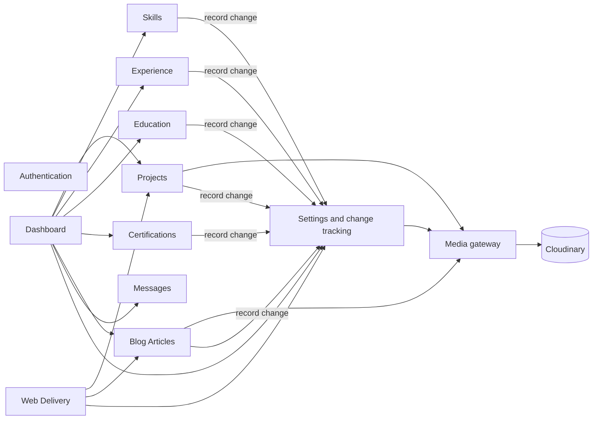

### 8.4 Module rules

- Modules never share a repository or a model. They cooperate only through services.
- The content modules do not depend on one another. A project knows nothing about a skill, which mirrors the data design (`DATABASE_DESIGN.md` C-1).
- **Content change tracking** is owned by the Settings module. After a successful create, update, publication change, image change, or removal in any content area, the module's service records the area's last-changed time (FR-DASH-003). Because removal leaves nothing to inspect, the time is recorded explicitly (`DATABASE_DESIGN.md` C-4). The update is made right after the content change. If it fails, the failure is logged and the content change stands. See Section 26, A-11.
- The Dashboard is read-only. It never changes data.
- The Authentication module is the only one that reads or changes the User entity.

---

## 9. Authentication Architecture

### 9.1 Concepts

| Concept | Architecture |
| --- | --- |
| **Two credentials** | A short-lived **access credential** proves the session on each admin request. A longer-lived **renewal credential** allows a new access credential without signing in again |
| **Carried by the browser** | Both are held in secure cookies that scripts cannot read. They are never in bodies, URLs, or logs |
| **Limited exposure** | The renewal credential is sent only to the session-renewal address. The access credential is sent to admin and session addresses |
| **Cookie properties** | Secure transport only, not readable by scripts, same-site only (ADR-12) |
| **Contents** | Each credential identifies the Admin and records when it was issued. The renewal credential also records when the session began, so the maximum session duration can be enforced |
| **Validity check** | Every credential is checked for authenticity, for expiry, and against the User's `sessionsValidFrom`. A credential issued before that moment is invalid (`DATABASE_DESIGN.md` 6.1) |
| **Lifetimes** | Access, inactivity, and maximum durations are Technical Decisions (FR-AUTH-005) |

### 9.2 Sign-in

1. The Admin submits credentials.
2. Rate limiting by client applies first. This covers attempts against unknown accounts.
3. The Authentication service reads the User. If `lockedUntil` is in the future, it returns the blocked response (FR-AUTH-004).
4. The password is compared in constant time against the stored protected form.
5. On failure, the failed-attempt count increases, and a threshold sets `lockedUntil`. A single general error is returned for any wrong credential (FR-AUTH-003).
6. On success, the count and block are cleared and both credentials are issued as cookies.

### 9.3 Session renewal

1. A protected request that fails with `SESSION_EXPIRED` makes the client call the renewal endpoint once.
2. The service validates the renewal credential, checks the inactivity limit and the maximum session duration, and checks `sessionsValidFrom`.
3. On success, a new access credential is issued, and the renewal credential is re-issued with a refreshed inactivity window, but the same session start time.
4. On failure, the response is `SESSION_EXPIRED`, and the session is over.

Active editing therefore continues without interruption, while an idle or very old session ends (FR-AUTH-005).

### 9.4 Sign-out

1. Credentials are cleared from the browser.
2. `sessionsValidFrom` moves to the current time, so any copy of an earlier credential can no longer be used.

Because there is one Admin, this ends the session on every device. See Section 26, A-14.

### 9.5 Password change

1. The service checks the current password and the new password's rules (FR-VAL-013).
2. It stores the new protected password and moves `sessionsValidFrom` forward, ending all existing sessions.
3. The request's own session receives freshly issued credentials, so the Admin continues working. Other devices receive `SESSION_EXPIRED`.

This settles `DATABASE_DESIGN.md` C-9 and the note in `API_DESIGN.md` Section 5.5.

### 9.6 Protected resources

Every route in the admin group passes through the session check before anything else. Section 10 describes the default-deny rule.

### 9.7 Session sequence

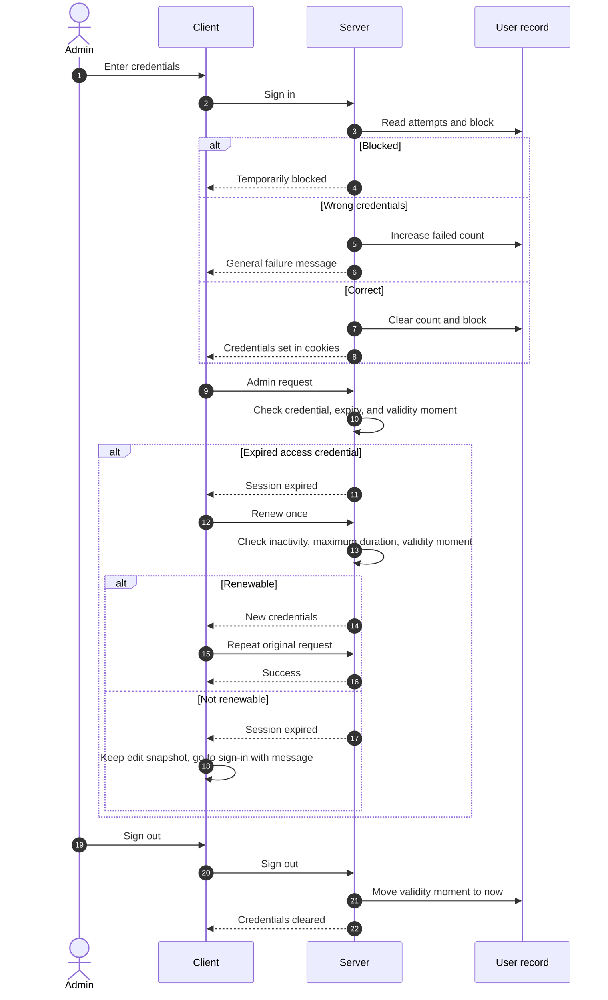

### 9.8 Initial setup

The User and the Setting records are created once, before the platform is used (`DATABASE_DESIGN.md` 6.1 and 6.9). The architecture provides a one-time setup procedure that runs outside the product, run by the owner, which takes the owner's credentials and the owner's name and headline. There are no default credentials. This is an operational tool, not a feature. The method is a Technical Decisions item.

---

## 10. Authorization Strategy

### 10.1 Resource classes

| Class | Who | Resources | Enforcement |
| --- | --- | --- | --- |
| **Public** | Anyone | Published content, public settings, message submission, sign-in, sign-out | Public route group. Public mappers. Service asks only for published records |
| **Session renewal** | Holder of a renewable session | Session renewal | Renewal credential check |
| **Protected, admin-only** | The signed-in Admin | Everything under `/admin`, current user, password change | Admin route group guard |

There is one role. "Protected" and "admin-only" are the same in Version 1 (`FUNCTIONAL_REQUIREMENTS.md` Section 4).

### 10.2 Rules

- **Default deny.** The session check is attached to the admin route group, not to individual routes. A new admin route is protected automatically, and cannot be forgotten.
- **Server decides.** The client hides admin features from visitors, but the server enforces access regardless (Section 4.3).
- **Layered visibility.** The service requests only what a caller may see. The mapper allows only the fields a caller may see. Two independent safeguards guard each public response (S-7, `DATABASE_DESIGN.md` Section 10).
- **Hidden existence.** A draft or removed record returns `404` on public routes, never `403` (FR-SITE-006).
- **One decision point.** Authorization decisions are made in one place, at the route group boundary. Services do not contain ad hoc role checks. If roles are ever introduced, that single point is where they are added (Section 18).
- **No privilege through the client.** Nothing the client sends, such as a status or a role flag, can raise its own access. Server-controlled fields are rejected (`API_DESIGN.md` Section 7.0).

---

## 11. Data Flow Architecture

### 11.1 Standard flow

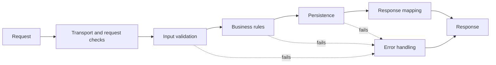

### 11.2 Three levels of checking

| Level | Where | What It Checks | Source |
| --- | --- | --- | --- |
| **Shape** | Request validation at the edge | Required fields, types, lengths, formats, unknown and read-only fields | `API_DESIGN.md` request tables |
| **Business** | Services | Publishing completeness (BR-005), published records staying valid (DV-002), skill uniqueness, cover image rule, image limit, valid transitions, duplicate message window | `FUNCTIONAL_REQUIREMENTS.md` and `DATABASE_DESIGN.md` |
| **Data** | Models and the data layer | Required fields, limits, allowed values, uniqueness under simultaneous requests, date order | `DATABASE_DESIGN.md` Section 8 |

Each level can catch what the one before missed, so a mistake in one place cannot corrupt stored data. The client's input rules (Section 6.6) are a fourth, convenience-only level. The server never relies on them.

### 11.3 Authority of the contract

`API_DESIGN.md` is the single source of the field rules. The client and server each implement them. There is no shared code between `client/` and `server/` in Version 1 (ADR-21), so the contract is the only thing keeping them aligned. When a rule changes, the contract is changed first.

### 11.4 Flow: publish a project

```mermaid
sequenceDiagram
    autonumber
    actor A as Admin
    participant CL as Client
    participant CT as Controller
    participant SV as Project service
    participant RP as Project repository
    participant ST as Settings service
    participant DB as MongoDB

    A->>CL: Choose Publish
    CL->>CT: Set status to published
    CT->>CT: Check session and request shape
    CT->>SV: Publish project
    SV->>RP: Load project
    RP->>DB: Read
    DB-->>RP: Project
    RP-->>SV: Project
    SV->>SV: Check required items and one cover image
    alt Items missing
        SV-->>CT: Publish requirements not met, listing items
        CT-->>CL: 422 with details
        CL-->>A: Missing items shown at fields
    else Complete
        SV->>SV: Set status, set first publication time if empty
        SV->>RP: Save
        RP->>DB: Write
        SV->>ST: Record projects area changed
        ST->>DB: Write
        SV-->>CT: Updated project
        CT->>CT: Map to admin shape
        CT-->>CL: 200
        CL-->>A: Confirmation
    end
```

### 11.4.1 Flow: submit a contact message

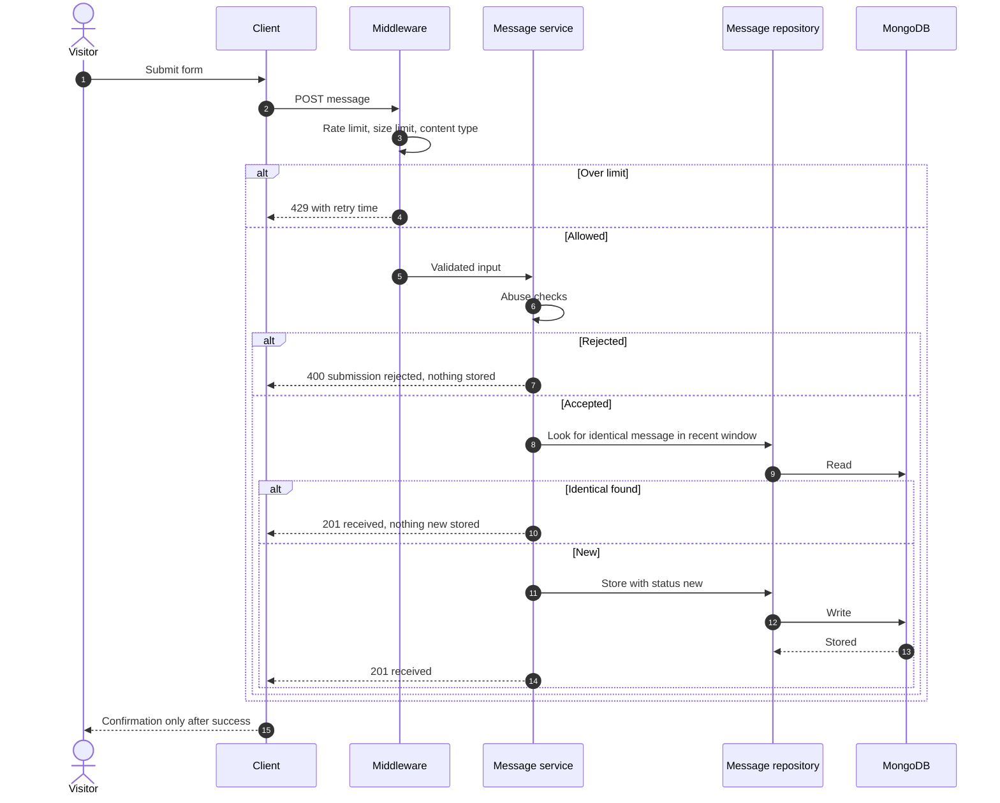

### 11.5 Flow: public read with visibility

1. A public route receives the request.
2. The controller calls a service operation for public reads.
3. The service asks the repository for published records only, in the order set by BR-007.
4. The controller applies the public mapper, which includes derived fields such as `isExpired` and omits identifiers, status, flags, and timestamps.
5. The standard success shape is returned.

---

## 12. Error Handling Architecture

### 12.1 Error flow

Failures are raised as **typed application errors** at the layer where they are detected. They travel upward unchanged and are converted to the standard response in one place, the central error handler.

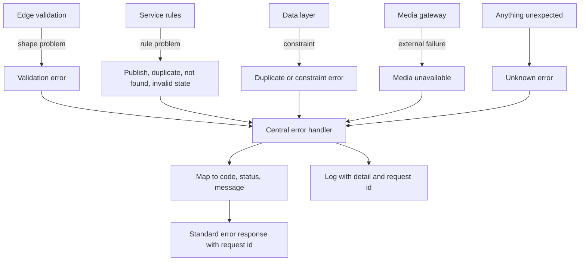

### 12.2 Error classes

| Class | API Code and Status | Logged As |
| --- | --- | --- |
| Validation | `VALIDATION_FAILED` 422, `INVALID_QUERY_PARAMETER` 422 | Debug or info |
| Publish requirements | `PUBLISH_REQUIREMENTS_NOT_MET` 422, `PUBLISHED_RECORD_INVALID` 422 | Info |
| Not found | `NOT_FOUND` 404 | Info |
| Duplicate | `DUPLICATE_SKILL` 409 | Info |
| Authentication | `UNAUTHENTICATED`, `SESSION_EXPIRED`, `INVALID_CREDENTIALS` 401 | Info, with security events flagged |
| Blocked or limited | `SIGN_IN_TEMPORARILY_BLOCKED`, `TOO_MANY_REQUESTS` 429 | Warning |
| Cross-site refusal | `FORBIDDEN` 403 | Warning |
| Malformed or oversized | 400, 413, 415 codes | Info |
| Submission rejected | `SUBMISSION_REJECTED` 400 | Info |
| Media failure | `MEDIA_SERVICE_UNAVAILABLE` 503 | Error |
| Database unavailable | `SERVICE_UNAVAILABLE` 503 | Error |
| Unexpected | `INTERNAL_ERROR` 500 | Error, with full detail |

### 12.3 Rules

- **One format.** Every error leaves the server in the standard shape with a code, a plain-language message, optional field details, and a request identifier (`API_DESIGN.md` Section 8.3).
- **No technical detail outwards.** Unexpected failures return a generic message. Details stay in the logs (FR-ERR-006).
- **No silent success.** A message submission, publish, or delete is confirmed only after it has happened (FR-ERR-002).
- **Rejected requests change nothing.**
- **Client handling.** The data-access layer normalizes errors. Features show field errors at fields, and other errors as notifications. A rendering failure inside a page is caught by an error boundary, which shows a friendly page or region message with a way to retry or navigate (FR-ERR-007).
- **Partial failure.** Where an operation spans the database and media storage, the order of steps ensures a failure never leaves a record without its image or with a broken reference (Section 13).

### 12.4 Logging points

| Point | Level | Content |
| --- | --- | --- |
| Every request completion | Info | Request id, method, route pattern, status, duration |
| Sign-in outcomes, blocks, session end, password change | Info or warning | Event type and request id. Never credentials |
| Rate limit triggered | Warning | Route group and client indicator |
| Validation failures | Debug | Field paths and codes. Never submitted values |
| Unexpected errors | Error | Error detail and stack, with request id |
| Media failures and cleanup failures | Error | Operation and asset reference |
| Admin changes | Info | Action, resource type, identifier (Section 15) |
| Startup problems | Error | Missing or invalid configuration |

---

## 13. File Upload Architecture

### 13.1 Decision

Images are uploaded **to the Backend API**, which validates them and stores them with the media service (ADR-13). The browser never uploads directly to the media service. This confirms the assumption in `API_DESIGN.md` Section 7.10, so the contract does not change.

### 13.2 Flow

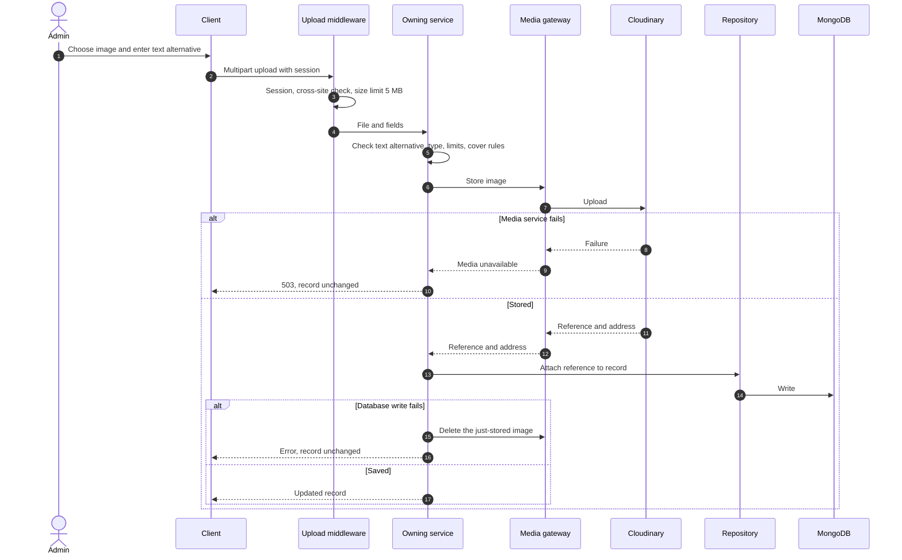

### 13.3 Rules

| Topic | Architecture |
| --- | --- |
| **Validation on the server** | Type is checked from the file's actual content, not its name. Allowed: JPEG, PNG, WebP. Maximum 5 MB (FR-VAL-011) |
| **No long-term file storage on the server** | Files are held only while being processed and are not kept |
| **Atomic from the Admin's view** | An upload either attaches fully or leaves the record unchanged (`API_DESIGN.md` 7.10) |
| **Replace** | The new image is stored first and attached. Then the old one is deleted. A failure never leaves the record without an image |
| **Remove** | The reference is removed from the record first, so the image is no longer shown. Then the stored file is deleted |
| **Remove record** | The record is removed first. Then all its images (cover, project images, body images) are deleted |
| **Cleanup failures** | If deleting a stored file fails after the record no longer references it, the failure is logged with the asset reference for retry. The file is orphaned but no longer referenced, and cleanup must be completed. See Section 26, A-16 |
| **Delivery** | Images are shown directly from the media service by their address. They do not pass through the API |
| **Vendor isolation** | Only the media gateway knows Cloudinary. A different provider could replace it without changing services |
| **Rules owned by services** | Cover image, image limit (12), text alternative requirement |
| **Body images** | Same gateway and rules. How body images are referenced within article content depends on the content format, a Technical Decisions item (`API_DESIGN.md` OI-1). The architecture requires only that all images used by an article can be listed from its record so they can be cleaned up |

---

## 14. Configuration Architecture

### 14.1 Principles

- **Configuration is separate from code.** Behavior differs per environment through configuration, never by editing code.
- **Fail fast.** The server validates all required configuration at startup and refuses to start if anything is missing or invalid (ADR-23).
- **Secrets stay secret.** They are never in the repository, logs, error messages, or client.
- **Typed and centralized.** Configuration is read once, in one place, and exposed to the rest of the application as a validated set of values.

### 14.2 Categories

| Category | Examples | Secret |
| --- | --- | --- |
| **Runtime** | Environment name, listening port | No |
| **Database** | Connection details | Yes |
| **Media service** | Account and access credentials, destination folder | Yes |
| **Session** | Signing keys for credentials, credential lifetimes, inactivity and maximum durations, cookie settings | Keys: yes. Lifetimes: no |
| **Limits** | Page sizes, upload size, list limits, duplicate-submission window | No |
| **Rate limits** | Per route group | No |
| **Site** | Public site address (for page metadata and crawler rules) | No |

### 14.3 Environments

| Environment | Notes |
| --- | --- |
| **Development** | The client's development server forwards API requests to the local server so the browser sees one origin, as in production. Development uses its own database and media destination |
| **Production** | Values supplied by the hosting platform. Separate secrets from development. Never shared |

### 14.4 Client configuration

The client receives only public, non-secret build-time values. Because the client and API share one origin, the client needs no API address, and no secret of any kind is present in the client build.

---

## 15. Logging Strategy

### 15.1 Application logs

- **Structured.** Each entry is machine-readable, with a timestamp, level, request identifier, and event type.
- **Single stream.** Logs are written to standard output. The hosting platform collects them. The application manages no log files.
- **Levels.** Debug, info, warning, and error, with the level set by configuration.
- **Request tracing.** The request identifier appears in the log entry and in any error response, so a reported error can be traced.

### 15.2 Error logs

Unexpected errors are logged with full detail and the request identifier. Detail is never returned to the client.

### 15.3 What is never logged

Passwords, credentials, session values, secrets, the content of contact messages, visitor email addresses, and article bodies. Logs stay free of personal data (`DATABASE_DESIGN.md` P-7, S-11).

### 15.4 Audit considerations

- The platform has one Admin, so an audit trail answers "what changed and when", not "who did it".
- Admin write operations produce structured log events with the action, the resource type, the record identifier, and the time. These events form the audit trail.
- There is no audit entity in the database. Change history is a future consideration (`DATABASE_DESIGN.md` Section 12).
- Security events (sign-in outcomes, blocks, session end, password change) are logged in the same way.
- Retention of logs depends on the hosting platform and is a Technical Decisions item.

---

## 16. Security Architecture

Principles only. Mechanisms are chosen in Technical Decisions.

| # | Principle | Architecture |
| --- | --- | --- |
| SA-1 | **Authentication** | Every admin operation requires a valid current session. Credentials are held in secure, script-unreadable cookies (Section 9) |
| SA-2 | **Authorization** | Default-deny at the admin route group. One decision point (Section 10) |
| SA-3 | **Least privilege** | Public responses expose only public fields. The database account and the media account have only the permissions the application needs. Each module touches only its own data |
| SA-4 | **Input validation** | Every request is validated at the edge, again by service rules, and again by the data layer. Unknown and read-only fields are rejected |
| SA-5 | **Output control** | Explicit allow-list mappers. No record is ever returned as stored |
| SA-6 | **Secure communication** | Encrypted connections only. Security headers on all responses. Cookies marked secure |
| SA-7 | **Protection against cross-site requests** | The session cookie is restricted to this site. Requests that change data are also verified to have originated from this site. No extra value is required from clients (ADR-12) |
| SA-8 | **Safe handling of stored text** | Article content is checked when stored and displayed through one component that cannot run content as code. Visitor messages are shown as plain text only. A content-security policy limits where scripts and images may come from, and allows the media service for images |
| SA-9 | **Password protection** | Passwords are stored only in a one-way protected form made with a slow, adaptive method (Technical Decisions). Comparison does not reveal timing differences |
| SA-10 | **Abuse resistance** | Rate limiting, sign-in blocking, and checks on contact submissions |
| SA-11 | **No information leakage** | Generic errors, hidden existence of drafts, one failure message for sign-in, no version or technology information in responses |
| SA-12 | **Secrets management** | Secrets live only in environment configuration, never in the repository or client (Section 14) |
| SA-13 | **Admin area not advertised** | Not linked. Not offered to search engines through no-index headers and page markers. It is deliberately not listed in public crawler rules, because listing it would reveal it (ADR-14) |
| SA-14 | **Dependency hygiene** | Dependencies are kept minimal, pinned, and reviewed for known issues. This is a process matter for Technical Decisions |
| SA-15 | **Data minimization** | Only data a requirement needs is collected and returned (`DATABASE_DESIGN.md` P-7) |
| SA-16 | **Defense in depth** | No single check is the only protection. For example, a draft is hidden both by the service query and by the response mapper |

---

## 17. Performance Architecture

### 17.1 Frontend

| Technique | Purpose |
| --- | --- |
| **Code splitting by route and by area** | Visitors never download the Admin area. Each page's code is loaded when needed |
| **Lazy image loading** | Images below the first view load as the visitor reaches them |
| **Appropriate image size** | Images are shown at the size needed. Resizing and format delivery by the media service is an opportunity for Technical Decisions. The contract guarantees only an address (`API_DESIGN.md` 6.0) |
| **Cache with revalidation** | Reads are shared between components. Public reads revalidate on page entry (Section 6.5) |
| **Summary lists** | Lists use short fields. Full content loads on the detail page |
| **Fingerprinted static files** | Client files are named by content, so they can be cached for a long time without risk of being stale |
| **Reduced motion** | Animation is limited and respects the visitor's preference (FR-A11Y-008) |

### 17.2 Backend

| Technique | Purpose |
| --- | --- |
| **Pagination** | Lists of projects, articles, and messages are divided. Page size has a maximum (`API_DESIGN.md` Section 9) |
| **Selective fields** | List queries return only the fields lists need. Article bodies are not loaded for lists (`DATABASE_DESIGN.md` 14.3) |
| **One aggregated Dashboard call** | The Dashboard needs one request, not one per area |
| **Indexed access patterns** | The data layer is planned around the patterns below |
| **Conditional responses** | Public responses can carry a validator so an unchanged resource costs almost nothing to confirm, while remaining fresh (`API_DESIGN.md` 8.9) |
| **Compression** | Responses are compressed in transit |
| **No server-side data cache in Version 1** | Reads are cheap at this scale. A cache would add staleness risk against BR-006 (ADR-15) |
| **Single connection pool** | One long-lived database connection pool |

### 17.3 Access patterns for the data layer

| Pattern | Used By |
| --- | --- |
| Find a project or article by public address name | Detail pages and page metadata |
| Published projects, featured first, then by first publication | Project list, Home |
| Published articles, newest first | Blog list |
| Messages by status, newest first | Messages |
| Sign-in identifier lookup | Sign-in |
| All skills by category and name | Skills |
| Experience, education by start date. Certifications by issue date | Their lists |
| Counts by status and area | Dashboard |

Index decisions belong to Technical Decisions.

### 17.4 Web Delivery

Client files are served with long-lived caching because they are fingerprinted. The page shell is served so that it is always revalidated, so a new release is picked up at once.

---

## 18. Scalability Strategy

### 18.1 Expected scale

The platform serves one owner and a modest, mostly read-only audience. Scalability here means capacity for growth in content and capability, not large traffic (Vision O-7, `DATABASE_DESIGN.md` 14.1).

### 18.2 How the architecture grows

| Growth | Approach |
| --- | --- |
| **New content module** | Follow the module template (Section 8.1) on both sides. Register it with Dashboard and change tracking if it is a content area |
| **New API endpoints** | Additive under `/api/v1`, per the versioning rules (`API_DESIGN.md` Section 14) |
| **Larger content volume** | Pagination exists for large lists. The small collections (skills, experience, education, certifications) can be paginated additively |
| **Higher traffic** | The server holds no per-request state, so more server instances can run behind the same site. Rate-limit counters are kept in memory in Version 1, so a shared store would be needed first (ADR-16) |
| **Multiple administrators (future)** | Requires a role concept, per-record ownership, and per-session records. The single authorization point (Section 10) and the User module boundary are where it would be added. It changes the data model and would need the earlier documents to be updated first |
| **Future integrations** | Reached only through gateways, like the media gateway. A new integration is a new gateway with no change to services |
| **Another media provider** | Replace the media gateway |
| **Search** | Would be added as a new capability, subject to scope approval (Section 22) |
| **Multiple languages** | Would affect content entities and the client. It needs earlier documents to be updated first |

### 18.3 What is deliberately not built for scale

No queues, no cache tier, no separate services, no read replicas, and no distributed session store. Building them now would add cost and complexity for load that will not occur (G-2).

---

## 19. Cross-Cutting Concerns

| Concern | Where It Lives | Applied How |
| --- | --- | --- |
| **Validation** | Edge, services, data layer, and client forms | Three server levels plus client convenience checks (Section 11.2) |
| **Logging** | Pipeline and all layers | Structured, request-linked, free of personal data (Section 15) |
| **Configuration** | One central module | Validated at startup, typed, no secrets in code (Section 14) |
| **Security** | Pipeline, route groups, mappers, gateways | Defense in depth (Section 16) |
| **Error handling** | Typed errors and the central handler | One format, one place of conversion (Section 12) |
| **Monitoring** | Hosting platform and logs | See below |
| **Authorization** | Admin route group | Default-deny (Section 10) |
| **Accessibility** | Shared UI | Built into components, inherited by features (Section 6.8) |
| **Consistency of responses** | Mappers and the response shapes | One set of shapes (`API_DESIGN.md` Section 8) |
| **Change tracking** | Settings module | Called by content services after changes (Section 8.4) |
| **Request tracing** | Pipeline | Request identifier in logs and error responses |

### 19.1 Monitoring

- Monitoring in Version 1 relies on structured logs and the hosting platform's availability checks.
- No dedicated health endpoint is added, because the API contract limits endpoints to those an approved requirement needs (`API_DESIGN.md` AP-12). An availability check can request the public settings endpoint or the home page.
- If a dedicated health endpoint is wanted, `API_DESIGN.md` should be updated first. See Section 26, A-10.
- Alerting thresholds and tools are Technical Decisions.

---

## 20. Architecture Decision Records

| ID | Decision | Reason | Trade-off | Status |
| --- | --- | --- | --- | --- |
| **ADR-01** | **Single repository with `client/` and `server/`** | Matches the project brief. One place for planning documents, one history, easy for a solo developer to keep in step | Client and server cannot share code without a third area. See ADR-21 | Accepted |
| **ADR-02** | **One client application with public and admin areas. The Admin area is loaded on demand** | One design system and data-access layer. Visitors never download admin code, which also reduces exposure | Slightly more routing logic than two separate applications. A bug in shared code can affect both areas | Accepted |
| **ADR-03** | **One server application serving the client files and the API on one origin** | Simplest to run and cheapest to host (`SCOPE.md` budget constraint). Enables same-site cookies, removes cross-origin handling, and lets the server supply page metadata | Client and server are released together. Static hosting of the client alone is not possible | Accepted |
| **ADR-04** | **Layered backend: routes, controllers, services, repositories, models** | Clear responsibilities, testable layers, rules in one place | More files and indirection for simple operations | Accepted |
| **ADR-05** | **Thin repositories, one per entity** | Keeps data access in one layer and makes services testable without a database | Mild duplication of simple queries. Some may see the layer as redundant over the data library, so it must be kept light | Accepted |
| **ADR-06** | **REST over HTTP, versioned in the path** | Matches `API_DESIGN.md`. Well understood. Fits a resource-oriented model | Less flexible for clients that need custom shapes. Multiple calls where one rich query might do (mitigated by the Dashboard call) | Accepted |
| **ADR-07** | **MongoDB with Mongoose, using embedded structures and no cross-record references** | Matches `DATABASE_DESIGN.md`. Records stand alone. Fits one-owner content | Repeated text such as technologies. Cross-entity queries are limited, which is acceptable here | Accepted |
| **ADR-08** | **TypeScript on both sides** | Catches contract mismatches early. One language across the project | Build step and type maintenance. Types are duplicated across client and server (ADR-21) | Accepted |
| **ADR-09** | **RTK Query for server state. Redux only for client-only state** | One cache with defined behavior. Clear boundary between server data and client state | Redux concepts needed for little client state. Mitigated by keeping that state small | Accepted |
| **ADR-10** | **Forms with client-side input rules mirroring the API. The server is the authority** | Fast feedback for users. Server cannot be bypassed | Rules exist in two places and may drift. The contract is the single source | Accepted |
| **ADR-11** | **Cookie-based session with an access credential and a renewal credential. `sessionsValidFrom` ends sessions** | Matches the stack. Scripts cannot read credentials. Needs no new entity (`DATABASE_DESIGN.md`) | Ending a session requires a User read on each request. Sign-out ends all devices | Accepted. Lifetimes in Technical Decisions |
| **ADR-12** | **Protect against cross-site requests with same-site cookies plus origin verification on data-changing requests** (resolves `API_DESIGN.md` K-10) | No new header or token is needed, so the API contract stays unchanged. Simple. Enabled by ADR-03 | Depends on the client and API sharing a site and on browsers honoring same-site rules. Not suitable if the client is later hosted separately | Accepted |
| **ADR-13** | **Images are uploaded to the API, which stores them with the media service** (resolves `API_DESIGN.md` OI-2) | Server-side validation. Atomic attach. No media credentials in the browser. Matches the contract | Image bytes pass through the server. Limited to 5 MB so this is acceptable | Accepted |
| **ADR-14** | **Web Delivery fills in page metadata and returns correct not-found statuses for public pages. Admin pages carry no-index markers** (resolves `API_DESIGN.md` K-11) | Meets FR-SEO-001 to 008 without moving to full server rendering, because the client renders the content. Share previews need metadata present in the first response | Adds a small server responsibility. Page content itself is still rendered by the client, which some crawlers handle less well than metadata | Accepted, with the sitemap confirmed by the owner (Section 26, A-3) |
| **ADR-15** | **No server-side data cache in Version 1** | Keeps changes visible on the next load (BR-006). Reads are cheap at this scale | Higher database reads than with a cache. Acceptable for the expected traffic | Accepted |
| **ADR-16** | **Single server instance assumed for Version 1. Rate-limit counters held in memory** | Avoids a shared store for a platform that does not need one | Running more than one instance would make limits per-instance. A shared store is needed at that point | Accepted |
| **ADR-17** | **Structured logs as the audit trail. No audit entity** | No new entity (`DATABASE_DESIGN.md` P-4). Sufficient for one Admin | No in-product history view. Log retention depends on the platform | Accepted |
| **ADR-18** | **Explicit response mappers for public and admin shapes** | Makes visibility structural, not reliant on remembering to omit a field | One mapper per resource and shape to maintain | Accepted |
| **ADR-19** | **Typed application errors and one central error handler** | Consistent errors. No error formatting in services | Requires discipline to raise typed errors, not generic ones | Accepted |
| **ADR-20** | **External services behind gateways** | Vendor isolation and testability | A small wrapper layer for one provider | Accepted |
| **ADR-21** | **No shared code between `client/` and `server/` in Version 1** | Honors the two-area repository. Avoids a third area | Types and input rules are written twice, and the contract is the only link | Accepted. Revisit if drift becomes a problem |
| **ADR-22** | **Hold unsaved form content in memory when a session ends, and restore it after sign-in** | Prevents losing a long article draft (`USER_FLOWS.md` G-1). Uses no browser storage | Content is lost if the page is reloaded. Adds client state | Accepted |
| **ADR-23** | **Validate configuration at startup and refuse to start on error** | Failures appear early, not in use | Startup fails for minor missing settings | Accepted |
| **ADR-24** | **Content change tracking is recorded right after each content change, and failure is logged, not fatal** | Keeps content operations simple (`FUNCTIONAL_REQUIREMENTS.md` FR-DASH-003) | A failed tracking update leaves a stale Dashboard date until the next change | Accepted |

---

## 21. Architecture Principles

| # | Principle | Application |
| --- | --- | --- |
| AR-1 | **High cohesion** | Each module, layer, and feature does one kind of thing, with its related parts together |
| AR-2 | **Low coupling** | Content modules do not depend on one another. Layers meet through narrow interfaces. External services sit behind gateways |
| AR-3 | **Single responsibility** | A routes file routes. A controller translates. A service decides. A repository stores |
| AR-4 | **Don't repeat yourself, where it matters** | Rules live in one place on each side. The API contract is the single source across sides. Duplication is accepted only where a shared area would be needed (ADR-21) |
| AR-5 | **Keep it simple** | Nothing is added for a need that does not exist yet. No cache, queues, or separate services |
| AR-6 | **SOLID awareness** | Dependencies point to abstractions at the edges that matter: gateways, repositories. Modules are open to extension through the template, and closed to change in their neighbors |
| AR-7 | **Fail safely** | Default-deny, fail-fast configuration, no silent success, rejected requests change nothing |
| AR-8 | **Make the safe thing the default** | New admin routes are protected automatically. Responses are allow-listed |
| AR-9 | **Contract first** | The API contract is changed before the code that depends on it |
| AR-10 | **Traceable** | Every structural choice can be traced to a requirement, a goal, or a stated constraint |
| AR-11 | **Reversible where possible** | Decisions are isolated behind boundaries so they can be changed later |
| AR-12 | **Honest about trade-offs** | Each significant decision records its cost (Section 20) |

---

## 22. Future Architectural Evolution

None of the following is part of Version 1. Each would need the earlier planning documents to be updated through the Scope Change Policy (`SCOPE.md` Section 14) before any design work.

| Possibility | When It Might Be Considered | What It Would Affect |
| --- | --- | --- |
| **Search service** | When content volume makes browsing difficult (`SCOPE.md` Section 6) | A new capability and API surface, and possibly a separate search index |
| **CDN in front of the site** | When traffic or global reach grows | Caching rules, especially BR-006 freshness |
| **Server-side rendering of page content** | If search visibility of client-rendered content proves insufficient | The Web Delivery role, extending ADR-14 |
| **Shared package for types and input rules** | If client and server drift (ADR-21) | Repository structure |
| **Shared rate-limit and session store** | When more than one server instance is needed | ADR-16 |
| **Per-session records** | If per-device sign-out is wanted | The User data and Authentication module |
| **Multiple administrators and roles** | If collaboration becomes a goal (currently excluded) | Data model, authorization, authentication |
| **Event-driven processing** | If features such as notifications, newsletters, or analytics are added | Introduces asynchronous work outside the request path |
| **Background jobs** | For image cleanup, scheduled work | A new runtime concern |
| **GraphQL** | Only if clients need flexible queries that REST handles poorly | A second API style. Not expected |
| **Microservices** | Only if parts of the system need independent scaling or ownership. Not expected for a single-owner portfolio | A large structural change |
| **Dedicated media library entity** | If images need reuse across content | Data model (`DATABASE_DESIGN.md` Section 12) |
| **Change history** | If recovery of earlier versions is wanted | Data model and logging |
| **Dedicated health and metrics endpoints** | If monitoring needs more than availability checks | API contract |

---

## 23. Out of Scope

This document does not define:

| Excluded | Belongs To |
| --- | --- |
| Source code of any kind | Implementation |
| Database schema and model definitions | `DATABASE_DESIGN.md` and implementation |
| API implementation | Implementation, per `API_DESIGN.md` |
| Folder and file layout | Implementation planning (Milestone 1.5), recorded as TD-049 |
| Deployment scripts, hosting platform choice, and container configuration | Delivery phase |
| Infrastructure and its provisioning | Delivery phase |
| CI/CD | Delivery phase |
| Testing implementation and tools | Delivery phase |
| Library and tool choices within the stack, including the server-side validation approach, logging tool, password protection method, rate-limiting tool, and content format | Technical Decisions |
| Credential lifetimes and exact rate limit values | Technical Decisions |
| Index definitions | Technical Decisions |
| Visual design and wireframes | Design work |

---

## 24. Conclusion

This architecture organizes the platform as one client application and one server application on a single site, backed by one database and one media service. Each side is layered so that every rule lives in one place and every dependency points one way. The entity modules share a template, so that adding or changing a module is routine. Visibility, authorization, and error handling are structural, not matters of remembering.

The design is deliberately small. It adds nothing the approved scope does not need, and it records what it leaves out and why. It resolves the three items that `API_DESIGN.md` left to this phase: uploads go through the API, requests that change data are protected by same-site cookies and origin checks, and search-engine requirements are met by supplying page metadata and correct statuses at delivery.

During implementation, this document guides placement of code, the direction of dependencies, and where each requirement is enforced. When a question has no obvious answer, the module template, the layer rules, and the principles in Section 21 decide it. When a decision here proves wrong, the ADR table shows what was traded away, and the change is made through the contract, not around it.

The next step is **Technical Decisions**, which will choose tools and values within this structure: libraries, lifetimes, the article content format, index definitions, the hosting platform class, and the setup procedure. The hosting vendor is chosen in the Delivery phase. Those choices must respect the boundaries set here, and may update this document where they change it.

---

## 25. Requirement Traceability

| Requirement Area | Architectural Element |
| --- | --- |
| FR-AUTH-001 to 010 | Authentication module, admin route group guard, session design (Sections 9, 10) |
| FR-SITE, FR-HOME, FR-ABOUT, FR-SKILL, FR-EXP, FR-EDU, FR-CERT, FR-PROJECT, FR-BLOG | Public Client features, public API, public mappers |
| FR-CONTACT | Contact feature, Messages module, rate limiting, duplicate window (Sections 6, 8, 11.4.1) |
| FR-DASH | Dashboard module and content change tracking (Section 8) |
| FR-ADMIN-* | Admin Client features and admin API modules |
| FR-MSG | Messages module |
| FR-SETTINGS | Settings module and Settings feature |
| FR-MEDIA | Media gateway and upload architecture (Section 13) |
| FR-VAL | Three validation levels (Section 11.2) |
| FR-ERR | Error architecture (Section 12) |
| FR-A11Y | Shared UI (Section 6.8) |
| FR-SEO | Web Delivery (ADR-14) |
| FR-RESP | Layouts and shared UI |
| BR-001 to BR-016 | Services (rules), mappers (visibility), repositories (ordering) |
| BR-006 | Public revalidation, no server cache (Sections 6.5, 17) |
| DATABASE_DESIGN Section 10 | Services and mappers, double enforcement (Section 10) |
| DATABASE_DESIGN 6.1 | Session design (Section 9) |
| API_DESIGN Sections 5, 11, 15, 16 | Sections 7.3, 9, 10, 16 |

---

## 26. Alignment with Previous Phases and Open Decisions

No earlier decision was changed, and no feature was added or removed. The items below record where the architecture resolved an item left open for this phase, interpreted an earlier document, or touches an earlier decision. Items that require updating an earlier document say so, and that update should be made before the architecture is relied on.

### 26.1 Items left open for this phase and now resolved

| # | Item | Resolution | Update to an Earlier Document |
| --- | --- | --- | --- |
| A-1 | `API_DESIGN.md` **OI-2**: image upload route | Upload through the API (ADR-13). Matches the contract | None |
| A-2 | `API_DESIGN.md` **K-10**: protection against cross-site requests | Same-site cookies plus origin verification (ADR-12). **No client-supplied header or token is required**, so the contract does not change | Record the closure in `API_DESIGN.md` Sections 8.8 and 16. Constraint: client and API must share one site, so the hosting platform chosen in Technical Decisions must support this |
| A-3 | `API_DESIGN.md` **K-11**: SEO delivery | Web Delivery fills in page metadata, returns correct not-found statuses, and marks the admin area no-index (ADR-14). Public page content is still rendered by the client | None to the API. **Owner to confirm** one optional element: a sitemap listing published pages, served by Web Delivery outside `/api`. It supports FR-SEO-001, and `API_DESIGN.md` Section 4.4 already treats search-engine feeds as outside the API. Crawler rules deliberately do not list the admin address, so as not to reveal it |
| A-4 | `DATABASE_DESIGN.md` **C-9** and `API_DESIGN.md` **OI-3**: effect of password change and sign-out on sessions | Password change ends all other sessions. The requesting session receives new credentials. Sign-out ends sessions everywhere (Section 9). Lifetimes remain Technical Decisions | Clarify `DATABASE_DESIGN.md` 6.1 and `API_DESIGN.md` Section 5.5 to state these behaviors |
| A-5 | `API_DESIGN.md` **OI-1**: article content format | **Still open.** Architecture states constraints only: one text field, safe to display, the images used must be listable from the record (Section 13.3). The format is a Technical Decisions item. ADM-ART-11 and ADM-ART-12 remain provisional | Update `API_DESIGN.md` Sections 6.7 and 7.7 after the decision |
| A-6 | `USER_FLOWS.md` **G-1**: loss of unsaved work when a session ends | Unsaved form content is held in memory and restored after sign-in (ADR-22). Not preserved across a page reload | None to requirements. **Owner to confirm**, since FR-AUTH-006 only says the Admin is directed to sign in |

### 26.2 Interpretations

| # | Matter | Treatment |
| --- | --- | --- |
| A-7 | **Page structure.** `FUNCTIONAL_REQUIREMENTS.md` calls Home, About, and the others "areas" without deciding whether they are separate pages | Each area is its own page with its own address, because FR-SEO-002 requires distinct titles and FR-PROJECT-007 and FR-BLOG-005 require stable addresses |
| A-8 | **Public and Admin "clients".** The brief names two clients | Two areas of one client application, with the Admin area loaded on demand (ADR-02) |
| A-9 | **Single site.** The brief does not state a hosting topology | One server application on one site serves both the client and the API (ADR-03). Consistent with the limited budget and solo-developer constraints in `SCOPE.md` Section 8 |
| A-10 | **Health endpoint.** Monitoring commonly uses one | Not added. `API_DESIGN.md` AP-12 allows only endpoints an approved requirement needs. An availability check can use an existing public endpoint | If one is wanted, update `API_DESIGN.md` first |
| A-11 | **Content change tracking and FR-DASH-003.** The requirement says the last-changed date updates on any add, change, or removal | The update is made right after the content change, and if it fails, the failure is logged, and the date is stale until the next change (ADR-24). **Owner to confirm** this is acceptable. Making it strictly atomic would need multi-record transactions, which add complexity |
| A-12 | **Initial setup.** `DATABASE_DESIGN.md` leaves the creation of the first User and Setting to a later phase | A one-time setup procedure run by the owner, outside the product (Section 9.8). Not a feature. Details are Technical Decisions |
| A-13 | **Rate limiting state.** `API_DESIGN.md` Section 15 leaves mechanism open | Held in memory on a single server instance (ADR-16). A shared store is needed before running several instances |
| A-14 | **Sign-out scope.** FR-AUTH-007 says only that the session ends | Sign-out ends sessions on all devices, because there is no per-session record (`DATABASE_DESIGN.md` C-3c). Per-device sign-out would need a session record, which is a data-model change. **Owner to confirm** |
| A-15 | **Email service dependency.** `SCOPE.md` Section 10 lists it as "to be confirmed" | Not needed by this architecture. With no notifications (D-1), nothing sends email. The dependency can be removed unless D-1 changes |
| A-16 | **Image cleanup failures and FR-MEDIA-005.** The requirement says removed images stop being publicly available | The record stops referencing the image first, so the platform no longer shows it. The stored file is then deleted, and a failed deletion is logged for retry. Until the retry succeeds, a file at its direct address could remain reachable by someone who knows it. **Owner to confirm** this is acceptable. Eliminating the gap requires a cleanup job (listed in Section 22) |
| A-17 | **Code shared between client and server.** The repository has only `client/` and `server/` | No shared code. Types and input rules are written on each side from the contract (ADR-21). If drift becomes a problem, a shared area would require updating the repository structure in the brief |
| A-18 | **Server-side validation tool.** The technology context lists Zod for the client only | The server-side tool is a Technical Decisions item. This document requires only the three-level checking in Section 11.2 |

### 26.3 Pending Phase 4 decisions

| Decision | Effect on the Architecture |
| --- | --- |
| **D-3** Project publishing state | If rejected, the Projects module loses its publish operation, and the Dashboard loses the project draft count. Little else changes |
| **D-4** Featured projects | If rejected, the ordering rule and the Home selection become simpler. No structural change |
| **D-5** Password recovery | Not provided. If added, it would need an email service, which A-15 currently removes. It would change the dependencies, the data model, and the API |
| **D-6** Downloadable résumé | Not provided. If added, the media gateway would also need to handle a document type, and Web Delivery or the API would serve it |

### 26.4 Consistency confirmed

- Every module in `SCOPE.md` Sections 4.1 to 4.3 has a place in the architecture, and nothing in `SCOPE.md` Sections 5 or 6 does.
- The nine entities and their visibility rules in `DATABASE_DESIGN.md` are implemented by the data layer, services, and mappers.
- All 70 endpoints in `API_DESIGN.md` are served by the modules in Section 8. No endpoint was added.
- The constraints in `SCOPE.md` Section 8 (solo developer, limited budget, MERN) shaped the decisions toward the simplest structure.
- No source code, schema definitions, folder layouts, or infrastructure configuration appear in this document.