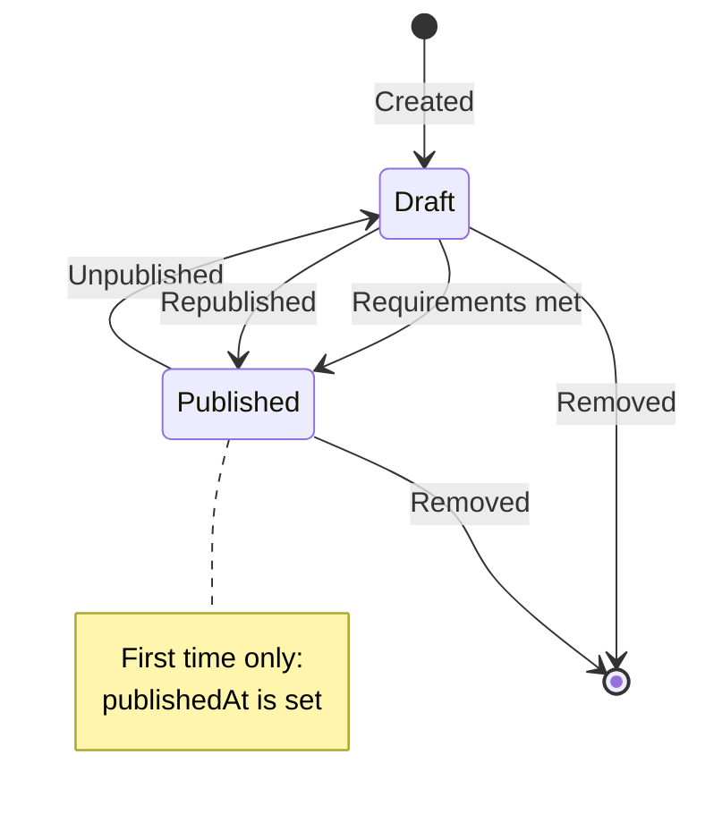
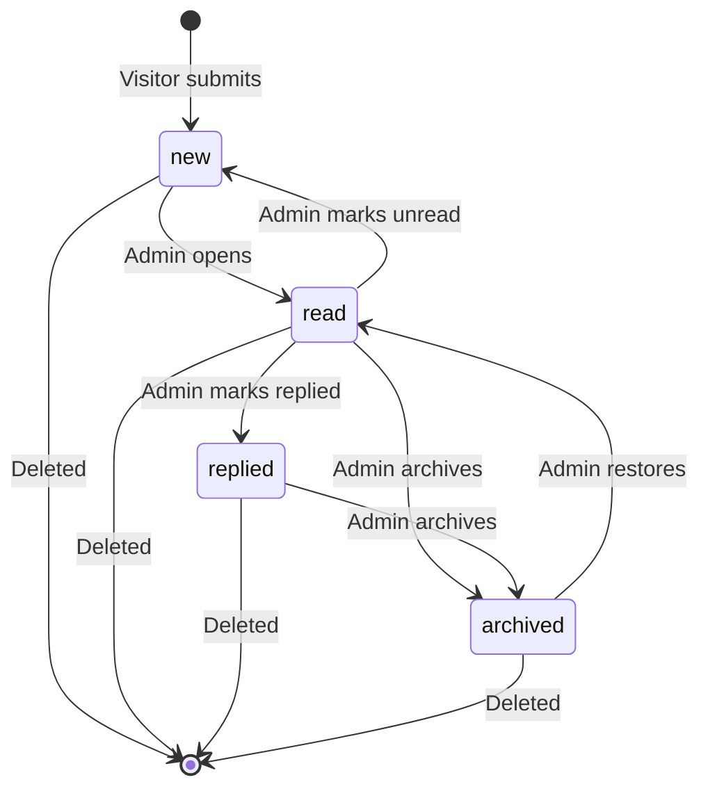
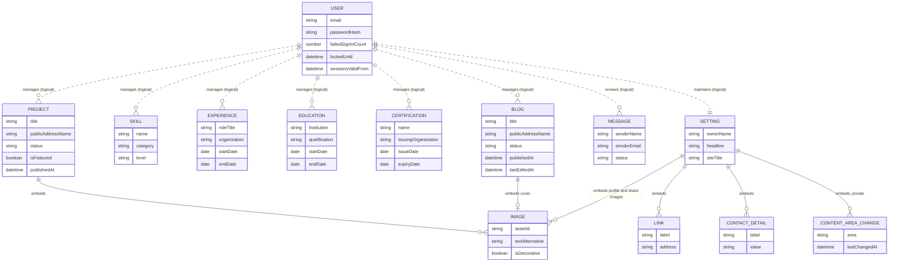

# Database Design — Personal Portfolio Platform

## 1. Document Information

| Field | Value |
| --- | --- |
| **Title** | Database Design — Personal Portfolio Platform |
| **Version** | 1.0.0 |
| **Status** | Draft — Pending Review |
| **Author** | Muhammad Bux |
| **Last Updated** | 2026-10-19 |
| **Current Phase** | Stage 2 — Design: Database Design |
| **Depends On** | `PROBLEM_STATEMENT.md`, `VISION.md`, `SCOPE.md`, `FUNCTIONAL_REQUIREMENTS.md`, `USER_FLOWS.md` |

---

## 2. Introduction

### 2.1 Purpose

This document defines what data the Version 1 platform stores, how that data is organized, how the pieces relate, the rules that keep the data consistent, and how it changes over time. It is a conceptual design. It contains no code, no schema definitions, and no interface or backend decisions.

### 2.2 Why data modeling matters

- Every requirement in `FUNCTIONAL_REQUIREMENTS.md` ultimately becomes a statement about data: something stored, changed, hidden, ordered, or removed.
- Errors in data design are expensive to correct after content exists. The platform will hold the owner's real professional record and real visitor messages, so changes later carry real risk.
- A clear model exposes ambiguity in earlier documents while it is still cheap to resolve. Section 18 records the points found.

### 2.3 How this document supports development

| Consumer | Use |
| --- | --- |
| API Design (next) | Knows which data exists, which fields are required, and which are private, so interfaces expose the right things. |
| Architecture | Knows the shape and volume of data, the access patterns, and the protection needs. |
| Implementation | Has an agreed definition of every field and rule to build against. |
| Reviewers | Can trace each stored item back to a requirement. |

---

## 3. Database Overview

### 3.1 Purpose

The database is the single source of truth for everything the platform shows and manages. It holds the owner's public portfolio content, the private account used to manage it, general portfolio information, and the messages visitors send. Nothing else is stored.

### 3.2 Main data categories

| Category | Entities | Nature |
| --- | --- | --- |
| **Portfolio content** | Project, Skill, Experience, Education, Certification, Blog | Authored by the Admin, shown publicly (subject to publishing state) |
| **General information** | Setting | Authored by the Admin, mostly public, with a small private part |
| **Visitor communication** | Message | Created by visitors, private to the Admin |
| **Administration** | User | Private. The single Admin account |

### 3.3 Organization approach

The platform has one owner and a modest volume of data. The design therefore treats each entity as a self-contained record. Data that only makes sense as part of a record, such as a project's images or an experience entry's list of responsibilities, is kept inside that record rather than split into separate entities. Records do not point at one another in Version 1. This keeps each piece of content independent, so that removing one never damages another.

### 3.4 Conventions

| Topic | Convention |
| --- | --- |
| Entity names | Singular, capitalized: `Project`, `Skill` |
| Field names | Descriptive, lower camel case: `issuingOrganization` |
| True or false fields | Begin with `is`: `isFeatured` |
| Timestamps | End with `At` and hold date and time: `publishedAt` |
| Calendar dates | End with `Date` and hold a date without a time: `issueDate` |
| Fixed choices | Named sets of allowed values, such as a status |
| Time reference | All timestamps are recorded in one universal time reference and presented in the viewer's context |
| Lists | A field holding several values is named in the plural: `technologies` |
| Types used in this document | **String** (short text), **Text** (long text), **Boolean**, **Date**, **Timestamp**, **Number**, **Enum** (fixed set of values), **List of X**, **Embedded X** (a structure kept inside the record) |
| Required column | **Yes** = always required. **No** = optional. **To publish** = may be empty in a draft but must be filled before publishing |

---

## 4. Data Modeling Principles

| # | Principle | What It Means Here |
| --- | --- | --- |
| P-1 | **Clear ownership** | Every piece of data belongs to exactly one record and one entity. Nothing is stored in two places. |
| P-2 | **Consistency** | Rules that must always be true, such as no end date before a start date, are enforced on the data itself, not left to individual screens. |
| P-3 | **No unnecessary duplication** | Values that can be worked out from stored data, such as counts, current-role status, or expired status, are calculated when needed and not stored. |
| P-4 | **Only approved entities** | The nine entities in the project brief are the only entities. Where a requirement needs more data, it is held inside an existing entity. |
| P-5 | **Records stand alone** | Version 1 records do not depend on other records. Removing content cannot leave a broken reference. |
| P-6 | **Privacy by separation** | Private data is clearly separated from public data so that exposing one cannot expose the other. |
| P-7 | **Minimal personal data** | Only the personal data a requirement needs is stored. In particular, only what a visitor types into the contact form is kept. |
| P-8 | **Simplicity** | The simplest structure that satisfies the requirements is preferred. Cleverness is avoided. |
| P-9 | **Room to grow** | The design must allow later additions, such as new entities and fields, without reshaping existing records. |
| P-10 | **Bounded growth** | Lists inside records have sensible limits, so a record cannot grow without bound. |
| P-11 | **Honest history** | Dates that mean something, such as first publication, are never overwritten by later edits. |

### 4.1 Data that is derived, not stored

The following values appear in the product but are calculated, in line with P-3.

| Derived Value | Calculated From |
| --- | --- |
| Current role or study in progress | An empty end date |
| Expired certification | Expiry date compared with the current date |
| Content counts and published or draft counts on the Dashboard | Counting records by status |
| Number of New messages | Counting messages by status |
| Pending drafts list | Records with draft status |
| Whether a "last updated" date is shown on an article | Whether a last-edited value exists |
| Display order of every list | Rules in `FUNCTIONAL_REQUIREMENTS.md` BR-007 applied to stored values |
| Home page project selection | Featured and published status, with a fallback to the most recently published |

---

## 5. Entity Overview

| Entity | Purpose | Importance |
| --- | --- | --- |
| **User** | The single Admin account that allows access to the management area | Critical. Protects every other entity. |
| **Project** | Portfolio projects, with the detail reviewers use to judge technical work | Critical. The main evidence of ability. |
| **Skill** | Technical skills grouped by category | High |
| **Experience** | Professional work history | High |
| **Education** | Academic history | Medium |
| **Certification** | Professional certifications and their validity | Medium |
| **Blog** | Technical articles | High. Evidence of thinking and communication. |
| **Message** | Messages sent by visitors through the Contact area | Critical. Ensures no inquiry is lost. |
| **Setting** | General portfolio information shown on Home, About, footer, Contact, and in search and sharing | High. Single source for owner identity. |

There is no separate entity for visitors, images, categories, or sessions. Section 18 explains each of these decisions.

---

## 6. Entity Detailed Design

### 6.0 Common fields and shared structures

#### Common fields

Every record in every entity has these fields. They are not repeated in each table.

| Field | Type | Required | Description |
| --- | --- | --- | --- |
| id | Unique identifier | Yes | Generated when the record is created. Never changes. Never reused. |
| createdAt | Timestamp | Yes | When the record was created. Never changes. |
| updatedAt | Timestamp | Yes | When the record was last changed. Updated on every change. |

#### Shared structure: Image

An Image is not an entity. It is a structure kept inside the record that uses it. The image file itself is held in an external media service. The database holds only a reference and the descriptive information.

| Field | Type | Required | Description |
| --- | --- | --- | --- |
| assetId | String | Yes | Identifier of the stored image in the media service. Used to replace or remove it. |
| assetAddress | String | Yes | Public web address from which the image is shown. |
| textAlternative | String | Yes, unless decorative | Short description for people who cannot see the image. Up to 200 characters. |
| isDecorative | Boolean | Yes | True if the image is purely decorative. Default false. |
| isCover | Boolean | Project images only | True for the single image designated as the project's cover. Default false. |

#### Shared structure: Link

| Field | Type | Required | Description |
| --- | --- | --- | --- |
| label | String | Yes | Name shown for the link, up to 50 characters. |
| address | String | Yes | A complete, valid web address. |

#### Shared structure: ContactDetail

| Field | Type | Required | Description |
| --- | --- | --- | --- |
| label | String | Yes | What the detail is, such as "Email". Up to 50 characters. |
| value | String | Yes | The detail itself. Up to 200 characters. |

---

### 6.1 User

#### Purpose

Holds the single Admin account that gives access to the management area (FR-AUTH-001 to 010).

#### Fields

| Field | Type | Required | Description |
| --- | --- | --- | --- |
| email | String | Yes | The Admin's sign-in identifier. Valid email format. Unique. |
| passwordHash | String | Yes | A one-way protected form of the password. The password itself is never stored. |
| failedSignInCount | Number | Yes | Count of consecutive failed sign-in attempts. Default 0. |
| lastFailedSignInAt | Timestamp | No | When the most recent failed attempt occurred. |
| lockedUntil | Timestamp | No | If set and in the future, sign-in is temporarily blocked. |
| sessionsValidFrom | Timestamp | Yes | Sessions that began before this moment are no longer valid. Set at creation, and moved forward when sessions must end. |

#### Business rules

- Exactly one User exists in Version 1. There is no registration and no second Admin (FR-AUTH-010).
- `email` is unique and must be in a valid format.
- The password is never stored in readable form, never shown, and never returned to anyone, including the Admin.
- A new password must meet the password rule in `FUNCTIONAL_REQUIREMENTS.md` FR-VAL-013 and must differ from the current one. The length check happens before protection, since the protected form no longer shows length.
- A failed sign-in increases `failedSignInCount`. When the count reaches the limit defined in the later security work, `lockedUntil` is set. A successful sign-in resets the count and clears the block.
- `sessionsValidFrom` is the only session-related data in Version 1. Section 18 explains why.
- The User record holds no personal profile. The owner's public name is held in Setting.

#### Lifecycle

| Stage | Behavior |
| --- | --- |
| **Creation** | Once, during initial setup of the platform. The method is decided in a later phase. |
| **Updates** | Password change (FR-AUTH-009), failed-attempt tracking, and moving `sessionsValidFrom`. |
| **Removal** | Not part of Version 1. There is no feature to remove the account. |

---

### 6.2 Project

#### Purpose

Stores each portfolio project in a consistent structure: problem, role, decisions, outcome, technologies, links, and images. This lets reviewers compare projects and judge depth (FR-PROJECT-001 to 007, FR-ADMIN-PROJECT-001 to 008).

#### Fields

| Field | Type | Required | Description |
| --- | --- | --- | --- |
| title | String | Yes | Project title. Up to 150 characters. |
| publicAddressName | String | Yes | Short readable name used in the project's public address. Made from the title. Unique among projects. |
| summary | String | To publish | Short description for lists and sharing. Up to 300 characters. |
| problemContext | Text | To publish | The problem or context the project addressed. |
| role | Text | To publish | The owner's role in the project. |
| keyDecisions | Text | No | Notable decisions and trade-offs. |
| outcome | Text | To publish | What the project achieved. |
| technologies | List of String | No | Technologies used, as plain text names. |
| liveProjectLink | String | No | Web address of the running project. |
| sourceCodeLink | String | No | Web address of the source code. |
| periodStart | Date | No | When the project began. |
| periodEnd | Date | No | When the project ended. Empty if ongoing or unknown. |
| images | List of Embedded Image | To publish (cover) | Project images. One is the cover. |
| status | Enum | Yes | `draft` or `published`. Default `draft`. |
| isFeatured | Boolean | Yes | Whether the project is highlighted. Default false. |
| publishedAt | Timestamp | No | When the project was first published. |

#### Business rules

- A project can be saved with only a title (FR-ADMIN-PROJECT-001).
- A project can be `published` only if `title`, `summary`, `problemContext`, `role`, `outcome`, and exactly one cover image are present (BR-005).
- Draft projects are never visible publicly. A project can be marked featured while it is a draft, but it appears publicly only once published.
- `publishedAt` is set the first time the project becomes published and is not changed afterward, including after unpublishing and republishing (P-11).
- `publicAddressName` may be regenerated from the title until the project is first published. After that it is fixed, so shared addresses never break (BR-008, FR-PROJECT-007).
- `technologies` are text only. They are not linked to Skill records (Section 18, C-1).
- `periodEnd` cannot be earlier than `periodStart`.
- Each image requires a text alternative unless marked decorative.
- Limits on size: at most 30 technologies and 12 images per project. These are initial values.

#### Lifecycle

| Stage | Behavior |
| --- | --- |
| **Creation** | Saved as `draft`. |
| **Updates** | Any field may change. Changes to a published project show publicly on the next load. |
| **Publishing** | `draft` to `published` when requirements are met. `publishedAt` is set on first publication only. |
| **Unpublishing** | `published` to `draft`. The record is unchanged otherwise. |
| **Removal** | Permanent, after confirmation. Its images stop being publicly available (FR-MEDIA-005). |

---

### 6.3 Skill

#### Purpose

Stores each technical skill so that skills can be shown grouped by category (FR-SKILL-001 to 004, FR-ADMIN-SKILL-001 to 005).

#### Fields

| Field | Type | Required | Description |
| --- | --- | --- | --- |
| name | String | Yes | Skill name, such as a language or tool. Up to 100 characters. |
| category | String | Yes | Name of the category the skill belongs to. Up to 50 characters. |
| level | Enum | No | `beginner`, `intermediate`, `advanced`, or `expert`. Empty if not set. |

#### Business rules

- The combination of `name` and `category` must be unique. Comparison ignores letter case and surrounding spaces (FR-ADMIN-SKILL-004).
- A category exists only because at least one skill uses it. There is no separate category record. A category with no skills disappears.
- When the Admin enters a category that matches an existing one apart from letter case, the existing spelling is used, so that categories stay consistent.
- A skill belongs to exactly one category.
- Public display order is stable: categories alphabetically, and skills alphabetically within a category (Section 18, C-7).

#### Lifecycle

| Stage | Behavior |
| --- | --- |
| **Creation** | Visible publicly as soon as saved (BR-003). |
| **Updates** | Name, category, and level may change. Changing category moves the skill to the new group. |
| **Removal** | Permanent, after confirmation. |

---

### 6.4 Experience

#### Purpose

Stores professional roles with enough detail for reviewers to understand scope and achievements (FR-EXP-001 to 004, FR-ADMIN-EXP-001 to 005).

#### Fields

| Field | Type | Required | Description |
| --- | --- | --- | --- |
| roleTitle | String | Yes | Title held. Up to 150 characters. |
| organization | String | Yes | Employer or client. Up to 150 characters. |
| location | String | No | Where the role was based. |
| startDate | Date | Yes | When the role began. Shown to month and year. |
| endDate | Date | No | When the role ended. Empty means the role is current. |
| summary | Text | No | Short summary of the role. |
| responsibilities | List of String | No | Main responsibilities. |
| achievements | List of String | No | Notable achievements, kept apart from responsibilities (FR-EXP-004). |
| technologies | List of String | No | Technologies used, as plain text names. |

#### Business rules

- `endDate` cannot be earlier than `startDate` (FR-ADMIN-EXP-004).
- An empty `endDate` means the role is current. This is derived, not stored.
- Public order is by `startDate`, most recent first.
- Visible publicly as soon as saved.
- Size limits: at most 20 responsibilities, 20 achievements, and 30 technologies, each item up to 500 characters (names up to 50). These are initial values.

#### Lifecycle

| Stage | Behavior |
| --- | --- |
| **Creation** | Visible as soon as saved. |
| **Updates** | Any field may change. Setting `endDate` ends a current role. |
| **Removal** | Permanent, after confirmation. |

---

### 6.5 Education

#### Purpose

Stores academic history (FR-EDU-001 to 003, FR-ADMIN-EDU-001 to 004).

#### Fields

| Field | Type | Required | Description |
| --- | --- | --- | --- |
| institution | String | Yes | Name of the institution. Up to 150 characters. |
| qualification | String | Yes | Qualification pursued or earned. Up to 150 characters. |
| fieldOfStudy | String | Yes | Subject area. Up to 150 characters. |
| startDate | Date | Yes | When study began. |
| endDate | Date | No | When study ended. Empty means in progress. |
| description | Text | No | Short description or notable achievements. |

#### Business rules

- `endDate` cannot be earlier than `startDate`.
- An empty `endDate` means study is in progress. This is derived, not stored.
- Public order is by `startDate`, most recent first.
- Visible publicly as soon as saved.

#### Lifecycle

| Stage | Behavior |
| --- | --- |
| **Creation** | Visible as soon as saved. |
| **Updates** | Any field may change. |
| **Removal** | Permanent, after confirmation. |

---

### 6.6 Certification

#### Purpose

Stores professional certifications and recognitions, with the information needed to confirm them (FR-CERT-001 to 003, FR-ADMIN-CERT-001 to 004).

#### Fields

| Field | Type | Required | Description |
| --- | --- | --- | --- |
| name | String | Yes | Certification name. Up to 150 characters. |
| issuingOrganization | String | Yes | Who issued it. Up to 150 characters. |
| issueDate | Date | Yes | When it was issued. |
| expiryDate | Date | No | When it expires. Empty if it does not expire. |
| credentialId | String | No | Identifier assigned by the issuer. |
| verificationLink | String | No | Web address where the issuer confirms the credential. |

#### Business rules

- `expiryDate` cannot be earlier than `issueDate`.
- "Expired" is derived by comparing `expiryDate` with the current date. It is never stored, because it changes as time passes (P-3).
- A certification with no `expiryDate` is never expired.
- Public order is by `issueDate`, most recent first.
- Visible publicly as soon as saved.

#### Lifecycle

| Stage | Behavior |
| --- | --- |
| **Creation** | Visible as soon as saved. |
| **Updates** | Any field may change. A renewal updates `expiryDate` instead of creating a duplicate. |
| **Removal** | Permanent, after confirmation. |

---

### 6.7 Blog

#### Purpose

Stores technical articles, including their publishing state and the dates visitors see (FR-BLOG-001 to 007, FR-ADMIN-BLOG-001 to 007).

#### Fields

| Field | Type | Required | Description |
| --- | --- | --- | --- |
| title | String | Yes | Article title. Up to 150 characters. |
| publicAddressName | String | Yes | Short readable name used in the article's public address. Made from the title. Unique among articles. |
| summary | String | To publish | Short description for lists and sharing. Up to 300 characters. |
| body | Text (formatted) | To publish | Article content with headings, paragraphs, lists, links, quotations, code excerpts, and images. Up to 100,000 characters. |
| coverImage | Embedded Image | No | Optional cover image. |
| status | Enum | Yes | `draft` or `published`. Default `draft`. |
| publishedAt | Timestamp | No | When the article was first published. |
| lastEditedAt | Timestamp | No | When the content was last changed after first publication. |

#### Business rules

- An article can be saved with only a title (FR-ADMIN-BLOG-001).
- An article can be `published` only if `title`, `summary`, and `body` are present (BR-005).
- `publishedAt` is set at first publication and never changes, including after unpublishing and republishing (FR-ADMIN-BLOG-005).
- `lastEditedAt` is set when the title, summary, body, or cover image of an article that has been published is changed. It is empty for an article never changed after first publication. A change to status alone does not set it.
- A last-updated date is shown publicly only if `lastEditedAt` is present (FR-BLOG-002).
- `publicAddressName` follows the same rule as for projects: may change until first publication, fixed afterward.
- Images inside the body follow the same rules as other images, including a text alternative. The body must keep enough information to list every image it uses.
- There is no author, comment, or tag data (Section 18, C-2).
- Public order is by `publishedAt`, newest first.

#### Lifecycle

| Stage | Behavior |
| --- | --- |
| **Creation** | Saved as `draft`. May be incomplete. |
| **Updates** | Any field may change. If published, `lastEditedAt` is set. |
| **Publishing** | `draft` to `published` when requirements are met. `publishedAt` is set on first publication only. |
| **Unpublishing** | `published` to `draft`. Dates are retained. |
| **Removal** | Permanent, after confirmation. Its cover and body images stop being publicly available. |

---

### 6.8 Message

#### Purpose

Stores each message a visitor sends through the Contact area so that no inquiry is lost and the Admin can track it (FR-CONTACT-001 to 009, FR-MSG-001 to 007).

#### Fields

| Field | Type | Required | Description |
| --- | --- | --- | --- |
| senderName | String | Yes | Name given by the visitor. 2 to 100 characters. |
| senderEmail | String | Yes | Email address given by the visitor. Valid format. |
| subject | String | No | Optional subject. Up to 150 characters. |
| messageText | Text | Yes | The message. 10 to 2,000 characters. |
| status | Enum | Yes | `new`, `read`, `replied`, or `archived`. Default `new`. |

`createdAt` serves as the date received.

#### Business rules

- A message is created only by a visitor submission. The Admin cannot create or edit one.
- Once stored, `senderName`, `senderEmail`, `subject`, and `messageText` never change (FR-MSG-002, "unaltered"). Only `status` changes.
- A new message is always `new`. Opening a `new` message sets it to `read`.
- The Admin can move a message to any status, including back to `new` (FR-MSG-003).
- Messages are never removed automatically (FR-MSG-007). There is no expiry.
- The whole record is private.
- Nothing is stored about the visitor beyond what they typed (P-7). Section 18, C-10 notes what this implies for abuse prevention.
- There is no link to a visitor account, because visitors have none.

#### Lifecycle

| Stage | Behavior |
| --- | --- |
| **Creation** | On accepted submission, with status `new`. A submission that is rejected or not accepted leaves no record. |
| **Updates** | Status only. |
| **Archiving** | The `archived` status takes a message out of active attention without deleting it. It can be restored. |
| **Removal** | Permanent, only by the Admin, after confirmation (FR-MSG-006). |

---

### 6.9 Setting

#### Purpose

Stores the general portfolio information used across the public site and in search and sharing (FR-SETTINGS-001 to 006). It also holds the small amount of internal information the Dashboard needs.

#### Fields: public

| Field | Type | Required | Description |
| --- | --- | --- | --- |
| ownerName | String | Yes | The owner's name. Up to 100 characters. |
| headline | String | Yes | Professional headline. Up to 150 characters. |
| homeIntroduction | Text | No | Short introductory statement on Home. |
| aboutNarrative | Text | No | Personal introduction on About. |
| professionalBackground | Text | No | Professional background on About. |
| profileImage | Embedded Image | No | The owner's picture. |
| availabilityStatement | String | No | Short statement of current availability. Up to 200 characters. |
| professionalLinks | List of Embedded Link | No | Links to professional profiles. |
| publicContactDetails | List of Embedded ContactDetail | No | Contact details the owner chooses to make public. |
| siteTitle | String | No | Default title for search and sharing. |
| siteDescription | String | No | Default description for search and sharing. Up to 300 characters. |
| defaultShareImage | Embedded Image | No | Default image used when a page is shared. |

#### Fields: private (internal)

| Field | Type | Required | Description |
| --- | --- | --- | --- |
| contentAreaChanges | List of Embedded ContentAreaChange | Yes | One entry per content area, recording when it was last changed. |

**ContentAreaChange** (shared within Setting only)

| Field | Type | Required | Description |
| --- | --- | --- | --- |
| area | Enum | Yes | `projects`, `skills`, `experience`, `education`, `certifications`, `blog`, or `settings`. |
| lastChangedAt | Timestamp | Yes | When any item in the area was last added, changed, or removed. |

#### Business rules

- Exactly one Setting record exists. It is never created or deleted by the Admin, only edited.
- `ownerName` and `headline` are required and cannot be blank. All other public fields are optional, and empty optional fields are simply not shown (BR-010).
- Empty links or contact details are not stored as blank entries.
- Each link requires a valid web address.
- `contentAreaChanges` is updated whenever any content area changes, including when an item is removed. It exists because removals cannot be detected from the remaining records (Section 18, C-4).
- Only the public fields are ever shown to visitors. `contentAreaChanges` is private.

#### Lifecycle

| Stage | Behavior |
| --- | --- |
| **Creation** | Once, at initial setup, with owner name and headline. |
| **Updates** | By the Admin. Saved changes appear publicly on the next load. |
| **Removal** | Not possible. The record always exists. |

---

## 7. Entity Relationships

### 7.1 Principle

Version 1 deliberately has no stored links between records. Each entity is an independent set of records. Relationships exist only in two forms: **embedded** (a structure belonging to one record) and **logical** (a relationship that is true of the system but needs no stored link).

### 7.2 Relationship summary

| Relationship | Kind | Description |
| --- | --- | --- |
| User manages all content, Settings, and Messages | Logical | There is one Admin and one owner, so every content record is implicitly the owner's. No record stores who created it (C-2). |
| Project contains Images | Embedded | A project holds a list of images, one of them designated as cover. |
| Blog contains a cover Image | Embedded | An article may hold one cover image. Images inside the body are part of the body. |
| Setting contains Images, Links, ContactDetails, and ContentAreaChanges | Embedded | General information is held in one record. |
| Project, Experience contain technologies | Embedded | Plain text lists. |
| Project and Skill | **None** | A project's technologies are text. No stored link exists (C-1). |
| Experience and Skill | **None** | Same as above. |
| Message and Visitor | Embedded | Sender name and email are fields of the message. There is no Visitor entity. |
| Message and User | None | A message is not assigned to the Admin. There is one Admin. |
| Home page and Project | Derived | Home shows featured published projects. This is calculated from status and the featured flag. |

### 7.3 Entity relationship diagram

Solid lines show data stored inside a record. Dashed lines show logical relationships with no stored link.

`IMAGE`, `LINK`, `CONTACT_DETAIL`, and `CONTENT_AREA_CHANGE` are embedded structures, not entities.

### 7.4 Consequences of the design

| Consequence | Benefit | Cost |
| --- | --- | --- |
| Removing any record affects no other record | No broken references. Simple removal. | Technology names are repeated as text where used. |
| A skill can be renamed without touching projects | Independence | Renaming a technology in a project must be done there. |
| No author on records | Less data | Adding multiple authors later needs a new field and a decision on existing records. |

---

## 8. Data Validation Rules

These rules describe what the stored data must always satisfy. They complement the checks in `FUNCTIONAL_REQUIREMENTS.md` Section 7 and do not replace them. Data must meet the rules however it arrives (FR-VAL-016).

| ID | Rule |
| --- | --- |
| DV-001 | **Required fields.** A required field cannot be missing, empty, or consist only of blank characters. |
| DV-002 | **To-publish fields.** A record with status `published` must have every "To publish" field completed. A draft may leave them empty. |
| DV-003 | **Length limits.** Every text field has a maximum length, as stated in each entity table. Descriptive Text fields, such as `problemContext`, have an initial limit of 20,000 characters. |
| DV-004 | **Fixed choices.** Status and level values must come from their defined sets. |
| DV-005 | **Valid dates.** Dates must be real dates. `endDate` cannot precede `startDate`. `expiryDate` cannot precede `issueDate`. `periodEnd` cannot precede `periodStart`. |
| DV-006 | **Valid web addresses.** Every link must be a complete, valid web address. |
| DV-007 | **Valid email.** `User.email` and `Message.senderEmail` must be in valid email format. |
| DV-008 | **Uniqueness: skills.** `name` and `category` together are unique, ignoring letter case and surrounding spaces. |
| DV-009 | **Uniqueness: addresses.** `publicAddressName` is unique within Project and unique within Blog. |
| DV-010 | **Uniqueness: Admin.** `User.email` is unique, and only one User exists. |
| DV-011 | **Single Setting.** Exactly one Setting record exists. |
| DV-012 | **Cover image.** A published project has exactly one image designated as cover. A draft has at most one. |
| DV-013 | **Images.** Every image has a reference and a web address. Its text alternative is required unless it is marked decorative. |
| DV-014 | **List limits.** Lists have maximum sizes (Section 6). |
| DV-015 | **Message permanence.** A message's content fields cannot change after creation. Only status changes. |
| DV-016 | **First-publication date.** `publishedAt` is set once and cannot be changed or cleared afterward. |
| DV-017 | **Credentials.** `passwordHash` never contains a readable password. |
| DV-018 | **Empty optional values.** Optional fields without a value hold nothing. Placeholder text such as "N/A" is not stored. |
| DV-019 | **Normalized text.** Leading and trailing spaces are removed from text fields before storage. |
| DV-020 | **Message size.** A message's length is between the stated minimum and maximum. |

---

## 9. Data Ownership Rules

| Entity | Created by | Updated by | Removed by | Visibility controlled by |
| --- | --- | --- | --- | --- |
| **User** | Initial setup | Admin (password), system (attempt tracking, sessions) | Not removable | Never visible |
| **Project** | Admin | Admin | Admin | Admin, through `status` |
| **Skill** | Admin | Admin | Admin | Always public once saved |
| **Experience** | Admin | Admin | Admin | Always public once saved |
| **Education** | Admin | Admin | Admin | Always public once saved |
| **Certification** | Admin | Admin | Admin | Always public once saved |
| **Blog** | Admin | Admin | Admin | Admin, through `status` |
| **Message** | Visitor (by submitting) | Admin (status only), system (marks read on opening) | Admin | Never visible publicly |
| **Setting** | Initial setup | Admin; system for `contentAreaChanges` | Not removable | Public fields are public. Internal field never |

### 9.1 Rules

- Only the Admin creates, changes, publishes, or removes content (BR-013).
- A visitor can cause exactly one kind of data to exist: a Message (BR-014).
- The system maintains values the Admin does not enter directly: identifiers, timestamps, `publishedAt`, `lastEditedAt`, a message's move to `read`, and `contentAreaChanges`.
- A visitor never changes any stored data after submission.
- The Admin never changes the content of a Message.

---

## 10. Content Visibility Rules

### 10.1 Public data

| Entity | Public When | Public Fields |
| --- | --- | --- |
| **Project** | `status` is `published` | title, public address name, summary, problem or context, role, key decisions, outcome, technologies, links, period, images |
| **Skill** | Always, once saved | name, category, level |
| **Experience** | Always, once saved | all fields except internal timestamps |
| **Education** | Always, once saved | all fields except internal timestamps |
| **Certification** | Always, once saved | all fields except internal timestamps |
| **Blog** | `status` is `published` | title, public address name, summary, body, cover image, `publishedAt`, `lastEditedAt` |
| **Setting** | Always | all public fields |

### 10.2 Private data

| Data | Reason |
| --- | --- |
| **All User data** | Credentials and access control |
| **All Message data** | Visitor personal information and private correspondence |
| **Setting: `contentAreaChanges`** | Internal management information |
| **Draft Projects and Blogs** | Unfinished work (BR-002) |
| **Status and featured flags** | Used to decide visibility and order, not shown as data |
| **`id`, `createdAt`, `updatedAt` on all entities** | Internal. Where a date is shown publicly, it is one of the named publication dates above |

### 10.3 Rules

- A draft is indistinguishable from a removed record to a visitor. Both give the not-found response (FR-SITE-006).
- Unpublishing makes a record private immediately.
- Public data must never be assembled from private fields.

---

## 11. Data Lifecycle Management

### 11.1 Creating records

- Records are created with valid required fields. "To publish" fields may be incomplete in drafts.
- Identifiers and timestamps are created by the system.
- Projects and articles start as `draft`. Messages start as `new`.
- A new or changed record in any content area updates that area's last-changed date.

### 11.2 Updating records

- Any change updates `updatedAt` and the area's last-changed date.
- Changes to published records are public at the next visitor load (BR-006).
- Dates that record history, `createdAt` and `publishedAt`, do not change.
- Message content does not change. Only message status can be updated.

### 11.3 Removing records

- In Version 1, removal is permanent and cannot be undone (BR-004). There is no recycle or restore.
- Removal requires prior confirmation, which is a behavior defined elsewhere.
- Removing a record leaves no dependent records, because none exist.
- Removing a record also removes its embedded data. The matching image files in the media service must stop being publicly available (FR-MEDIA-005). How this is done is for a later phase, and this design supports it by keeping every image reference enumerable within its record.
- Removal updates the area's last-changed date.

### 11.4 Reversible alternatives

| Entity | Reversible Alternative to Removal |
| --- | --- |
| Project | Unpublish (returns to draft) |
| Blog | Unpublish (returns to draft) |
| Message | Archive |
| Skill, Experience, Education, Certification | None. Confirmation is the only protection (G-4 in `USER_FLOWS.md`). |

### 11.5 Archiving and retention

- The only archive concept in Version 1 is the `archived` message status.
- Messages are kept until the Admin deletes them. This respects "no inquiry lost" and leaves deletion of personal data under the owner's control.
- Version 1 has no history of changes, so earlier versions of content cannot be recovered. Backup of the database is an operational matter and is not covered here.

---

## 12. Future Database Considerations

These are possibilities only. None is part of Version 1, and none is required by the current design.

| Possible Future Entity | Related Future Idea | Notes |
| --- | --- | --- |
| **Analytics events** | Analytics, portfolio insights | Would need privacy design. |
| **Testimonials** | Testimonials | Independent records, with optional display control. |
| **Newsletter subscribers** | Newsletter | Introduces new personal data and consent concerns. |
| **Resume versions** | Résumé builder | Would draw from existing records. |
| **Social links** | Richer profile links | Version 1 holds professional links inside Setting. |
| **Category** | Owner-controlled category order | Needed only if alphabetical order proves insufficient. |
| **Media item** | Reusing images across content | Needed only if an image library is introduced. |
| **Session record** | Per-device sessions | Needed only if the later authentication design requires it. |
| **Translations** | Multi-language support | Would affect most entities. |
| **Change history** | Recovery of earlier versions | Would address accidental changes and deletions. |

Principle P-9 asks that adding these should not require reshaping existing records.

---

## 13. Database Security Considerations

Principles only. Mechanisms are decided in later phases.

| # | Principle |
| --- | --- |
| S-1 | **Protect private data.** Messages, credentials, and internal information are never exposed publicly. |
| S-2 | **Restrict administrative access.** Only the Admin can change content and read private data. |
| S-3 | **Never store secrets readably.** Passwords are held only in a one-way protected form. |
| S-4 | **Validate all incoming data.** Data must meet the rules in Section 8, however it arrives, to prevent corrupt or malicious content. |
| S-5 | **Treat stored text as untrusted.** Visitor messages, and any formatted article content, must be handled safely when displayed. |
| S-6 | **Minimize collected data.** Only information a requirement needs is stored (P-7). |
| S-7 | **Avoid exposing sensitive information.** Public views must use only public fields (Section 10). |
| S-8 | **Separate public and private concerns.** The private part of Setting is distinct from its public part. |
| S-9 | **Limit failed access attempts.** Sign-in failures are tracked on the User record so that repeated failures can be restricted. |
| S-10 | **Plan for backup and recovery.** The database holds the owner's only copy of their portfolio, so protection against loss is required. Detail is for the infrastructure phase. |
| S-11 | **Respect personal data.** Visitor email addresses and messages are personal data. Retention and deletion are under the owner's control (FR-MSG-006, FR-MSG-007). |

---

## 14. Performance Considerations

### 14.1 Expected scale

Data volume is small. Likely a few dozen items across each content area, a modest article list, and messages accumulating slowly. The challenge is design clarity, not scale. Public pages are read often and changed rarely.

### 14.2 Main ways data is read

| Need | Description |
| --- | --- |
| Find a project or article by its public address | Frequent on public pages. Must be quick and unambiguous. |
| List published projects | Featured first, then by first-publication date |
| List published articles | Newest first, in divided pages (FR-BLOG-003) |
| List skills by category | All skills, grouped |
| List experience, education, certifications | Small lists, sorted by date |
| Read general information | On nearly every public page |
| List messages, filter by status, newest first | Admin only |
| Counts for the Dashboard | Counting by status and area |
| Look up the Admin by sign-in identifier | At every sign-in |

### 14.3 Design-level considerations

- **Lists must not need heavy content.** List views of projects and articles use short fields. They must not require loading full article bodies or long descriptions.
- **Embedded lists stay bounded** (P-10), so records stay small.
- **The Setting record is read often and small.** It should be readily available to every public page.
- **Avoid duplication.** Derived values (Section 4.1) avoid repeated updates and inconsistency.
- **Likely areas for indexing, later.** Public addresses, status combined with date for projects and articles, message status and date, and the sign-in identifier. Actual choices belong to implementation.
- **Counts.** At this scale, counting on demand is acceptable, which avoids storing counts.
- **Growth watch.** If messages or articles grow much larger than expected, revisit how lists are divided and how old messages are archived.

---

## 15. Out of Scope

This document does not cover:

| Excluded | Belongs To |
| --- | --- |
| API design | Next Stage 2 document |
| Backend architecture | Architecture |
| Authentication flow, including how sessions work | Authentication design |
| Deployment and hosting | Delivery phase |
| Database implementation code and schema definitions | Implementation |
| Migration strategy and initial setup process | Later planning |
| Index definitions | Implementation |
| Backup and recovery procedures | Infrastructure phase |
| Media service configuration | Architecture and implementation |
| Security mechanisms | Security design |

---

## 16. Conclusion

The data design follows from the earlier planning documents. Nine entities cover every module in `SCOPE.md`. Each field traces to a requirement, each rule to a business rule or a validation requirement, and each relationship decision was made to keep Version 1 simple: records stand alone, embedded structures stay inside their owners, and anything derivable is calculated.

A clear data model gives API Design a precise list of what can be read and changed, which parts are private, and which values must be checked. It gives Architecture the shape, size, and access patterns of the data, so that choices are fitted to a small, read-heavy system and not to an imagined large one. It also makes later changes safer, because the places where flexibility was deliberately limited, such as technologies as text, are written down along with the reason.

The next step is **API Design**, which will define how the data described here is made available to the public site and to the management area. Every interface should map to the entities, fields, and visibility rules above.

---

## 17. Requirement Traceability

| Requirement Area | Entity and Fields |
| --- | --- |
| FR-AUTH | User: `email`, `passwordHash`, `failedSignInCount`, `lastFailedSignInAt`, `lockedUntil`, `sessionsValidFrom` |
| FR-HOME, FR-ABOUT, FR-SETTINGS | Setting: public fields |
| FR-SKILL, FR-ADMIN-SKILL | Skill |
| FR-EXP, FR-ADMIN-EXP | Experience |
| FR-EDU, FR-ADMIN-EDU | Education |
| FR-CERT, FR-ADMIN-CERT | Certification |
| FR-PROJECT, FR-ADMIN-PROJECT | Project |
| FR-BLOG, FR-ADMIN-BLOG | Blog |
| FR-CONTACT, FR-MSG | Message |
| FR-MEDIA | Embedded Image in Project, Blog, Setting |
| FR-DASH-001, 002, 005 | Derived from counts and status. No stored data. |
| FR-DASH-003 | Setting: `contentAreaChanges` |
| FR-SEO-003, 004 | Setting: `siteTitle`, `siteDescription`, `defaultShareImage`. Project and Blog: `summary`, images |
| FR-SEO-005, 006, FR-PROJECT-007, FR-BLOG-005 | Project and Blog: `publicAddressName` |
| BR-003, BR-005 | Project and Blog: `status`, "To publish" fields |
| BR-007 | Stored dates and flags used for ordering |
| BR-011 | `updatedAt` and `contentAreaChanges` |

---

## 18. Alignment with Previous Phases and Open Decisions

No earlier decision has been changed. The items below record where this design departs from an example in the brief, interprets something earlier documents left open, or needs the owner's confirmation. Items C-1 to C-3 are the most significant.

### 18.1 Departures from examples in the brief

| # | Matter | Treatment | Reason |
| --- | --- | --- | --- |
| C-1 | **Project and Skill relationship.** The brief's example shows projects containing skill references. | No relationship. A project's `technologies` is a list of plain text. | `FUNCTIONAL_REQUIREMENTS.md` describes project "technologies" as content, not a link. `USER_FLOWS.md` N-1 states that visitors match technologies to skills themselves and that direct links would be a scope change. A stored link would also tie removal of a skill to projects and would require behavior no requirement defines. If the owner wants projects linked to skills, it should go through the Scope Change Policy. |
| C-2 | **Blog belongs to an author.** The brief's example links articles to a User. | No author link on any record. | There is one Admin (FR-AUTH-010), articles show no author, and every record is the owner's by definition. A link on every record adds data with no use. Multi-author support, if ever needed, is a future change. |

### 18.2 Needs that did not justify new entities

| # | Need | Treatment |
| --- | --- | --- |
| C-3a | **Images** (FR-MEDIA) | Embedded structure in the owning record. No Media entity. |
| C-3b | **Skill categories** (FR-ADMIN-SKILL-001) | A text field on Skill. No Category entity. |
| C-3c | **Sessions and sign-out** (FR-AUTH-005 to 007) | One field on User (`sessionsValidFrom`). Whether per-session records are needed is for the authentication design, which may require revisiting this. |
| C-3d | **Last-changed date per area** (FR-DASH-003) | Stored in the private part of Setting. See C-4. |
| C-3e | **Visitors** | No entity. Sender details live in the Message. |

### 18.3 Interpretations and gaps

| # | Matter | Treatment | Owner Decision Needed |
| --- | --- | --- | --- |
| C-4 | **Last-changed dates and removal.** FR-DASH-003 says the date changes when an item is added, changed, or removed. A removed item leaves no trace in its area, so the date cannot be derived from remaining records. | Stored per area in Setting (private). | Confirm. |
| C-5 | **"Newest first" for projects.** FR and BR-007 do not say what "newest" means. | First-publication date (`publishedAt`). A project finished years ago but published recently would rank above a more recent one unless featured. | Confirm, or choose the project period instead. |
| C-6 | **Required fields.** The functional requirements do not list required fields for every entity. | Proposed in each entity table: only the fields the requirements name as always shown. For example, Experience requires role title, organization, and start date. | Confirm. |
| C-7 | **Skill order.** FR-SKILL-004 asks only for a stable order. With no Category entity, the Admin cannot control category order. | Alphabetical order for categories and skills. | Confirm. If Admin-controlled order is wanted, it is a scope change. |
| C-8 | **Article "last updated" rule.** FR-BLOG-002 says it is shown if changed after publication, but not what counts as a change. | `lastEditedAt` is set only when content fields change on a published article, not on status changes alone. | Confirm. |
| C-9 | **Sessions ending on password change.** FR-AUTH-009 says the new password is required at next sign-in but not whether existing sessions end. | `sessionsValidFrom` allows existing sessions to end. Whether it is used is for the authentication design. | Decide in authentication design. |
| C-10 | **Abuse prevention without extra data.** FR-CONTACT-008 requires reducing abusive submissions. Data minimization (P-7) means no address or device data is stored with messages. | None stored in Version 1. If abuse controls later need such data, that is a decision for the security design, with its own privacy consideration. | Decide in security design. |
| C-11 | **Size limits.** Item counts and longer text limits (for example 12 images per project and 20,000 characters) are not in the requirements. | Proposed as initial values in line with FR-VAL-008, adjustable without changing the design. | Confirm. |
| C-12 | **Soft removal.** BR-004 makes removal permanent. No history or restore is stored. | Followed as written. This leaves accidental deletion of skills, experience, education, and certifications unrecoverable (G-4 in `USER_FLOWS.md`). | No change proposed. Change history is listed as a future consideration. |
| C-13 | **Formatted article content.** The data design says articles need formatted content but not how it is represented. | Left to API Design and Architecture. Only the requirements are stated: preserve structure, and allow image references to be listed. | Decide in later design. |
| C-14 | **Image deletion at the media service.** FR-MEDIA-005 requires removed content's images to stop being public. | The database keeps every image reference enumerable. The removal process is a later design matter. | Decide in Architecture. |

### 18.4 Pending Phase 4 decisions

| Decision | Effect on This Design |
| --- | --- |
| **D-3** Publishing state for projects | Project holds `status` and `publishedAt`. If rejected, both fields and the draft rules are removed. No other entity is affected. |
| **D-4** Featured projects | Project holds `isFeatured`. If rejected, the field is removed. |
| **D-5** Password recovery | Not stored. User has no recovery data. If added later, User will need new fields. |
| **D-6** Downloadable résumé | Nothing is stored. If added, Setting would need a file reference. |

### 18.5 Consistency confirmed

- Only the nine approved entities exist. No entity from `SCOPE.md` Section 5 or 6 is included.
- No field supports a feature outside Version 1.
- Visibility follows `FUNCTIONAL_REQUIREMENTS.md` BR-002 and BR-003.
- No code, schema definitions, interfaces, or backend details appear in this document.