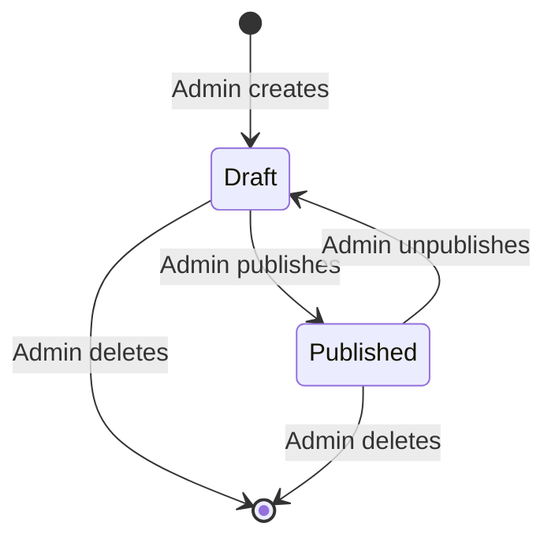
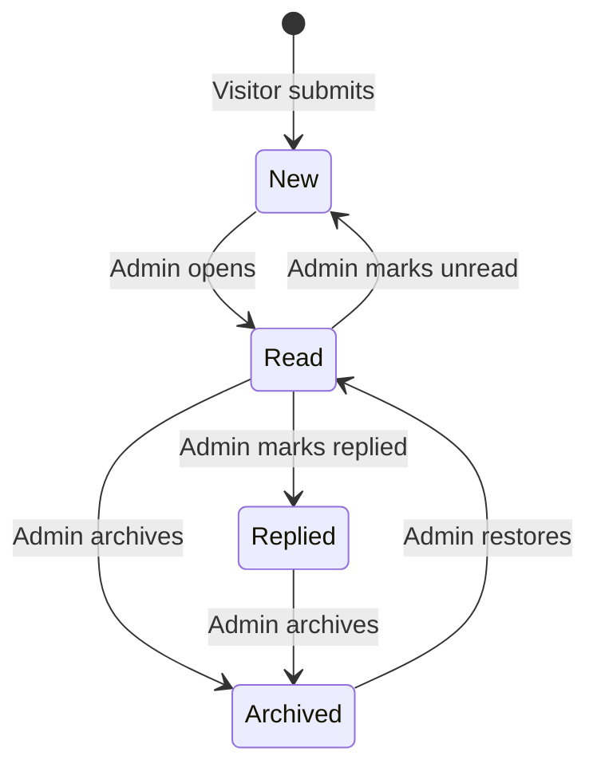

# Functional Requirements — Personal Portfolio Platform

## 1. Document Information

| Field             | Value                                                                         |
| ----------------- | ----------------------------------------------------------------------------- |
| **Title**         | Functional Requirements — Personal Portfolio Platform                         |
| **Version**       | 1.0.0                                                                         |
| **Status**        | Draft — Pending Review                                                        |
| **Author**        | Muhammad Bux                                                                  |
| **Last Updated**  | 2026-10-19                                                                    |
| **Current Phase** | Phase 4 — Functional Requirements (Stage 1: Think)                            |
| **Depends On**    | `PROBLEM_STATEMENT.md` (Phase 1), `VISION.md` (Phase 2), `SCOPE.md` (Phase 3) |

---

## 2. Introduction

### 2.1 Purpose

This document defines what the Version 1 system shall do. It describes observable behavior, the business rules the system follows, and the criteria used to confirm that each behavior is correct. It does not describe how the behavior is built.

### 2.2 Scope versus functional requirements

| Document                                     | Question It Answers                                       | Level of Detail |
| -------------------------------------------- | --------------------------------------------------------- | --------------- |
| `SCOPE.md`                                   | Which modules and capabilities belong in Version 1?       | Module level    |
| `FUNCTIONAL_REQUIREMENTS.md` (this document) | What must each of those modules do, and under what rules? | Behavior level  |

This document adds no module that `SCOPE.md` does not list. Where a requirement needs a decision that `SCOPE.md` left open, the decision is recorded in Section 17 so it can be reviewed rather than assumed.

### 2.3 Intended readers

- **The owner**, to approve what will be built.
- **Whoever designs the user flows (Phase 5) and the later technical designs**, to know what must be supported.
- **Reviewers of the planning record**, to assess the quality of the process.

### 2.4 Conventions

| Convention               | Meaning                                                                                                             |
| ------------------------ | ------------------------------------------------------------------------------------------------------------------- |
| **Requirement ID**       | `FR-<AREA>-<NNN>`. IDs are permanent and are never reused.                                                          |
| **Business rule ID**     | `BR-<NNN>`. Rules that apply across several areas.                                                                  |
| **"shall"**              | A mandatory Version 1 requirement.                                                                                  |
| **Visitor / Admin**      | The two user roles defined in Section 4.                                                                            |
| **Published**            | Visible to visitors on the public website.                                                                          |
| **Draft**                | Saved by the Admin but not visible to visitors.                                                                     |
| **Acceptance criteria**  | Statements that can be checked by observing the system. Each must be true for the requirement to be considered met. |
| **Time and size limits** | Where a number appears, it is an initial value that can be adjusted without changing the requirement itself.        |

---

## 3. System Overview

### 3.1 Public portfolio experience

Visitors browse a professional website containing nine content areas: Home, About, Skills, Experience, Education, Certifications, Projects, Blog, and Contact. They can read everything without registering or signing in. A visitor can send the owner a message through the Contact area.

The experience is designed so that a reviewer can form an accurate impression quickly, as defined in the Version 1 success criteria in `SCOPE.md`, and can look deeper into projects and writing when they choose to.

### 3.2 Admin management experience

The Admin signs in to a restricted area and uses it to keep all public content current, to publish or withdraw content, to manage images, to maintain general portfolio information, and to review messages from visitors. No change to public content requires editing the application itself.

### 3.3 Main user groups

The six audience groups identified in the earlier phases collapse into two system roles. Their different needs affect the content and its presentation, not the capabilities available to them.

| Audience Group (Phase 1 and 2) | System Role |
| ------------------------------ | ----------- |
| Hiring Engineer                | Visitor     |
| Tech Lead                      | Visitor     |
| Engineering Manager            | Visitor     |
| Recruiter                      | Visitor     |
| Freelance Client               | Visitor     |
| Portfolio Owner                | Admin       |

### 3.4 Content lifecycle

Projects and blog articles have a publishing state. Other content areas are visible once saved. See Section 6 for the rules.

### 3.5 Message lifecycle

---

## 4. User Roles

| Role        | Description                                                              | Main Responsibilities                                                                                                                                                                            |
| ----------- | ------------------------------------------------------------------------ | ------------------------------------------------------------------------------------------------------------------------------------------------------------------------------------------------ |
| **Visitor** | Any person viewing the public website. Not signed in. Has no account.    | Read portfolio content. Send a message to the owner through the Contact area.                                                                                                                    |
| **Admin**   | The portfolio owner. The only person who can access the management area. | Create, change, publish, withdraw, and remove portfolio content. Manage images. Maintain general portfolio information. Review and manage visitor messages. Manage their own access credentials. |

Only these two roles exist in Version 1. There is no registration for visitors, no additional administrators, and no tiered permissions.

---

## 5. Functional Requirements

All requirements in this section are mandatory for Version 1.

### A. Public Website Requirements

#### A.0 Site-wide behavior

| ID          | Feature                           | Description                                                                 | User    | Expected Behavior                                                                                                                       | Acceptance Criteria                                                                                                                                           |
| ----------- | --------------------------------- | --------------------------------------------------------------------------- | ------- | --------------------------------------------------------------------------------------------------------------------------------------- | ------------------------------------------------------------------------------------------------------------------------------------------------------------- |
| FR-SITE-001 | Navigation                        | Visitors can reach every public area from anywhere on the site.             | Visitor | A consistent navigation is available on every public page. It identifies the area the visitor is currently in.                          | AC1: All nine areas are reachable from every public page. AC2: The current area is identifiable. AC3: No public page is a dead end.                     |
| FR-SITE-002 | Footer information                | Basic owner and contact information is available on every public page.      | Visitor | The footer presents the owner's name and the professional links and contact details the Admin has chosen to show.                       | AC1: The footer appears on every public page. AC2: Links shown match the Admin's current Settings. AC3: Items the Admin left empty are not shown.       |
| FR-SITE-003 | Empty content areas               | A list area with no published entries must still make sense to the visitor. | Visitor | The area shows a short, neutral message instead of a blank or broken layout.                                                            | AC1: An area with no published entries shows a message. AC2: No error is displayed to the visitor.                                                         |
| FR-SITE-004 | Page not found                    | Addresses that do not lead to public content give a helpful response.       | Visitor | The visitor sees a clear "not found" page with a way back to the site.                                                                  | AC1: Mistyped addresses show the page. AC2: Addresses of draft or removed content show the same page. AC3: The page provides navigation to other areas. |
| FR-SITE-005 | Consistent presentation           | Names, labels, and formats are uniform.                                     | Visitor | Dates, periods, and labels follow one format across all areas.                                                                          | AC1: Dates use one consistent format across the site. AC2: Ongoing periods are labeled consistently, for example "Present".                                |
| FR-SITE-006 | Visibility of unpublished content | Content not meant to be public is never exposed.                            | Visitor | Drafts, removed content, messages, and the management area are never shown in public pages, lists, or search-engine-facing information. | AC1: No draft item appears in any public list. AC2: A draft's address does not display its content to a visitor.                                           |

#### A.1 Home Page

| ID          | Feature                   | Description                                                  | User    | Expected Behavior                                                                                                                                        | Acceptance Criteria                                                                                                                 |
| ----------- | ------------------------- | ------------------------------------------------------------ | ------- | -------------------------------------------------------------------------------------------------------------------------------------------------------- | ----------------------------------------------------------------------------------------------------------------------------------- |
| FR-HOME-001 | Professional introduction | The Home page introduces the owner.                          | Visitor | Shows the owner's name, professional headline, and a short introductory statement. A profile image is shown if the Admin has provided one.               | AC1: Name, headline, and introduction match Settings. AC2: The page displays correctly when no profile image exists.             |
| FR-HOME-002 | Availability statement    | Visitors can see whether the owner is open to opportunities. | Visitor | If the Admin has provided an availability statement, it is shown prominently. If not, nothing is shown.                                                  | AC1: The statement appears when set. AC2: It does not appear when empty. AC3: Changing it in Settings updates the Home page.  |
| FR-HOME-003 | Featured work             | The Home page presents a selection of projects.              | Visitor | Shows published projects marked as featured, with a link to the full Projects list. If none are featured, it shows the most recently published projects. | AC1: Only published projects appear. AC2: Featured projects take priority. AC3: A link leads to the full list.                |
| FR-HOME-004 | Primary actions           | Visitors are guided to the most useful next steps.           | Visitor | The page offers clear entry points to Projects and Contact.                                                                                              | AC1: Both entry points are visible without extensive scrolling on a typical desktop screen. AC2: Each leads to the correct area. |
| FR-HOME-005 | Access to all areas       | The Home page connects to the rest of the site.              | Visitor | Navigation (FR-SITE-001) is present.                                                                                                                     | AC1: Every public area is reachable from Home.                                                                                      |

#### A.2 About

| ID           | Feature                 | Description                                            | User    | Expected Behavior                                                                                    | Acceptance Criteria                                                                                  |
| ------------ | ----------------------- | ------------------------------------------------------ | ------- | ---------------------------------------------------------------------------------------------------- | ---------------------------------------------------------------------------------------------------- |
| FR-ABOUT-001 | Personal introduction   | Presents who the owner is.                             | Visitor | Displays a narrative introduction written by the Admin, with the profile image if provided.          | AC1: The narrative matches Settings. AC2: Paragraph structure authored by the Admin is preserved. |
| FR-ABOUT-002 | Professional background | Describes the owner's professional focus and approach. | Visitor | Displays the professional background text provided by the Admin as part of the About content.        | AC1: The content is shown in readable form. AC2: Empty parts are omitted without leaving gaps.    |
| FR-ABOUT-003 | Career pointers         | Connects the summary to detailed records.              | Visitor | Provides clear links to the Experience and Education areas and shows the owner's professional links. | AC1: Links lead to the correct areas. AC2: Professional links are shown only if provided.         |

#### A.3 Skills

| ID           | Feature                | Description                                     | User    | Expected Behavior                                                                                                   | Acceptance Criteria                                                                                 |
| ------------ | ---------------------- | ----------------------------------------------- | ------- | ------------------------------------------------------------------------------------------------------------------- | --------------------------------------------------------------------------------------------------- |
| FR-SKILL-001 | Skills display         | Shows the owner's technical skills.             | Visitor | Displays all skills the Admin has saved.                                                                            | AC1: Every saved skill appears. AC2: A removed skill does not appear.                            |
| FR-SKILL-002 | Skill categories       | Skills are organized into categories.           | Visitor | Skills appear grouped under their category heading, such as a language or a type of tool.                           | AC1: Each skill appears under exactly one category. AC2: A category with no skills is not shown. |
| FR-SKILL-003 | Proficiency indication | Visitors can see an optional level for a skill. | Visitor | If the Admin has set a level for a skill, it is shown with the skill. Skills without a level are shown without one. | AC1: Levels come from a fixed set of labels. AC2: A skill without a level shows no placeholder.  |
| FR-SKILL-004 | Consistent order       | Skills appear in a predictable order.           | Visitor | Categories and the skills within them appear in a stable, consistent order.                                         | AC1: The same order is shown on every visit unless the Admin changes the content.                   |

#### A.4 Experience

| ID         | Feature                    | Description                                  | User    | Expected Behavior                                                                                                                                   | Acceptance Criteria                                                                                   |
| ---------- | -------------------------- | -------------------------------------------- | ------- | --------------------------------------------------------------------------------------------------------------------------------------------------- | ----------------------------------------------------------------------------------------------------- |
| FR-EXP-001 | Experience list            | Shows the owner's professional history.      | Visitor | Displays entries most recent first.                                                                                                                 | AC1: Entries are in reverse chronological order of start date. AC2: Removed entries do not appear. |
| FR-EXP-002 | Entry details              | Each entry gives the facts a reviewer needs. | Visitor | Each entry shows role title, organization, period, and optionally location, a short summary, responsibilities, achievements, and technologies used. | AC1: Required fields are always shown. AC2: Optional fields appear only when provided.             |
| FR-EXP-003 | Current role               | Ongoing roles are clearly identified.        | Visitor | A role without an end date is labeled as current, for example "Present".                                                                            | AC1: The period shows the start date and the current-role label.                                      |
| FR-EXP-004 | Achievements distinguished | Outcomes are separate from duties.           | Visitor | Responsibilities and achievements are shown as separate groups when both exist.                                                                     | AC1: Each group has its own label. AC2: A group with no items is not shown.                        |

#### A.5 Education

| ID         | Feature        | Description                            | User    | Expected Behavior                                                                                                                    | Acceptance Criteria                                                                     |
| ---------- | -------------- | -------------------------------------- | ------- | ------------------------------------------------------------------------------------------------------------------------------------ | --------------------------------------------------------------------------------------- |
| FR-EDU-001 | Education list | Shows the owner's academic background. | Visitor | Displays entries most recent first.                                                                                                  | AC1: Entries are in reverse chronological order. AC2: Removed entries do not appear. |
| FR-EDU-002 | Entry details  | Each entry gives the key facts.        | Visitor | Each entry shows institution, qualification, field of study, and period, and optionally a short description or notable achievements. | AC1: Required fields always appear. AC2: Optional fields appear only when provided.  |
| FR-EDU-003 | Ongoing study  | Ongoing education is identified.       | Visitor | An entry without an end date is labeled as in progress.                                                                              | AC1: The label appears when no end date exists.                                         |

#### A.6 Certifications

| ID          | Feature             | Description                             | User    | Expected Behavior                                                                                                                                 | Acceptance Criteria                                                                                                                         |
| ----------- | ------------------- | --------------------------------------- | ------- | ------------------------------------------------------------------------------------------------------------------------------------------------- | ------------------------------------------------------------------------------------------------------------------------------------------- |
| FR-CERT-001 | Certifications list | Shows certifications and recognitions.  | Visitor | Displays entries most recently issued first.                                                                                                      | AC1: Entries are ordered by issue date, newest first. AC2: Removed entries do not appear.                                                |
| FR-CERT-002 | Entry details       | Each entry identifies the credential.   | Visitor | Each entry shows its name, issuing organization, and issue date, and optionally an expiry date, a credential identifier, and a verification link. | AC1: Required fields always appear. AC2: A verification link, when present, opens the issuer's verification page and is clearly labeled. |
| FR-CERT-003 | Expired credentials | Visitors are not misled about validity. | Visitor | A certification whose expiry date has passed is visibly marked as expired.                                                                        | AC1: Expired entries carry a visible label. AC2: Entries with no expiry date are never marked expired.                                   |

#### A.7 Projects

| ID             | Feature                  | Description                                                         | User    | Expected Behavior                                                                                                                                    | Acceptance Criteria                                                                                                                                              |
| -------------- | ------------------------ | ------------------------------------------------------------------- | ------- | ---------------------------------------------------------------------------------------------------------------------------------------------------- | ---------------------------------------------------------------------------------------------------------------------------------------------------------------- |
| FR-PROJECT-001 | Projects list            | Visitors can browse the owner's projects.                           | Visitor | Shows each published project with its title, short summary, cover image, and technologies. Featured projects appear first, then others newest first. | AC1: Only published projects appear. AC2: Featured projects precede non-featured ones. AC3: Each item leads to its detail view.                            |
| FR-PROJECT-002 | Project detail           | Visitors can examine a project in depth.                            | Visitor | The detail view shows the title, summary, the problem or context, the owner's role, key decisions, outcome, technologies, images, and links.         | AC1: All provided information appears. AC2: Sections with no content are omitted, not shown empty.                                                            |
| FR-PROJECT-003 | Consistent structure     | Reviewers can compare projects.                                     | Visitor | Every project presents its information in the same order and with the same labels.                                                                   | AC1: Two projects with the same fields filled show them in identical order and labeling.                                                                         |
| FR-PROJECT-004 | External links           | Visitors can reach the live project and its source where available. | Visitor | Links to the live project and the source code appear only when provided, with clear labels.                                                          | AC1: Links are labeled by purpose. AC2: Missing links are not shown. AC3: A link leaves the portfolio without losing the visitor's place when they return. |
| FR-PROJECT-005 | Project images           | Visitors can see visual material for a project.                     | Visitor | Images of the project appear in its detail view with the text alternatives the Admin supplied.                                                       | AC1: All project images are shown. AC2: Each image has a text alternative.                                                                                    |
| FR-PROJECT-006 | Navigation between views | Visitors can move easily between list and detail.                   | Visitor | The detail view offers a way back to the list.                                                                                                       | AC1: A return path exists from every project detail view.                                                                                                        |
| FR-PROJECT-007 | Stable address           | Projects can be shared and bookmarked.                              | Visitor | Each published project has its own address that stays the same when the project is edited.                                                           | AC1: The address remains valid after editing. AC2: Opening it shows that project directly.                                                                    |

#### A.8 Blog

| ID          | Feature                    | Description                                         | User    | Expected Behavior                                                                                                                                        | Acceptance Criteria                                                                                                                                                                       |
| ----------- | -------------------------- | --------------------------------------------------- | ------- | -------------------------------------------------------------------------------------------------------------------------------------------------------- | ----------------------------------------------------------------------------------------------------------------------------------------------------------------------------------------- |
| FR-BLOG-001 | Article list               | Visitors can browse articles.                       | Visitor | Shows published articles newest first, each with title, summary, publication date, and cover image if provided.                                          | AC1: Only published articles appear. AC2: Order is by publication date, newest first.                                                                                                  |
| FR-BLOG-002 | Reading an article         | Visitors can read the full article.                 | Visitor | The article view shows the title, publication date, and formatted body. If the article was changed after publication, a last-updated date is also shown. | AC1: Headings, paragraphs, lists, links, quotations, code excerpts, and images appear as authored. AC2: A last-updated date appears only if the article was changed after publication. |
| FR-BLOG-003 | Long lists                 | Visitors can reach every article as the list grows. | Visitor | When there are more articles than fit comfortably on one page, the list is divided and the visitor can move through all of it.                           | AC1: Every published article is reachable. AC2: The visitor can tell how to reach further articles.                                                                                    |
| FR-BLOG-004 | Unpublished content hidden | Withdrawn articles are not readable.                | Visitor | Drafts and removed articles are not shown or readable.                                                                                                   | AC1: Opening the address of a draft or removed article shows the not-found page.                                                                                                          |
| FR-BLOG-005 | Stable address             | Articles can be shared.                             | Visitor | Each published article keeps the same address when edited.                                                                                               | AC1: The address remains valid after editing the article.                                                                                                                                 |
| FR-BLOG-006 | Navigation                 | Visitors can move between views.                    | Visitor | The article view offers a way back to the list.                                                                                                          | AC1: A return path exists from every article.                                                                                                                                             |
| FR-BLOG-007 | No visitor interaction     | Articles are read-only for visitors.                | Visitor | Visitors cannot comment on or submit content to articles.                                                                                                | AC1: No commenting or submission option exists in any article view.                                                                                                                       |

#### A.9 Contact

| ID             | Feature               | Description                                               | User    | Expected Behavior                                                                                                                                                                                 | Acceptance Criteria                                                                                                                             |
| -------------- | --------------------- | --------------------------------------------------------- | ------- | ------------------------------------------------------------------------------------------------------------------------------------------------------------------------------------------------- | ----------------------------------------------------------------------------------------------------------------------------------------------- |
| FR-CONTACT-001 | Message form          | Visitors can send a message to the owner.                 | Visitor | The form asks for the visitor's name, email address, an optional subject, and the message. No account is required.                                                                                | AC1: All four fields are present. AC2: Subject is optional. AC3: A visitor can submit without signing in.                                 |
| FR-CONTACT-002 | Input checking        | Visitors are guided to give usable information.           | Visitor | Input is checked against Section 7 before submission is accepted. Problems are shown next to the relevant field.                                                                                  | AC1: A missing required field blocks submission and is identified. AC2: An invalid email address blocks submission and is identified.        |
| FR-CONTACT-003 | Confirmation          | Visitors know their message was received.                 | Visitor | After a successful submission, the visitor sees a clear confirmation and the form is cleared.                                                                                                     | AC1: Confirmation appears only after the message has been stored. AC2: The form is cleared.                                                  |
| FR-CONTACT-004 | Failure handling      | A failed submission does not lose the visitor's effort.   | Visitor | If the message cannot be sent, the visitor is told and their entered text is kept so they can retry.                                                                                              | AC1: A clear failure message appears. AC2: Entered text remains in the form.                                                                 |
| FR-CONTACT-005 | Duplicate prevention  | Accidental repeat submissions are avoided.                | Visitor | While a submission is being processed, the visitor cannot submit the same message again.                                                                                                          | AC1: One submit action produces one stored message.                                                                                             |
| FR-CONTACT-006 | Message retention     | No inquiry is lost.                                       | Visitor | Every accepted message is retained and made available to the Admin.                                                                                                                               | AC1: Each accepted message appears in the Admin's message list with status New.                                                                 |
| FR-CONTACT-007 | Privacy notice        | Visitors know how their details are used.                 | Visitor | A short notice near the form states that the details are used only to respond to the message.                                                                                                     | AC1: The notice is visible before submission.                                                                                                   |
| FR-CONTACT-008 | Abuse reduction       | Automated or abusive submissions are discouraged.         | Visitor | The system reduces automated and repeated abusive submissions without requiring visitors to create accounts or complete heavy steps. Detailed targets are in the Security reference (Section 12). | AC1: Legitimate submissions are accepted normally. AC2: Clearly automated or repeated abusive submissions are not stored as normal messages. |
| FR-CONTACT-009 | Other contact options | Visitors can use the owner's chosen alternative channels. | Visitor | The Contact area shows the public contact details and professional links the Admin has chosen to show.                                                                                            | AC1: Listed details match Settings. AC2: Empty items are not shown.                                                                          |

---

### B. Admin CMS Requirements

#### B.1 Admin Authentication

| ID          | Feature                 | Description                                      | User           | Expected Behavior                                                                                                                                                                          | Acceptance Criteria                                                                                                                                                                 |
| ----------- | ----------------------- | ------------------------------------------------ | -------------- | ------------------------------------------------------------------------------------------------------------------------------------------------------------------------------------------ | ----------------------------------------------------------------------------------------------------------------------------------------------------------------------------------- |
| FR-AUTH-001 | Restricted access       | Only the Admin can use the management area.      | Admin          | Every management page and action requires a signed-in Admin.                                                                                                                               | AC1: An unauthenticated person cannot view or use any management page or action.                                                                                                    |
| FR-AUTH-002 | Sign in                 | The Admin signs in with their credentials.       | Admin          | The Admin enters their credentials and, if correct, is taken to the Dashboard.                                                                                                             | AC1: Correct credentials grant access. AC2: Incorrect credentials do not.                                                                                                        |
| FR-AUTH-003 | Failed sign-in handling | Failed attempts give limited information.        | Admin          | A failed sign-in shows one general message that does not reveal which credential was wrong.                                                                                                | AC1: The same message appears for any incorrect credential.                                                                                                                         |
| FR-AUTH-004 | Attempt limiting        | Repeated failures are restricted.                | Admin          | After several failed attempts in a short period, further attempts are temporarily blocked and the Admin is told to try again later. Thresholds are in the Security reference (Section 12). | AC1: Repeated failures lead to a temporary block. AC2: A clear message explains the block.                                                                                       |
| FR-AUTH-005 | Session continuity      | The Admin is not interrupted during normal work. | Admin          | An active Admin stays signed in without frequent sign-ins. A session ends after a period of inactivity and after a maximum overall duration.                                               | AC1: Normal activity does not trigger unexpected sign-outs. AC2: An inactive session ends. AC3: A session cannot continue indefinitely.                                       |
| FR-AUTH-006 | Session expiry handling | The Admin understands when a session has ended.  | Admin          | When a session ends, the Admin is directed to sign in and told why.                                                                                                                        | AC1: A clear message explains that the session ended. AC2: After signing in, the Admin returns to the Dashboard or the page they were on.                                        |
| FR-AUTH-007 | Sign out                | The Admin can end their session.                 | Admin          | A sign-out control is available on every management page. After signing out, management pages are no longer accessible.                                                                    | AC1: Sign-out is reachable from every management page. AC2: Management pages require signing in again afterward.                                                                 |
| FR-AUTH-008 | Hidden management area  | The management area is not promoted publicly.    | Visitor, Admin | The public navigation has no link to the management area, and it is excluded from search results.                                                                                          | AC1: No public page links to the management area. AC2: Management pages are not offered to search engines.                                                                       |
| FR-AUTH-009 | Change password         | The Admin can change their own password.         | Admin          | The Admin provides the current password and a new password that meets the strength rule in Section 7.                                                                                      | AC1: A wrong current password blocks the change. AC2: A weak new password is rejected with an explanation. AC3: After a change, the new password is required at next sign-in. |
| FR-AUTH-010 | Single administrator    | Only one Admin exists.                           | Admin          | There is no self-registration and no way for another person to create an Admin account through the public site.                                                                            | AC1: No registration option exists anywhere in the product.                                                                                                                         |

#### B.2 Dashboard

| ID          | Feature           | Description                                              | User  | Expected Behavior                                                                                                  | Acceptance Criteria                                                                                                           |
| ----------- | ----------------- | -------------------------------------------------------- | ----- | ------------------------------------------------------------------------------------------------------------------ | ----------------------------------------------------------------------------------------------------------------------------- |
| FR-DASH-001 | Content overview  | The Admin sees the state of their portfolio at a glance. | Admin | Shows, for each content area, the number of items. For Projects and Blog it also shows published and draft counts. | AC1: Counts match the actual content. AC2: Counts update after content changes.                                            |
| FR-DASH-002 | Message overview  | The Admin sees incoming inquiries immediately.           | Admin | Shows the number of New messages and the most recent messages with a link to the full list.                        | AC1: The New count matches messages with status New. AC2: Recent messages are shown newest first.                          |
| FR-DASH-003 | Content freshness | The Admin can see which areas need attention.            | Admin | Shows when each content area was last changed.                                                                     | AC1: Each area shows its last-changed date. AC2: The date updates when any item in the area is added, changed, or removed. |
| FR-DASH-004 | Management access | Every management area is reachable.                      | Admin | Provides access to every management area and shortcuts to add new content.                                         | AC1: Every Admin CMS module in Scope is reachable from the Dashboard. AC2: Shortcuts open the correct creation form.       |
| FR-DASH-005 | Pending drafts    | The Admin is reminded of unfinished work.                | Admin | Lists draft projects and articles with a link to continue editing.                                                 | AC1: All drafts appear. AC2: A published item does not appear.                                                             |

#### B.3 Project Management

| ID                   | Feature               | Description                                   | User  | Expected Behavior                                                                                                                                                    | Acceptance Criteria                                                                                                                         |
| -------------------- | --------------------- | --------------------------------------------- | ----- | -------------------------------------------------------------------------------------------------------------------------------------------------------------------- | ------------------------------------------------------------------------------------------------------------------------------------------- |
| FR-ADMIN-PROJECT-001 | Create project        | The Admin can add a project.                  | Admin | The Admin enters title, short summary, problem or context, role, key decisions, outcome, technologies, links, images, and period. A new project is saved as a Draft. | AC1: A project can be saved with only a title. AC2: A newly saved project is a Draft and is not visible to visitors.                     |
| FR-ADMIN-PROJECT-002 | View projects         | The Admin can see all projects.               | Admin | Lists every project with its title, status, featured marking, and last-changed date.                                                                                 | AC1: Drafts and published projects both appear with their status.                                                                           |
| FR-ADMIN-PROJECT-003 | Update project        | The Admin can change any project field.       | Admin | Changes are saved and, for a published project, appear publicly afterward.                                                                                           | AC1: A saved change appears in the Admin view immediately. AC2: A published project shows the change publicly.                           |
| FR-ADMIN-PROJECT-004 | Delete project        | The Admin can remove a project.               | Admin | Deletion requires confirmation and cannot be undone in Version 1.                                                                                                    | AC1: Confirmation is requested before removal. AC2: A removed project no longer appears in the Admin list or publicly.                   |
| FR-ADMIN-PROJECT-005 | Publish and unpublish | The Admin controls project visibility.        | Admin | Publishing requires the completeness rules in BR-005. Unpublishing returns the project to Draft.                                                                     | AC1: An incomplete project cannot be published and the missing items are named. AC2: An unpublished project disappears from public view. |
| FR-ADMIN-PROJECT-006 | Feature projects      | The Admin can highlight selected projects.    | Admin | A project can be marked or unmarked as featured.                                                                                                                     | AC1: A featured project appears first in public lists. AC2: A Draft can be marked featured but is not shown until published.             |
| FR-ADMIN-PROJECT-007 | Preview               | The Admin can see a project as visitors will. | Admin | A preview shows the public view of a project, including a Draft, without making it public.                                                                           | AC1: Preview is available for Drafts and published projects. AC2: A preview is not accessible to visitors.                               |
| FR-ADMIN-PROJECT-008 | Project images        | The Admin manages a project's images.         | Admin | Images are added, replaced, and removed under the rules in Section 5 (B.12). One image is designated as the cover.                                                   | AC1: A project can have several images. AC2: Exactly one image is the cover.                                                             |

#### B.4 Skills Management

| ID                 | Feature              | Description                                    | User  | Expected Behavior                                                                                                           | Acceptance Criteria                                                                                                   |
| ------------------ | -------------------- | ---------------------------------------------- | ----- | --------------------------------------------------------------------------------------------------------------------------- | --------------------------------------------------------------------------------------------------------------------- |
| FR-ADMIN-SKILL-001 | Add skill            | The Admin can add a skill.                     | Admin | The Admin enters a name and category, and optionally a level. The Admin can choose an existing category or enter a new one. | AC1: A saved skill appears publicly under its category. AC2: A new category is created when a new name is entered. |
| FR-ADMIN-SKILL-002 | Edit skill           | The Admin can change a skill.                  | Admin | Name, category, and level can be changed.                                                                                   | AC1: Changes appear publicly after saving. AC2: Moving a skill to another category updates its public grouping.    |
| FR-ADMIN-SKILL-003 | Remove skill         | The Admin can remove a skill.                  | Admin | Removal requires confirmation.                                                                                              | AC1: Confirmation is requested. AC2: The skill no longer appears publicly.                                         |
| FR-ADMIN-SKILL-004 | Duplicate prevention | The same skill is not listed twice by mistake. | Admin | A skill with the same name as an existing skill in the same category is rejected.                                           | AC1: A duplicate is rejected with an explanation.                                                                     |
| FR-ADMIN-SKILL-005 | View skills          | The Admin sees all skills.                     | Admin | Lists all skills grouped by category.                                                                                       | AC1: Every saved skill appears.                                                                                       |

#### B.5 Experience Management

| ID               | Feature          | Description                            | User  | Expected Behavior                                                                                                                                       | Acceptance Criteria                                                                                             |
| ---------------- | ---------------- | -------------------------------------- | ----- | ------------------------------------------------------------------------------------------------------------------------------------------------------- | --------------------------------------------------------------------------------------------------------------- |
| FR-ADMIN-EXP-001 | Add entry        | The Admin can add an experience entry. | Admin | The Admin enters role title, organization, start date, optional end date, optional location, summary, responsibilities, achievements, and technologies. | AC1: A saved entry appears publicly. AC2: Missing required fields block saving.                              |
| FR-ADMIN-EXP-002 | Edit entry       | The Admin can change an entry.         | Admin | Any field can be changed.                                                                                                                               | AC1: Changes appear publicly after saving.                                                                      |
| FR-ADMIN-EXP-003 | Remove entry     | The Admin can remove an entry.         | Admin | Removal requires confirmation.                                                                                                                          | AC1: Confirmation is requested. AC2: The entry no longer appears publicly.                                   |
| FR-ADMIN-EXP-004 | Date consistency | Periods make sense.                    | Admin | An end date earlier than the start date is rejected. Leaving the end date empty marks the role as current.                                              | AC1: An invalid period is rejected with an explanation. AC2: An empty end date displays as current publicly. |
| FR-ADMIN-EXP-005 | View entries     | The Admin sees all entries.            | Admin | Lists entries most recent first.                                                                                                                        | AC1: All entries appear in reverse chronological order.                                                         |

#### B.6 Education Management

| ID               | Feature      | Description                            | User  | Expected Behavior                                                                                                     | Acceptance Criteria                                                                                     |
| ---------------- | ------------ | -------------------------------------- | ----- | --------------------------------------------------------------------------------------------------------------------- | ------------------------------------------------------------------------------------------------------- |
| FR-ADMIN-EDU-001 | Add entry    | The Admin can add an education record. | Admin | The Admin enters institution, qualification, field of study, start date, optional end date, and optional description. | AC1: A saved record appears publicly. AC2: Missing required fields block saving.                     |
| FR-ADMIN-EDU-002 | Edit entry   | The Admin can change a record.         | Admin | Any field can be changed.                                                                                             | AC1: Changes appear publicly after saving. AC2: An end date earlier than the start date is rejected. |
| FR-ADMIN-EDU-003 | Remove entry | The Admin can remove a record.         | Admin | Removal requires confirmation.                                                                                        | AC1: Confirmation is requested. AC2: The record no longer appears publicly.                          |
| FR-ADMIN-EDU-004 | View entries | The Admin sees all records.            | Admin | Lists records most recent first.                                                                                      | AC1: All records appear in reverse chronological order.                                                 |

#### B.7 Certification Management

| ID                | Feature              | Description                           | User  | Expected Behavior                                                                                                                  | Acceptance Criteria                                                                                        |
| ----------------- | -------------------- | ------------------------------------- | ----- | ---------------------------------------------------------------------------------------------------------------------------------- | ---------------------------------------------------------------------------------------------------------- |
| FR-ADMIN-CERT-001 | Add certification    | The Admin can add a certification.    | Admin | The Admin enters name, issuing organization, issue date, and optionally expiry date, credential identifier, and verification link. | AC1: A saved certification appears publicly. AC2: Missing required fields block saving.                 |
| FR-ADMIN-CERT-002 | Edit certification   | The Admin can change a certification. | Admin | Any field can be changed.                                                                                                          | AC1: Changes appear publicly after saving. AC2: An expiry date earlier than the issue date is rejected. |
| FR-ADMIN-CERT-003 | Remove certification | The Admin can remove a certification. | Admin | Removal requires confirmation.                                                                                                     | AC1: Confirmation is requested. AC2: The certification no longer appears publicly.                      |
| FR-ADMIN-CERT-004 | View certifications  | The Admin sees all certifications.    | Admin | Lists certifications most recently issued first.                                                                                   | AC1: All certifications appear in the stated order.                                                        |

#### B.8 Blog Management

| ID                | Feature           | Description                                    | User  | Expected Behavior                                                                                                                                                                    | Acceptance Criteria                                                                                                                                                                   |
| ----------------- | ----------------- | ---------------------------------------------- | ----- | ------------------------------------------------------------------------------------------------------------------------------------------------------------------------------------ | ------------------------------------------------------------------------------------------------------------------------------------------------------------------------------------- |
| FR-ADMIN-BLOG-001 | Create article    | The Admin can write a new article.             | Admin | The Admin enters a title, short summary, formatted body, and optionally a cover image. A new article is saved as a Draft.                                                            | AC1: An article can be saved with only a title. AC2: A new article is not visible to visitors.                                                                                     |
| FR-ADMIN-BLOG-002 | Formatted writing | The Admin can structure an article.            | Admin | The body supports headings, paragraphs, lists, links, quotations, code excerpts, and images with text alternatives.                                                                  | AC1: Each formatting type is available while writing. AC2: The published article shows the formatting as authored.                                                                 |
| FR-ADMIN-BLOG-003 | Edit article      | The Admin can change an article.               | Admin | Changes are saved. If the article is published, the public version updates and a last-updated date is recorded.                                                                      | AC1: Saved changes appear in the Admin view immediately. AC2: A published article shows the change publicly.                                                                       |
| FR-ADMIN-BLOG-004 | Remove article    | The Admin can remove an article.               | Admin | Removal requires confirmation and cannot be undone in Version 1.                                                                                                                     | AC1: Confirmation is requested. AC2: The article disappears from the Admin list and publicly.                                                                                      |
| FR-ADMIN-BLOG-005 | Publishing state  | The Admin controls article visibility.         | Admin | Publishing requires the completeness rules in BR-005. Unpublishing returns the article to Draft. The publication date is set at first publication and is not changed by later edits. | AC1: An incomplete article cannot be published and the missing items are named. AC2: An unpublished article disappears publicly. AC3: The publication date remains after edits. |
| FR-ADMIN-BLOG-006 | Preview           | The Admin can see an article as visitors will. | Admin | A preview shows the public view of an article, including a Draft, without making it public.                                                                                          | AC1: Preview is available for any article. AC2: A preview is not accessible to visitors.                                                                                           |
| FR-ADMIN-BLOG-007 | View articles     | The Admin sees all articles.                   | Admin | Lists every article with title, status, publication date if any, and last-changed date.                                                                                              | AC1: Drafts and published articles both appear with their status.                                                                                                                     |

#### B.9 Message Management

| ID         | Feature                  | Description                                      | User  | Expected Behavior                                                                                                              | Acceptance Criteria                                                                                                                  |
| ---------- | ------------------------ | ------------------------------------------------ | ----- | ------------------------------------------------------------------------------------------------------------------------------ | ------------------------------------------------------------------------------------------------------------------------------------ |
| FR-MSG-001 | Message list             | The Admin sees all visitor messages.             | Admin | Lists messages newest first with sender name, subject if any, date received, and status. New messages are visually distinct.   | AC1: All stored messages appear. AC2: New messages are distinguishable from others.                                               |
| FR-MSG-002 | Read a message           | The Admin can read the full message.             | Admin | Shows the sender's name, email address, subject, message, and date received. Opening a New message sets it to Read.            | AC1: All submitted details are shown unaltered. AC2: A New message becomes Read when opened.                                      |
| FR-MSG-003 | Message status           | The Admin tracks the state of each request.      | Admin | Each message has one status: New, Read, Replied, or Archived. The Admin can change it, including marking a message as unread.  | AC1: The Admin can move a message to any status. AC2: The new status is shown in the list.                                        |
| FR-MSG-004 | Filter by status         | The Admin can focus on what needs attention.     | Admin | The list can be limited to a chosen status.                                                                                    | AC1: Choosing a status shows only messages with that status.                                                                         |
| FR-MSG-005 | Reply outside the system | Replying happens in the Admin's own email.       | Admin | The system does not send replies. It makes the sender's address easy to use, and the Admin marks the message Replied manually. | AC1: No reply is sent by the system. AC2: The sender's address is available to copy or open in the Admin's own email application. |
| FR-MSG-006 | Delete message           | The Admin can permanently remove a message.      | Admin | Deletion requires confirmation and cannot be undone.                                                                           | AC1: Confirmation is requested. AC2: A deleted message no longer appears.                                                         |
| FR-MSG-007 | Message permanence       | Messages are never lost without an Admin action. | Admin | Messages are never removed automatically in Version 1.                                                                         | AC1: A message remains until the Admin deletes it.                                                                                   |

#### B.10 Settings Management

| ID              | Feature                                | Description                                                   | User  | Expected Behavior                                                                                     | Acceptance Criteria                                                                                                                  |
| --------------- | -------------------------------------- | ------------------------------------------------------------- | ----- | ----------------------------------------------------------------------------------------------------- | ------------------------------------------------------------------------------------------------------------------------------------ |
| FR-SETTINGS-001 | Owner identity                         | The Admin manages the name and headline.                      | Admin | The Admin sets the owner's name and professional headline, which appear on the public site.           | AC1: Name and headline are required. AC2: Changes appear publicly after saving.                                                   |
| FR-SETTINGS-002 | Home and About content                 | The Admin manages the text on Home and About.                 | Admin | The Admin edits the Home introduction, the About narrative, and the professional background.          | AC1: Changes appear on the Home and About areas after saving. AC2: Content can be edited without altering the application itself. |
| FR-SETTINGS-003 | Profile image                          | The Admin manages the owner's picture.                        | Admin | A profile image can be added, replaced, or removed under the rules in B.12.                           | AC1: The image appears where the public site shows the owner. AC2: With no image, the public site displays correctly.             |
| FR-SETTINGS-004 | Availability statement                 | The Admin states current availability.                        | Admin | An optional short statement can be set, changed, or cleared.                                          | AC1: Setting it shows it on Home. AC2: Clearing it removes it from Home.                                                          |
| FR-SETTINGS-005 | Professional links and contact details | The Admin chooses which links and contact details are public. | Admin | The Admin enters professional links and public contact details. Only filled items are shown publicly. | AC1: Entered items appear in the footer, About, and Contact areas. AC2: Invalid links are rejected.                               |
| FR-SETTINGS-006 | Site title and description             | Default information for search and sharing.                   | Admin | The Admin sets a site title and short description used when a page has no more specific information.  | AC1: Values are used by pages lacking their own. AC2: A default image can be set for sharing.                                     |

#### B.11 Content-wide Admin Behavior

| ID               | Feature               | Description                                    | User  | Expected Behavior                                                                                      | Acceptance Criteria                                                                            |
| ---------------- | --------------------- | ---------------------------------------------- | ----- | ------------------------------------------------------------------------------------------------------ | ---------------------------------------------------------------------------------------------- |
| FR-ADMIN-GEN-001 | Save feedback         | The Admin always knows whether a save worked.  | Admin | After each save, delete, publish, or status change, the Admin sees a clear success or failure message. | AC1: Every such action produces visible feedback.                                              |
| FR-ADMIN-GEN-002 | Unsaved changes       | Work is not lost by accident.                  | Admin | If the Admin leaves a form with unsaved changes, they are warned first.                                | AC1: A warning appears when leaving with unsaved changes. AC2: The Admin can stay or leave. |
| FR-ADMIN-GEN-003 | Consistent management | Every management area works in a familiar way. | Admin | Lists, forms, confirmations, and messages follow the same pattern in every area.                       | AC1: Add, edit, and remove work the same way in every area.                                    |

#### B.12 Image Management

| ID           | Feature                   | Description                              | User  | Expected Behavior                                                                                                          | Acceptance Criteria                                                                                                       |
| ------------ | ------------------------- | ---------------------------------------- | ----- | -------------------------------------------------------------------------------------------------------------------------- | ------------------------------------------------------------------------------------------------------------------------- |
| FR-MEDIA-001 | Add image                 | The Admin can attach images to content.  | Admin | Images can be added to projects, articles, and the owner's profile.                                                        | AC1: An added image appears in the relevant public view.                                                                  |
| FR-MEDIA-002 | Replace and remove image  | The Admin can change images.             | Admin | An image can be replaced or removed from an item. Only that item changes.                                                  | AC1: Replacing an image updates that item publicly. AC2: Removing an image removes it from public view.                |
| FR-MEDIA-003 | Image checking            | Unsuitable images are rejected.          | Admin | Images are checked against the rules in Section 7.                                                                         | AC1: An unsupported file type is rejected with an explanation. AC2: An oversized file is rejected with an explanation. |
| FR-MEDIA-004 | Text alternatives         | Images are accessible.                   | Admin | Each content image requires a short text alternative before saving. A purely decorative image can be marked as decorative. | AC1: Saving an image without a text alternative is blocked unless marked decorative.                                      |
| FR-MEDIA-005 | Images of removed content | Removed content leaves no public images. | Admin | When an item is removed, its images are no longer publicly visible.                                                        | AC1: Images of a removed item are not shown anywhere publicly.                                                            |

---

## 6. Content Management Rules

| ID         | Rule                                                                                                                                                                                                               |
| ---------- | ------------------------------------------------------------------------------------------------------------------------------------------------------------------------------------------------------------------ |
| **BR-001** | All public content comes from what the Admin has saved in the management area. No public content requires editing the application itself.                                                                          |
| **BR-002** | Only published content is visible to visitors. Drafts are never visible.                                                                                                                                           |
| **BR-003** | Projects and blog articles have a publishing state (Draft or Published). Skills, experience, education, and certifications are visible as soon as they are saved.                                                  |
| **BR-004** | Removing content takes it out of public view at once. In Version 1, removal is permanent and cannot be undone.                                                                                                     |
| **BR-005** | **Required before publishing.** **Project:** title, short summary, problem or context, role, outcome, and a cover image. **Blog article:** title, short summary, and body. Drafts may be incomplete.      |
| **BR-006** | A change to saved content appears publicly the next time a visitor loads the affected page.                                                                                                                        |
| **BR-007** | Display order is fixed by content type: experience and education newest first, certifications by issue date newest first, projects with featured first then newest, articles newest first, and skills by category. |
| **BR-008** | Published projects and articles keep their public addresses when edited.                                                                                                                                           |
| **BR-009** | Destructive actions (removing content, deleting messages) require confirmation.                                                                                                                                    |
| **BR-010** | Optional information that is empty is omitted from public pages, not shown as blank or as a placeholder.                                                                                                           |
| **BR-011** | A "last changed" date is tracked for every content area and shown to the Admin.                                                                                                                                    |
| **BR-012** | Public pages never show private information, including messages and Admin details.                                                                                                                                 |
| **BR-013** | Only the Admin can create, change, publish, or remove content.                                                                                                                                                     |
| **BR-014** | The only content that originates from visitors is contact messages. Visitors cannot publish, comment, or register.                                                                                                 |
| **BR-015** | Terminology, date formats, and labels are consistent across the whole product.                                                                                                                                     |
| **BR-016** | Unpublished content can be previewed by the Admin without becoming public.                                                                                                                                         |

---

## 7. Validation Requirements

The system shall check input before accepting it and shall tell the user what is wrong. Length limits are initial values.

| ID         | Applies To                   | Rule                                                                                                                                              |
| ---------- | ---------------------------- | ------------------------------------------------------------------------------------------------------------------------------------------------- |
| FR-VAL-001 | Required fields              | A required field cannot be empty or contain only blank characters.                                                                                |
| FR-VAL-002 | Email addresses              | Must be in a valid email format. Applies to visitor messages.                                                                                     |
| FR-VAL-003 | Visitor name                 | Required, 2 to 100 characters.                                                                                                                    |
| FR-VAL-004 | Contact subject              | Optional, up to 150 characters.                                                                                                                   |
| FR-VAL-005 | Contact message              | Required, 10 to 2,000 characters.                                                                                                                 |
| FR-VAL-006 | Titles                       | Required, up to 150 characters, for projects, articles, roles, qualifications, certifications, and similar.                                       |
| FR-VAL-007 | Short summaries              | Required where stated, up to 300 characters.                                                                                                      |
| FR-VAL-008 | Long text                    | Descriptions, narratives, and article bodies have generous but finite limits so pages remain usable.                                              |
| FR-VAL-009 | Dates                        | Must be real dates in the supported format. An end date cannot precede its start date. An expiry date cannot precede the issue date.              |
| FR-VAL-010 | Links                        | Must be complete, valid web addresses.                                                                                                            |
| FR-VAL-011 | Images                       | Only common web image formats (JPEG, PNG, WebP) are accepted. Maximum size is 5 MB per image.                                                     |
| FR-VAL-012 | Text alternatives            | Required for each content image unless marked decorative, up to 200 characters.                                                                   |
| FR-VAL-013 | Password                     | At least 12 characters, and must differ from the current password.                                                                                |
| FR-VAL-014 | Uniqueness                   | A skill cannot duplicate another skill in the same category.                                                                                      |
| FR-VAL-015 | Missing information handling | When required information is missing or invalid, the action is not completed, entered data is kept, and every problem is identified at its field. |
| FR-VAL-016 | Same checks for all input    | A rule applies regardless of how the input arrives; a visitor cannot bypass checks by any means.                                                  |

---

## 8. Error Handling Requirements

| ID         | Requirement                                                                                                                                  | Acceptance Criteria                                                                                 |
| ---------- | -------------------------------------------------------------------------------------------------------------------------------------------- | --------------------------------------------------------------------------------------------------- |
| FR-ERR-001 | **Clear messages.** Every error message says what went wrong and what the user can do next, in plain language.                               | AC1: No message consists only of a code or generic wording. AC2: Each message names the problem. |
| FR-ERR-002 | **Failures are announced.** A failed save, send, delete, or publish always tells the user.                                                   | AC1: A failed action never appears to have succeeded.                                               |
| FR-ERR-003 | **No lost work.** When an action fails, the user's entered information remains available to retry.                                           | AC1: Form content is preserved after a failure.                                                     |
| FR-ERR-004 | **Invalid actions prevented.** The system does not allow operations that would produce invalid content, such as publishing incomplete items. | AC1: Such actions are blocked, with an explanation.                                                 |
| FR-ERR-005 | **Problems at the field.** Input errors are shown next to the field concerned.                                                               | AC1: Each error is associated with its field.                                                       |
| FR-ERR-006 | **No technical detail for visitors.** Visitors never see internal or technical information in error messages.                                | AC1: Public error messages contain no internal details.                                             |
| FR-ERR-007 | **Graceful public failure.** If public content cannot be loaded, the visitor sees a friendly message and a way to retry or navigate.         | AC1: A failure to load never leaves a blank page.                                                   |
| FR-ERR-008 | **Confirmed outcomes.** Success is stated clearly after meaningful actions.                                                                  | AC1: Save, publish, send, and delete each produce a confirmation.                                   |
| FR-ERR-009 | **Stale session.** An action attempted after session expiry does not silently fail.                                                          | AC1: The Admin is told the session ended (see FR-AUTH-006).                                         |

---

## 9. Accessibility Requirements

The Version 1 baseline is conformance with the success criteria of WCAG 2.1 Level AA that apply to the content and interactions in this product, for both the public website and the management area. Detailed targets are defined in the Non-Functional Requirements phase.

| ID          | Requirement                                                                                                                     | Acceptance Criteria                                                                                                  |
| ----------- | ------------------------------------------------------------------------------------------------------------------------------- | -------------------------------------------------------------------------------------------------------------------- |
| FR-A11Y-001 | **Keyboard access.** Every function is usable with a keyboard alone.                                                            | AC1: All links, buttons, and form controls can be reached and operated by keyboard. AC2: No keyboard trap exists. |
| FR-A11Y-002 | **Visible focus.** The element currently in focus is clearly visible.                                                           | AC1: Focus is visible on every interactive element.                                                                  |
| FR-A11Y-003 | **Readable content.** Text has sufficient contrast with its background and can be enlarged without loss of content.             | AC1: Text meets the contrast level in the baseline. AC2: Content remains usable at larger text sizes.             |
| FR-A11Y-004 | **Clear structure.** Pages have a logical heading structure and clearly identified regions.                                     | AC1: Each page has one main heading. AC2: Headings do not skip levels.                                            |
| FR-A11Y-005 | **Text alternatives.** Meaningful images have text alternatives.                                                                | AC1: Every meaningful image has a text alternative.                                                                  |
| FR-A11Y-006 | **Labelled forms.** Every form field has a visible label, and errors are announced to assistive technology.                     | AC1: All fields are labelled. AC2: Errors are programmatically associated with their fields.                      |
| FR-A11Y-007 | **Not color alone.** Meaning is never conveyed by color alone.                                                                  | AC1: Status and error indications include text or another cue.                                                       |
| FR-A11Y-008 | **Motion preferences.** Animation is never required to understand content and is reduced when the user asks for reduced motion. | AC1: With reduced motion requested, nonessential animation is minimized.                                             |
| FR-A11Y-009 | **Clear navigation.** Navigation is consistent and its purpose is obvious.                                                      | AC1: Navigation is in the same place and order on every page.                                                        |
| FR-A11Y-010 | **Meaningful links.** Link text describes its destination.                                                                      | AC1: No link is labeled only "click here" or similar.                                                                |

---

## 10. SEO Requirements

| ID         | Requirement                                                                                                                                      | Acceptance Criteria                                                                                                                                     |
| ---------- | ------------------------------------------------------------------------------------------------------------------------------------------------ | ------------------------------------------------------------------------------------------------------------------------------------------------------- |
| FR-SEO-001 | **Discoverability.** Published public pages can be found and understood by search engines.                                                       | AC1: All published pages are available to search engines. AC2: Drafts and the management area are not.                                               |
| FR-SEO-002 | **Meaningful page titles.** Each public page has a distinct, descriptive title.                                                                  | AC1: No two pages share an identical title unless they are the same page.                                                                               |
| FR-SEO-003 | **Page descriptions.** Each public page has a short description. Projects and articles use their own summaries. Other pages use Settings values. | AC1: Every public page has a description.                                                                                                               |
| FR-SEO-004 | **Shareable previews.** When a page is shared, it shows a meaningful title, description, and image.                                              | AC1: Shared project and article pages show their own title, summary, and image when available. AC2: Other pages use the default image from Settings. |
| FR-SEO-005 | **Readable addresses.** Public addresses are short and descriptive.                                                                              | AC1: Project and article addresses reflect their titles.                                                                                                |
| FR-SEO-006 | **Stable addresses.** Public addresses do not change when content is edited (see BR-008).                                                        | AC1: Editing does not break existing addresses.                                                                                                         |
| FR-SEO-007 | **Content structure.** Pages use meaningful headings so content hierarchy is clear.                                                              | AC1: Heading structure meets FR-A11Y-004.                                                                                                               |
| FR-SEO-008 | **Removed content.** Addresses of removed content do not present stale content.                                                                  | AC1: They show the not-found page.                                                                                                                      |

---

## 11. Responsive Requirements

| ID          | Requirement                                                                                                                                           | Acceptance Criteria                                                                                                                               |
| ----------- | ----------------------------------------------------------------------------------------------------------------------------------------------------- | ------------------------------------------------------------------------------------------------------------------------------------------------- |
| FR-RESP-001 | **Desktop.** Pages make effective use of wide screens without excessively long lines of text.                                                         | AC1: Text stays comfortably readable at wide sizes.                                                                                               |
| FR-RESP-002 | **Tablet.** All functions and content work on tablet-size screens in both orientations.                                                               | AC1: No content or function is cut off or unavailable.                                                                                            |
| FR-RESP-003 | **Mobile.** All public content and functions work on phone-size screens.                                                                              | AC1: Pages do not require horizontal scrolling for the main content. AC2: Text is readable without zooming. AC3: Navigation remains usable. |
| FR-RESP-004 | **Touch use.** Controls are large and spaced enough for touch.                                                                                        | AC1: Controls can be used reliably by touch.                                                                                                      |
| FR-RESP-005 | **Admin on all sizes.** No management function is unavailable on any supported screen size. Layouts may favor tablet and desktop for complex editing. | AC1: Every Admin function can be completed on a phone, even if less conveniently. AC2: Reviewing messages is comfortable on a phone.           |
| FR-RESP-006 | **Same content.** All screen sizes receive the same content.                                                                                          | AC1: No public content is exclusive to a particular screen size.                                                                                  |
| FR-RESP-007 | **Orientation.** Layout adapts when device orientation changes.                                                                                       | AC1: Rotating a device does not hide content or functions.                                                                                        |

---

## 12. Non-Functional Requirement References

This document does not define the following categories. They are specified in the later Non-Functional Requirements work. Requirements in this document that depend on them point here.

| Category                                                                                                                    | Referenced By                      |
| --------------------------------------------------------------------------------------------------------------------------- | ---------------------------------- |
| **Security** (including sign-in protection, attempt limits, session durations, abuse reduction, and protection of messages) | FR-AUTH-001 to 010, FR-CONTACT-008 |
| **Privacy** (handling of visitor details submitted through Contact)                                                         | FR-CONTACT-007, FR-MSG-007         |
| **Performance** (page load and response expectations)                                                                       | All public requirements            |
| **Reliability and availability**                                                                                            | FR-CONTACT-006, FR-ERR-007         |
| **Maintainability**                                                                                                         | BR-001, FR-ADMIN-GEN-003           |
| **Accessibility targets in detail**                                                                                         | Section 9                          |
| **SEO targets in detail**                                                                                                   | Section 10                         |
| **Browser and device compatibility**                                                                                        | Section 11                         |

---

## 13. Future Considerations

The following ideas align with `VISION.md` and are listed in `SCOPE.md` as deferred. They are **not** Version 1 requirements. Requirements in this document have been written so that none of these would require them to be reworked.

- Search across content
- Newsletter
- Testimonials
- Analytics and portfolio insights
- Résumé generation or downloadable résumé
- Multi-language support
- Public access to portfolio data
- Theme customization and dark mode refinements
- Advanced SEO
- Case-study library and project filtering
- Email alerts for new messages, subject to the open decision in Section 17

---

## 14. Out of Scope

This document does not cover:

| Excluded                                                                                                                            | Belongs To                             |
| ----------------------------------------------------------------------------------------------------------------------------------- | -------------------------------------- |
| Database design                                                                                                                     | Later design phase                     |
| API contracts                                                                                                                       | Later design phase                     |
| System and application architecture                                                                                                 | Later design phase                     |
| UI design and wireframes                                                                                                            | Later design phase                     |
| User flows and journeys                                                                                                             | Phase 5 — User Flows                   |
| Deployment                                                                                                                          | Later delivery phase                   |
| Testing strategy                                                                                                                    | Later delivery phase                   |
| Non-functional targets in detail                                                                                                    | Later Non-Functional Requirements work |
| Anything excluded in `SCOPE.md` Section 5, such as multiple users, payments, chat, comments, notifications, and mobile applications | Not in Version 1                       |

---

## 15. Conclusion

Functional requirements turn an approved scope into statements that can be checked. Each requirement here says what the system does, for whom, and how to confirm it. Without that, scope remains a list of nouns, and design and build proceed on individual interpretation.

This document defines more than 150 numbered requirements across the nine public areas and the ten management modules, plus the rules for content, validation, errors, accessibility, search readiness, and screen sizes. It adds no module beyond `SCOPE.md`, and keeps the Version 1 boundary intact.

The next step is **Phase 5 — User Flows**, which will describe how a Visitor and the Admin move through these behaviors to accomplish real tasks. Every flow should be traceable to requirements here, and any step with no supporting requirement signals a gap to resolve through the change policy in `SCOPE.md` Section 14.

---

## 16. Traceability to Version 1 Success Criteria

| Scope Criterion                                     | Satisfied By                                  |
| --------------------------------------------------- | --------------------------------------------- |
| VS-1 All nine public areas exist and are populated  | Sections A.1 to A.9, FR-SITE-001 to 003       |
| VS-2 Content manageable without editing source code | BR-001, Sections B.3 to B.10, FR-SETTINGS-002 |
| VS-3 Only the owner can manage content              | FR-AUTH-001 to 010, BR-013                    |
| VS-4 Recruiters can evaluate projects easily        | FR-HOME-003, FR-PROJECT-001 to 003            |
| VS-5 Each featured project communicates depth       | FR-PROJECT-002, FR-ADMIN-PROJECT-005, BR-005  |
| VS-6 Contact messages retained and manageable       | FR-CONTACT-006, FR-MSG-001 to 007             |
| VS-7 Public site is responsive                      | Section 11                                    |
| VS-8 Accessibility and SEO basics are in place      | Sections 9 and 10                             |
| VS-9 Images can be added and replaced               | Section B.12                                  |
| VS-10 Planning documents complete and consistent    | Section 17                                    |
| VS-11 No excluded item has been built               | Section 14, FR-BLOG-007, FR-AUTH-010          |

---

## 17. Alignment with Previous Phases and Open Decisions

No earlier decision has been changed. The items below record where this document applied a default, interpreted something that earlier documents left open, or found a tension. Each should be confirmed by the owner before Phase 5.

### 17.1 Defaults applied from SCOPE.md Section 17

| #   | Earlier Open Decision                      | Treatment Here                                                                                                                                                                                                                                      |
| --- | ------------------------------------------ | --------------------------------------------------------------------------------------------------------------------------------------------------------------------------------------------------------------------------------------------------- |
| D-1 | Email alert when a message arrives         | The stated default was applied. No alert is sent. Messages are retained and the Dashboard shows the number of New messages (FR-DASH-002, FR-MSG-001). This keeps the exclusion of notifications intact but depends on the Admin checking regularly. |
| D-2 | Home and About content managed in Settings | The stated default was applied (FR-SETTINGS-002).                                                                                                                                                                                                   |

### 17.2 Interpretations of matters earlier documents left open

| #   | Matter                                                                                                                                                                                                                                                  | Earlier Reference                            | Treatment Here                                                                                                                                    | Owner Decision Needed                                               |
| --- | ------------------------------------------------------------------------------------------------------------------------------------------------------------------------------------------------------------------------------------------------------- | -------------------------------------------- | ------------------------------------------------------------------------------------------------------------------------------------------------- | ------------------------------------------------------------------- |
| D-3 | **Publishing state for projects.** Scope describes only Blog publishing; Projects are "create, view, update, and remove". The Vision and Problem Statement both stress credible content, and the requirement to hide incomplete work follows from that. | `SCOPE.md` 4.2                               | Projects have Draft and Published states, with completeness rules before publishing (BR-003, BR-005).                                             | Confirm. If not wanted, projects would be visible as soon as saved. |
| D-4 | **Featured projects.** Phase 1 SC-2 and Scope VS-5 refer to featured projects, but Scope lists no capability for marking them.                                                                                                                          | `PROBLEM_STATEMENT.md` SC-2; `SCOPE.md` VS-5 | A single featured marking per project is included (FR-ADMIN-PROJECT-006) as the minimum that makes the criterion testable.                        | Confirm.                                                            |
| D-5 | **Password recovery.** Scope is silent on what happens if the Admin loses their password.                                                                                                                                                               | `SCOPE.md` 4.2                               | Not included in Version 1. FR-AUTH-009 covers changing a known password only. Recovery is assumed to be handled by the owner outside the product. | Confirm, or request a change under the Scope Change Policy.         |
| D-6 | **Downloadable résumé.** Recruiters commonly expect one. Scope lists none, and the résumé builder is deferred.                                                                                                                                          | `SCOPE.md` Section 6                         | Not included.                                                                                                                                     | Raise through the Scope Change Policy if wanted.                    |
| D-7 | **Accessibility and SEO baselines.** Scope defers the definition of the baseline to this phase (VS-8).                                                                                                                                                  | `SCOPE.md` VS-8                              | Defined at a product level in Sections 9 and 10, with detailed targets deferred to the Non-Functional Requirements work.                          | None.                                                               |

### 17.3 Tensions noted, not resolved

| #   | Tension                                                                                                                                                                  | Detail                                                                                                   |
| --- | ------------------------------------------------------------------------------------------------------------------------------------------------------------------------ | -------------------------------------------------------------------------------------------------------- |
| T-1 | **Timely replies versus no notifications.** Vision M-5 expects the owner to respond within a self-defined time. With no alerts (D-1), this relies on the owner's habits. | Retained as a known trade-off and a candidate for the first Version 2 item if messages are missed.       |
| T-2 | **Admin on phones.** Scope requires responsiveness across phone, tablet, and desktop but does not say whether this includes the management area.                         | Interpreted as including it (FR-RESP-005), with permission for less convenient layouts on small screens. |

### 17.4 Consistency confirmed

- All modules listed in `SCOPE.md` Sections 4.1 to 4.3 are covered.
- Nothing listed in `SCOPE.md` Section 5 appears as a requirement.
- The Vision principles are reflected in content rules and accessibility, search, and responsive requirements.
- Phase 1 success criteria SC-1 to SC-6 are each supported by requirements in this document.
