# Implementation Roadmap — Personal Portfolio Platform

## 1. Document Information

| Field             | Value                                                                                                                                                                                     |
| ----------------- | ----------------------------------------------------------------------------------------------------------------------------------------------------------------------------------------- |
| **Title**         | Implementation Roadmap — Personal Portfolio Platform                                                                                                                                      |
| **Version**       | 1.0.0                                                                                                                                                                                     |
| **Status**        | Draft — Pending Review                                                                                                                                                                    |
| **Author**        | Muhammad Bux                                                                                                                                                                              |
| **Last Updated**  | 2026-10-20                                                                                                                                                                                |
| **Current Phase** | Implementation Planning (follows Stage 2 — Design)                                                                                                                                        |
| **Depends On**    | `PROBLEM_STATEMENT.md`, `VISION.md`, `SCOPE.md`, `FUNCTIONAL_REQUIREMENTS.md`, `USER_FLOWS.md`, `DATABASE_DESIGN.md`, `API_DESIGN.md`, `ARCHITECTURE_DESIGN.md`, `TECHNICAL_DECISIONS.md` |
| **Supersedes**    | The owner's earlier three-phase development roadmap (Phases 1 to 3 are preserved and refined here. Phases 4 to 14 are new)                                                                |

---

## 2. Purpose and How to Use This Roadmap

This is the master implementation guide for Version 1, from the first commit to the v1.0.0 release. It breaks the work into **14 phases and 68 milestones**. Every milestone is one logical step with its own goal, checklist, completion criteria, and commit.

**How to use it**

1. Work one milestone at a time, in order, unless the dependency notes allow otherwise.
2. Before starting a milestone, check the gate table in Section 5 for owner decisions or document updates that milestone needs.
3. Finish a milestone only when its Definition of Done and the Common Rules in Section 6 are both met.
4. Create the milestone's commit at the stated boundary, then review against its checklist before starting the next.
5. When reality differs from the plan, change this document first, then the work (contract-first, TD-022).

This roadmap adds no features. Every milestone traces to an approved requirement, endpoint, or decision. The 70 endpoints in `API_DESIGN.md` are each assigned to exactly one milestone (Appendix A).

---

## 3. Planning Assumptions

| Assumption                         | Value                                                                                                                                                                                                                    |
| ---------------------------------- | ------------------------------------------------------------------------------------------------------------------------------------------------------------------------------------------------------------------------ |
| **One focused day**                | About 6 hours of productive work, including tests and review                                                                                                                                                             |
| **Estimates**                      | Effort estimates are in focused days. They are planning estimates, not measurements, and are most uncertain for milestones that touch external services (M6.3, M6.4, M9.1)                                               |
| **Pace A**                         | 3 focused days per calendar week (about 18 hours a week, alongside other commitments)                                                                                                                                    |
| **Pace B**                         | 5 focused days per calendar week                                                                                                                                                                                         |
| **Contingency**                    | 20% is added to totals in the timeline (see the timeline in Final Deliverable 1)                                                                                                                                         |
| **Team**                           | One developer who is also the owner, reviewer, and operator                                                                                                                                                              |
| **Environment**                    | Local development, plus one production environment. There is no separate staging environment in Version 1                                                                                                                |
| **Verification of external facts** | Library versions, maintenance status, hosting terms, and database tier terms are verified when the relevant milestone starts (`TECHNICAL_DECISIONS.md` Section 2.4). Nothing here depends on a specific price or version |
| **Content authoring**              | Writing real portfolio content runs as a parallel track from Phase 9 onward. It is not on the code critical path, and M14.1 is the final review of it                                                                    |

---

## 4. What Changed from the Existing Roadmap

The earlier roadmap covered only Phases 1 to 3 and listed milestones with goals and short task lists. The structure is preserved. The changes below fix ordering problems, remove conflicts with approved documents, and add the detail each milestone needs.

### 4.1 Phase structure

| Earlier Roadmap                             | This Roadmap                          | Change                                                                     |
| ------------------------------------------- | ------------------------------------- | -------------------------------------------------------------------------- |
| Phase 1 — Project Foundation (5 milestones) | **Phase 1 — Project Foundation** (5)  | Kept. Content expanded. M1.4 gains test tooling. M1.5 gains boundary rules |
| Phase 2 — Backend Foundation (5)            | **Phase 2 — Backend Foundation** (5)  | Kept. Order changed. Health check removed. Details below                   |
| Phase 3 — Frontend Foundation (5)           | **Phase 3 — Frontend Foundation** (5) | Kept. Content expanded                                                     |
| (not in the earlier roadmap)                | Phases 4 to 14                        | Added so the roadmap reaches v1.0                                          |

### 4.2 Milestone-level changes to Phases 1 to 3

| Earlier Milestone                           | New Milestone                                 | What Changed and Why                                                                                                                                                                            |
| ------------------------------------------- | --------------------------------------------- | ----------------------------------------------------------------------------------------------------------------------------------------------------------------------------------------------- |
| 1.1 Repository Initialization               | **M1.1** Repository Initialization            | Adds branch protection, a pinned Node version, the nine planning documents, and filling in the author placeholder. All were implied by `TECHNICAL_DECISIONS.md` TD-001, TD-011, and TD-022      |
| 1.2 Frontend Setup ("Install Dependencies") | **M1.2** Frontend Setup                       | The blanket "install dependencies" is narrowed. Each package is installed in the milestone that first uses it, and recorded (TD-038, DP-10)                                                     |
| 1.3 Backend Setup                           | **M1.3** Backend Setup                        | Adds Express 5 verification and a compiled build, so the production start path is proven on day one                                                                                             |
| 1.4 Code Quality                            | **M1.4** Code Quality and Test Tooling        | Test tooling is chosen here because "testing throughout" needs a runner before the first line of logic. This settles `TECHNICAL_DECISIONS.md` TD-048, which had deferred it                     |
| 1.5 Project Structure                       | **M1.5** Project Structure and Boundaries     | The folder layout is now decided and recorded (new TD-049). Layer rules from the architecture become lint rules. Environment files hold variable names only. Configuration _code_ moves to M2.2 |
| 2.1 Server Bootstrap                        | **M2.1** Server Bootstrap                     | Adds an app factory (for tests) and graceful shutdown (TD-047)                                                                                                                                  |
| 2.2 Configuration Layer                     | **M2.2** Configuration Layer                  | Adds fail-fast validation (TD-046)                                                                                                                                                              |
| 2.5 Health Check & Logging                  | **M2.3** Logging and Request Tracing          | Moved earlier, because the middleware and error handler both need it. **The health check is removed** (see N-1 in Section 5.3)                                                                  |
| 2.3 Middleware Layer                        | **M2.4** Middleware Layer                     | Now follows logging. Implements the fixed pipeline order in `ARCHITECTURE_DESIGN.md` Section 7.3                                                                                                |
| 2.4 Global Error Handling                   | **M2.5** Global Error Handling                | Now last, since it uses logging and the pipeline. Adds the shared request validation helper                                                                                                     |
| 3.1 React Router Setup                      | **M3.1** React Router and Page Shells         | Adds code splitting of the admin area and focus management                                                                                                                                      |
| 3.2 Tailwind Setup                          | **M3.2** Tailwind v4, Design Tokens and Fonts | Adds tokens, contrast checks, and self-hosted fonts                                                                                                                                             |
| 3.3 Redux Toolkit                           | **M3.3** Redux Toolkit Store                  | Limited to the four client-only state items in the architecture                                                                                                                                 |
| 3.4 RTK Query                               | **M3.4** RTK Query Data-Access Layer          | Adds single-flight session renewal and error normalization                                                                                                                                      |
| 3.5 Layout & Shared Components              | **M3.5** Layouts and Shared UI                | Adds accessible primitives and the reduced-motion wrapper                                                                                                                                       |

### 4.3 Why Phases 4 to 14 are ordered as they are

| Principle                                | How the Order Applies It                                                                                                                     |
| ---------------------------------------- | -------------------------------------------------------------------------------------------------------------------------------------------- |
| Foundation before features               | Phases 1 to 4 build no user-visible feature                                                                                                  |
| Infrastructure before business logic     | Configuration, logging, middleware, and errors come before any module (Phase 2)                                                              |
| Authentication before protected features | Phase 5 completes before any admin module (Phase 7 onward)                                                                                   |
| Reusable systems before duplication      | One pilot module (Skills) proves the pattern. A consolidation milestone (M8.4) follows the next three                                        |
| Deploy early                             | Phase 6 puts a thin vertical slice (sign-in) on the real host before any content module, so hosting surprises appear while changes are cheap |
| Protect the highest-value scope          | Projects come before Blog. Blog is last, so it is the planned cut line (`SCOPE.md` Section 14.4)                                             |
| Public features before optimization      | The whole public site (Phase 12) is built before the audits (Phase 13)                                                                       |
| Testing throughout                       | Every milestone lists its tests. Phase 13 verifies, and does not introduce testing                                                           |

---

## 5. Pre-Implementation Gates and Alignment Notes

### 5.1 Document updates required before a milestone

`TECHNICAL_DECISIONS.md` Section 14 listed small updates to earlier documents. Under the contract-first rule (AR-9), each is made **before** the milestone that depends on it. Each is a documentation commit (`docs:`) separate from the milestone's code commit.

| ID   | Update                                                                                                                     | Needed Before   |
| ---- | -------------------------------------------------------------------------------------------------------------------------- | --------------- |
| G-D1 | `ARCHITECTURE_DESIGN.md` Sections 4.4, 23, 24: hosting vendor choice and folder layout are implementation matters          | M1.5            |
| G-D2 | `DATABASE_DESIGN.md` Section 6.0: allow system-assigned fixed identifiers for User and Setting                             | M4.2            |
| G-D3 | `DATABASE_DESIGN.md` 6.1 and C-9, `API_DESIGN.md` Sections 5.5, 8.8, 16: session behavior and cross-site protection (K-10) | M5.1            |
| G-D4 | `API_DESIGN.md` Sections 6.7, 7.7, 7.10, 22 (OI-1), `DATABASE_DESIGN.md` 6.7 and C-13: article body is restricted Markdown | M11.1           |
| G-D5 | `API_DESIGN.md` Section 15: optionally record the rate-limit values from TD-027                                            | M2.4 (optional) |

### 5.2 Owner decisions and confirmations

Every item has a documented default, so work can proceed if a decision is late. Each should still be confirmed before the milestone listed, because changing it afterwards costs rework.

| ID    | Decision                                                                                                                                                                                                                                   | Default If Undecided | Needed Before                                  |
| ----- | ------------------------------------------------------------------------------------------------------------------------------------------------------------------------------------------------------------------------------------------ | -------------------- | ---------------------------------------------- |
| G-O1  | **D-3** projects have a publishing state. **D-4** featured projects                                                                                                                                                                        | Both included        | M9.2                                           |
| G-O2  | **D-5** password recovery stays outside the product, handled by the operations tool                                                                                                                                                        | As stated            | M4.3                                           |
| G-O3  | **D-6** no downloadable résumé in Version 1                                                                                                                                                                                                | Excluded             | M9.1                                           |
| G-O4  | Session lifetimes: 15 minutes, 2 hours inactivity, 24 hours maximum (TD-016)                                                                                                                                                               | As stated            | M5.1                                           |
| G-O5  | Rate-limit values (TD-027)                                                                                                                                                                                                                 | As stated            | M2.4                                           |
| G-O6  | Sign-out ends sessions on every device (`ARCHITECTURE_DESIGN.md` A-14)                                                                                                                                                                     | As stated            | M5.4                                           |
| G-O7  | Unsaved form content is held in memory and restored after sign-in (A-6)                                                                                                                                                                    | As stated            | M5.5                                           |
| G-O8  | Content change tracking is best effort (A-11)                                                                                                                                                                                              | As stated            | M7.1                                           |
| G-O9  | Image cleanup gap accepted, with an owner-run cleanup action (A-16, TD-032)                                                                                                                                                                | As stated            | M9.1                                           |
| G-O10 | Sitemap included (A-3, TD-036)                                                                                                                                                                                                             | Included             | M13.1                                          |
| G-O11 | Email service dependency removed from the plan (A-15)                                                                                                                                                                                      | Removed              | M6.3                                           |
| G-O12 | Interpretations in `DATABASE_DESIGN.md` Section 18 and `API_DESIGN.md` Section 22: required fields (C-6), alphabetical skill order (C-7), `lastEditedAt` rule (C-8), "newest" projects by first publication (C-5), admin list order (K-12) | As written           | M7.2 (C-6, C-7), M9.2 (C-5, K-12), M11.2 (C-8) |
| G-O13 | Hosting vendor selected against the TD-040 requirements table                                                                                                                                                                              | Decided in M6.3      | M6.3                                           |
| G-O14 | Pre-launch indexing switch (N-11)                                                                                                                                                                                                          | Included             | M13.1                                          |

### 5.3 How conflicts between the earlier roadmap, the brief, and approved documents were handled

| #    | Matter                                                                                                                                                                                                                                  | Handling                                                                                                                                                                                                  |
| ---- | --------------------------------------------------------------------------------------------------------------------------------------------------------------------------------------------------------------------------------------- | --------------------------------------------------------------------------------------------------------------------------------------------------------------------------------------------------------- |
| N-1  | **Health check endpoint.** The earlier roadmap's M2.5 includes one. `API_DESIGN.md` AP-12 allows only endpoints an approved requirement needs, and `TECHNICAL_DECISIONS.md` TD-042 chose to use `GET /settings` for availability checks | **Not built.** Logging is delivered in M2.3. Availability monitoring uses the public settings endpoint in M14.3. If a dedicated endpoint is wanted, update `API_DESIGN.md` first, then add a task to M2.5 |
| N-2  | **Folder structure.** `TECHNICAL_DECISIONS.md` C-2 left the concrete layout to implementation planning                                                                                                                                  | Decided in M1.5 and recorded as new **TD-049**                                                                                                                                                            |
| N-3  | **Test tools.** TD-048 deferred them to "Delivery"                                                                                                                                                                                      | The Delivery work _is_ this roadmap, so they are chosen in M1.4, and TD-048 is updated from Deferred to Accepted                                                                                          |
| N-4  | **Hosting vendor.** TD-040 deferred it                                                                                                                                                                                                  | Chosen in M6.3 against the requirements table and recorded as new **TD-050**                                                                                                                              |
| N-5  | **CI/CD.** Excluded from earlier documents as Delivery work                                                                                                                                                                             | Included in Phase 6 (M6.1 and M6.4). Local pre-commit checks are in M1.4 (TD-039)                                                                                                                         |
| N-6  | **Blog before or after Contact.** The earlier plan order does not say. `SCOPE.md` Section 14.4 protects Contact above Blog                                                                                                              | Blog is built last. Phase 11 and milestone M12.5 can be dropped without touching any other phase (the cut line)                                                                                           |
| N-7  | **Contact abuse checks.** `API_DESIGN.md` gives the form four fields only, so a hidden field or CAPTCHA would change the contract                                                                                                       | M10.1 uses server-side limits and content checks only. If spam proves a problem, update `FUNCTIONAL_REQUIREMENTS.md` and `API_DESIGN.md` first                                                            |
| N-8  | **Preview before public pages.** Admin previews (FR-ADMIN-PROJECT-007) need the public project view, which the public phase builds                                                                                                      | M9.4 builds the presentational project detail component. M12.3 reuses it. Nothing is duplicated                                                                                                           |
| N-9  | **Dashboard before Blog.** The Dashboard contract includes article counts                                                                                                                                                               | M10.4 returns zero counts for articles until M11.2 extends it                                                                                                                                             |
| N-10 | **Operations tool.** It has commands outside the product                                                                                                                                                                                | No endpoints are added. The 70-endpoint coverage in Appendix A is unchanged                                                                                                                               |
| N-11 | **Pre-launch indexing switch.** The production site is reachable by address before launch                                                                                                                                               | M13.1 adds a configuration value that keeps pages out of search engines until launch. It is operational only. **Add it to `TECHNICAL_DECISIONS.md` as TD-051**                                            |
| N-12 | **Phases 4 to 14** were not in the earlier roadmap                                                                                                                                                                                      | Designed here to reach v1.0                                                                                                                                                                               |
| N-13 | **Production visibility before launch.** Alpha and Beta run on the production host                                                                                                                                                      | Pages are no-index and unlinked. If stricter privacy is wanted, use a platform-level access gate (a vendor feature, not product code)                                                                     |

---

## 6. Roadmap Principles and Common Rules

### 6.1 Principles

Foundation before features. Infrastructure before business logic. Authentication before protected features. Reusable systems before duplication. Public features before optimization. Testing throughout. Security by design. Incremental delivery. Small reviewable milestones.

### 6.2 Common Definition of Done (applies to every milestone)

A milestone is done only when all of these are true, in addition to its own Definition of Done.

- [ ] The code follows the layer and feature rules, and the lint boundary rules pass.
- [ ] TypeScript strict type check passes on the affected area.
- [ ] Lint and formatting checks pass.
- [ ] Tests written in the milestone pass, and the full existing suite still passes.
- [ ] Behavior matches the contract (`API_DESIGN.md`). Any intended difference is written into the contract first.
- [ ] Any new dependency is justified, verified as maintained, and recorded in the `TECHNICAL_DECISIONS.md` log (TD-038).
- [ ] No secret, personal data, or message content appears in code, logs, or fixtures.
- [ ] Relevant documents are updated in the same change.
- [ ] The self-review checklist (Section 6.3) is complete.

### 6.3 Self-review checklist

1. Does the change match a requirement, and nothing more?
2. Does it match the contract, including status codes, error codes, and field names?
3. Are layer boundaries respected? Is each rule in exactly one place?
4. Is all input validated, and every output allow-listed?
5. Are failures typed, logged correctly, and reported without detail?
6. Is it accessible by keyboard, with labels and visible focus?
7. Are tests meaningful and independent of each other?
8. Are documents and the decision log current?

### 6.4 Milestone working method

1. Create a short-lived branch named for the milestone, for example `m2-4-middleware-layer`.
2. Write tests first for rules and edge cases where practical. Commit work in progress freely.
3. When the Definition of Done is met and checks pass, squash-merge to `main` as one milestone commit.
4. Update the milestone's issue or tracker entry, and review against its checklist.

---

## 7. Phase Overview

| Phase | Name                                 | Milestones        | Effort (focused days) | Output                                                                     |
| ----- | ------------------------------------ | ----------------- | --------------------- | -------------------------------------------------------------------------- |
| 1     | Project Foundation                   | M1.1 to M1.5      | 3.5                   | Repository, two running scaffolds, quality tooling, structure              |
| 2     | Backend Foundation                   | M2.1 to M2.5      | 6.5                   | Server edge: bootstrap, config, logs, middleware, errors                   |
| 3     | Frontend Foundation                  | M3.1 to M3.5      | 8.5                   | Routing, tokens, store, data access, layouts, shared UI                    |
| 4     | Data Layer Foundation                | M4.1 to M4.4      | 5.5                   | Database connection, system entities, password protection, operations tool |
| 5     | Authentication                       | M5.1 to M5.5      | 9                     | Secure admin access, end to end                                            |
| 6     | Delivery Foundation                  | M6.1 to M6.5      | 7.5                   | CI, single-origin serving, hosting, first deployment, tested backup        |
| 7     | Admin Platform and Pilot Module      | M7.1 to M7.5      | 11                    | Settings, Skills, admin shell and patterns                                 |
| 8     | Timeline Content Modules             | M8.1 to M8.4      | 7                     | Experience, Education, Certifications, consolidation                       |
| 9     | Media and Projects                   | M9.1 to M9.5      | 13                    | Media pipeline, Projects, Settings images                                  |
| 10    | Messages, Contact and Dashboard      | M10.1 to M10.5    | 8.5                   | Contact intake, message management, Dashboard                              |
| 11    | Blog                                 | M11.1 to M11.5    | 12.5                  | Markdown pipeline, articles, images, editor                                |
| 12    | Public Website                       | M12.1 to M12.5    | 11.5                  | All nine public areas                                                      |
| 13    | Search-Engine Delivery and Hardening | M13.1 to M13.5    | 11.5                  | Metadata, accessibility, responsive, performance, security                 |
| 14    | Release Readiness and Launch         | M14.1 to M14.5    | 11                    | Content, documents, operations, RC, v1.0                                   |
|       | **Total**                            | **68 milestones** | **126.5**             |                                                                            |

---

## Phase 1 — Project Foundation

| Item                   | Detail                                                                                                                                                                                                                                                                              |
| ---------------------- | ----------------------------------------------------------------------------------------------------------------------------------------------------------------------------------------------------------------------------------------------------------------------------------- |
| **Objective**          | Create a clean, reproducible, quality-controlled repository in which both applications run locally, with the structure and boundaries the architecture requires                                                                                                                     |
| **Estimated Duration** | 3.5 focused days (about 1.2 weeks at Pace A)                                                                                                                                                                                                                                        |
| **Dependencies**       | None. Document update G-D1 is recommended before M1.5                                                                                                                                                                                                                               |
| **Exit Criteria**      | A fresh clone installs and runs both applications from documented commands. Lint, format, type check, and tests run locally and on every commit. The layout and boundary rules exist and are enforced. The planning documents are in the repository. TD-048 and TD-049 are recorded |

### Milestone 1.1 — Repository Initialization

**Estimated effort:** 0.5 focused day

**Goal**
Create the repository as the single home for code and planning documents, with baseline hygiene and a protected main branch.

**Why This Milestone Exists**
Every later milestone produces commits. A trustworthy base (ignore rules, pinned runtime, protected history) prevents accidents such as committing secrets, and records the project's history from the start.

**Tasks**

- [ ] Create the GitHub repository (private until at least Beta). Clone it. Use `main` as the default branch.
- [ ] Add `.gitignore` covering dependencies, build output, local environment files, logs, and editor and operating-system files.
- [ ] Add line-ending normalization rules.
- [ ] Pin the Node.js Active LTS line with a version file at the root (TD-011).
- [ ] Add `README.md`: purpose, status, link to the documents, prerequisites, and a "how to run" placeholder to be completed in M1.2 and M1.3.
- [ ] Choose and add a `LICENSE` (owner decision: open license or all rights reserved).
- [ ] Import the nine planning documents into a documentation area at the repository root, with a short index. Replace the `[Your Name]` author placeholder in all of them.
- [ ] Record the commit message convention (see Final Deliverable 5) in the documentation area.
- [ ] Make the first commit on `main`. Then enable branch protection: no direct pushes, no force-push, linear history.
- [ ] Create GitHub milestones for Phases 1 to 14 and one issue per roadmap milestone (optional, recommended).

**Deliverables**

- Repository with protected `main`.
- `.gitignore`, version file, `README.md`, `LICENSE`.
- Planning documents and an index.
- Commit convention document. Tracker entries.

**Definition of Done**

- [ ] A fresh clone shows the README and all nine documents.
- [ ] A direct push to `main` is rejected.
- [ ] No environment file, secret, or personal data is tracked.
- [ ] The author placeholder no longer appears in any document.

**Git Commit Boundary**
The very first commit is made on `main` before protection is enabled and contains only the hygiene files and imported documents: `chore(repo): initialize repository and import planning documents (M1.1)`. Branch protection is enabled immediately after. Every later commit goes through a branch.

**Review Checklist**

- [ ] `.gitignore` excludes every secret-bearing file type used in this project.
- [ ] License decision recorded.
- [ ] README links resolve.
- [ ] Branch protection verified by an attempted push.

**Dependencies**
None.

**Risks**

- Committing a secret before protection exists.
- Postponing the license decision until it blocks making the repository public.

**Notes**

- Keep the repository private until the secrets scan in M13.5 and the decision in M14.5.
- The planning documents contain no secrets, but check them once for personal data you do not want public.

---

### Milestone 1.2 — Frontend Setup

**Estimated effort:** 0.5 focused day

**Goal**
Scaffold `client/` as a React, TypeScript (strict), and Vite application with the smallest possible dependency set, and prove it runs and builds.

**Why This Milestone Exists**
A running client proves the toolchain. Keeping the dependency set small follows TD-038: every package is installed when first used, not in advance.

**Tasks**

- [ ] Create `client/` from the Vite React TypeScript template. Verify the current stable major versions of React and Vite.
- [ ] Turn on TypeScript strict mode and remove implicit untyped values.
- [ ] Remove all template demo content, styles, and assets.
- [ ] Set the page title, language attribute, and viewport settings in the page shell.
- [ ] Add scripts for development, build, preview, and type check.
- [ ] Give `client/` its own package definition and lockfile (TD-038).
- [ ] Add a client environment template listing public, non-secret build-time values only (TD-046).
- [ ] Build for production and inspect the output: files are fingerprinted.
- [ ] Record the installed packages and the verification date in the decision log.

**Deliverables**

- A running `client/` application and production build.
- Scripts, lockfile, environment template.
- Updated README run instructions for the client.

**Definition of Done**

- [ ] The development command serves the app in a browser.
- [ ] The build command succeeds and produces fingerprinted files.
- [ ] Type check passes in strict mode.
- [ ] Only React, React DOM, and build and type tooling are installed.

**Git Commit Boundary**
Commit once the app runs and builds from a clean install: `feat(client): scaffold Vite React TypeScript application (M1.2)`.

**Review Checklist**

- [ ] No template leftovers.
- [ ] Lockfile committed. Install uses the lockfile only.
- [ ] Strict mode confirmed.
- [ ] Dependency list matches the decision log.

**Dependencies**
M1.1.

**Risks**

- Template defaults that conflict with later decisions (for example, an unwanted lint or style setup).
- Version drift between development and the pinned Node version.

**Notes**

- The earlier roadmap's "install dependencies" is deliberately narrowed. Router, store, styling, and form libraries arrive in Phase 3, when they are first used.

---

### Milestone 1.3 — Backend Setup

**Estimated effort:** 0.5 focused day

**Goal**
Scaffold `server/` as an Express 5 and TypeScript (strict) application that starts, listens, and runs both in development and from a compiled build.

**Why This Milestone Exists**
Proving the compiled production start path now, before any logic exists, avoids discovering module-format or build problems later under pressure.

**Tasks**

- [ ] Create `server/` with its own package definition and lockfile.
- [ ] Install Express on its current major version (5, TD-012) and the TypeScript tooling. Verify versions.
- [ ] Enable TypeScript strict mode. Choose one module system for the server and record it.
- [ ] Add a minimal entry point that starts the server on a configurable port and logs one startup line.
- [ ] Add a development runner with automatic restart, a compile step, and a start command that runs the compiled output.
- [ ] Declare the supported Node version in the package definition.
- [ ] Add scripts for development, build, start, and type check.
- [ ] Verify that an unknown path returns the default not-found response.

**Deliverables**

- A running `server/` application, in development and from compiled output.
- Scripts, lockfile, and README run instructions.

**Definition of Done**

- [ ] Development start works with automatic restart.
- [ ] Build followed by start runs the compiled server.
- [ ] Type check passes in strict mode.
- [ ] No endpoint exists beyond the framework default.

**Git Commit Boundary**
Commit when both the development and compiled starts work: `feat(server): scaffold Express TypeScript application (M1.3)`.

**Review Checklist**

- [ ] Module system recorded.
- [ ] Port is configurable, not hard-coded in a way that blocks configuration later.
- [ ] No route was added.
- [ ] Dependencies recorded.

**Dependencies**
M1.1.

**Risks**

- Module-format confusion between source and compiled output.
- Express 5 middleware that is not yet compatible (check each when it is introduced).

**Notes**

- No health route is added. See N-1.

---

### Milestone 1.4 — Code Quality and Test Tooling

**Estimated effort:** 1 focused day

**Goal**
Put automatic quality checks and a test runner in place for both areas, so every later change is checked from the first line of logic.

**Why This Milestone Exists**
Quality rules added late must be retrofitted to existing code. Adding them now costs almost nothing, and "testing throughout" needs a runner before the first rule exists to test.

**Tasks**

- [ ] Add ESLint with TypeScript rules to both areas. Add accessibility rules to the client.
- [ ] Add Prettier and shared formatting settings. Add an editor configuration file.
- [ ] Add Husky and lint-staged so staged files are formatted and linted on commit (TD-039). Add a pre-push type check if it stays fast.
- [ ] Verify maintenance status of the candidate test tools, then choose: a unit and integration runner for both areas, an HTTP testing tool for the server, a component testing library with accessibility assertions for the client, and an end-to-end tool for later (proposed default: Vitest, Supertest, Testing Library with axe, Playwright).
- [ ] Update `TECHNICAL_DECISIONS.md` TD-048 from Deferred to Accepted with the chosen tools and reasons.
- [ ] Add one trivial passing test per area to prove each runner works.
- [ ] Add scripts in each area for lint, format check, type check, and test.
- [ ] Document the commit convention check (a hook that validates the message format, optional).

**Deliverables**

- Lint, format, hook, and test configurations in both areas.
- TD-048 updated. One smoke test per area.

**Definition of Done**

- [ ] A badly formatted staged file is fixed or blocked at commit.
- [ ] Lint, format check, type check, and test commands pass in both areas.
- [ ] TD-048 records the tools and reasons.

**Git Commit Boundary**
Commit when hooks work and all four commands pass in both areas: `chore(repo): add lint, format, hooks and test tooling (M1.4)`.

**Review Checklist**

- [ ] Hooks run fast enough not to be skipped.
- [ ] Rule set is minimal and justified.
- [ ] Test tools verified as maintained.
- [ ] No rule disables are hidden in configuration without a reason.

**Dependencies**
M1.2, M1.3.

**Risks**

- Hook friction leads to skipping hooks. Keep them fast.
- Configuration sprawl across two areas.

**Notes**

- Layer boundary lint rules wait for M1.5, because they need the structure to exist.
- Hooks are local only. Continuous integration is M6.1.

---

### Milestone 1.5 — Project Structure and Boundaries

**Estimated effort:** 1 focused day

**Goal**
Decide and document the concrete layout of both areas, create the minimum structure, enforce the dependency rules with lint, and set up environment templates.

**Why This Milestone Exists**
The architecture defines layers and rules but not folders. Deciding the layout once, and enforcing the rules automatically, prevents drift while the project is small.

**Tasks**

- [ ] Complete document update G-D1.
- [ ] Decide the client layout: application shell, routing, layouts, features (public and admin), shared UI, data access, state, utilities, configuration (`ARCHITECTURE_DESIGN.md` Section 6.1).
- [ ] Decide the server layout: routes, controllers, services, repositories, models, middleware, gateways, utilities, configuration (Section 7.2).
- [ ] Define the module template: the exact set of files every entity module has on the server and the client.
- [ ] Create only the structure that has content now. Avoid empty placeholder trees.
- [ ] Set up path aliases so imports show their layer.
- [ ] Add import-boundary lint rules: shared UI cannot import features, features cannot import other features' internals, controllers cannot import repositories, only repositories import models, only the media gateway imports the media SDK (TD-039).
- [ ] Prove the rules by temporarily adding a violating import in each area, confirming lint fails, then removing it.
- [ ] Add environment templates (names only, no values) for the categories in TD-046, in the server and client areas. Make sure real environment files are ignored.
- [ ] Write the naming conventions from `TECHNICAL_DECISIONS.md` Section 6 into the documentation area.
- [ ] Record the layout as new **TD-049** in `TECHNICAL_DECISIONS.md`.

**Deliverables**

- Layout and module template, documented.
- Boundary lint rules, proven.
- Environment templates. TD-049.

**Definition of Done**

- [ ] Each deliberate boundary violation fails lint and is then removed.
- [ ] Environment templates exist, and the real environment files are ignored.
- [ ] TD-049 is recorded and G-D1 is applied.

**Git Commit Boundary**
Commit when the boundary proof is done and the temporary violations are removed: `chore(repo): define project structure, boundary rules and environment templates (M1.5)`.

**Review Checklist**

- [ ] The layout matches the architecture's layers and rules.
- [ ] No empty folders or speculative code.
- [ ] Boundary rules tested.
- [ ] The module template is concrete enough to follow.

**Dependencies**
M1.4.

**Risks**

- Over-structuring before real code exists.
- Boundary rules that give false positives and get disabled.

**Notes**

- The layout can change, but only by updating TD-049 and the rules together.

---

## Phase 2 — Backend Foundation

| Item                   | Detail                                                                                                                                                                                                                                                                                                                                                                                                                                   |
| ---------------------- | ---------------------------------------------------------------------------------------------------------------------------------------------------------------------------------------------------------------------------------------------------------------------------------------------------------------------------------------------------------------------------------------------------------------------------------------- |
| **Objective**          | Build the server's edge so that every later module plugs in without touching infrastructure: app composition, validated configuration, logging with request tracing, the fixed middleware pipeline, and central error handling                                                                                                                                                                                                           |
| **Estimated Duration** | 6.5 focused days (about 2.2 weeks at Pace A)                                                                                                                                                                                                                                                                                                                                                                                             |
| **Dependencies**       | Phase 1                                                                                                                                                                                                                                                                                                                                                                                                                                  |
| **Exit Criteria**      | The server starts only with valid configuration. Every request has an identifier and exactly one log line. The pipeline follows `ARCHITECTURE_DESIGN.md` Section 7.3, apart from the session and per-route validation, which later milestones attach. Every failure is returned in the standard error shape with the correct status. Automated tests prove each behavior. No shipped endpoint exists yet, and tests use test-only routes |

### Milestone 2.1 — Server Bootstrap

**Estimated effort:** 1 focused day

**Goal**
Compose the application in a factory that is separate from process start, so it is testable, and start and stop it cleanly.

**Why This Milestone Exists**
Every later test of the server mounts the application without listening on a port. Graceful shutdown (TD-047) must exist before resources such as the database connection do.

**Tasks**

- [ ] Create an application factory that returns the configured application without listening.
- [ ] Create the process entry that builds the application, listens, and registers shutdown handling.
- [ ] On a termination signal: stop accepting requests, let in-flight requests finish within a time limit, run registered shutdown hooks, then exit.
- [ ] Add a registry for startup and shutdown hooks that later milestones (database, others) use.
- [ ] Define the policy for unhandled rejections and uncaught exceptions: log, then exit with a failure code.
- [ ] Disable the framework identification header.
- [ ] Create empty route groups for `/api/v1` public routes, `/api/v1/admin`, and `/api/v1/auth`, with the base path as a single constant.
- [ ] Make the trusted-proxy setting configurable (used by rate limiting in M2.4).
- [ ] Write tests that mount the factory with the HTTP testing tool and test shutdown behavior.

**Deliverables**

- Application factory, process entry, hook registry, empty route groups.
- Tests for startup and shutdown.

**Definition of Done**

- [ ] A test mounts the application without a port.
- [ ] A termination signal lets an in-flight request finish, then the process exits cleanly.
- [ ] An unhandled rejection logs and exits with a failure code.

**Git Commit Boundary**
Commit when the shutdown test passes: `feat(server): application factory, startup and graceful shutdown (M2.1)`.

**Review Checklist**

- [ ] The factory has no side effects at import time.
- [ ] Hooks run in a defined order.
- [ ] Route groups match the architecture's classes.
- [ ] No route logic exists.

**Dependencies**
M1.5.

**Risks**

- Signal handling differs between hosts and operating systems.
- Hook ordering bugs appear once more hooks exist.

**Notes**

- The factory is the foundation for testability (G-5).

---

### Milestone 2.2 — Configuration Layer

**Estimated effort:** 1 focused day

**Goal**
Read, validate, and expose all configuration from one place, and refuse to start on any problem.

**Why This Milestone Exists**
Every later milestone needs settings (database, secrets, lifetimes, limits). A single validated source stops misconfiguration from surfacing later as strange runtime behavior.

**Tasks**

- [ ] Install Zod on the server (TD-009). Verify the version.
- [ ] Define the configuration schema for the TD-046 categories: runtime, database, media service, session (secrets and lifetimes), limits, rate limits, site address.
- [ ] Load values from the environment, using the runtime's built-in environment file support in development (TD-046).
- [ ] Give non-secret values their documented defaults: 15 minutes, 2 hours, 24 hours; page sizes and size limits from `API_DESIGN.md`; rate limits from TD-027.
- [ ] Give secrets no defaults. Require a minimum strength and require different values for the access and renewal secrets.
- [ ] Expose one immutable, typed configuration object. Forbid reading the environment anywhere else.
- [ ] On any problem, print the names of the offending variables only (never values), then exit with a failure code.
- [ ] Update the environment template.
- [ ] Test valid, missing, malformed, weak, and duplicate-secret cases.

**Deliverables**

- The configuration module and schema.
- Updated environment template.
- Configuration tests.

**Definition of Done**

- [ ] The server refuses to start with missing or invalid configuration and names only the variables at fault.
- [ ] No secret value appears in any output.
- [ ] A lint rule or test confirms the environment is read only by the configuration module.

**Git Commit Boundary**
Commit when the failure-case tests pass: `feat(server): validated configuration with fail-fast startup (M2.2)`.

**Review Checklist**

- [ ] Every setting in TD-046 exists.
- [ ] No secret has a default.
- [ ] Errors expose names, not values.
- [ ] Defaults match `TECHNICAL_DECISIONS.md`.

**Dependencies**
M2.1.

**Risks**

- Secrets leaking through error messages or logs.
- A schema that grows beyond what the project needs.

**Notes**

- Lifetime and rate values are pending owner confirmation (G-O4, G-O5). They are configuration, so confirmation never forces code changes.

---

### Milestone 2.3 — Logging and Request Tracing

**Estimated effort:** 1 focused day

**Goal**
Produce structured, redacted logs with a request identifier on every request.

**Why This Milestone Exists**
The middleware and the error handler both log. Logging must exist first, and tracing must exist from the first request so that no later behavior is ever debugged blind.

**Tasks**

- [ ] Install the structured logger (TD-028). Verify maintenance.
- [ ] Configure JSON output to standard output with a configurable level. Allow readable output in development only.
- [ ] Add middleware that assigns every request a new identifier and keeps it available to later layers. Do not trust identifiers supplied by clients.
- [ ] Log exactly one completion entry per request: identifier, method, route pattern, status, duration.
- [ ] Define redaction rules covering credentials, cookies, authorization data, passwords, message content, sender details, and article bodies.
- [ ] Create a helper for security and audit events (sign-in outcomes, blocks, session end, password change, admin changes) with event types from `ARCHITECTURE_DESIGN.md` Sections 12.4 and 15.4.
- [ ] Log startup and shutdown events without secrets.
- [ ] Test redaction with canary values placed in headers, cookies, and bodies, and confirm none appear.

**Deliverables**

- Logger, request identification, request log, redaction rules, event helper.
- Redaction tests.

**Definition of Done**

- [ ] Every request produces one completion entry containing its identifier.
- [ ] Canary values never appear in any log output.
- [ ] Request bodies are never logged.

**Git Commit Boundary**
Commit when the canary tests pass: `feat(server): structured logging, redaction and request tracing (M2.3)`.

**Review Checklist**

- [ ] The identifier is available to the error handler in M2.5.
- [ ] Redaction is by rule, not by remembering.
- [ ] No personal data is logged by design.
- [ ] Log levels are sensible.

**Dependencies**
M2.2.

**Risks**

- Missing a redaction path.
- Log volume if levels are wrong.

**Notes**

- This milestone replaces the earlier roadmap's "Health Check & Logging". The health check is not built (N-1). Availability checks use the public settings endpoint (TD-042).

---

### Milestone 2.4 — Middleware Layer

**Estimated effort:** 2 focused days

**Goal**
Implement the shared request pipeline in the fixed order of `ARCHITECTURE_DESIGN.md` Section 7.3, apart from the session check and per-route validation.

**Why This Milestone Exists**
Security and robustness behaviors belong at the edge, applied to every request before any module exists. Building them now means no module can forget them.

**Tasks**

- [ ] Install and verify the security header library, rate limiter, and compression middleware. Check each for compatibility with Express 5.
- [ ] Apply security headers and the strict content security policy (TD-029): same-origin scripts and styles, images from this site and the media service address in configuration, no framing, no cross-origin sharing, strict transport. Use a looser development policy only where the dev server needs it, and record any exception.
- [ ] Configure the trusted-proxy setting.
- [ ] Add response compression.
- [ ] Add body size limits and content-type enforcement for write methods: JSON or multipart only. Return the standard codes for oversized bodies and wrong types (the error format is completed in M2.5, so tests assert status and code).
- [ ] Add rate limiting by route group with the TD-027 values, returning 429 and a retry time.
- [ ] Add cookie parsing.
- [ ] Add the origin and fetch-site verification middleware for data-changing requests (TD-030) as a reusable piece. Auth attaches it in Phase 5.
- [ ] Do not add a CORS layer.
- [ ] Test with test-only routes: headers present, oversized body rejected, wrong type rejected, rate limit triggers and resets, no cross-origin headers, origin mismatch refused, compression applied.

**Deliverables**

- The middleware pipeline in the documented order.
- Pipeline tests.

**Definition of Done**

- [ ] Each protection is demonstrated by a failing-then-passing test.
- [ ] The order matches Section 7.3.
- [ ] No CORS headers are sent.

**Git Commit Boundary**
Commit when all pipeline tests pass: `feat(server): security headers, limits, rate limiting and origin checks (M2.4)`.

**Review Checklist**

- [ ] Policy exceptions are recorded with reasons.
- [ ] Rate limit values are configuration.
- [ ] The trusted-proxy handling is documented.
- [ ] Middleware compatibility with Express 5 verified.

**Dependencies**
M2.3.

**Risks**

- A policy that blocks legitimate development tooling and gets weakened carelessly.
- Wrong proxy configuration attributes all traffic to one address (verified in M6.4).
- Rate-limit state is in memory (ADR-16).

**Notes**

- Complete gate G-O5 (and optionally G-D5) first.

---

### Milestone 2.5 — Global Error Handling

**Estimated effort:** 1.5 focused days

**Goal**
Convert every failure into the standard error response through one handler, and provide the shared response and validation helpers.

**Why This Milestone Exists**
Consistent error behavior is a contract (`API_DESIGN.md` Section 13). Building it before modules means every module raises typed errors from its first line.

**Tasks**

- [ ] Define typed application errors for every code and status in the catalog in `API_DESIGN.md` Section 13.2.
- [ ] Build the central error handler: maps typed errors to the standard shape with the request identifier. Unknown errors become `INTERNAL_ERROR` with a generic message and a detailed log entry. Stack traces never reach clients.
- [ ] Return the standard not-found and method-not-allowed responses for unmatched routes and methods.
- [ ] Map malformed JSON to `MALFORMED_REQUEST`.
- [ ] Build the request validation helper on Zod: validates path, query, and body, rejects unknown and read-only fields, and translates issues into the API's detail codes with field paths (including list items such as `technologies[2]`).
- [ ] Build response helpers for the Item, Collection, and No-content shapes, and the pagination metadata.
- [ ] Build query parameter validation for `page`, `pageSize`, with per-endpoint defaults and maximums, producing `INVALID_QUERY_PARAMETER`.
- [ ] Establish the convention for public and admin response mappers (explicit allow-lists).
- [ ] Test every error class, status, and shape with test-only routes, including an unexpected error and an asynchronous failure.

**Deliverables**

- Error classes, handler, validation and response helpers, mapper convention.
- Error tests.

**Definition of Done**

- [ ] Every error in the catalog produces the correct status, code, and shape.
- [ ] An unexpected error yields a generic response and a detailed log entry.
- [ ] Contract examples from `API_DESIGN.md` Section 8 pass as tests.

**Git Commit Boundary**
Commit when all error, validation, and response tests pass: `feat(server): central error handling, validation and response helpers (M2.5)`.

**Review Checklist**

- [ ] No internal detail in any response.
- [ ] Detail codes match the contract.
- [ ] Helpers are small and have no business rules.
- [ ] Express 5 asynchronous error propagation verified.

**Dependencies**
M2.4.

**Risks**

- Drift between the catalog and the implementation.
- Leaking internal messages through Zod issues.

**Notes**

- If the catalog needs a new code, update `API_DESIGN.md` first.

---

## Phase 3 — Frontend Foundation

| Item                   | Detail                                                                                                                                                                                                                                                                                                                                               |
| ---------------------- | ---------------------------------------------------------------------------------------------------------------------------------------------------------------------------------------------------------------------------------------------------------------------------------------------------------------------------------------------------- |
| **Objective**          | Build the client skeleton so that feature work only adds features: routing with page shells, design tokens and styling, client state, the data-access layer, and layouts with shared accessible components                                                                                                                                           |
| **Estimated Duration** | 8.5 focused days (about 2.8 weeks at Pace A)                                                                                                                                                                                                                                                                                                         |
| **Dependencies**       | Phase 1. It does not depend on Phase 2, but uses the contract                                                                                                                                                                                                                                                                                        |
| **Exit Criteria**      | Every route group exists with placeholder pages. Tokens drive all styling. The store holds only the four client-state items. The data-access layer is typed against the contract and tested with mocked responses. Layouts and shared components pass accessibility tests. The admin area is a separate lazily loaded chunk. No feature logic exists |

### Milestone 3.1 — React Router and Page Shells

**Estimated effort:** 1 focused day

**Goal**
Define every route and its page shell, with the admin area loaded on demand and focus handled on navigation.

**Why This Milestone Exists**
Routes define the product's addresses. The public route table also has to be mirrored by the server (M6.2, M13.1), so it should be decided once, early, and kept in one place.

**Tasks**

- [ ] Install React Router (TD-024). Verify the current major version.
- [ ] Define public routes: Home, About, Skills, Experience, Education, Certifications, Projects list and detail, Blog list and article, Contact. Detail routes use the public address name.
- [ ] Define admin routes: sign-in, Dashboard, management pages for Projects, Skills, Experience, Education, Certifications, Articles, Messages, and Settings, plus the account page.
- [ ] Define the not-found route.
- [ ] Load the admin route group lazily and confirm in the build output that it is a separate chunk.
- [ ] Add a placeholder guard hook for admin routes (the session arrives in Phase 5).
- [ ] Move focus to the main heading on each navigation and announce the page change.
- [ ] Add the navigation-blocking utility for unsaved changes (FR-ADMIN-GEN-002) as a tested hook.
- [ ] Set a distinct document title per route using React's built-in metadata support.
- [ ] Write the public route table in one documented place.
- [ ] Test: each route renders its shell, unknown routes show not-found, focus moves.

**Deliverables**

- Routes, page shells, lazy admin chunk, guard placeholder, unsaved-changes hook, public route table.

**Definition of Done**

- [ ] Every route renders a placeholder.
- [ ] Unknown addresses show the not-found page.
- [ ] The production build shows the admin code in a separate chunk.
- [ ] A test proves focus moves on navigation.

**Git Commit Boundary**
Commit when the route tests and chunk check pass: `feat(client): routing, page shells and lazy admin area (M3.1)`.

**Review Checklist**

- [ ] The public route table is complete and documented.
- [ ] Public pages are each their own page (A-7).
- [ ] No admin link exists in public navigation.
- [ ] Titles are distinct.

**Dependencies**
M1.5.

**Risks**

- Router API changes between major versions.
- Focus management forgotten later.

**Notes**

- The route table is reused by Web Delivery (C-16). Keep it a plain, documented list.

---

### Milestone 3.2 — Tailwind v4, Design Tokens and Fonts

**Estimated effort:** 1.5 focused days

**Goal**
Set up Tailwind v4 with a semantic token system and self-hosted fonts, so all later styling is consistent and accessible by construction.

**Why This Milestone Exists**
Tokens decided now make every later component consistent (BR-015), and make dark mode or theme work a token change later, not a rewrite.

**Tasks**

- [ ] Install Tailwind v4 for Vite as documented for the installed version. Verify the browser support statement against TD-045.
- [ ] Define tokens: semantic colors (surface, text, accent, danger, success, border), type scale, spacing, radii, breakpoints, and motion durations.
- [ ] Verify the contrast of every text and background token pair against the AA baseline (FR-A11Y-003).
- [ ] Select a small number of font families and weights. Check that the licenses allow self-hosting. Self-host them with system fallbacks (TD-044).
- [ ] Add base styles: reset, readable text defaults, a clearly visible focus style (FR-A11Y-002), and a reduced-motion rule.
- [ ] Confirm no inline scripts or styles are required, which is needed by the strict content security policy.
- [ ] Add a development-only token reference page and review it on three screen sizes.
- [ ] Write a short note on how to use tokens, and forbid ad hoc values.

**Deliverables**

- Token system, fonts, base styles, token reference page, usage note.

**Definition of Done**

- [ ] Contrast ratios are verified and recorded for every pair.
- [ ] Fonts load from this site only. No third-party request is made.
- [ ] The token page renders correctly at phone, tablet, and desktop widths.

**Git Commit Boundary**
Commit when contrast and font checks are recorded: `feat(client): Tailwind v4, design tokens and self-hosted fonts (M3.2)`.

**Review Checklist**

- [ ] Tokens are semantic, not literal.
- [ ] Network panel shows no third-party requests.
- [ ] Focus style is visible on every token background.
- [ ] Font licenses recorded.

**Dependencies**
M3.1.

**Risks**

- Tooling changes in the newer Tailwind major version.
- Font licensing.
- Palette chosen for appearance and failing contrast.

**Notes**

- Dark mode is deferred (SCOPE Section 6). Semantic tokens keep it cheap later.

---

### Milestone 3.3 — Redux Toolkit Store

**Estimated effort:** 1 focused day

**Goal**
Create the store with exactly the client-only state defined in the architecture, and no more.

**Why This Milestone Exists**
RTK Query (M3.4) requires the store. Defining its legitimate contents now sets the boundary: server data never enters it.

**Tasks**

- [ ] Install Redux Toolkit and React Redux. Verify versions.
- [ ] Configure the store and typed hooks. Enable the developer tools in development only.
- [ ] Create four slices only: session status, notifications, pending edit snapshot, unsaved-changes flag (`ARCHITECTURE_DESIGN.md` Section 6.4).
- [ ] Build the notification mechanism with an accessible live region so success and failure are announced (FR-ADMIN-GEN-001).
- [ ] Write the rule "no server data in slices" into the documentation and add a review check.
- [ ] Test each reducer, including the edit snapshot being kept in memory only.

**Deliverables**

- Store, four slices, typed hooks, notification mechanism, tests, written rule.

**Definition of Done**

- [ ] The store contains exactly four slices.
- [ ] Reducer tests pass.
- [ ] A notification is announced by an assistive technology test.

**Git Commit Boundary**
Commit when slices and tests pass: `feat(client): Redux Toolkit store for client-only state (M3.3)`.

**Review Checklist**

- [ ] No server data modeled in the store.
- [ ] The snapshot is not persisted to browser storage.
- [ ] Types are strict.

**Dependencies**
M3.2.

**Risks**

- Scope creep of the store.

**Notes**

- The edit snapshot supports ADR-22. It is cleared after use.

---

### Milestone 3.4 — RTK Query Data-Access Layer

**Estimated effort:** 2 focused days

**Goal**
Build the one layer that talks to the API: typed requests, error normalization, single-flight session renewal, and the freshness rules for public data.

**Why This Milestone Exists**
All API knowledge belongs in one place. Getting renewal and error handling right once, with tests, prevents every feature from inventing its own.

**Tasks**

- [ ] Define the base API with a wrapper around the base request that sends credentials, uses JSON, and treats network failure as a friendly error (FR-ERR-007).
- [ ] Normalize every error response into one client shape: code, message, details, request identifier.
- [ ] Implement single-flight renewal: on `SESSION_EXPIRED`, call the renewal endpoint once, hold concurrent requests until it finishes, retry them on success, and on failure clear the session and flag that it ended. No retry loops.
- [ ] Define resource tag types and the invalidation convention: each write declares what it makes stale.
- [ ] Set public reads to revalidate on page entry, and never reuse cached data as fresh across page loads (BR-006).
- [ ] Define pagination argument conventions.
- [ ] Define response types for the public and admin shapes from `API_DESIGN.md`. Build fixtures from the contract's examples.
- [ ] Build a utility that maps error `details` paths onto form fields, including list items.
- [ ] Set up a mock server layer for tests using the contract fixtures.
- [ ] Test: normalization, one renewal for many concurrent expired requests, renewal failure path, no loops, revalidation behavior.

**Deliverables**

- Base API layer, renewal wrapper, error normalization, field-error mapper, types and fixtures, mock layer, tests.

**Definition of Done**

- [ ] A test with N concurrent expired requests makes exactly one renewal call.
- [ ] A failed renewal clears the session state and does not loop.
- [ ] Fixtures from every contract example type-check.

**Git Commit Boundary**
Commit when renewal and error tests pass: `feat(client): data-access layer with session renewal and error normalization (M3.4)`.

**Review Checklist**

- [ ] No endpoint-specific feature logic yet.
- [ ] Types match the contract exactly.
- [ ] Public freshness rule demonstrated.
- [ ] Field mapping handles list indexes.

**Dependencies**
M3.3.

**Risks**

- Renewal loops or races.
- Types drifting from the contract (ADR-21).
- Stale public data.

**Notes**

- Endpoints are added with the features that use them. Contract fixtures come from the contract text, so the contract remains the single source.

---

### Milestone 3.5 — Layouts and Shared UI

**Estimated effort:** 3 focused days

**Goal**
Build the three layouts and the shared accessible components that features will use.

**Why This Milestone Exists**
Building shared components once, with accessibility tested, means every feature inherits it (`ARCHITECTURE_DESIGN.md` Section 6.8). It is the last foundation step before features.

**Tasks**

- [ ] Verify maintenance status, then install the accessible primitive library (TD-025) and the animation library (TD-010).
- [ ] Build the public layout: skip link, header navigation to all nine areas with the current area shown (FR-SITE-001), footer region (FR-SITE-002).
- [ ] Build the admin layout: navigation to every management area, and a sign-out control on every page (FR-AUTH-007), as a placeholder action for now.
- [ ] Build the sign-in layout.
- [ ] Build the form components: field wrapper (label, hint, error), text input, text area, select, checkbox.
- [ ] Build the confirm dialog, notification display, empty state (FR-SITE-003), loading and error states with retry, error boundaries for page and region (FR-ERR-007), pagination control, image component that requires a text alternative or an explicit decorative flag, and the not-found page content.
- [ ] Build the animation wrapper that honors the reduced-motion preference (FR-A11Y-008). Define the small set of allowed animation patterns.
- [ ] Make layouts responsive at phone, tablet, and desktop widths (FR-RESP-001 to 007).
- [ ] Build a development-only gallery of components.
- [ ] Test: keyboard operation, accessibility assertions with zero violations, reduced motion, responsive layout.

**Deliverables**

- Three layouts, shared components, animation wrapper, gallery, tests.

**Definition of Done**

- [ ] Every component is operable by keyboard with visible focus.
- [ ] Accessibility assertions report no violations for every component and layout.
- [ ] Reduced motion disables non-essential animation in a test.
- [ ] Layouts render correctly at three widths.

**Git Commit Boundary**
Commit when the accessibility and responsive tests pass: `feat(client): layouts and shared accessible UI components (M3.5)`.

**Review Checklist**

- [ ] Only components named in the architecture were built.
- [ ] Wrapped primitives are replaceable in one layer.
- [ ] Animation set is small and restrained.
- [ ] The gallery was reviewed on a phone-width screen.

**Dependencies**
M3.2, M3.3, M3.4.

**Risks**

- Over-building a component kit.
- Primitive library maintenance concerns (fallback in TD-025).

**Notes**

- This is the largest foundation milestone. If it runs over, move the pagination control and image component to the first milestone that uses them. They are the least coupled.

---

## Phase 4 — Data Layer Foundation

| Item                   | Detail                                                                                                                                                                                                                                                                                                  |
| ---------------------- | ------------------------------------------------------------------------------------------------------------------------------------------------------------------------------------------------------------------------------------------------------------------------------------------------------- |
| **Objective**          | Connect the server to MongoDB, establish the data conventions with a real-database test setup, create the two system entities, protect passwords, and provide the operations tool so the first account and settings can exist                                                                           |
| **Estimated Duration** | 5.5 focused days (about 1.8 weeks at Pace A)                                                                                                                                                                                                                                                            |
| **Dependencies**       | Phase 2                                                                                                                                                                                                                                                                                                 |
| **Exit Criteria**      | The server connects at startup and refuses to start if it cannot. Tests run against a real database engine. User and Setting enforce the single-record rule. Passwords are never stored or logged in readable form. The operations tool creates the owner account and settings, and resets the password |

### Milestone 4.1 — Database Connection and Data Conventions

**Estimated effort:** 1.5 focused days

**Goal**
Connect to MongoDB through Mongoose, set the data conventions, and build a test setup that uses a real database engine.

**Why This Milestone Exists**
Every entity depends on the connection and conventions. Testing against a real engine early catches behavior that mocks hide, such as unique indexes and case-insensitive comparison.

**Tasks**

- [ ] Install Mongoose (TD-014). Verify the version and compatibility with the database version.
- [ ] Create the connection module that reads configuration, connects as a startup hook, and fails startup if it cannot connect. Close it in the shutdown hook.
- [ ] Log connection events without secrets.
- [ ] Create a development database with a least-privilege user (SA-3).
- [ ] Set global conventions: strict schemas, automatic created and updated times, hidden internal version marker, UTC times, plain-object reads in repositories.
- [ ] Document the repository convention: one thin repository per entity, returning plain data, with no business rules.
- [ ] Translate data-layer constraint failures (duplicate keys, validation failures) into the typed errors from M2.5.
- [ ] Set up the test harness against a real database engine, with helpers that reset data between tests. Confirm the engine supports the case-insensitive unique indexes needed later (TD-033).
- [ ] Test: startup failure on unreachable database, graceful close on shutdown, error translation.

**Deliverables**

- Connection module, conventions, error translation, test harness, tests.

**Definition of Done**

- [ ] The server does not start when the database is unreachable, and says so without secrets.
- [ ] Tests run against a real engine and clean up after themselves.
- [ ] A duplicate key failure becomes a typed duplicate error.

**Git Commit Boundary**
Commit when startup, shutdown, and translation tests pass: `feat(server): database connection, data conventions and test harness (M4.1)`.

**Review Checklist**

- [ ] Credentials are in configuration only.
- [ ] No transactions are used (ADR-24).
- [ ] The test engine matches the production engine's relevant behavior.
- [ ] The development user has minimal permissions.

**Dependencies**
M2.5.

**Risks**

- Test engine differences from the hosted database (collation, versions).
- Connection pool and timeout settings.

**Notes**

- Index definitions come with each entity, using the table in TD-033.

---

### Milestone 4.2 — System Entities: User and Setting

**Estimated effort:** 1.5 focused days

**Goal**
Implement the User and Setting entities with their single-record guarantees and data-level rules.

**Why This Milestone Exists**
Authentication needs the User. Every content module needs the Setting for change tracking. Their single-record enforcement is the foundation of the safe account model.

**Tasks**

- [ ] Complete document update G-D2.
- [ ] Implement the User model exactly as `DATABASE_DESIGN.md` Section 6.1: unique email, protected password field, failed-attempt fields, block time, and the session validity moment.
- [ ] Implement the Setting model per Section 6.9: public fields, embedded image, link, and contact-detail structures, and the private area-change list.
- [ ] Enforce the single-record rule with fixed system-assigned identifiers (TD-034).
- [ ] Implement the limits and required fields: owner name and headline required, text limits, list rules, valid web addresses, no blank entries.
- [ ] Implement the unique email index (TD-033).
- [ ] Implement thin repositories: User (find by email, record failed attempt, clear attempts, set block, move validity moment, change password data) and Setting (read, update, record area change).
- [ ] Make sure the password field is never returned except to the authentication lookup that needs it.
- [ ] Test every data rule (DV-001 to DV-020 that apply), including that a second User or Setting cannot be created and that list and length limits hold.

**Deliverables**

- User and Setting models, indexes, repositories, data-rule tests.

**Definition of Done**

- [ ] A second User or Setting is rejected by the data layer.
- [ ] Every applicable validation rule has a passing test.
- [ ] No repository method returns the protected password field by default.

**Git Commit Boundary**
Commit when the data-rule tests pass: `feat(server): User and Setting entities with single-record rules (M4.2)`.

**Review Checklist**

- [ ] Fields and names match `DATABASE_DESIGN.md` exactly.
- [ ] No business rule is in a model or repository.
- [ ] Embedded structure limits tested.
- [ ] The fixed identifier approach matches TD-034.

**Dependencies**
M4.1.

**Risks**

- Misreading "exactly one record" enforcement.
- Embedded list validation complexity.

**Notes**

- The Setting's change-tracking service arrives in M7.1. Only the storage exists here.

---

### Milestone 4.3 — Password Protection

**Estimated effort:** 1 focused day

**Goal**
Provide password hashing, verification, and policy checking with Argon2id.

**Why This Milestone Exists**
The operations tool (next) and sign-in (Phase 5) both need it. Proving that the native library builds early avoids a late surprise, and the fallback decision belongs here.

**Tasks**

- [ ] Complete gate G-O2.
- [ ] Verify the Argon2id library's maintenance and that it builds on the development machine. Note the production build check planned in M6.4.
- [ ] Implement hashing with parameters meeting current published guidance, and constant-time verification.
- [ ] Store the parameters with the hash so they can be raised later, and detect when a rehash is needed.
- [ ] Implement the password policy: at least 12 characters (FR-VAL-013), must differ from the current password.
- [ ] Measure hashing time on the development machine and record the target (a few hundred milliseconds on production hardware, to be re-checked in M6.4).
- [ ] Document the fallback to the standard library method if the native build fails on the host (TD-026).
- [ ] Test hashing, verification, wrong password, policy outcomes, and rehash detection. Add a canary test that no plaintext password appears in storage or logs.

**Deliverables**

- Password module and tests. Recorded timing. Documented fallback.

**Definition of Done**

- [ ] A correct password verifies and an incorrect one does not.
- [ ] Policy tests cover length and "same as current".
- [ ] No plaintext password appears in storage or logs under test.

**Git Commit Boundary**
Commit when the tests and timing record exist: `feat(server): Argon2id password protection and policy (M4.3)`.

**Review Checklist**

- [ ] Constant-time comparison is used.
- [ ] Parameters follow current guidance.
- [ ] Fallback is documented.
- [ ] Nothing logs a password.

**Dependencies**
M4.2.

**Risks**

- Native build failure on the host.
- Parameters set too low or too high.

**Notes**

- The length check happens before hashing, since a hash does not reveal length.

---

### Milestone 4.4 — Operations Tool

**Estimated effort:** 1.5 focused days

**Goal**
Provide a command-line tool, run by the owner outside the product, that creates the owner account and settings and resets the password.

**Why This Milestone Exists**
There is no registration and no setup page by design. Without this tool, nobody can sign in, so Phase 5 cannot be tested. It also makes the "recovery handled outside the product" assumption real.

**Tasks**

- [ ] Create a command-line entry point in the server area that uses the same configuration, logging, and data layer, and opens no network port.
- [ ] Implement `create-owner`: asks for email, password (without echo), owner name, and headline. Creates both the User and the Setting. Refuses if either already exists.
- [ ] Implement `reset-password`: asks for a new password, applies the policy, stores it, clears attempt counters and any block, and moves the session validity moment forward.
- [ ] Never accept a password as a command argument, so it cannot enter shell history.
- [ ] Use meaningful exit codes and clear messages.
- [ ] Use no default credentials anywhere.
- [ ] Log each action as an audit event, without secrets.
- [ ] Write tests against the real database: create, refuse a second creation, reset, and that reset invalidates sessions via the validity moment.
- [ ] Document local use in the README.

**Deliverables**

- Operations tool with two commands, tests, documentation.

**Definition of Done**

- [ ] Running `create-owner` on an empty database creates the User and Setting.
- [ ] A second run refuses and changes nothing.
- [ ] `reset-password` changes the password and moves the validity moment.
- [ ] No password appears in arguments, logs, or output.

**Git Commit Boundary**
Commit when the tool and its tests pass: `feat(server): operations tool for owner setup and password reset (M4.4)`.

**Review Checklist**

- [ ] The tool exposes no network interface.
- [ ] Both commands are safe to run twice.
- [ ] No default credentials.
- [ ] Production use is documented for the later runbook.

**Dependencies**
M4.3.

**Risks**

- Mishandling of terminal input.
- Owner locked out if the tool cannot run in production (verified in M6.4).

**Notes**

- A media cleanup command is added in M9.5.
- This tool is not a product feature and adds no endpoint (N-10).

---

## Phase 5 — Authentication

| Item                   | Detail                                                                                                                                                                                                                                                                                                                                                          |
| ---------------------- | --------------------------------------------------------------------------------------------------------------------------------------------------------------------------------------------------------------------------------------------------------------------------------------------------------------------------------------------------------------- |
| **Objective**          | Secure admin access from end to end: credential issuing, sign-in with attempt limiting, a default-deny guard, session renewal, sign-out, password change, and the client sign-in experience                                                                                                                                                                     |
| **Estimated Duration** | 9 focused days (about 3 weeks at Pace A)                                                                                                                                                                                                                                                                                                                        |
| **Dependencies**       | Phase 4. M5.5 also needs Phase 3                                                                                                                                                                                                                                                                                                                                |
| **Exit Criteria**      | AUTH-01 to AUTH-05 pass contract tests. A test enumerates every route under `/admin` and proves each rejects a request without a session. The Admin can sign in, work, be renewed, sign out, and change the password in a browser. A session that ends during editing returns the Admin to sign-in without losing entered content. Security gate CP-3 is passed |

### Milestone 5.1 — Credential Issuing and Cookies

**Estimated effort:** 1.5 focused days

**Goal**
Build the building blocks of the session: signing and verifying the two credentials, computing expiry, and setting and clearing the cookies.

**Why This Milestone Exists**
Sign-in, renewal, the guard, and sign-out all depend on these primitives. Testing them on their own, with hostile cases, makes the endpoints built on them simpler and safer.

**Tasks**

- [ ] Complete gates G-D3 and G-O4.
- [ ] Verify the token library's maintenance (TD-015).
- [ ] Implement issuing and verifying the access credential and the renewal credential: fixed algorithm, separate secrets, claims limited to the admin identifier, issue time, expiry, and (for renewal) the session start time.
- [ ] Implement expiry rules: access 15 minutes. Renewal expiry is the earlier of "inactivity limit after renewal" and "maximum session length after the session start" (TD-016).
- [ ] Implement the validity check: reject any credential issued before the User's validity moment.
- [ ] Implement cookie helpers: not readable by scripts, secure transport only, same-site strict, no domain set, renewal cookie limited to the renewal path. Set and clear.
- [ ] Document how the secure flag behaves on local development over plain HTTP.
- [ ] Test hostile cases: expired, tampered, wrong secret, wrong algorithm including "none", issued before validity moment, past the maximum, and the sliding window arithmetic.

**Deliverables**

- Credential and cookie modules. Hostile-case tests.

**Definition of Done**

- [ ] Every hostile credential in the list is rejected.
- [ ] Expiry arithmetic tests pass, including the maximum cap.
- [ ] Cookie attributes are asserted in tests.

**Git Commit Boundary**
Commit when the hostile-case tests pass: `feat(server): session credentials and cookie handling (M5.1)`.

**Review Checklist**

- [ ] The algorithm is fixed, not read from the credential.
- [ ] Secrets are separate per credential type.
- [ ] No secret in logs.
- [ ] Lifetimes come from configuration.

**Dependencies**
M4.4.

**Risks**

- Token misuse (algorithm confusion, missing claim checks).
- Equal timestamps at the validity boundary.

**Notes**

- Decide and test whether a credential issued at exactly the validity moment is valid, so password change in M5.4 behaves predictably.

---

### Milestone 5.2 — Sign-in and Attempt Limiting

**Estimated effort:** 1.5 focused days

**Goal**
Implement sign-in with generic failure messages, attempt counting, temporary blocking, and rate limiting.

**Why This Milestone Exists**
Sign-in is the most attacked endpoint. Its protections must be complete before anything depends on it.

**Tasks**

- [ ] Implement AUTH-01 with request validation (email format, password present).
- [ ] Read the User. If blocked, return `SIGN_IN_TEMPORARILY_BLOCKED` with a retry time.
- [ ] Verify the password in constant time. For an unknown email, perform an equivalent dummy verification so timing does not reveal whether the account exists.
- [ ] On failure, increase the failed count. After 5 consecutive failures, set a block for 15 minutes (TD-027). Return the single generic `INVALID_CREDENTIALS` message in every failure case.
- [ ] On success, clear the count and block, and set both credentials as cookies. Return the user's `id` and `email` only.
- [ ] Apply the strict sign-in rate limit.
- [ ] Log security events for success, failure, and block, without credentials.
- [ ] Test: success, wrong password, unknown email (identical response), the block threshold and its expiry, rate limit, and no credential in logs. Check responses against the contract examples.

**Deliverables**

- AUTH-01 with tests.

**Definition of Done**

- [ ] Wrong password and unknown email give identical responses.
- [ ] The sixth attempt within the window is blocked, with a retry time.
- [ ] Contract tests for AUTH-01 pass.

**Git Commit Boundary**
Commit when contract and block tests pass: `feat(server): sign-in with attempt limiting (M5.2)`.

**Review Checklist**

- [ ] No response reveals which credential was wrong.
- [ ] Timing equalization present.
- [ ] Counters reset on success.
- [ ] Rate limit and account block both exist.

**Dependencies**
M5.1.

**Risks**

- Timing differences leaking account existence.
- A lockout that can be triggered by an attacker against the owner (accepted trade-off, with a short block).

**Notes**

- Attempts against unknown emails cannot be tracked on a User, so the per-client rate limit covers them.

---

### Milestone 5.3 — Session Guard and Renewal

**Estimated effort:** 2 focused days

**Goal**
Protect the whole admin route group by default, and implement session renewal and the current-user endpoint.

**Why This Milestone Exists**
Default-deny must exist before any admin module does, so that no admin route can ever be added unprotected.

**Tasks**

- [ ] Implement the session guard as middleware attached to the admin route group, not to individual routes.
- [ ] Distinguish `UNAUTHENTICATED` (no credential) from `SESSION_EXPIRED` (credential no longer valid).
- [ ] Attach the origin and fetch-site check from M2.4 to data-changing requests on session-carried routes (TD-030).
- [ ] Implement AUTH-04, the current-user endpoint.
- [ ] Implement AUTH-02: validate the renewal credential (sent only to its path), check inactivity, maximum duration, and the validity moment, then issue a new access credential and re-issue the renewal credential with the same session start. Return 204.
- [ ] Apply the renewal rate limit.
- [ ] Add a test that enumerates every route registered under `/admin` and asserts that each rejects an unauthenticated request. This covers every future module automatically.
- [ ] Test renewal success, expiry by inactivity, expiry at the maximum, tampered credentials, and cross-origin refusal.

**Deliverables**

- Admin guard, AUTH-02, AUTH-04, route-registry test.

**Definition of Done**

- [ ] The registry test passes and fails if an unprotected route is added.
- [ ] Contract tests for AUTH-02 and AUTH-04 pass.
- [ ] A cross-origin data-changing request is refused with `403`.

**Git Commit Boundary**
Commit when the registry and contract tests pass: `feat(server): admin session guard, renewal and current user (M5.3)`.

**Review Checklist**

- [ ] The guard sits at the route group boundary.
- [ ] Error codes match the contract.
- [ ] The renewal credential is not accepted on other paths.
- [ ] The registry test cannot silently skip routes.

**Dependencies**
M5.2.

**Risks**

- A route registered outside the group by mistake (caught by the registry test).
- Renewal edge cases at expiry boundaries.

**Notes**

- Until real admin modules exist, a test-only admin route stands in. It must not ship.

---

### Milestone 5.4 — Sign-out and Password Change

**Estimated effort:** 1.5 focused days

**Goal**
Implement sign-out and password change so that sessions end properly and copies of old credentials stop working.

**Why This Milestone Exists**
Sessions are only safe if they can be ended. This completes the session lifecycle on the server.

**Tasks**

- [ ] Complete gate G-O6.
- [ ] Implement AUTH-03: clear the cookies, move the validity moment forward, and return 204 even when no session exists.
- [ ] Implement AUTH-05: validate the current password (return `422` with detail code `INCORRECT`), check the new password's policy (`PASSWORD_TOO_WEAK`, `PASSWORD_UNCHANGED`), store it, and move the validity moment.
- [ ] Re-issue fresh credentials for the requesting session after a password change, so the Admin continues. Other sessions then receive `SESSION_EXPIRED`.
- [ ] Apply a rate limit to the password endpoint.
- [ ] Log security events.
- [ ] Test: a copied credential is unusable after sign-out, other sessions end after a password change, the current session continues, wrong current password, weak password, same password, and the validity-boundary behavior decided in M5.1.

**Deliverables**

- AUTH-03 and AUTH-05 with tests.

**Definition of Done**

- [ ] A replayed credential fails after sign-out.
- [ ] After a password change, the requesting session continues and a second session is rejected.
- [ ] Contract tests for AUTH-03 and AUTH-05 pass.

**Git Commit Boundary**
Commit when replay and password-change tests pass: `feat(server): sign-out and password change (M5.4)`.

**Review Checklist**

- [ ] Sign-out is idempotent.
- [ ] Failure details match the contract.
- [ ] No password in logs or responses.
- [ ] Behavior matches `ARCHITECTURE_DESIGN.md` Sections 9.4 and 9.5.

**Dependencies**
M5.3.

**Risks**

- Races between moving the validity moment and re-issuing credentials.
- Sign-out ending all devices may surprise the owner (accepted).

**Notes**

- This milestone completes the server side of authentication.

---

### Milestone 5.5 — Admin Sign-in on the Client

**Estimated effort:** 2.5 focused days

**Goal**
Build the sign-in experience and session handling in the client, including session expiry during editing.

**Why This Milestone Exists**
Authentication is only useful when the Admin can use it. This milestone also proves, end to end, the session behavior that every admin feature will rely on.

**Tasks**

- [ ] Complete gate G-O7.
- [ ] Add the authentication endpoints (sign-in, renewal, sign-out, current user, password change) to the data-access layer.
- [ ] Build the sign-in page: form with validation, loading, prevention of double submission, accessible error display, and the blocked state with the retry time.
- [ ] Load the session state at application start from the current-user call.
- [ ] Replace the guard placeholder: unauthenticated visitors to admin routes go to sign-in, and return to the intended page afterward.
- [ ] Wire the sign-out control in the admin layout.
- [ ] Implement session-end handling: show the session-ended message (FR-AUTH-006), keep the pending edit snapshot in memory, and restore the entered content after sign-in on the same page (ADR-22).
- [ ] Build the account page with the password change form and its error mapping.
- [ ] Mark admin pages no-index and keep them unlinked from public navigation (FR-AUTH-008).
- [ ] Set up the end-to-end tool against a locally running server and database. Write the first end-to-end test: sign in, see the Dashboard placeholder, sign out.
- [ ] Test: component and integration tests with the mock layer, the expiry and restore flow using a test form, accessibility checks.

**Deliverables**

- Sign-in page, guard, session handling, account page, end-to-end harness and first test.

**Definition of Done**

- [ ] A browser test signs in and out against the real server.
- [ ] A test simulates session expiry during form editing, signs in again, and finds the entered content restored.
- [ ] Sign-in and account pages have no accessibility violations.

**Git Commit Boundary**
Commit when the end-to-end and restore tests pass: `feat(client): admin sign-in, session handling and account page (M5.5)`.

**Review Checklist**

- [ ] Admin routes are unreachable without a session.
- [ ] The snapshot is memory only and cleared after use.
- [ ] Session-ended and blocked messages are clear.
- [ ] Credentials never appear in client logs or storage.

**Dependencies**
M3.5, M3.4, M5.4.

**Risks**

- Restoring content to the wrong form or page.
- End-to-end test flakiness.

**Notes**

- **Checkpoint CP-3 (Security gate 1)** follows this milestone (see Final Deliverable 6).

---

## Phase 6 — Delivery Foundation

| Item                   | Detail                                                                                                                                                                                                                                                                                                                                                 |
| ---------------------- | ------------------------------------------------------------------------------------------------------------------------------------------------------------------------------------------------------------------------------------------------------------------------------------------------------------------------------------------------------ |
| **Objective**          | Put a thin vertical slice (sign-in) on the real host before any content module exists, so hosting, cookie, proxy, and backup risks appear early. Establish continuous integration, single-origin serving, production services, and a tested backup                                                                                                     |
| **Estimated Duration** | 7.5 focused days (about 2.5 weeks at Pace A). Includes waiting time for accounts and domain setup                                                                                                                                                                                                                                                      |
| **Dependencies**       | Phase 5, and Phases 2 and 3                                                                                                                                                                                                                                                                                                                            |
| **Exit Criteria**      | Every pull request is checked automatically. The server serves the built client and API from one origin. A hosting vendor is chosen against the requirements table. The deployed application supports sign-in on the real domain with secure cookies. Logs are visible. A backup has been restored successfully. Secrets are separate from development |

### Milestone 6.1 — Continuous Integration

**Estimated effort:** 1.5 focused days

**Goal**
Run the quality checks automatically on every pull request, and require them before merging.

**Why This Milestone Exists**
Local hooks can be skipped. Automatic checks protect `main`, and they must exist before the project grows beyond what one person can retest by hand.

**Tasks**

- [ ] Create the pipeline definition for pull requests and pushes to `main`.
- [ ] Use separate jobs for the client and the server, each installing from the lockfile only.
- [ ] Run lint, format check, type check, tests, and build in each. Provide a real database engine for server tests.
- [ ] Read the Node version from the repository's version file.
- [ ] Add a dependency advisory check (TD-038).
- [ ] Cache installs safely.
- [ ] Require the checks as status checks in branch protection.
- [ ] Keep the run fast, and record the typical duration.
- [ ] Verify by opening a pull request that fails lint, and confirm that merging is blocked.

**Deliverables**

- Pipeline for both areas. Required status checks.

**Definition of Done**

- [ ] A failing check blocks merging.
- [ ] A passing change merges.
- [ ] No secret is needed or stored in the pipeline.

**Git Commit Boundary**
Commit when the blocked and passing pull requests have both been demonstrated: `ci: add pull request checks for client and server (M6.1)`.

**Review Checklist**

- [ ] The pipeline mirrors local commands.
- [ ] Runs are reasonably fast.
- [ ] Required checks are enforced.
- [ ] Advisory check results are reviewable.

**Dependencies**
M5.5.

**Risks**

- Flaky tests undermining trust in the pipeline.
- Free pipeline minutes for a private repository.

**Notes**

- Deployment automation is part of M6.4.

---

### Milestone 6.2 — Web Delivery Foundation

**Estimated effort:** 1 focused day

**Goal**
Make the server deliver the built client and the API from one origin, with the caching rules from the technical decisions.

**Why This Milestone Exists**
One origin is required for same-site cookies and origin checks (ADR-03, ADR-12). It should be proven locally, before it is proven on a host.

**Tasks**

- [ ] Serve the client's built files from the server, with fingerprinted files cached for a year and the page shell always revalidated (TD-037).
- [ ] Serve the page shell for the public route patterns in the route table from M3.1, and for the admin area. Return the correct not-found status for unknown addresses, with the shell showing the not-found page.
- [ ] Make sure API addresses are never swallowed by the shell fallback: an unknown API address returns the standard JSON not-found error.
- [ ] Serve the admin shell with no-index headers, and set a no-index header on API responses.
- [ ] Apply no-store to authentication and admin API responses.
- [ ] Keep the development proxy so the browser sees one origin in development as well.
- [ ] Test: asset cache headers, shell revalidation, status codes for known and unknown addresses, JSON not-found for unknown API paths, no-index headers.
- [ ] Verify the production build served by the compiled server works end to end locally, including sign-in.

**Deliverables**

- Single-origin serving, cache policy, no-index handling, tests.

**Definition of Done**

- [ ] Build and start serve the site and API on one origin locally.
- [ ] Header and status tests pass.
- [ ] An unknown API path returns JSON, not the shell.

**Git Commit Boundary**
Commit when the header and routing tests pass: `feat(server): serve client and API from one origin with cache policy (M6.2)`.

**Review Checklist**

- [ ] The public route list used here matches the client's table.
- [ ] Cache rules match TD-037.
- [ ] No-index set on admin and API.
- [ ] The shell fallback is limited to known patterns.

**Dependencies**
M6.1.

**Risks**

- The shell fallback masking API errors.
- Route-list drift between client and server (C-16).

**Notes**

- Page metadata injection and per-record not-found checks come in M13.1.

---

### Milestone 6.3 — Hosting and Production Services

**Estimated effort:** 2 focused days

**Goal**
Choose the hosting vendor against the requirements table, and set up the production database, media account, domain, and secrets.

**Why This Milestone Exists**
Accounts, domain setup, and vendor limits have lead time and uncertainty. Doing this early, before content depends on it, keeps hosting from becoming a late-stage surprise.

**Tasks**

- [ ] Complete gates G-O11 and G-O13.
- [ ] Verify current pricing, free-tier behavior (sleep on idle), build support for native packages, log retention, trusted-proxy behavior, and restart handling for shortlisted vendors. Check each against the TD-040 requirements table.
- [ ] Choose the vendor and record the decision and reasons as new **TD-050**.
- [ ] Obtain the domain (start early because of setup time) and plan encrypted connections on the custom domain.
- [ ] Provision the production database on a tier that provides restorable backups (TD-041), with a least-privilege user and restricted network access.
- [ ] Create the production media account and destination, with restricted credentials.
- [ ] Generate production secrets from a secure source, one per purpose, different from development (TD-046). Store them only in the platform's settings.
- [ ] Write the production environment checklist: every configuration value, its category, and where it is set.
- [ ] Record costs and the expected monthly total.
- [ ] Do not provision an email service (A-15).

**Deliverables**

- TD-050. Domain, database, media account, secrets in the platform, environment checklist, cost record.

**Definition of Done**

- [ ] Each TD-040 requirement is checked off with evidence.
- [ ] Production secrets exist only in the platform.
- [ ] The database tier provides restorable backups, or the fallback export plan is recorded.

**Git Commit Boundary**
Commit the documentation of the decision and checklist: `docs: record hosting decision TD-050 and production environment checklist (M6.3)`.

**Review Checklist**

- [ ] Decision reasons are recorded, including rejected vendors.
- [ ] No secret in the repository.
- [ ] Budget fits `SCOPE.md` constraints.
- [ ] Domain renewal date noted.

**Dependencies**
M6.2.

**Risks**

- Pricing or free-tier terms differ from expectations (unverified until this milestone).
- DNS or verification delays.
- A vendor that sleeps on idle.

**Notes**

- Buying the domain earlier, in parallel with earlier phases, removes this lead time from the critical path.

---

### Milestone 6.4 — First Deployment (Walking Skeleton)

**Estimated effort:** 2 focused days

**Goal**
Deploy the current application to the production host, and verify sign-in, cookies, headers, logs, and the proxy behavior on the real domain.

**Why This Milestone Exists**
Sign-in exercises the riskiest integration points: secure cookies, same-site rules, origin checks, the native password library, and client address handling. Finding problems here costs hours. Finding them at launch would cost days.

**Tasks**

- [ ] Set up deployment from `main` through the vendor's integration or a pipeline job. The build step must compile the native password library on the host, or apply the documented fallback (TD-026).
- [ ] Apply the production configuration. Confirm that a deliberately removed variable stops startup with a clear message, then restore it.
- [ ] Run the operations tool in production to create the owner account (carefully handling the password).
- [ ] Verify encrypted connections, strict transport, security headers, and the content security policy in a real browser, with no violations.
- [ ] Verify sign-in, renewal, expiry, sign-out, and password change on the real domain, and verify the cookie attributes in browser tools.
- [ ] Verify that the origin check refuses a data-changing request from another origin.
- [ ] Verify the trusted-proxy setting: rate limits and blocks count the visitor's real address, not the platform's.
- [ ] Verify logs are visible with request identifiers, and check how long they are retained.
- [ ] Verify a restart during deployment ends in-flight requests gracefully.
- [ ] Re-check password hashing time on production hardware and adjust parameters.
- [ ] Document the rollback procedure (redeploy the previous version).
- [ ] Show a neutral placeholder on the public pages. Keep indexing off (N-11).
- [ ] Record all findings. Tag the commit `v0.1.0-skeleton` as an internal checkpoint.

**Deliverables**

- Running production deployment with sign-in. Findings record. Rollback procedure.

**Definition of Done**

- [ ] The Admin signs in and out on the production domain.
- [ ] Cookie attributes and headers are as specified.
- [ ] Per-client rate limiting counts real addresses.
- [ ] The rollback procedure is written and tested once.

**Git Commit Boundary**
Commit the deployment configuration and findings once the checklist passes: `ci: automate deployment and verify production skeleton (M6.4)`. Tag `v0.1.0-skeleton`.

**Review Checklist**

- [ ] No secret in the repository or logs.
- [ ] The site is not indexed.
- [ ] The native build works or the fallback is documented.
- [ ] Hashing time within target.

**Dependencies**
M5.5, M6.2, M6.3.

**Risks**

- Proxy headers distort client addresses.
- Secure cookies not set behind the vendor's proxy.
- Cold starts.
- Native build failure.

**Notes**

- **Checkpoint CP-4 (Deployment gate)** follows M6.5.

---

### Milestone 6.5 — Backup and Restore Verification

**Estimated effort:** 1 focused day

**Goal**
Confirm that the production data can actually be restored.

**Why This Milestone Exists**
Removal is permanent in Version 1, and the database holds the only copy of the portfolio. A backup that has never been restored is an assumption, not a protection (TD-041).

**Tasks**

- [ ] Enable and configure backups with at least 7 days of retention, or set up the fallback scheduled export stored outside the platform.
- [ ] Restore the latest backup into a separate database.
- [ ] Verify the restored data: the User and Setting exist and are intact.
- [ ] Verify that the application can run against the restored copy.
- [ ] Write the restore procedure, with exact steps and the time it took.
- [ ] Confirm that backups carry the same access protection as live data.
- [ ] Schedule a restore test for each release point.

**Deliverables**

- Backup configuration. Restore procedure and test record.

**Definition of Done**

- [ ] A restore into a separate database succeeded and was verified.
- [ ] The procedure is written and the time recorded.
- [ ] Backup access is restricted.

**Git Commit Boundary**
Commit the procedure and test record: `docs: add backup and restore procedure with verified test (M6.5)`.

**Review Checklist**

- [ ] Retention meets 7 days.
- [ ] The restored copy is deleted after the test.
- [ ] The procedure was followed exactly as written.

**Dependencies**
M6.4.

**Risks**

- The chosen tier lacks backups. Use the fallback.
- Restore procedure steps missing details.

**Notes**

- Repeat this test in M14.3 with real content. Review **CP-4** after this milestone.

---

## Phase 7 — Admin Platform and Pilot Module

| Item                   | Detail                                                                                                                                                                                                                                                           |
| ---------------------- | ---------------------------------------------------------------------------------------------------------------------------------------------------------------------------------------------------------------------------------------------------------------- |
| **Objective**          | Build the Settings module with change tracking, then prove the module template end to end with Skills as the pilot, together with the admin shell and the shared admin patterns                                                                                  |
| **Estimated Duration** | 11 focused days (about 3.7 weeks at Pace A)                                                                                                                                                                                                                      |
| **Dependencies**       | Phase 5. Phase 6 recommended, so everything ships to the real environment from here on                                                                                                                                                                           |
| **Exit Criteria**      | Settings text fields and Skills can be managed through the browser in production. PUB-SET-01 and PUB-SKL-01 are live. Change tracking records changes, including removals. The admin shell and patterns are documented and tested. The module template is proven |

### Milestone 7.1 — Settings Module Backend and Change Tracking

**Estimated effort:** 2 focused days

**Goal**
Implement the Settings endpoints for text content, the public settings read, and the content change tracking that every content module depends on.

**Why This Milestone Exists**
Every later module records changes through the Settings module, and every public page reads the public settings. It must exist first.

**Tasks**

- [ ] Complete gate G-O8.
- [ ] Implement the Settings service, controller, routes, and the public and admin response mappers (explicit allow-lists).
- [ ] Implement PUB-SET-01 with the public mapper, and apply the public caching rules (revalidate, with a validator).
- [ ] Implement ADM-SET-01 (read) and ADM-SET-02 (update text and list fields): required name and headline not blank, limits, list replacement as a whole, `null` clears, blank list entries rejected, unknown and read-only fields rejected.
- [ ] Implement the change tracking service: record an area's last-changed time for projects, skills, experience, education, certifications, blog, and settings. It is called after successful writes. A failure is logged and does not fail the write (ADR-24).
- [ ] Record the `settings` area when settings change.
- [ ] Never expose the private area-change list in any response.
- [ ] Test the contract examples, the public allow-list (a canary in every private field), list replacement semantics, and the tracker's success and failure paths.

**Deliverables**

- PUB-SET-01, ADM-SET-01, ADM-SET-02. Change tracking service. Mappers. Tests.

**Definition of Done**

- [ ] Contract tests for the three endpoints pass.
- [ ] The public response contains no private or internal field.
- [ ] A tracker failure is logged and the write still succeeds.

**Git Commit Boundary**
Commit when contract and allow-list tests pass: `feat(server): settings module and content change tracking (M7.1)`.

**Review Checklist**

- [ ] Field names match the contract.
- [ ] The tracker is called by services only.
- [ ] No private data in public output.
- [ ] Image fields exist but return `null` until Phase 9.

**Dependencies**
M5.3, M4.2.

**Risks**

- Allow-list gaps.
- Errors in list replacement semantics.

**Notes**

- The public settings endpoint is also the availability check target (TD-042).

---

### Milestone 7.2 — Skills Module Backend

**Estimated effort:** 2 focused days

**Goal**
Implement the Skills entity, its admin CRUD endpoints, and the public grouped list. This is the pilot that proves the module template.

**Why This Milestone Exists**
Skills is the simplest content entity with real rules (uniqueness, categories, ordering). Proving the full backend template here makes the rest cheaper and less risky.

**Tasks**

- [ ] Complete gate G-O12 (required fields, alphabetical order).
- [ ] Implement the Skill model, with the unique name-within-category index using case-insensitive comparison (TD-033).
- [ ] Implement the repository with ordered queries.
- [ ] Implement service rules: reuse an existing category's spelling when a match differs only in letter case, detect duplicates (`DUPLICATE_SKILL`, 409), validate the level values, trim text.
- [ ] Implement ADM-SKL-01 to ADM-SKL-05 and PUB-SKL-01 with grouped output, categories and skills alphabetical.
- [ ] Call change tracking after writes.
- [ ] Apply public mappers and caching rules.
- [ ] Test: contract examples, duplicates created simultaneously (the data layer must stop one), ordering, grouping, category spelling reuse, and the error codes.
- [ ] Document the module template as proven (a short implementation note).

**Deliverables**

- Skill model, repository, service, controllers, routes, mappers, tests. Proven template note.

**Definition of Done**

- [ ] Six endpoints pass contract tests.
- [ ] The simultaneous-duplicate test passes.
- [ ] Ordering is deterministic.

**Git Commit Boundary**
Commit when contract and concurrency tests pass: `feat(server): skills module with admin CRUD and public list (M7.2)`.

**Review Checklist**

- [ ] No business rule in the model or repository.
- [ ] Mapper output matches the contract.
- [ ] Change tracking called for every write.
- [ ] Template note written.

**Dependencies**
M7.1.

**Risks**

- Case-insensitive uniqueness behaving differently in the hosted database.
- Grouping logic placed in the wrong layer.

**Notes**

- Check the index behavior against the hosted database in the production environment after deployment.

---

### Milestone 7.3 — Admin Shell and Shared Admin Patterns

**Estimated effort:** 3 focused days

**Goal**
Build the complete admin layout and the reusable patterns for management lists, forms, confirmations, and feedback.

**Why This Milestone Exists**
Nine admin modules share the same behaviors. Building the patterns once, with accessibility tested, means each module only supplies its fields.

**Tasks**

- [ ] Complete the admin layout: navigation to every area, sign-out, responsive behavior down to phone width (FR-RESP-005).
- [ ] Build the Dashboard placeholder page.
- [ ] Build the management list pattern: table or list, empty state, loading state, error state with retry, row actions, status badges.
- [ ] Build the management form pattern: React Hook Form and Zod, server error mapping onto fields (including list items), submit state, and prevention of double submission.
- [ ] Build the confirm-removal flow (BR-009) using the confirm dialog.
- [ ] Wire success and failure notifications for every action (FR-ADMIN-GEN-001).
- [ ] Wire the unsaved-changes warning (FR-ADMIN-GEN-002) and the edit snapshot hook.
- [ ] Build the list editor component for repeated values (to be reused for links, technologies, responsibilities).
- [ ] Document the patterns briefly.
- [ ] Test the patterns in isolation: keyboard use, accessibility, error mapping, double-submit prevention, unsaved warning.

**Deliverables**

- Complete admin shell, list and form patterns, confirm flow, list editor, tests, pattern note.

**Definition of Done**

- [ ] Patterns pass accessibility and keyboard tests.
- [ ] Server error details map onto nested and list fields.
- [ ] The unsaved warning appears and can be dismissed either way.

**Git Commit Boundary**
Commit when pattern tests pass: `feat(client): admin shell and shared management patterns (M7.3)`.

**Review Checklist**

- [ ] Patterns are minimal and each has a real consumer in M7.4 or M7.5.
- [ ] No feature-specific logic in shared components.
- [ ] The admin layout works on a phone.
- [ ] The notes explain how to use each pattern.

**Dependencies**
M5.5, M3.5.

**Risks**

- Over-abstraction before a second use.
- Table accessibility on small screens.

**Notes**

- The consolidation milestone M8.4 reviews these patterns after three more modules use them.

---

### Milestone 7.4 — Skills Management UI

**Estimated effort:** 2 focused days

**Goal**
Deliver the first complete admin feature: managing skills in the browser.

**Why This Milestone Exists**
It proves the full vertical slice (database, API, client, browser) through the production path, using the new patterns, before nine modules depend on them.

**Tasks**

- [ ] Add the Skills endpoints to the data-access layer, with invalidation rules.
- [ ] Build the list: all skills grouped by category, derived from the flat admin list.
- [ ] Build the add and edit form: name, category chosen from existing categories or typed new, optional level.
- [ ] Build removal with confirmation.
- [ ] Display duplicate and validation errors at the fields.
- [ ] Show success and failure notifications.
- [ ] Write component and integration tests.
- [ ] Write an end-to-end test: add a skill, edit its category, remove it, and check the public endpoint reflects each change.
- [ ] Verify FR-ADMIN-SKILL-001 to 005 acceptance criteria.

**Deliverables**

- Skills management feature with tests.

**Definition of Done**

- [ ] The end-to-end test passes against the real server.
- [ ] Every acceptance criterion in FR-ADMIN-SKILL-001 to 005 is verified.
- [ ] The feature works on a phone-width screen.

**Git Commit Boundary**
Commit when the end-to-end test passes: `feat(client): skills management (M7.4)`.

**Review Checklist**

- [ ] Uses the shared patterns and adds no duplicates.
- [ ] Errors appear at fields.
- [ ] Keyboard operation verified.
- [ ] Production deployment checked.

**Dependencies**
M7.2, M7.3.

**Risks**

- Category chooser usability.

**Notes**

- Deploy to production at the end of each module milestone from here on.

---

### Milestone 7.5 — Settings Management UI

**Estimated effort:** 2 focused days

**Goal**
Let the Admin manage the portfolio's general information in the browser.

**Why This Milestone Exists**
Home, About, the footer, and Contact all read Settings. The owner needs real content to exist before the public pages are built.

**Tasks**

- [ ] Add the Settings endpoints to the data-access layer.
- [ ] Build the sections: owner identity (name, headline), Home introduction, About narrative and professional background, availability statement.
- [ ] Build the professional links editor and the public contact details editor with the list editor component, with validation of addresses and no blank entries.
- [ ] Build the site title and description fields.
- [ ] Add saving with confirmation, unsaved-changes warning, and field-level errors.
- [ ] Leave the image fields for M9.5.
- [ ] Write component and integration tests.
- [ ] Write an end-to-end test: change the headline and verify the public settings endpoint.
- [ ] Verify FR-SETTINGS-001, 002, 004, 005, and 006 acceptance criteria.

**Deliverables**

- Settings management feature with tests.

**Definition of Done**

- [ ] The end-to-end test passes.
- [ ] Acceptance criteria for the listed requirements are verified.
- [ ] Clearing an optional value removes it from the public response.

**Git Commit Boundary**
Commit when the end-to-end test passes: `feat(client): settings management for portfolio information (M7.5)`.

**Review Checklist**

- [ ] Required fields cannot be saved blank.
- [ ] Lists replace as a whole, as in the contract.
- [ ] Real owner information entered in production (start of the content track).
- [ ] Phase exit criteria are met.

**Dependencies**
M7.1, M7.3.

**Risks**

- List editor behavior with empty entries.

**Notes**

- Entering real identity and introduction text now starts the content track early.

---

## Phase 8 — Timeline Content Modules

| Item                   | Detail                                                                                                                                                                                                                                             |
| ---------------------- | -------------------------------------------------------------------------------------------------------------------------------------------------------------------------------------------------------------------------------------------------- |
| **Objective**          | Add Experience, Education, and Certifications using the proven module template, then consolidate the repetition that real use reveals                                                                                                              |
| **Estimated Duration** | 7 focused days (about 2.3 weeks at Pace A)                                                                                                                                                                                                         |
| **Dependencies**       | Phase 7                                                                                                                                                                                                                                            |
| **Exit Criteria**      | The three modules work end to end (backend and admin UI) in production. PUB-EXP-01, PUB-EDU-01, and PUB-CRT-01 are live. Derived fields are correct. Shared code is extracted without any behavior change, and the module template note is updated |

### Milestone 8.1 — Experience Module

**Estimated effort:** 2.5 focused days

**Goal**
Deliver Experience management and the public experience list, backend and admin UI.

**Why This Milestone Exists**
It is the first module built from the template without a pilot's trial and error, and it introduces list-valued fields and date periods that Education and Certifications reuse.

**Tasks**

- [ ] Implement the Experience model, repository, service, controllers, routes, and mappers. Required: role title, organization, start date. Optional: location, end date, summary, responsibilities, achievements, technologies.
- [ ] Enforce limits: 20 responsibilities, 20 achievements, 30 technologies, item lengths as in the contract (TD, `API_DESIGN.md` Section 7.4).
- [ ] Enforce that an end date is not before the start date (`END_BEFORE_START`).
- [ ] Implement ADM-EXP-01 to ADM-EXP-05 (newest start first) and PUB-EXP-01 with the derived `isCurrent` field computed from an empty end date.
- [ ] Call change tracking after writes.
- [ ] Build the admin list and form: three list editors, a clear "current role" behavior (leave the end date empty), edit, and removal with confirmation.
- [ ] Add the endpoints to the data-access layer.
- [ ] Test the contract examples, date rules, list limits, ordering, and the derived field.
- [ ] Write an end-to-end test: add a current role, end it, and check the public response.
- [ ] Verify FR-ADMIN-EXP-001 to 005 acceptance criteria.

**Deliverables**

- Experience backend and admin UI with tests.

**Definition of Done**

- [ ] Six endpoints pass contract tests.
- [ ] Date and list-limit rules are tested.
- [ ] The end-to-end test passes and the acceptance criteria are verified.

**Git Commit Boundary**
Commit when the end-to-end test passes: `feat: experience module with admin UI and public list (M8.1)`.

**Review Checklist**

- [ ] Derived fields are not stored or writable.
- [ ] Ordering matches BR-007.
- [ ] No duplicated code that belongs in a shared place, noted for M8.4.
- [ ] Deployed and checked in production.

**Dependencies**
M7.4.

**Risks**

- List editor usability for long entries.
- Date handling at month boundaries.

**Notes**

- Dates are calendar dates with no time zone (TD-043). Display uses month and year.

---

### Milestone 8.2 — Education Module

**Estimated effort:** 1.5 focused days

**Goal**
Deliver Education management and the public education list.

**Why This Milestone Exists**
It repeats the pattern with fewer fields, which confirms the template is truly reusable and gives a second data point for consolidation.

**Tasks**

- [ ] Implement the Education model, repository, service, controllers, routes, and mappers. Required: institution, qualification, field of study, start date. Optional: end date, description.
- [ ] Enforce the date order rule.
- [ ] Implement ADM-EDU-01 to ADM-EDU-05 and PUB-EDU-01 with the derived `isInProgress`.
- [ ] Call change tracking after writes.
- [ ] Build the admin list and form, using existing patterns.
- [ ] Add endpoints to the data-access layer.
- [ ] Test the contract examples, ordering, and derived field.
- [ ] Write an end-to-end test for add, edit, and remove.
- [ ] Verify FR-ADMIN-EDU-001 to 004 acceptance criteria.

**Deliverables**

- Education backend and admin UI with tests.

**Definition of Done**

- [ ] Six endpoints pass contract tests.
- [ ] The end-to-end test passes and the acceptance criteria are verified.

**Git Commit Boundary**
Commit when the end-to-end test passes: `feat: education module with admin UI and public list (M8.2)`.

**Review Checklist**

- [ ] Built without copying Experience code that belongs in a shared place.
- [ ] Ordering and derived field correct.
- [ ] Deployed and checked in production.

**Dependencies**
M8.1.

**Risks**

- Copy-paste drift from Experience.

**Notes**

- Keep a list of repeated pieces for M8.4.

---

### Milestone 8.3 — Certifications Module

**Estimated effort:** 1.5 focused days

**Goal**
Deliver Certifications management and the public list, with the derived expiry status.

**Why This Milestone Exists**
It adds the one derived field that depends on the current date, which needs a clear rule and tests.

**Tasks**

- [ ] Implement the Certification model, repository, service, controllers, routes, and mappers. Required: name, issuing organization, issue date. Optional: expiry date, credential identifier, verification link.
- [ ] Enforce that the expiry date is not before the issue date, and that the verification link is a valid web address.
- [ ] Implement ADM-CRT-01 to ADM-CRT-05 and PUB-CRT-01 (newest issued first).
- [ ] Derive `isExpired` on the server from the expiry date: expired from the day after the expiry date, in UTC (TD-043). A certification without an expiry date is never expired.
- [ ] Call change tracking after writes.
- [ ] Build the admin list and form.
- [ ] Add endpoints to the data-access layer.
- [ ] Test the contract examples and the expiry rule, including the day-boundary cases, using a controllable clock.
- [ ] Write an end-to-end test for add, renew (change the expiry date), and remove.
- [ ] Verify FR-ADMIN-CERT-001 to 004 acceptance criteria.

**Deliverables**

- Certifications backend and admin UI with tests.

**Definition of Done**

- [ ] Six endpoints pass contract tests.
- [ ] Boundary tests for `isExpired` pass.
- [ ] The end-to-end test passes.

**Git Commit Boundary**
Commit when expiry tests and the end-to-end test pass: `feat: certifications module with derived expiry status (M8.3)`.

**Review Checklist**

- [ ] `isExpired` is never stored or accepted as input.
- [ ] Clock is injectable for tests.
- [ ] Deployed and checked in production.

**Dependencies**
M8.2.

**Risks**

- Time zone mistakes near midnight.

**Notes**

- A few hours' difference from the owner's local day is accepted (TD-043).

---

### Milestone 8.4 — Content Module Consolidation

**Estimated effort:** 1.5 focused days

**Goal**
Extract the code that is genuinely repeated across four modules into shared pieces, without changing behavior.

**Why This Milestone Exists**
With four modules built, repetition is visible, and the right abstractions are clear. Extracting earlier would have guessed. Extracting later would let duplication spread.

**Tasks**

- [ ] List repeated code on both sides: CRUD scaffolding, date-range validation, ordered-list queries, month-and-year formatting, list editor usage, management page structure, end-to-end helpers.
- [ ] Extract only what is identical in at least three places, into shared utilities or components, following the layer rules.
- [ ] Leave code that merely looks similar. Do not build a generic framework.
- [ ] Run the complete test suite and confirm no test changed in meaning.
- [ ] Compare bundle size before and after.
- [ ] Update the module template note with what is shared and what stays module-specific.
- [ ] Review the admin patterns from M7.3 and adjust them if real use showed problems.
- [ ] Update the decision log if any dependency changed.

**Deliverables**

- Shared utilities and components. Updated module template note. Unchanged behavior, shown by tests.

**Definition of Done**

- [ ] The whole suite, including end-to-end tests, passes with no assertion changes.
- [ ] Code duplicated in three or more places is removed.
- [ ] The template note is current.

**Git Commit Boundary**
Commit when the suite passes unchanged: `refactor: extract shared module and admin patterns (M8.4)`.

**Review Checklist**

- [ ] No behavior change.
- [ ] No speculative abstraction.
- [ ] Layer and feature boundaries still hold.
- [ ] Phase 8 exit criteria are met.

**Dependencies**
M8.1, M8.2, M8.3.

**Risks**

- Over-abstraction.
- A refactor that hides a regression (guarded by the existing tests).

**Notes**

- **Checkpoint CP-5 (Pattern review)** follows this milestone.

---

## Phase 9 — Media and Projects

| Item                   | Detail                                                                                                                                                                                                                                        |
| ---------------------- | --------------------------------------------------------------------------------------------------------------------------------------------------------------------------------------------------------------------------------------------- |
| **Objective**          | Build the media pipeline, then Projects, the most important content type, including publishing rules, images, preview, and the admin UI                                                                                                       |
| **Estimated Duration** | 13 focused days (about 4.3 weeks at Pace A)                                                                                                                                                                                                   |
| **Dependencies**       | Phase 7. Phase 8 is recommended, because it supplies the shared patterns                                                                                                                                                                      |
| **Exit Criteria**      | Images upload, replace, and remove atomically, with all failure paths tested. Projects can be created, completed, published, previewed, featured, and removed. PUB-PRJ-01 and PUB-PRJ-02 are live. Settings images work. Media cleanup exists |

### Milestone 9.1 — Media Gateway and Upload Pipeline

**Estimated effort:** 3 focused days

**Goal**
Build the media gateway and the upload pipeline, with Settings images as the first consumer.

**Why This Milestone Exists**
Images are needed by Projects, Articles, and Settings. The pipeline has the most failure modes of any part of the system, so it is built and tested alone, on the simplest consumer, before Projects depend on it.

**Tasks**

- [ ] Complete gates G-O3 and G-O9.
- [ ] Verify maintenance, then install the media SDK, the multipart parser, and the content-type detection library.
- [ ] Build the media gateway as the only code that talks to the media service: upload into a per-record destination (TD-032), delete by reference, delete by destination, and derive an asset identifier from an address.
- [ ] Apply the upload policy (TD-031): longest side limited on upload, automatic format and quality on delivery, embedded metadata including location removed. Verify the metadata behavior with a test image that has location data.
- [ ] Build the upload middleware: one file, 5 MB, held in memory, real type check for JPEG, PNG, WebP, and the codes `IMAGE_TOO_LARGE` and `UNSUPPORTED_IMAGE_TYPE`. Apply the upload rate limit.
- [ ] Build shared image rules: text alternative required unless decorative, up to 200 characters.
- [ ] Build an in-memory fake gateway for tests, and a manual sandbox integration check.
- [ ] Implement the Settings single-slot images as the first consumer: ADM-SET-03 to ADM-SET-08 (profile image and default sharing image: upload or replace, change text, remove). Replace order: store the new image, save the record, then delete the old one. If saving fails, delete the just-stored image.
- [ ] Test failure injection: media service down (`503` and record unchanged), database failure after upload (compensating delete), oversized and mistyped files, missing text alternative.

**Deliverables**

- Media gateway, upload middleware, image rules, fake gateway, ADM-SET-03 to ADM-SET-08, tests.

**Definition of Done**

- [ ] Six endpoints pass contract tests.
- [ ] Every failure-injection test leaves the record unchanged.
- [ ] A real sandbox upload confirms that location metadata is removed and dimension limits apply.

**Git Commit Boundary**
Commit when failure-injection and contract tests pass: `feat(server): media gateway, upload pipeline and settings images (M9.1)`.

**Review Checklist**

- [ ] Only the gateway imports the media SDK (lint rule).
- [ ] No file persists on the server's disk.
- [ ] Credentials only in configuration.
- [ ] Vendor behaviors verified, not assumed.

**Dependencies**
M7.1.

**Risks**

- The vendor does not strip metadata or limit dimensions as assumed.
- Memory use under concurrent uploads, bounded by the rate limit.

**Notes**

- Settings is the first consumer so that Projects work starts on a proven pipeline.

---

### Milestone 9.2 — Projects Backend: Records and Public Address

**Estimated effort:** 2 focused days

**Goal**
Implement the Project entity, public address generation, and the admin endpoints for creating, listing, reading, updating, and deleting drafts.

**Why This Milestone Exists**
Projects have the richest data and rules of any content type. Splitting the record work from publishing and images keeps each step reviewable.

**Tasks**

- [ ] Complete gates G-O1 and G-O12 (K-12 admin order, C-5 "newest" meaning).
- [ ] Implement the Project model per `DATABASE_DESIGN.md` Section 6.2, with limits (30 technologies, text limits) and the indexes from TD-033.
- [ ] Implement the public address routine (TD-035): normalize, transliterate accents, hyphenate, limit length, add a short counter on collision, and fall back when no Latin letters remain. Regenerate on title change until first publication.
- [ ] Implement the repository, and the service rules: create always as draft, update, featured flag, delete.
- [ ] Implement ADM-PRJ-01 (list: most recently changed first, paginated), ADM-PRJ-02, ADM-PRJ-03, ADM-PRJ-04, and ADM-PRJ-05.
- [ ] Reject read-only fields and a status in create and update requests.
- [ ] Enforce that the period end is not before the start.
- [ ] Call change tracking after writes.
- [ ] Test: contract examples, address edge cases (accents, empty after normalization, long titles, simultaneous collisions), period rule, list order and pagination, limits.

**Deliverables**

- Project model, indexes, address routine, repository, service, ADM-PRJ-01 to ADM-PRJ-05, tests.

**Definition of Done**

- [ ] Five endpoints pass contract tests.
- [ ] Simultaneous creations with the same title receive different addresses.
- [ ] A project can be saved with only a title.

**Git Commit Boundary**
Commit when contract and address tests pass: `feat(server): projects records and public address generation (M9.2)`.

**Review Checklist**

- [ ] `status`, `publishedAt`, and `publicAddressName` are not client-writable.
- [ ] Address rules match TD-035.
- [ ] No images yet. Removal hooks are ready for M9.3.
- [ ] Gate decisions recorded.

**Dependencies**
M9.1, M7.1.

**Risks**

- Address collisions under concurrency.
- The pending decisions (D-3, D-4) changing the fields.

**Notes**

- If D-3 or D-4 is rejected, remove the related fields before this milestone, not after.

---

### Milestone 9.3 — Projects Backend: Publishing, Images and Public Reads

**Estimated effort:** 3 focused days

**Goal**
Implement the publication rules, project images, preview, and the public list and detail endpoints.

**Why This Milestone Exists**
Publishing is the rule that keeps unfinished work from becoming public. It is the highest-risk business logic in the system, and the public endpoints are the product's main output.

**Tasks**

- [ ] Implement ADM-PRJ-06: publish requires title, summary, problem or context, role, outcome, and exactly one cover image (BR-005). Failure returns `PUBLISH_REQUIREMENTS_NOT_MET` naming every missing item. `publishedAt` is set only the first time.
- [ ] Implement unpublish, returning the project to draft with `publishedAt` kept.
- [ ] Implement the rule that an update or image change that would leave a published project invalid is rejected with `PUBLISHED_RECORD_INVALID` and changes nothing.
- [ ] Implement ADM-PRJ-07, preview in the public detail shape, available for drafts.
- [ ] Implement ADM-PRJ-08 to ADM-PRJ-10: add an image (limit 12), change text and cover designation (setting a cover clears the old one), and remove an image (the cover of a published project cannot be removed).
- [ ] Make project removal delete all its images through the gateway.
- [ ] Implement PUB-PRJ-01: published only, featured first then first publication newest first, paginated, with the `featured` filter. Implement PUB-PRJ-02, returning not found for drafts.
- [ ] Apply public mappers that omit status, flags, identifiers, and timestamps. Apply the revalidation rules.
- [ ] Test: publication rules in every combination, visibility (a draft never appears publicly), ordering, pagination, cover switching under concurrency, deletion cleanup, and the contract examples. Do one real sandbox run.

**Deliverables**

- ADM-PRJ-06 to ADM-PRJ-10, PUB-PRJ-01, PUB-PRJ-02, tests.

**Definition of Done**

- [ ] The seven endpoints pass contract tests.
- [ ] A draft is never returned by any public endpoint, proven by test.
- [ ] A cover switch under concurrent requests leaves exactly one cover.

**Git Commit Boundary**
Commit when the visibility and publication tests pass: `feat(server): project publishing, images, preview and public endpoints (M9.3)`.

**Review Checklist**

- [ ] Missing items are all listed, not only the first.
- [ ] Public output matches the allow-list.
- [ ] Images are deleted on removal.
- [ ] Unpublish retains the first publication date.

**Dependencies**
M9.2.

**Risks**

- Subtle publication-rule errors.
- Concurrent cover changes.

**Notes**

- Public project reads are the most important data in the product. Treat their tests as the most important tests.

---

### Milestone 9.4 — Projects Management UI

**Estimated effort:** 3 focused days

**Goal**
Deliver project management in the browser: list, form, images, publishing, featuring, and preview.

**Why This Milestone Exists**
This is the owner's main working screen, and it produces the content the whole product exists to show.

**Tasks**

- [ ] Add the project endpoints to the data-access layer.
- [ ] Build the list: title, status, featured marking, last changed, pagination.
- [ ] Build the form: all text fields, technologies list editor, links, period. Saving as a draft requires only a title.
- [ ] Build the reusable image manager component: upload with a required text alternative or an explicit "decorative" choice, cover selection, replace, remove, progress and failure display, limit of 12. It is reused by Articles and Settings.
- [ ] Build publish and unpublish, displaying the missing items next to their fields.
- [ ] Build the featured toggle.
- [ ] Build the presentational project detail component, reused later for the public page (N-8), and the admin preview route that renders it from the preview response.
- [ ] Add the unsaved-changes warning and the session-expiry snapshot behavior.
- [ ] Write component and integration tests.
- [ ] Write an end-to-end test: create a draft, add an image, try to publish and see the missing items, complete, publish, and confirm it appears in the public endpoint.
- [ ] Verify FR-ADMIN-PROJECT-001 to 008 and the FR-MEDIA acceptance criteria.

**Deliverables**

- Projects management feature, image manager component, project detail component, preview, tests.

**Definition of Done**

- [ ] The end-to-end test passes against the real server.
- [ ] Acceptance criteria for FR-ADMIN-PROJECT and FR-MEDIA are verified.
- [ ] The image manager works by keyboard and shows failures clearly.

**Git Commit Boundary**
Commit when the end-to-end test passes: `feat(client): projects management, image manager and preview (M9.4)`.

**Review Checklist**

- [ ] The detail component has no admin-specific code, so it can be reused publicly.
- [ ] Text alternative cannot be skipped.
- [ ] Publish errors map to the right fields.
- [ ] Deployed and checked in production.

**Dependencies**
M9.3, M8.4, M3.5.

**Risks**

- Image upload UX on slow connections.
- Long form complexity.

**Notes**

- Begin writing real project content now (content track). It tests the form with real data early.

---

### Milestone 9.5 — Settings Images UI and Media Cleanup

**Estimated effort:** 2 focused days

**Goal**
Complete the Settings images in the browser, and add the cleanup and retry behavior for media deletion failures.

**Why This Milestone Exists**
The media lifecycle is not finished until failed deletions are handled and the owner can reconcile stored images. This closes the gap recorded in A-16 as far as Version 1 allows.

**Tasks**

- [ ] Use the image manager component for the profile image and the default sharing image in Settings, with required text alternatives.
- [ ] After removal or replacement, delete the old stored file with a few bounded retries after the response is sent. On final failure, log the asset reference.
- [ ] Add a cleanup command to the operations tool: find stored image destinations with no matching record, report them (dry run by default), and delete them after confirmation (TD-032).
- [ ] Document how and when the owner should run cleanup.
- [ ] Test: a simulated delete failure is retried and logged, the cleanup command finds a planted orphan, the dry run changes nothing.
- [ ] Verify FR-SETTINGS-003 and the sharing-image data used by FR-SEO-004.
- [ ] Write an end-to-end test: add, replace, and remove a profile image.

**Deliverables**

- Settings images UI. Retry behavior. Cleanup command. Documentation. Tests.

**Definition of Done**

- [ ] A failed deletion is retried and then logged with the asset reference.
- [ ] The cleanup command finds and, after confirmation, removes a planted orphan.
- [ ] The dry run is the default and changes nothing.

**Git Commit Boundary**
Commit when retry and cleanup tests pass: `feat: settings images UI, deletion retries and media cleanup command (M9.5)`.

**Review Checklist**

- [ ] The cleanup command cannot delete a referenced image.
- [ ] Retries do not delay the response.
- [ ] The residual gap is documented.
- [ ] Phase 9 exit criteria are met.

**Dependencies**
M9.1, M9.4.

**Risks**

- Cleanup deleting something still in use. A strict dry-run default and a reference check are required.

**Notes**

- **Checkpoint CP-6 (Projects and media review)** follows this milestone.

---

## Phase 10 — Messages, Contact and Dashboard

| Item                   | Detail                                                                                                                                                                                                                                                |
| ---------------------- | ----------------------------------------------------------------------------------------------------------------------------------------------------------------------------------------------------------------------------------------------------- |
| **Objective**          | Let visitors send messages safely, let the Admin manage them, and give the Admin a Dashboard overview of everything built so far                                                                                                                      |
| **Estimated Duration** | 8.5 focused days (about 2.8 weeks at Pace A)                                                                                                                                                                                                          |
| **Dependencies**       | Phase 7. Phase 9 for Dashboard project data                                                                                                                                                                                                           |
| **Exit Criteria**      | PUB-MSG-01 stores messages with abuse protection and no extra personal data. Messages can be reviewed, filtered, and managed. The Dashboard reports accurate counts, recent messages, last-changed dates, and pending drafts for the areas that exist |

### Milestone 10.1 — Contact Submission Backend

**Estimated effort:** 2 focused days

**Goal**
Implement visitor message submission with validation, duplicate prevention, abuse limits, and minimal data.

**Why This Milestone Exists**
Contact is a high-priority path (`SCOPE.md` Section 14.4), and it is the only public write endpoint, so it needs the most careful abuse protection.

**Tasks**

- [ ] Implement the Message model per `DATABASE_DESIGN.md` Section 6.8: sender name, sender email, optional subject, message text, status. Add the sender-email-with-time index for the duplicate check.
- [ ] Implement PUB-MSG-01: validate each field with the contract limits, store with status `new`, and return only `{ received: true }` with no identifier.
- [ ] Implement the duplicate window: an identical submission (same email and text) within 60 seconds returns the same success and stores nothing new.
- [ ] Implement abuse controls that need no contract change (N-7): the strict per-client rate limit (5 per hour) and content checks that reject clearly automated or abusive text with `SUBMISSION_REJECTED`, without storing it.
- [ ] Store nothing about the visitor beyond the four fields (P-7).
- [ ] Never log message content or sender details.
- [ ] Test: contract examples, every validation failure, the duplicate window, the rate limit, content rejection, database failure returning `503`, and a canary check that no personal data reaches logs.

**Deliverables**

- Message model and PUB-MSG-01 with tests.

**Definition of Done**

- [ ] Contract tests pass.
- [ ] A double submission stores one message.
- [ ] A rejected submission stores nothing.
- [ ] No personal data appears in logs under test.

**Git Commit Boundary**
Commit when contract, duplicate, and logging tests pass: `feat(server): contact message submission with abuse controls (M10.1)`.

**Review Checklist**

- [ ] No identifier in the response.
- [ ] Rejection responses are generic.
- [ ] Rate-limit value is configuration.
- [ ] Only the four fields are stored.

**Dependencies**
M7.1, M2.5.

**Risks**

- Spam passing content checks. Stronger measures need a contract change (N-7).
- Legitimate messages wrongly rejected.

**Notes**

- Review the rejection heuristics conservatively. A missed spam message costs little, and a wrongly rejected real one costs an opportunity.

---

### Milestone 10.2 — Message Management Backend

**Estimated effort:** 1.5 focused days

**Goal**
Implement the Admin's message endpoints: list, read, change status, and delete.

**Why This Milestone Exists**
It ensures no inquiry is lost (SC-5) and completes the message lifecycle on the server.

**Tasks**

- [ ] Implement ADM-MSG-01: list newest first, with the `status` filter and pagination. Items contain identifier, sender name, subject, status, and time received.
- [ ] Implement ADM-MSG-02: read a message in full, with no side effects.
- [ ] Implement ADM-MSG-03: change status only. Any status can be set from any other. Reject every other field as read-only.
- [ ] Implement ADM-MSG-04: delete permanently.
- [ ] Keep message content immutable after creation (DV-015).
- [ ] Never delete messages automatically (FR-MSG-007).
- [ ] Test: the contract examples, filter and pagination, every status transition, content immutability, deletion, and that unauthenticated calls fail.

**Deliverables**

- ADM-MSG-01 to ADM-MSG-04 with tests.

**Definition of Done**

- [ ] Four endpoints pass contract tests.
- [ ] Attempts to change content fields are rejected.
- [ ] No endpoint creates or edits a message.

**Git Commit Boundary**
Commit when contract tests pass: `feat(server): message management endpoints (M10.2)`.

**Review Checklist**

- [ ] `GET` never changes status (K-5).
- [ ] The filter validates its values.
- [ ] Statuses and codes match the contract.

**Dependencies**
M10.1, M5.3.

**Risks**

- Accidental side effects on read.

**Notes**

- Marking a message read when opened is the client's job (K-5).

---

### Milestone 10.3 — Message Management UI

**Estimated effort:** 2 focused days

**Goal**
Let the Admin read and manage visitor messages in the browser.

**Why This Milestone Exists**
With no notifications (D-1), the Admin must be able to find and track inquiries reliably, including on a phone.

**Tasks**

- [ ] Add the endpoints to the data-access layer.
- [ ] Build the list: newest first, new messages visually distinct (not by color alone), status filter, pagination, empty state.
- [ ] Build the message view: all submitted details, unaltered.
- [ ] When a new message is opened, send the status update to read.
- [ ] Add status controls, including marking a message unread.
- [ ] Make the sender's address easy to copy or open in the Admin's own email application (FR-MSG-005). The product sends nothing.
- [ ] Build deletion with confirmation.
- [ ] Make it usable on a phone (FR-RESP-005).
- [ ] Display message text as plain text only.
- [ ] Write component and integration tests, and an end-to-end test: submit through the public endpoint, find it, open it, mark it replied.
- [ ] Verify FR-MSG-001 to 007 acceptance criteria.

**Deliverables**

- Messages management feature with tests.

**Definition of Done**

- [ ] The end-to-end test passes.
- [ ] A hostile message body is shown as inert text.
- [ ] Acceptance criteria verified.

**Git Commit Boundary**
Commit when the end-to-end and hostile-content tests pass: `feat(client): message management (M10.3)`.

**Review Checklist**

- [ ] No message content is ever interpreted as markup.
- [ ] Reading a message marks it read exactly once.
- [ ] Works on a phone.

**Dependencies**
M10.2, M7.3.

**Risks**

- Rendering message text unsafely.

**Notes**

- Test with a message containing markup and long text.

---

### Milestone 10.4 — Dashboard Backend

**Estimated effort:** 1.5 focused days

**Goal**
Implement the single aggregated Dashboard endpoint for all areas that exist so far.

**Why This Milestone Exists**
The Dashboard needs data from several modules. Building it after the modules it summarizes avoids placeholders, and one call keeps the client simple.

**Tasks**

- [ ] Implement ADM-DSH-01 as a read-only module that uses the other modules' services and never their models.
- [ ] Compute content counts: projects (total, published, draft), skills, experience, education, certifications.
- [ ] Compute messages: the number of new messages and the five most recent.
- [ ] Return the last-changed time for every area from the Setting's private tracker.
- [ ] Return pending drafts for projects.
- [ ] Return zero counts and no drafts for articles until Phase 11 extends them (N-9), so the response keeps the contract's shape.
- [ ] Test the contract example, counts after creates, publishes, and removals, that removal updates the last-changed time, and the empty state.

**Deliverables**

- ADM-DSH-01 with tests.

**Definition of Done**

- [ ] Contract test passes.
- [ ] Counts match the actual data after every kind of change.
- [ ] Last-changed time updates after a removal.

**Git Commit Boundary**
Commit when contract and consistency tests pass: `feat(server): dashboard overview endpoint (M10.4)`.

**Review Checklist**

- [ ] No private data beyond the Admin's needs.
- [ ] No model access from the Dashboard.
- [ ] Every area appears in the last-changed list.

**Dependencies**
M9.3, M10.2, M7.1.

**Risks**

- Counting performance (not a concern at this volume).
- Stale last-changed times after a tracker failure (accepted, ADR-24).

**Notes**

- Articles are added in M11.2.

---

### Milestone 10.5 — Dashboard UI

**Estimated effort:** 1.5 focused days

**Goal**
Show the Admin the state of the portfolio at a glance.

**Why This Milestone Exists**
It is the Admin's landing page, and it supports the Vision's "content stays current" outcome by showing which areas are stale.

**Tasks**

- [ ] Add the endpoint to the data-access layer.
- [ ] Build the overview: counts per area, with published and draft figures for projects.
- [ ] Build the new-messages summary and the recent messages list with links.
- [ ] Build the last-changed display per area, making the oldest easy to spot.
- [ ] Build the pending drafts list with links to continue editing.
- [ ] Build quick-add shortcuts to the creation forms that exist.
- [ ] Provide empty, loading, and error states.
- [ ] Write component and integration tests, and an end-to-end test using the data created by earlier tests.
- [ ] Verify FR-DASH-001 to 005 acceptance criteria that apply.

**Deliverables**

- Dashboard feature with tests.

**Definition of Done**

- [ ] Figures match the backend after changes.
- [ ] Shortcuts open the right forms.
- [ ] Phase 10 exit criteria are met.

**Git Commit Boundary**
Commit when tests pass: `feat(client): dashboard overview (M10.5)`.

**Review Checklist**

- [ ] No information conveyed by color alone.
- [ ] Works on a phone.
- [ ] Shortcuts exist only for existing modules.

**Dependencies**
M10.4, M7.3.

**Risks**

- Showing blog shortcuts before the Blog exists.

**Notes**

- The Blog's Dashboard parts are added in M11.2 and M11.4.

---

## Phase 11 — Blog

| Item                   | Detail                                                                                                                                                                                                                                                                                                                                                                                           |
| ---------------------- | ------------------------------------------------------------------------------------------------------------------------------------------------------------------------------------------------------------------------------------------------------------------------------------------------------------------------------------------------------------------------------------------------ |
| **Objective**          | Add the Markdown content pipeline and the Blog module: articles, publishing, images, and the admin editor                                                                                                                                                                                                                                                                                        |
| **Estimated Duration** | 12.5 focused days (about 4.2 weeks at Pace A)                                                                                                                                                                                                                                                                                                                                                    |
| **Dependencies**       | Phase 9 (media pipeline and image manager), Phase 10 (Dashboard to extend), Phase 7                                                                                                                                                                                                                                                                                                              |
| **Exit Criteria**      | The Markdown subset is enforced identically on the server and the client, proven against a hostile fixture suite. Articles can be written, illustrated, previewed, published, and removed. PUB-ART-01 and PUB-ART-02 are live. The Dashboard includes articles. The editor is accessible. **Cut line:** this entire phase, and milestone M12.5, can be dropped without affecting any other phase |

### Milestone 11.1 — Markdown Content Pipeline

**Estimated effort:** 2.5 focused days

**Goal**
Build the restricted Markdown validation (server) and the safe renderer (client), with a hostile fixture suite.

**Why This Milestone Exists**
Article content is the one place untrusted-looking markup could enter the system. The pipeline is a security boundary, so it is built and attacked first, independent of any endpoint or screen.

**Tasks**

- [ ] Complete gate G-D4 (documents updated for the Markdown decision).
- [ ] Verify maintenance, then choose the Markdown parsing libraries for the server and the client renderer (TD-023).
- [ ] Define the allowed subset: headings levels 2 to 4, paragraphs, emphasis, lists, block quotes, links, inline and fenced code, images.
- [ ] Build the server validator: parse to a tree, reject raw HTML and any node type outside the subset, allow only web and email link schemes, require image sources to be this article's media addresses, enforce the 100,000 character limit.
- [ ] Build the image listing function: parse the body and return every image address, mapped to asset identifiers through the gateway.
- [ ] Build the client renderer as the single article content display. It builds elements from the parsed tree and never inserts raw markup. Add a lint rule forbidding raw markup insertion elsewhere.
- [ ] Build a hostile fixture suite: script tags, event attributes, `javascript:` and `data:` links, encoded and obfuscated variants, nested structures, deeply nested input, very large input, images from foreign addresses. Keep identical fixtures on both sides.
- [ ] Build golden tests for correct rendering of each allowed element, including heading structure and image text alternatives.
- [ ] Define how external links open and are marked.

**Deliverables**

- Server validator, image lister, client renderer, fixtures, tests.

**Definition of Done**

- [ ] Every hostile fixture is rejected by the server and rendered inert by the client.
- [ ] Every allowed element renders correctly.
- [ ] No raw markup insertion exists in the client code.

**Git Commit Boundary**
Commit when the hostile and golden suites pass on both sides: `feat: restricted Markdown validation and safe rendering pipeline (M11.1)`.

**Review Checklist**

- [ ] Fixtures are identical on both sides.
- [ ] The subset matches TD-023.
- [ ] The client has no unsafe insertion path.
- [ ] Parser libraries verified as maintained.

**Dependencies**
M9.1.

**Risks**

- Parser edge cases.
- Divergence between server and client grammar (no shared code, ADR-21).

**Notes**

- The fixture list is part of the contract. Add to it whenever a case is discovered.

---

### Milestone 11.2 — Articles Backend: Records and Publishing

**Estimated effort:** 3 focused days

**Goal**
Implement the Blog entity, its admin endpoints, publication rules, and the public list and detail, and extend the Dashboard with articles.

**Why This Milestone Exists**
It is the second publishing-state entity. Reusing the proven project rules keeps it cheap, and extending the Dashboard here keeps the contract complete.

**Tasks**

- [ ] Complete gate G-O12 (C-8 `lastEditedAt`).
- [ ] Implement the Blog model per `DATABASE_DESIGN.md` Section 6.7, with the indexes from TD-033.
- [ ] Reuse the public address routine.
- [ ] Implement the service: create as draft, update with the body validated by M11.1, delete (images are cleaned up in M11.3).
- [ ] Set `lastEditedAt` only when the content of an already-published article changes, never on a status change alone. Keep `publishedAt` from first publication, across unpublish and republish.
- [ ] Implement ADM-ART-01 to ADM-ART-05, ADM-ART-06 (publish requires title, summary, body, with `PUBLISH_REQUIREMENTS_NOT_MET`), and ADM-ART-07 (preview).
- [ ] Enforce `PUBLISHED_RECORD_INVALID` on updates to published articles.
- [ ] Implement PUB-ART-01 (published, newest first, paginated) and PUB-ART-02 (`lastEditedAt` returned only when present, not found for drafts).
- [ ] Call change tracking after writes.
- [ ] Extend ADM-DSH-01 with article counts, pending article drafts, and the blog area.
- [ ] Test: contract examples, date rules (publish, edit, unpublish, republish), visibility, pagination, hostile body rejection, and the extended Dashboard.

**Deliverables**

- Blog model, ADM-ART-01 to ADM-ART-07, PUB-ART-01, PUB-ART-02, Dashboard extension, tests.

**Definition of Done**

- [ ] Nine endpoints pass contract tests.
- [ ] Date rules are proven through the full publish, edit, unpublish, republish sequence.
- [ ] A draft is never public.
- [ ] The Dashboard reflects articles.

**Git Commit Boundary**
Commit when contract and date-rule tests pass: `feat(server): articles records, publishing and public endpoints (M11.2)`.

**Review Checklist**

- [ ] `lastEditedAt` rule matches the decision.
- [ ] Hostile bodies are rejected at save time.
- [ ] Public output matches the allow-list.
- [ ] The Dashboard shape is unchanged apart from real figures.

**Dependencies**
M11.1, M10.4.

**Risks**

- Date rule mistakes.
- Large bodies in lists (lists must never load bodies).

**Notes**

- Keep list queries limited to summary fields.

---

### Milestone 11.3 — Article Images

**Estimated effort:** 2 focused days

**Goal**
Implement the cover image and body image endpoints, and clean up an article's images when it is removed.

**Why This Milestone Exists**
Images complete the article record and must follow the same atomic rules as other images. The body-image endpoints can leave provisional status now that the content format is decided.

**Tasks**

- [ ] Implement ADM-ART-08 to ADM-ART-10: add or replace, change text for, and remove the cover image, following the single-slot rules from M9.1.
- [ ] Implement ADM-ART-11 and ADM-ART-12: add a body image, returning its reference for insertion, and remove one.
- [ ] Store each article's images under its own destination.
- [ ] On save, verify that every image in the body belongs to this article.
- [ ] On article removal, delete the cover and all body images through the gateway, using the list from the body and the article's destination.
- [ ] Update `API_DESIGN.md` to mark ADM-ART-11 and ADM-ART-12 stable, and record how body images are referenced.
- [ ] Test: contract examples, atomic behavior, an image from another article rejected, removal cleaning up all images, upload failures.

**Deliverables**

- ADM-ART-08 to ADM-ART-12, cleanup behavior, contract update, tests.

**Definition of Done**

- [ ] Five endpoints pass contract tests.
- [ ] Removing an article deletes its cover and body images.
- [ ] A body referencing another article's image is rejected.

**Git Commit Boundary**
Commit when contract and cleanup tests pass: `feat(server): article cover and body images (M11.3)`.

**Review Checklist**

- [ ] Uploaded but unused body images are handled as documented.
- [ ] Text alternative required at upload.
- [ ] Contract document updated.

**Dependencies**
M11.2, M9.1.

**Risks**

- Orphaned body images that were uploaded and never used (removed with the article, or by cleanup).

**Notes**

- Per-record destinations make article cleanup a single operation.

---

### Milestone 11.4 — Articles Management UI

**Estimated effort:** 3.5 focused days

**Goal**
Deliver article management and the Markdown editor in the browser.

**Why This Milestone Exists**
Writing is the owner's most demanding admin task. The editor must be usable, accessible, and safe.

**Tasks**

- [ ] Add the article endpoints to the data-access layer.
- [ ] Build the list: title, status, publication date, last changed, pagination.
- [ ] Build the form: title, summary, and the editor.
- [ ] Build the editor as an accessible text area with a formatting toolbar (heading, emphasis, list, quote, link, code, image) and a preview tab using the public renderer from M11.1. Use no editor framework (TD-023).
- [ ] Build the image insertion flow: upload through the body-image endpoint, with the text alternative or an explicit "decorative" choice required before insertion.
- [ ] Build the cover image manager from the shared image manager component.
- [ ] Build publish and unpublish, showing missing items at their fields.
- [ ] Build the full-page preview from the preview endpoint.
- [ ] Add the unsaved-changes warning and the session-expiry snapshot behavior, and test them with a long article.
- [ ] Extend the Dashboard UI with article counts, pending drafts, and the quick-add shortcut.
- [ ] Write component and integration tests, and an end-to-end test: write, insert an image, publish, and verify the public endpoint.
- [ ] Verify FR-ADMIN-BLOG-001 to 007 acceptance criteria.

**Deliverables**

- Articles management, editor, image insertion, preview, Dashboard extension, tests.

**Definition of Done**

- [ ] The end-to-end test passes.
- [ ] A long draft survives a session expiry and is restored after sign-in.
- [ ] Acceptance criteria verified.

**Git Commit Boundary**
Commit when the end-to-end and snapshot tests pass: `feat(client): article management and Markdown editor (M11.4)`.

**Review Checklist**

- [ ] The preview uses the same renderer as the public page.
- [ ] Image insertion cannot skip the text alternative choice.
- [ ] No editor framework added.
- [ ] Deployed and checked in production.

**Dependencies**
M11.3, M9.4, M10.5.

**Risks**

- Editor usability and accessibility.
- Complexity growing toward a full editor.

**Notes**

- Keep the toolbar to the subset's elements.

---

### Milestone 11.5 — Editor Accessibility and Content Safety Verification

**Estimated effort:** 1.5 focused days

**Goal**
Verify that the editor is accessible and that unsafe content cannot get through anywhere.

**Why This Milestone Exists**
The editor and the renderer form a security and accessibility boundary. A dedicated check, before the public Blog pages depend on it, is cheaper than discovering a flaw afterward.

**Tasks**

- [ ] Walk the whole editing workflow by keyboard only, including the toolbar, preview tab, and image insertion.
- [ ] Check the toolbar and preview with a screen reader.
- [ ] Run automated accessibility checks on the editor and the preview.
- [ ] Submit every hostile fixture through the API and through the editor: confirm they are rejected or rendered inert, end to end.
- [ ] Check the preview and public article responses for content security policy violations in a real browser.
- [ ] Test an article at the 100,000 character limit for editing and rendering performance.
- [ ] Fix findings. Add any new hostile case to the shared fixtures.
- [ ] Update documents if behavior changed.

**Deliverables**

- Verification record. Fixes. Updated fixtures.

**Definition of Done**

- [ ] No keyboard trap or unlabeled control remains.
- [ ] No hostile fixture executes anywhere.
- [ ] No content security policy violation appears on article pages.
- [ ] Phase 11 exit criteria are met.

**Git Commit Boundary**
Commit the fixes and the verification record: `test: editor accessibility and content safety verification (M11.5)`.

**Review Checklist**

- [ ] Findings are fixed or logged with a reason.
- [ ] Fixtures updated.
- [ ] No raw markup path exists.

**Dependencies**
M11.4.

**Risks**

- Findings large enough to need more than the planned effort.

**Notes**

- **Checkpoint CP-7 (Content safety gate)** follows this milestone.

---

## Phase 12 — Public Website

| Item                   | Detail                                                                                                                                                                                                                                                                             |
| ---------------------- | ---------------------------------------------------------------------------------------------------------------------------------------------------------------------------------------------------------------------------------------------------------------------------------- |
| **Objective**          | Build all nine public areas from the shared layouts, components, and data-access layer, using the public endpoints that already exist                                                                                                                                              |
| **Estimated Duration** | 11.5 focused days (about 3.8 weeks at Pace A)                                                                                                                                                                                                                                      |
| **Dependencies**       | Phases 3, 7, 8, 9, and 10. M12.5 also needs Phase 11                                                                                                                                                                                                                               |
| **Exit Criteria**      | Every public area works on the production host with real data. Optional empty values are omitted, and empty areas show a clear message. Drafts and removed records show the not-found page. The site works by keyboard and on phone, tablet, and desktop. **Alpha release** is cut |

### Milestone 12.1 — Public Layout, Home and About

**Estimated effort:** 3 focused days

**Goal**
Connect the public layout to the site settings, and build the Home and About pages.

**Why This Milestone Exists**
Navigation, footer, and the owner's identity appear on every page. They must be correct before the content pages are built, and they give the first visible result of the product.

**Tasks**

- [ ] Add the public settings endpoint to the data-access layer, with revalidation on each page entry.
- [ ] Complete the public layout: header navigation (all nine areas, current area shown), footer with the owner's name and the chosen links and details (FR-SITE-001, FR-SITE-002). Hide empty items.
- [ ] Build Home: name, headline, introduction, profile image (graceful when absent), availability statement (only when set), and primary actions to Projects and Contact (FR-HOME-001 to 005). The featured projects section is added in M12.3.
- [ ] Build About: personal introduction, professional background, pointers to Experience and Education, and professional links (FR-ABOUT-001 to 003).
- [ ] Apply the empty-value rule: optional information that is empty is omitted without placeholders (BR-010).
- [ ] Set distinct page titles and descriptions from settings.
- [ ] Verify keyboard navigation, headings, and responsive behavior.
- [ ] Write component, integration, and end-to-end tests, including a profile with no image and no availability statement.
- [ ] Verify FR-SITE-001 to 003, FR-HOME-001, 002, 004, 005, and FR-ABOUT acceptance criteria.

**Deliverables**

- Final public layout, Home, About, tests.

**Definition of Done**

- [ ] Every public page shows correct navigation and footer.
- [ ] Missing optional data produces no blank areas or placeholders.
- [ ] Accessibility checks report no violations.

**Git Commit Boundary**
Commit when end-to-end and accessibility tests pass: `feat(client): public layout, Home and About pages (M12.1)`.

**Review Checklist**

- [ ] Headings form a correct structure.
- [ ] Footer matches Settings.
- [ ] No admin link anywhere.
- [ ] Deployed and checked on a phone.

**Dependencies**
M7.1, M3.5.

**Risks**

- Layout regressions on small screens.

**Notes**

- Home's featured projects arrive with the Projects pages (N-8 reuse).

---

### Milestone 12.2 — Skills, Experience, Education and Certifications Pages

**Estimated effort:** 2.5 focused days

**Goal**
Build the four list-style public pages from their public endpoints.

**Why This Milestone Exists**
They share a structure (a list of records with dates and optional details), and building them together keeps their presentation consistent (BR-015).

**Tasks**

- [ ] Add the four public endpoints to the data-access layer.
- [ ] Build Skills: skills grouped by category with the optional level (FR-SKILL-001 to 004).
- [ ] Build Experience: newest first, "Present" for the current role, responsibilities and achievements as separate labeled groups when both exist (FR-EXP-001 to 004).
- [ ] Build Education: newest first, "in progress" label (FR-EDU-001 to 003).
- [ ] Build Certifications: newest issued first, the expired label, a clearly labeled verification link (FR-CERT-001 to 003).
- [ ] Use one consistent date and period format with the browser's built-in formatting (TD-043).
- [ ] Show the empty-area message when a list is empty (FR-SITE-003).
- [ ] Verify that external links are labeled and that returning to the site is easy.
- [ ] Write component, integration, and end-to-end tests, and an accessibility check for each page.
- [ ] Verify acceptance criteria for FR-SKILL, FR-EXP, FR-EDU, and FR-CERT.

**Deliverables**

- Four public pages with tests.

**Definition of Done**

- [ ] Each page renders real data and its empty state.
- [ ] Derived labels (current, in progress, expired) appear correctly.
- [ ] Accessibility checks report no violations.

**Git Commit Boundary**
Commit when tests pass: `feat(client): skills, experience, education and certifications pages (M12.2)`.

**Review Checklist**

- [ ] Formats consistent across pages.
- [ ] No duplicate presentation code that belongs in a shared component.
- [ ] Optional fields omitted when empty.

**Dependencies**
M12.1, M8.3.

**Risks**

- Inconsistent presentation across the four pages.

**Notes**

- Test with real data, including an expired certification and an ongoing study.

---

### Milestone 12.3 — Projects Pages

**Estimated effort:** 2.5 focused days

**Goal**
Build the public Projects list and detail pages, and the Home page's featured projects.

**Why This Milestone Exists**
Projects are the main evidence of ability. This is the page reviewers will spend the most time on, so it must be correct and fast.

**Tasks**

- [ ] Add the public project endpoints to the data-access layer.
- [ ] Build the list: title, summary, cover image, technologies, pagination, featured first as returned (FR-PROJECT-001).
- [ ] Build the detail page by reusing the presentational component from M9.4: problem, role, decisions, outcome, technologies, images with text alternatives, labeled links, omitted empty sections (FR-PROJECT-002 to 005).
- [ ] Add the return path to the list (FR-PROJECT-006).
- [ ] Show the not-found page for a draft or removed project, which the API reports as not found (FR-SITE-006).
- [ ] Build Home's featured projects: request featured projects, and when none exist, request the most recent (FR-HOME-003).
- [ ] Set page titles and descriptions from project data.
- [ ] Write component, integration, and end-to-end tests: a published project appears, a draft returns the not-found page, unpublishing removes it.
- [ ] Check images load lazily below the first view.
- [ ] Verify FR-PROJECT-001 to 007 and FR-HOME-003 acceptance criteria.

**Deliverables**

- Projects list and detail pages, Home featured section, tests.

**Definition of Done**

- [ ] A published project is visible. A draft is not reachable.
- [ ] The Home page falls back correctly when no project is featured.
- [ ] Accessibility and responsive checks pass.

**Git Commit Boundary**
Commit when end-to-end and accessibility tests pass: `feat(client): public projects pages and featured projects (M12.3)`.

**Review Checklist**

- [ ] The detail component is reused, not copied.
- [ ] Addresses use the public address name.
- [ ] External links are labeled by purpose.
- [ ] Deployed and checked on a phone.

**Dependencies**
M12.2, M9.4.

**Risks**

- Slow list pages with large images (optimization is M13.4).

**Notes**

- Show the page to a trusted reviewer now, and ask the two-minute question (SC-1).

---

### Milestone 12.4 — Contact Page

**Estimated effort:** 1.5 focused days

**Goal**
Build the public Contact page and form.

**Why This Milestone Exists**
Contact converts interest into conversation. It is a high-priority path, so it is built before the Blog.

**Tasks**

- [ ] Add the message submission endpoint to the data-access layer.
- [ ] Build the form: name, email, optional subject, message, with limits matching the API, validation at the fields, and labels (FR-CONTACT-001, 002).
- [ ] Prevent double submission while a request is in progress (FR-CONTACT-005).
- [ ] Show the confirmation only after the success response, and clear the form (FR-CONTACT-003).
- [ ] On failure, keep the entered text, explain what happened, and allow a retry (FR-CONTACT-004). Handle the rate-limit and rejection responses with clear, non-technical messages.
- [ ] Show the privacy notice before submission (FR-CONTACT-007).
- [ ] Show the owner's other contact details and links from Settings (FR-CONTACT-009).
- [ ] Write component and integration tests, and an end-to-end test: submit from the page, then see it in the admin message list.
- [ ] Verify FR-CONTACT-001 to 009 acceptance criteria.

**Deliverables**

- Contact page and tests.

**Definition of Done**

- [ ] The end-to-end test passes from visitor to admin.
- [ ] A failed submission keeps the text.
- [ ] Accessibility checks report no violations, including field errors.

**Git Commit Boundary**
Commit when the end-to-end test passes: `feat(client): public contact page (M12.4)`.

**Review Checklist**

- [ ] No confirmation before success.
- [ ] Error messages are plain language.
- [ ] Privacy notice visible.
- [ ] Alternative contact details match Settings.

**Dependencies**
M12.3, M10.1.

**Risks**

- Wrong messaging for rate-limit and rejection cases.

**Notes**

- Send a real test message in production and confirm it arrives.

---

### Milestone 12.5 — Blog Pages

**Estimated effort:** 2 focused days

**Goal**
Build the public Blog list and article pages.

**Why This Milestone Exists**
It completes the public site. It is deliberately last, as the planned cut line: if time runs short, this milestone and Phase 11 are the first to go (`SCOPE.md` Section 14.4).

**Tasks**

- [ ] Add the public article endpoints to the data-access layer.
- [ ] Build the list: title, summary, publication date, cover image if present, pagination (FR-BLOG-001, 003).
- [ ] Build the article page with the safe renderer from M11.1: title, publication date, a last-updated date only when present (FR-BLOG-002).
- [ ] Show the not-found page for a draft or removed article (FR-BLOG-004) and provide the return path (FR-BLOG-006).
- [ ] Ensure there are no commenting or submission controls (FR-BLOG-007).
- [ ] Style code excerpts and images for readability and responsiveness.
- [ ] Set page titles and descriptions from article data.
- [ ] Write component, integration, and end-to-end tests, including a published article, a draft returning the not-found page, and the last-updated date rules.
- [ ] Verify FR-BLOG-001 to 007 acceptance criteria and the heading structure (FR-A11Y-004).

**Deliverables**

- Blog list and article pages with tests.

**Definition of Done**

- [ ] A published article renders safely and completely.
- [ ] A draft is not reachable.
- [ ] Accessibility checks report no violations.
- [ ] Phase 12 exit criteria are met.

**Git Commit Boundary**
Commit when tests pass: `feat(client): public blog pages (M12.5)`.

**Review Checklist**

- [ ] No raw markup insertion anywhere.
- [ ] Last-updated date appears only when it should.
- [ ] Long articles are readable on a phone.

**Dependencies**
M12.4, M11.3.

**Risks**

- Long articles with large images affecting performance (M13.4).

**Notes**

- **Alpha release** follows this milestone. **Checkpoint CP-8** (see Final Deliverable 6) is the feature-complete review.

---

## Phase 13 — Search-Engine Delivery and Hardening

| Item                   | Detail                                                                                                                                                                                                                                                                        |
| ---------------------- | ----------------------------------------------------------------------------------------------------------------------------------------------------------------------------------------------------------------------------------------------------------------------------- |
| **Objective**          | Make pages discoverable and shareable correctly, then verify accessibility, responsiveness, performance, and security against the requirements before any external review                                                                                                     |
| **Estimated Duration** | 11.5 focused days (about 3.8 weeks at Pace A)                                                                                                                                                                                                                                 |
| **Dependencies**       | Phase 12                                                                                                                                                                                                                                                                      |
| **Exit Criteria**      | Pages carry correct titles, descriptions, and sharing information. Unpublished and unknown addresses return the correct status. Accessibility, responsive, performance, and security reviews are complete with findings fixed or logged with reasons. **Beta release** is cut |

### Milestone 13.1 — Page Metadata, Not-Found Statuses and Crawler Rules

**Estimated effort:** 2.5 focused days

**Goal**
Deliver the Web Delivery behavior that makes pages discoverable, shareable, and correct for search engines.

**Why This Milestone Exists**
The client renders content in the browser, so search and sharing previews depend on the server supplying the right first response (ADR-14). Verifying it needs the full site to exist.

**Tasks**

- [ ] Complete gates G-O10 and G-O14. Record the pre-launch indexing switch as TD-051.
- [ ] Fill in the page shell for each public request: title, description, canonical address, and sharing image, taken from public data through the services, with every inserted value escaped (TD-036).
- [ ] Use a project's or article's own summary and image where they exist, and the defaults from Settings otherwise (FR-SEO-003, 004).
- [ ] For project and article addresses, check that the record is published and return the not-found status if it is not. Do the same for unknown addresses (FR-SEO-008, FR-SITE-004).
- [ ] Keep the admin shell and API responses no-index. Do not list the admin address in crawler rules.
- [ ] Generate crawler rules and, if confirmed, a sitemap of published pages from current data.
- [ ] Add the configuration value that keeps all pages out of search engines until launch, on by default (N-11).
- [ ] Verify with requests that do not run scripts, and with a sharing preview checker.
- [ ] Test: escaping (a title containing markup stays inert), correct statuses, correct metadata per page type, the indexing switch, and that the server's route list matches the client's route table.

**Deliverables**

- Metadata injection, correct statuses, crawler rules, sitemap, indexing switch, TD-051, tests.

**Definition of Done**

- [ ] A script-free request for each page type returns correct metadata.
- [ ] A draft or removed address returns a not-found status.
- [ ] The route list comparison test passes.
- [ ] Indexing is off until the switch is changed.

**Git Commit Boundary**
Commit when metadata, status, and escaping tests pass: `feat(server): page metadata, correct statuses and crawler rules (M13.1)`.

**Review Checklist**

- [ ] No unescaped value in the shell.
- [ ] The admin address is not advertised.
- [ ] The sitemap lists published pages only.
- [ ] TD-051 recorded.

**Dependencies**
M12.5, M6.2.

**Risks**

- Metadata injection introducing an escaping flaw.
- Route list drift (C-16).

**Notes**

- If indexing results disappoint after launch, server rendering is the documented next step (`TECHNICAL_DECISIONS.md` Section 9).

---

### Milestone 13.2 — Accessibility Audit and Fixes

**Estimated effort:** 2.5 focused days

**Goal**
Verify every page and flow against the accessibility requirements, and fix what is found.

**Why This Milestone Exists**
Component-level tests do not catch page-level problems such as heading order or focus after navigation. A whole-product audit before any external review is cheaper than rework after.

**Tasks**

- [ ] Run automated accessibility checks across every public and admin page in the end-to-end suite.
- [ ] Walk every user flow by keyboard only.
- [ ] Check key flows with a screen reader on at least two platforms: sign-in, publishing a project, contact submission, reading an article.
- [ ] Verify contrast for every real page state, including focus, error, and disabled states.
- [ ] Verify focus management after navigation and after dialogs.
- [ ] Verify reduced-motion behavior and 200 percent text enlargement.
- [ ] Verify that no information is conveyed by color alone.
- [ ] Record results against FR-A11Y-001 to 010.
- [ ] Fix findings. Log any item deferred, with its reason.

**Deliverables**

- Audit record. Fixes. Any deferred items with reasons.

**Definition of Done**

- [ ] Automated checks report no violations on any page.
- [ ] Every flow is keyboard-operable.
- [ ] FR-A11Y-001 to 010 each have a recorded result.

**Git Commit Boundary**
Commit the fixes and the record: `fix(client): accessibility audit fixes and record (M13.2)`.

**Review Checklist**

- [ ] No deferred item blocks a core flow.
- [ ] Screen reader checks recorded.
- [ ] Results kept for future audits.

**Dependencies**
M13.1.

**Risks**

- Findings larger than planned.
- Screen reader differences between platforms.

**Notes**

- Repeat the automated checks in continuous integration so accessibility cannot regress.

---

### Milestone 13.3 — Responsive and Cross-Browser Verification

**Estimated effort:** 2 focused days

**Goal**
Verify that every page and flow works on phone, tablet, and desktop screens, and in the supported browsers.

**Why This Milestone Exists**
Visitors use phones, and the Admin may too (FR-RESP-005). Browser differences, especially with same-site cookies and the content security policy, only show in real browsers.

**Tasks**

- [ ] Check every public and admin page at phone, tablet, and desktop widths and in both orientations (FR-RESP-001 to 007).
- [ ] Check the supported browsers: current and previous major versions of Chrome, Firefox, Safari, and Edge, plus iOS Safari and Android Chrome (TD-045).
- [ ] Verify sign-in, session renewal, and sign-out in every browser, including cookie behavior.
- [ ] Verify the content security policy produces no violations in each browser.
- [ ] Verify fonts and images load, and that no horizontal scrolling appears for main content.
- [ ] Verify touch target sizes and that the admin is usable on a phone.
- [ ] Run the end-to-end suite across multiple browser engines.
- [ ] Fix findings.

**Deliverables**

- Verification matrix and record. Fixes.

**Definition of Done**

- [ ] Every page passes at the three widths.
- [ ] Core flows pass in every supported browser.
- [ ] No policy violation appears.

**Git Commit Boundary**
Commit the fixes and the matrix: `fix(client): responsive and cross-browser fixes and verification record (M13.3)`.

**Review Checklist**

- [ ] The matrix covers all pages and browsers.
- [ ] Failures found have fixes or logged reasons.
- [ ] Mobile admin checked on a real device.

**Dependencies**
M13.2.

**Risks**

- Safari-specific cookie or layout differences.
- Access to real devices.

**Notes**

- Test on at least one real phone and tablet, not only simulators.

---

### Milestone 13.4 — Performance Review

**Estimated effort:** 2 focused days

**Goal**
Measure and improve page load, bundle size, caching, and query performance against the plan.

**Why This Milestone Exists**
Performance is part of professionalism (Vision). The architecture planned the mechanisms, and this milestone verifies they work in the real deployment.

**Tasks**

- [ ] Analyze the bundles: confirm the admin code is separate, and set a budget for the public initial download.
- [ ] Run page-level performance audits on Home, Projects, a project, Blog, and an article, on a throttled mobile profile.
- [ ] Verify images load lazily and at appropriate sizes, and that the media service delivers optimized formats.
- [ ] Verify the caching rules in the deployment: shell revalidated, fingerprinted files cached for a year, public API revalidated with validators, admin and auth never cached (TD-037).
- [ ] Review the list queries against the indexes with query plans, and add or adjust indexes if a list scans.
- [ ] Check response sizes. Confirm lists exclude article bodies.
- [ ] Confirm animations do not cause layout shift.
- [ ] Fix findings and record the budgets.

**Deliverables**

- Performance record, budgets, fixes.

**Definition of Done**

- [ ] The public initial download meets the recorded budget.
- [ ] Caching headers are verified in production.
- [ ] No list query performs an unindexed scan.

**Git Commit Boundary**
Commit the fixes and the record: `perf: bundle, caching and query improvements with recorded budgets (M13.4)`.

**Review Checklist**

- [ ] Measurements taken on the production host, not only locally.
- [ ] Budgets recorded for future comparison.
- [ ] No premature optimization beyond findings.

**Dependencies**
M13.3.

**Risks**

- Optimizing without measurement.
- Cold starts on the host affecting measurements.

**Notes**

- Cold start effects belong to the hosting choice (TD-040), not to the code.

---

### Milestone 13.5 — Security Review

**Estimated effort:** 2.5 focused days

**Goal**
Review the whole system against the security principles, test it adversarially, and fix what is found.

**Why This Milestone Exists**
Security properties have been built and tested piece by piece. This review checks that they hold together, in the deployed system, before real visitors or outside reviewers arrive.

**Tasks**

- [ ] Walk the architecture security principles (SA-1 to SA-16) and API security principles (SE-1 to SE-14), and record the evidence for each.
- [ ] Verify headers and the content security policy in the deployed site with no violations.
- [ ] Test authentication adversarially: tampered, expired, and replayed credentials, sign-in lockout, and credentials after sign-out and password change.
- [ ] Attempt cross-site requests from another origin, using a test page, and confirm refusal.
- [ ] Re-run the route registry test that proves every admin route rejects unauthenticated requests.
- [ ] Test input attacks: query operator injection in every input, script injection in messages and articles, oversized and malformed bodies, and abusive uploads.
- [ ] Confirm rate limits work per client address in production, and review the values against the logs.
- [ ] Scan the repository and its full history for secrets.
- [ ] Run a dependency advisory audit and resolve or record each finding.
- [ ] Review logs for personal data and secrets.
- [ ] Review the database and media credentials for least privilege.
- [ ] Fix findings. Record anything accepted, with a reason.

**Deliverables**

- Security review record. Fixes. Accepted-risk list.

**Definition of Done**

- [ ] Every security principle has recorded evidence.
- [ ] No critical or high finding remains open.
- [ ] The secrets scan is clean.

**Git Commit Boundary**
Commit the fixes and the record: `security: review, fixes and evidence record (M13.5)`.

**Review Checklist**

- [ ] The adversarial tests are kept in the test suite.
- [ ] Accepted risks are justified and few.
- [ ] Secrets rotated if any exposure was found.

**Dependencies**
M13.4.

**Risks**

- A finding that requires redesign rather than a fix.

**Notes**

- **Beta release** and **Checkpoint CP-9 (Audit gate)** follow this milestone.

---

## Phase 14 — Release Readiness and Launch

| Item                   | Detail                                                                                                                                                                                                                                     |
| ---------------------- | ------------------------------------------------------------------------------------------------------------------------------------------------------------------------------------------------------------------------------------------ |
| **Objective**          | Finalize real content, synchronize documents with what was built, prepare operations, verify the release against all acceptance criteria, and launch                                                                                       |
| **Estimated Duration** | 11 focused days (about 3.7 weeks at Pace A). Content authoring runs in parallel from Phase 9, so the calendar time of M14.1 can overlap earlier phases                                                                                     |
| **Dependencies**       | Phase 13. Content authoring begins in Phase 9                                                                                                                                                                                              |
| **Exit Criteria**      | Real content is complete and reviewed. Documents match the built system. Monitoring, backups, and runbook are ready. The release candidate passes every acceptance criterion and success criterion. v1.0.0 is live, indexed, and monitored |

### Milestone 14.1 — Content Population and Quality Review

**Estimated effort:** 4 focused days (spread across Phases 9 to 14)

**Goal**
Complete and review the real portfolio content so it meets the quality that the Problem Statement and Vision require.

**Why This Milestone Exists**
A technically complete platform with weak content would fail its purpose (`SCOPE.md` Section 10). Content is a release dependency, and it is the item most likely to be underestimated.

**Tasks**

- [ ] Complete owner identity, introduction, About, availability statement, links, and contact details.
- [ ] Enter all skills with sensible categories and levels.
- [ ] Enter experience with responsibilities and achievements kept separate, education, and certifications with verification links where available.
- [ ] Complete every featured project with the problem, the owner's role, key decisions, and the outcome (SC-2). Add images with meaningful text alternatives.
- [ ] Publish at least the planned number of articles, or decide that Blog launches with fewer (or none, if the cut line was used).
- [ ] Check every item for accuracy, consistency with the résumé and other professional profiles, and tone (no inflated claims).
- [ ] Proofread all text.
- [ ] Have one or two trusted reviewers use the Beta and perform the two-minute test: can they state your focus, strengths, and top projects (SC-1)?
- [ ] Fix content issues raised.

**Deliverables**

- Complete, reviewed content in production.
- Reviewer feedback record.

**Definition of Done**

- [ ] Every public area contains real, accurate content (VS-1).
- [ ] Every featured project meets the depth standard (VS-5).
- [ ] At least one external reviewer completed the two-minute test successfully.

**Git Commit Boundary**
Content lives in the database, not the repository. Commit the review record and any content-related fixes to the code or documents: `docs: content review record and fixes (M14.1)`.

**Review Checklist**

- [ ] Content agrees with other professional profiles.
- [ ] Text alternatives are meaningful.
- [ ] No placeholder or test content remains.
- [ ] Personal data in content is intentional.

**Dependencies**
M9.4 (content track begins), M13.5 (Beta for reviewers).

**Risks**

- Content quality or quantity falling short of the standard.
- Reviewer feedback arriving late.

**Notes**

- Start in Phase 9, and keep a content backlog. Do not leave this until the end.

---

### Milestone 14.2 — Documentation Synchronization

**Estimated effort:** 1.5 focused days

**Goal**
Make every document match the system that was actually built.

**Why This Milestone Exists**
The documents are part of the project's value (Vision O-6), and the main risk to them is drift (Problem Statement R-3). They should be reconciled once, deliberately, before release.

**Tasks**

- [ ] Apply any remaining updates listed in Section 5.1 that were not yet made.
- [ ] Compare each endpoint's implemented behavior with `API_DESIGN.md`, and update whichever is wrong, the document first.
- [ ] Record all new decisions in `TECHNICAL_DECISIONS.md`: TD-048 final, TD-049, TD-050, TD-051, and any added dependency or change.
- [ ] Resolve and record the status of each pending owner decision (D-3, D-4, D-5, D-6, and the G-O items).
- [ ] Update the README: purpose, how to run, structure, how to deploy, link to documents, status.
- [ ] Update this roadmap with actual effort and any changes.
- [ ] Set each document's status and version to reflect the release.
- [ ] Write a short "known limitations" note drawn from the accepted risks and the cut or deferred items.

**Deliverables**

- Synchronized documents. Updated README. Limitations note.

**Definition of Done**

- [ ] No document contradicts the implemented behavior.
- [ ] Every new decision has a record.
- [ ] A fresh reader can run the project from the README alone.

**Git Commit Boundary**
Commit all documentation changes together: `docs: synchronize documents with the implemented system (M14.2)`.

**Review Checklist**

- [ ] Contract-first order was followed in every change.
- [ ] Versions and statuses updated.
- [ ] No secret in the documents.

**Dependencies**
M13.5.

**Risks**

- Discovering more drift than expected.

**Notes**

- Keep each fix small. If a document is wrong because the code is wrong, fix the code.

---

### Milestone 14.3 — Operations Readiness

**Estimated effort:** 1.5 focused days

**Goal**
Put monitoring, backups, and operating procedures in place so the owner can run the site alone.

**Why This Milestone Exists**
A site that cannot be operated by its only owner is a risk. This makes outages visible and recovery routine, and it confirms the backup with real content.

**Tasks**

- [ ] Set up an external availability check on the public settings endpoint (TD-042). Configure the alert to the owner.
- [ ] Configure the platform's crash and restart alerts.
- [ ] Verify that logs are retained as expected (at least 30 days where the platform allows) and that the owner knows how to read them.
- [ ] Repeat the backup restore test with real content (TD-041), and record the result and time.
- [ ] Write the runbook: deploy, roll back, read logs, restart, run the operations tool (create, reset password, media cleanup), restore from backup, rotate secrets (which ends all sessions), renew the domain, handle a suspected incident.
- [ ] Write the dependency update routine (a regular schedule, and advisory checks).
- [ ] Verify the plan for turning indexing on at launch.
- [ ] Check that the owner can reach every operations tool from a clean machine.

**Deliverables**

- Monitoring, alerts, runbook, restore record, update routine.

**Definition of Done**

- [ ] An induced outage triggers an alert to the owner.
- [ ] A restore with real content succeeded.
- [ ] Each runbook procedure was followed once to confirm it works.

**Git Commit Boundary**
Commit the runbook and records: `docs: operations runbook, monitoring and restore verification (M14.3)`.

**Review Checklist**

- [ ] Alerts reach a channel the owner actually watches.
- [ ] The runbook has exact steps.
- [ ] Domain and certificate renewal dates are recorded.

**Dependencies**
M14.2, M6.5.

**Risks**

- Alerts that are ignored.
- A runbook step that cannot be done without access the owner may not have.

**Notes**

- Test the "lost password" procedure from a clean machine.

---

### Milestone 14.4 — Release Candidate Verification

**Estimated effort:** 3 focused days

**Goal**
Freeze features and verify the release against every acceptance criterion, user flow, and success criterion.

**Why This Milestone Exists**
This is the final proof that the product meets what was approved. It converts the whole planning set into a pass-or-fail check.

**Tasks**

- [ ] Declare a feature freeze. From here, only defect fixes are made.
- [ ] Execute the traceability matrices: each requirement's acceptance criteria in `FUNCTIONAL_REQUIREMENTS.md`, each of the 15 user flows in `USER_FLOWS.md` (main steps, alternatives, and problems), and each of the 70 endpoints against its contract.
- [ ] Verify the Version 1 success criteria VS-1 to VS-11 in `SCOPE.md`.
- [ ] Run the full automated suite and a complete manual regression on the production host.
- [ ] Confirm that nothing from `SCOPE.md` Sections 5 and 6 exists in the product.
- [ ] Verify backups and monitoring one more time.
- [ ] Fix only blockers. Log everything else as a known issue or a Version 2 candidate.
- [ ] Tag the release candidate.
- [ ] Observe the production environment for 48 to 72 hours: logs, errors, availability.
- [ ] Complete the go or no-go checklist.

**Deliverables**

- Executed matrices. Known-issue list. Release candidate tag. Go or no-go record.

**Definition of Done**

- [ ] Every requirement, flow, and endpoint has a recorded pass, or a recorded and accepted exception.
- [ ] VS-1 to VS-11 are all met.
- [ ] The observation period shows no unexplained errors.

**Git Commit Boundary**
Commit the verification records and any blocker fixes: `chore: release candidate verification and go/no-go record (M14.4)`. Tag `v1.0.0-rc.1`.

**Review Checklist**

- [ ] No feature added after the freeze.
- [ ] Known issues are honest and prioritized.
- [ ] The go or no-go decision is written down.

**Dependencies**
M14.3, M14.1.

**Risks**

- Late discovery of requirement gaps.
- Pressure to add features during the freeze.

**Notes**

- **Checkpoint CP-10 (Go or no-go)** is this milestone's final step.

---

### Milestone 14.5 — Launch v1.0

**Estimated effort:** 1 focused day

**Goal**
Make the site public and discoverable, verify it as a visitor sees it, and close the project.

**Why This Milestone Exists**
Launch changes one thing: the site becomes visible to the world. It should be a controlled, reversible step with immediate verification.

**Tasks**

- [ ] Turn the indexing switch on (N-11).
- [ ] Verify metadata, canonical addresses, the sitemap, and sharing previews on the real domain.
- [ ] Submit the sitemap to the search engines' site tools, if used, and verify the site is discoverable.
- [ ] Decide whether to make the repository public. If yes, run the secrets scan again on the full history first.
- [ ] Add the site address to the résumé and professional profiles.
- [ ] Send a real test message through the Contact page and confirm it arrives and can be managed.
- [ ] Tag `v1.0.0`.
- [ ] Monitor logs, availability, and messages closely for the first week. Review search indexing coverage after a few days, and note any problem as a Version 2 or server-rendering trigger.
- [ ] Hold a short retrospective: estimates versus actuals, decisions that held up, and decisions to revisit.
- [ ] Record Version 2 candidates from `SCOPE.md` Section 6, in priority order.

**Deliverables**

- Live v1.0.0. Retrospective. Version 2 candidate list.

**Definition of Done**

- [ ] Anyone can reach the site, and search engines are allowed to index it.
- [ ] A test message was received and managed.
- [ ] The release is tagged, and the retrospective is written.

**Git Commit Boundary**
Commit the release notes and retrospective: `chore(release): v1.0.0 launch notes and retrospective (M14.5)`. Tag `v1.0.0` on this commit.

**Review Checklist**

- [ ] Indexing is on only after the final checks.
- [ ] Rollback plan ready.
- [ ] Monitoring watched in the first week.

**Dependencies**
M14.4.

**Risks**

- An issue visible only to the public.
- Indexing delays that feel like failure.

**Notes**

- **Checkpoint CP-11 (Post-launch review)** takes place after the first week.

---

## Final Deliverable 1 — Overall Milestone Timeline

### Phase-level timeline

Calendar estimates use the two paces in Section 3. They assume no waiting beyond what is noted in M6.3.

| Phase | Name                                 | Milestones | Effort (days) | Cumulative (days) | Cumulative at Pace A (3 days a week) | Cumulative at Pace B (5 days a week) |
| ----- | ------------------------------------ | ---------- | ------------- | ----------------- | ------------------------------------ | ------------------------------------ |
| 1     | Project Foundation                   | 5          | 3.5           | 3.5               | 1.2 weeks                            | 0.7 weeks                            |
| 2     | Backend Foundation                   | 5          | 6.5           | 10                | 3.3 weeks                            | 2.0 weeks                            |
| 3     | Frontend Foundation                  | 5          | 8.5           | 18.5              | 6.2 weeks                            | 3.7 weeks                            |
| 4     | Data Layer Foundation                | 4          | 5.5           | 24                | 8.0 weeks                            | 4.8 weeks                            |
| 5     | Authentication                       | 5          | 9             | 33                | 11.0 weeks                           | 6.6 weeks                            |
| 6     | Delivery Foundation                  | 5          | 7.5           | 40.5              | 13.5 weeks                           | 8.1 weeks                            |
| 7     | Admin Platform and Pilot Module      | 5          | 11            | 51.5              | 17.2 weeks                           | 10.3 weeks                           |
| 8     | Timeline Content Modules             | 4          | 7             | 58.5              | 19.5 weeks                           | 11.7 weeks                           |
| 9     | Media and Projects                   | 5          | 13            | 71.5              | 23.8 weeks                           | 14.3 weeks                           |
| 10    | Messages, Contact and Dashboard      | 5          | 8.5           | 80                | 26.7 weeks                           | 16.0 weeks                           |
| 11    | Blog                                 | 5          | 12.5          | 92.5              | 30.8 weeks                           | 18.5 weeks                           |
| 12    | Public Website                       | 5          | 11.5          | 104               | 34.7 weeks                           | 20.8 weeks                           |
| 13    | Search-Engine Delivery and Hardening | 5          | 11.5          | 115.5             | 38.5 weeks                           | 23.1 weeks                           |
| 14    | Release Readiness and Launch         | 5          | 11            | 126.5             | 42.2 weeks                           | 25.3 weeks                           |

**With 20% contingency:** 152 focused days, which is about 51 weeks at Pace A or about 30 weeks at Pace B.

**Where the estimates are least reliable:** M3.5, M6.3, M6.4, M9.1, M11.4, and M14.1. Revise the plan after each phase, using actual effort.

### Milestone-level timeline

| Milestone | Name                                                   | Effort (days) | Cumulative (days) |
| --------- | ------------------------------------------------------ | ------------- | ----------------- |
| M1.1      | Repository Initialization                              | 0.5           | 0.5               |
| M1.2      | Frontend Setup                                         | 0.5           | 1.0               |
| M1.3      | Backend Setup                                          | 0.5           | 1.5               |
| M1.4      | Code Quality and Test Tooling                          | 1             | 2.5               |
| M1.5      | Project Structure and Boundaries                       | 1             | 3.5               |
| M2.1      | Server Bootstrap                                       | 1             | 4.5               |
| M2.2      | Configuration Layer                                    | 1             | 5.5               |
| M2.3      | Logging and Request Tracing                            | 1             | 6.5               |
| M2.4      | Middleware Layer                                       | 2             | 8.5               |
| M2.5      | Global Error Handling                                  | 1.5           | 10                |
| M3.1      | React Router and Page Shells                           | 1             | 11                |
| M3.2      | Tailwind v4, Design Tokens and Fonts                   | 1.5           | 12.5              |
| M3.3      | Redux Toolkit Store                                    | 1             | 13.5              |
| M3.4      | RTK Query Data-Access Layer                            | 2             | 15.5              |
| M3.5      | Layouts and Shared UI                                  | 3             | 18.5              |
| M4.1      | Database Connection and Data Conventions               | 1.5           | 20                |
| M4.2      | System Entities: User and Setting                      | 1.5           | 21.5              |
| M4.3      | Password Protection                                    | 1             | 22.5              |
| M4.4      | Operations Tool                                        | 1.5           | 24                |
| M5.1      | Credential Issuing and Cookies                         | 1.5           | 25.5              |
| M5.2      | Sign-in and Attempt Limiting                           | 1.5           | 27                |
| M5.3      | Session Guard and Renewal                              | 2             | 29                |
| M5.4      | Sign-out and Password Change                           | 1.5           | 30.5              |
| M5.5      | Admin Sign-in on the Client                            | 2.5           | 33                |
| M6.1      | Continuous Integration                                 | 1.5           | 34.5              |
| M6.2      | Web Delivery Foundation                                | 1             | 35.5              |
| M6.3      | Hosting and Production Services                        | 2             | 37.5              |
| M6.4      | First Deployment (Walking Skeleton)                    | 2             | 39.5              |
| M6.5      | Backup and Restore Verification                        | 1             | 40.5              |
| M7.1      | Settings Module Backend and Change Tracking            | 2             | 42.5              |
| M7.2      | Skills Module Backend                                  | 2             | 44.5              |
| M7.3      | Admin Shell and Shared Admin Patterns                  | 3             | 47.5              |
| M7.4      | Skills Management UI                                   | 2             | 49.5              |
| M7.5      | Settings Management UI                                 | 2             | 51.5              |
| M8.1      | Experience Module                                      | 2.5           | 54                |
| M8.2      | Education Module                                       | 1.5           | 55.5              |
| M8.3      | Certifications Module                                  | 1.5           | 57                |
| M8.4      | Content Module Consolidation                           | 1.5           | 58.5              |
| M9.1      | Media Gateway and Upload Pipeline                      | 3             | 61.5              |
| M9.2      | Projects Backend: Records and Public Address           | 2             | 63.5              |
| M9.3      | Projects Backend: Publishing, Images and Public Reads  | 3             | 66.5              |
| M9.4      | Projects Management UI                                 | 3             | 69.5              |
| M9.5      | Settings Images UI and Media Cleanup                   | 2             | 71.5              |
| M10.1     | Contact Submission Backend                             | 2             | 73.5              |
| M10.2     | Message Management Backend                             | 1.5           | 75                |
| M10.3     | Message Management UI                                  | 2             | 77                |
| M10.4     | Dashboard Backend                                      | 1.5           | 78.5              |
| M10.5     | Dashboard UI                                           | 1.5           | 80                |
| M11.1     | Markdown Content Pipeline                              | 2.5           | 82.5              |
| M11.2     | Articles Backend: Records and Publishing               | 3             | 85.5              |
| M11.3     | Article Images                                         | 2             | 87.5              |
| M11.4     | Articles Management UI                                 | 3.5           | 91                |
| M11.5     | Editor Accessibility and Content Safety Verification   | 1.5           | 92.5              |
| M12.1     | Public Layout, Home and About                          | 3             | 95.5              |
| M12.2     | Skills, Experience, Education and Certifications Pages | 2.5           | 98                |
| M12.3     | Projects Pages                                         | 2.5           | 100.5             |
| M12.4     | Contact Page                                           | 1.5           | 102               |
| M12.5     | Blog Pages                                             | 2             | 104               |
| M13.1     | Page Metadata, Not-Found Statuses and Crawler Rules    | 2.5           | 106.5             |
| M13.2     | Accessibility Audit and Fixes                          | 2.5           | 109               |
| M13.3     | Responsive and Cross-Browser Verification              | 2             | 111               |
| M13.4     | Performance Review                                     | 2             | 113               |
| M13.5     | Security Review                                        | 2.5           | 115.5             |
| M14.1     | Content Population and Quality Review                  | 4             | 119.5             |
| M14.2     | Documentation Synchronization                          | 1.5           | 121               |
| M14.3     | Operations Readiness                                   | 1.5           | 122.5             |
| M14.4     | Release Candidate Verification                         | 3             | 125.5             |
| M14.5     | Launch v1.0                                            | 1             | 126.5             |

---

## Final Deliverable 2 — Phase Dependency Diagram

Solid arrows are hard dependencies. Dotted arrows are soft dependencies (helpful but not required).

```mermaid
flowchart LR
    P1["P1 Project Foundation"]
    P2["P2 Backend Foundation"]
    P3["P3 Frontend Foundation"]
    P4["P4 Data Layer Foundation"]
    P5["P5 Authentication"]
    P6["P6 Delivery Foundation"]
    P7["P7 Admin Platform and Pilot Module"]
    P8["P8 Timeline Content Modules"]
    P9["P9 Media and Projects"]
    P10["P10 Messages, Contact and Dashboard"]
    P11["P11 Blog - cut line"]
    P12["P12 Public Website"]
    P13["P13 Search Delivery and Hardening"]
    P14["P14 Release Readiness and Launch"]

    P1 --> P2
    P1 --> P3
    P2 --> P4
    P4 --> P5
    P3 --> P5
    P5 --> P6
    P3 --> P6
    P6 --> P7
    P5 --> P7
    P7 --> P8
    P7 --> P9
    P8 -.->|shared patterns| P9
    P9 --> P10
    P7 --> P10
    P9 --> P11
    P10 -.->|Dashboard to extend| P11
    P8 --> P12
    P9 --> P12
    P10 --> P12
    P11 -.->|Blog pages only| P12
    P12 --> P13
    P13 --> P14
    P9 -.->|content authoring starts| P14
```

---

## Final Deliverable 3 — Milestone Dependency Diagram

Within each phase the diagram shows real dependencies, not only the order of work. Dotted arrows are soft dependencies.

```mermaid
flowchart LR
    subgraph Ph1["Phase 1"]
        M1_1["M1.1 Repo"] --> M1_2["M1.2 Client"] --> M1_3["M1.3 Server"] --> M1_4["M1.4 Quality"] --> M1_5["M1.5 Structure"]
    end
    subgraph Ph2["Phase 2"]
        M2_1["M2.1 Bootstrap"] --> M2_2["M2.2 Config"] --> M2_3["M2.3 Logging"] --> M2_4["M2.4 Middleware"] --> M2_5["M2.5 Errors"]
    end
    subgraph Ph3["Phase 3"]
        M3_1["M3.1 Router"] --> M3_2["M3.2 Tailwind"] --> M3_3["M3.3 Store"] --> M3_4["M3.4 Data access"] --> M3_5["M3.5 Layouts and UI"]
    end
    subgraph Ph4["Phase 4"]
        M4_1["M4.1 Database"] --> M4_2["M4.2 User and Setting"] --> M4_3["M4.3 Passwords"] --> M4_4["M4.4 Operations tool"]
    end
    subgraph Ph5["Phase 5"]
        M5_1["M5.1 Credentials"] --> M5_2["M5.2 Sign-in"] --> M5_3["M5.3 Guard and renewal"] --> M5_4["M5.4 Sign-out and password"] --> M5_5["M5.5 Client sign-in"]
    end
    subgraph Ph6["Phase 6"]
        M6_1["M6.1 CI"] --> M6_2["M6.2 Web delivery"] --> M6_3["M6.3 Hosting"] --> M6_4["M6.4 First deployment"] --> M6_5["M6.5 Backup restore"]
    end
    subgraph Ph7["Phase 7"]
        M7_1["M7.1 Settings backend"]
        M7_2["M7.2 Skills backend"]
        M7_3["M7.3 Admin shell"]
        M7_4["M7.4 Skills UI"]
        M7_5["M7.5 Settings UI"]
        M7_1 --> M7_2
        M7_2 --> M7_4
        M7_3 --> M7_4
        M7_1 --> M7_5
        M7_3 --> M7_5
    end
    subgraph Ph8["Phase 8"]
        M8_1["M8.1 Experience"] --> M8_2["M8.2 Education"] --> M8_3["M8.3 Certifications"] --> M8_4["M8.4 Consolidation"]
    end
    subgraph Ph9["Phase 9"]
        M9_1["M9.1 Media pipeline"] --> M9_2["M9.2 Projects records"] --> M9_3["M9.3 Projects publishing"] --> M9_4["M9.4 Projects UI"] --> M9_5["M9.5 Settings images and cleanup"]
    end
    subgraph Ph10["Phase 10"]
        M10_1["M10.1 Contact backend"] --> M10_2["M10.2 Messages backend"] --> M10_3["M10.3 Messages UI"]
        M10_4["M10.4 Dashboard backend"] --> M10_5["M10.5 Dashboard UI"]
        M10_2 --> M10_4
    end
    subgraph Ph11["Phase 11 - cut line"]
        M11_1["M11.1 Markdown pipeline"] --> M11_2["M11.2 Articles backend"] --> M11_3["M11.3 Article images"] --> M11_4["M11.4 Articles UI"] --> M11_5["M11.5 Editor verification"]
    end
    subgraph Ph12["Phase 12"]
        M12_1["M12.1 Layout, Home, About"] --> M12_2["M12.2 List pages"] --> M12_3["M12.3 Projects pages"] --> M12_4["M12.4 Contact page"] --> M12_5["M12.5 Blog pages"]
    end
    subgraph Ph13["Phase 13"]
        M13_1["M13.1 Metadata"] --> M13_2["M13.2 Accessibility"] --> M13_3["M13.3 Responsive"] --> M13_4["M13.4 Performance"] --> M13_5["M13.5 Security"]
    end
    subgraph Ph14["Phase 14"]
        M14_1["M14.1 Content"]
        M14_2["M14.2 Documents"] --> M14_3["M14.3 Operations"] --> M14_4["M14.4 RC verification"] --> M14_5["M14.5 Launch"]
        M14_1 --> M14_4
    end

    M1_5 --> M2_1
    M1_5 --> M3_1
    M2_5 --> M4_1
    M4_4 --> M5_1
    M3_4 --> M5_5
    M3_5 --> M5_5
    M5_5 --> M6_1
    M5_5 --> M6_4
    M5_3 --> M7_1
    M4_2 --> M7_1
    M6_5 -.-> M7_1
    M5_5 --> M7_3
    M3_5 --> M7_3
    M7_4 --> M8_1
    M7_3 --> M8_1
    M7_1 --> M9_1
    M8_4 -.-> M9_4
    M7_1 --> M10_1
    M7_3 --> M10_3
    M9_3 --> M10_4
    M9_1 --> M11_1
    M10_4 --> M11_2
    M9_4 --> M11_4
    M10_5 --> M11_4
    M7_1 --> M12_1
    M3_5 --> M12_1
    M8_3 --> M12_2
    M9_3 --> M12_3
    M9_4 --> M12_3
    M10_1 --> M12_4
    M11_3 --> M12_5
    M12_5 --> M13_1
    M6_2 --> M13_1
    M13_5 --> M14_2
    M6_5 --> M14_3
    M9_4 -.-> M14_1
    M13_5 -.-> M14_1
```

---

## Final Deliverable 4 — Critical Path Analysis

### The dependency-critical chain

The longest chain of **hard** dependencies, in focused days:

| Step | Phase                                           | Effort   |
| ---- | ----------------------------------------------- | -------- |
| 1    | Phase 1 — Project Foundation                    | 3.5      |
| 2    | Phase 2 — Backend Foundation                    | 6.5      |
| 3    | Phase 4 — Data Layer Foundation                 | 5.5      |
| 4    | Phase 5 — Authentication                        | 9        |
| 5    | Phase 6 — Delivery Foundation                   | 7.5      |
| 6    | Phase 7 — Admin Platform and Pilot Module       | 11       |
| 7    | Phase 9 — Media and Projects                    | 13       |
| 8    | Phase 11 — Blog                                 | 12.5     |
| 9    | Phase 12 — Public Website                       | 11.5     |
| 10   | Phase 13 — Search-Engine Delivery and Hardening | 11.5     |
| 11   | Phase 14 — Release Readiness (without M14.1)    | 7        |
|      | **Chain total**                                 | **98.5** |

The remaining 28 days of effort sit **off** the chain: Phase 3 (8.5), Phase 8 (7), Phase 10 (8.5), and the authoring part of M14.1 (4). They have schedule float, but a solo developer must still do them, so they extend the calendar. The chain is therefore the sequence that cannot be reordered, and the off-chain items are where the order can flex.

### Float

| Work                                    | Must Finish Before   | Float                                                                         |
| --------------------------------------- | -------------------- | ----------------------------------------------------------------------------- |
| Phase 3 (frontend foundation)           | M5.5                 | Can run alongside Phases 2 and 4. About 6.5 days after Phase 4 (M5.1 to M5.4) |
| Phase 8 (timeline modules)              | M12.2                | Can move after Phases 9 to 11 if needed. Float of about 34 days               |
| Phase 10 (messages, Contact, Dashboard) | M12.4 (Contact page) | About 12.5 days against Phase 11. The Blog's Dashboard parts are soft         |
| M14.1 content authoring                 | M14.4                | Runs alongside Phases 9 to 13                                                 |
| Phase 11 (Blog)                         | M12.5                | Not required by anything else. It can be cut entirely                         |

### Schedule-critical milestones

These are on the chain, and have the greatest uncertainty.

| Milestone    | Why It Is Risky                                                                            |
| ------------ | ------------------------------------------------------------------------------------------ |
| M5.1 to M5.5 | Security-sensitive, and a defect here invalidates later work                               |
| M6.3, M6.4   | External accounts, vendor limits, native build, proxy behavior, cookies on the real domain |
| M9.1         | Vendor behaviors (metadata, dimensions), failure paths, atomic attach                      |
| M9.3         | The publication rules are the highest-risk business logic                                  |
| M11.1        | A security boundary, and divergent client and server grammars                              |
| M13.1        | Metadata injection, escaping, and not-found statuses                                       |
| M13.5        | Findings may need redesign instead of a fix                                                |

### Long-lead items to start early

| Item                                               | Start By                                    | Reason                                                           |
| -------------------------------------------------- | ------------------------------------------- | ---------------------------------------------------------------- |
| Domain purchase and DNS planning                   | Phase 4                                     | Setup and propagation take time (M6.3)                           |
| Hosting, database tier, and media service research | Phase 5                                     | Pricing and free-tier terms must be verified, not assumed (M6.3) |
| Library maintenance checks                         | Each milestone that introduces a dependency | Prevents building on an abandoned package                        |
| Owner decisions (Section 5.2)                      | Before the milestone listed                 | Late decisions cause rework                                      |
| Content authoring                                  | Phase 9                                     | M14.1 is the item most often underestimated                      |
| Outside reviewers                                  | Before Beta                                 | Their feedback feeds M14.1                                       |
| Real device access (phone, tablet)                 | Before M13.3                                | Simulators miss real behavior                                    |

### If the schedule slips

Reduce scope in this order, following `SCOPE.md` Section 14.4. Reduce depth before removing anything. Record every reduction as a scope change.

1. **Cut the Blog**: skip Phase 11 and M12.5 (saves 14.5 days). Remove the Blog link and Dashboard shortcuts. Nothing else depends on them.
2. **Simplify the Dashboard**: keep counts and new messages, and defer last-changed and pending drafts (saves about 1.5 days).
3. **Narrow cross-browser verification** in M13.3 to the current major versions only (saves about 0.5 day).
4. **Defer** the sitemap and the owner-run cleanup action (saves about 1 day), with documented consequences.
5. **Never cut**: authentication, the route registry test, backups, the security review, the accessibility audit, or the publication rules. They protect the owner and visitors.

---

## Final Deliverable 5 — Recommended Git Commit Strategy

### Branching and merging

| Topic                      | Strategy                                                                                                                                                                  |
| -------------------------- | ------------------------------------------------------------------------------------------------------------------------------------------------------------------------- |
| **Model**                  | Trunk-based development. `main` is always releasable once Phase 6 is complete                                                                                             |
| **Branches**               | One short-lived branch per milestone, named `m<phase>-<milestone>-<short-name>`, for example `m2-4-middleware-layer`                                                      |
| **Work in progress**       | Commit freely on the branch. Small, frequent commits are encouraged                                                                                                       |
| **Merging**                | Squash-merge to `main` as **one commit per milestone**, made when the Definition of Done is met                                                                           |
| **Protection**             | No direct pushes, no force-push, linear history, required status checks (from M6.1)                                                                                       |
| **Pull requests**          | Even as a solo developer, open a pull request for each milestone. The description contains the self-review checklist (Section 6.3) and the milestone's Definition of Done |
| **Contract-first changes** | A document change that precedes code goes in its own `docs:` commit, merged before the milestone that depends on it                                                       |
| **Decision log**           | Each new decision is added to `TECHNICAL_DECISIONS.md` in the same pull request as the code that introduces it                                                            |
| **Hotfixes after v1.0**    | A short branch from `main`, a test that reproduces the defect, a fix, a patch version tag                                                                                 |
| **Reverts**                | Revert with a new commit. Never rewrite history                                                                                                                           |
| **Deployment**             | After M6.4, `main` deploys automatically. A broken `main` is fixed or reverted immediately                                                                                |

### Commit message convention

Use the conventional form `type(scope): summary`, with the milestone number in the summary.

| Part        | Values                                                                                         |
| ----------- | ---------------------------------------------------------------------------------------------- |
| **type**    | `feat`, `fix`, `refactor`, `perf`, `test`, `docs`, `chore`, `ci`, `security`                   |
| **scope**   | `client`, `server`, `repo`, or omitted when a change spans both                                |
| **summary** | Imperative, lower case, under about 72 characters, ending with `(Mx.y)` for a milestone commit |
| **body**    | Why the change was made and any trade-off, where not obvious                                   |
| **footer**  | References to decisions or documents, for example `Refs: TD-016`                               |

Example: `feat(server): sign-in with attempt limiting (M5.2)`.

### What goes in a milestone commit

- The code, tests, and documentation for that milestone, and nothing else.
- No unrelated formatting or refactoring.
- No secrets, personal data, or generated files.
- A milestone that touched the contract also contains the contract change, or points to the earlier `docs:` commit.

### Tags

| Tag               | Applied At                  |
| ----------------- | --------------------------- |
| `v0.1.0-skeleton` | M6.4. Internal checkpoint   |
| `v0.9.0-alpha.1`  | After M12.5                 |
| `v0.9.0-beta.1`   | After M13.5                 |
| `v1.0.0-rc.1`     | M14.4                       |
| `v1.0.0`          | M14.5                       |
| `v1.0.x`          | Patch releases after launch |

Versioning follows semantic versioning. Milestones are not tagged, since each has a single squash commit that can be found by its `(Mx.y)` suffix.

---

## Final Deliverable 6 — Recommended Review Checkpoints

A checkpoint is a deliberate pause to verify that what has been built is sound before building on it. Each has a pass condition. A failure is fixed before the next phase starts.

| Checkpoint | After                | Name                            | What Is Reviewed                                                  | Pass Condition                                                                                                                    |
| ---------- | -------------------- | ------------------------------- | ----------------------------------------------------------------- | --------------------------------------------------------------------------------------------------------------------------------- |
| **CP-1**   | M1.5                 | Foundation review               | Fresh-clone setup, quality tooling, structure rules               | A fresh clone installs and runs both areas from the README. Boundary lint demonstrably works                                      |
| **CP-2**   | M3.5                 | Foundations review              | Backend edge (Phase 2) and frontend foundation (Phase 3) together | Contract examples for errors pass. Components pass accessibility checks. The admin chunk is separate                              |
| **CP-3**   | M5.5                 | Security gate 1                 | Authentication end to end                                         | Route registry test passes. Hostile credential tests pass. Cookie attributes confirmed in a browser. Session expiry restore works |
| **CP-4**   | M6.5                 | Deployment gate                 | The production skeleton, backup, CI                               | Sign-in works on the real domain. Real client addresses are rate limited. A restore succeeded. Required checks block bad merges   |
| **CP-5**   | M8.4                 | Pattern review                  | The module template and admin patterns after four modules         | No duplication in three or more places. The template note is accurate. Time per module is trending down                           |
| **CP-6**   | M9.5                 | Projects and media review       | The core value of the product                                     | Draft projects are never public. Failure paths leave records unchanged. The owner can publish a real project end to end           |
| **CP-7**   | M11.5                | Content safety gate             | Markdown pipeline and editor                                      | Every hostile fixture is inert. No policy violations. The editor is keyboard-operable                                             |
| **CP-8**   | M12.5                | Feature-complete review (Alpha) | The whole product against `SCOPE.md` Section 4                    | Every in-scope module works end to end. Nothing out of scope exists                                                               |
| **CP-9**   | M13.5                | Audit gate (Beta)               | Accessibility, responsive, performance, security records          | No critical or high finding open. All audit records exist                                                                         |
| **CP-10**  | M14.4                | Go or no-go                     | Release candidate against all acceptance and success criteria     | VS-1 to VS-11 met. Every requirement, flow, and endpoint passed or has an accepted exception                                      |
| **CP-11**  | One week after M14.5 | Post-launch review              | Logs, availability, messages, indexing                            | No unexplained errors. Messages work. Indexing progresses                                                                         |

### Per-milestone review

Before starting the next milestone, complete the milestone's own Review Checklist and the Common Definition of Done (Section 6.2).

### Per-phase review

At the end of every phase, confirm:

- [ ] Every milestone in the phase is merged, and each has its commit.
- [ ] The phase's Exit Criteria are met, with evidence.
- [ ] Documents and the decision log are current.
- [ ] Actual effort is recorded and the remaining plan is re-estimated.
- [ ] The next phase's gates (Section 5) are cleared or defaulted knowingly.
- [ ] The production environment still works after the latest deployment (from Phase 6).

---

## Final Deliverable 7 — Suggested Release Points

| Release                            | Tag               | After          | Audience                                         | Entry Criteria                                                                                                                                         | What May Change Afterward                                                  |
| ---------------------------------- | ----------------- | -------------- | ------------------------------------------------ | ------------------------------------------------------------------------------------------------------------------------------------------------------ | -------------------------------------------------------------------------- |
| **Skeleton (internal checkpoint)** | `v0.1.0-skeleton` | M6.4           | The owner only                                   | Sign-in works on the production domain. Nothing else is public                                                                                         | Anything                                                                   |
| **Alpha**                          | `v0.9.0-alpha.1`  | M12.5 and CP-8 | The owner, and perhaps one trusted person        | Every in-scope module works end to end on production. Accessibility, performance, and security reviews not yet done. Content partly real. Indexing off | Fixes and hardening. No new features                                       |
| **Beta**                           | `v0.9.0-beta.1`   | M13.5 and CP-9 | A small number of trusted outside reviewers      | All Phase 13 reviews complete with findings resolved. Backups verified. Indexing off. The site is unlinked                                             | Fixes and content only                                                     |
| **Release Candidate**              | `v1.0.0-rc.1`     | M14.4          | The owner, in a 48 to 72 hour observation period | Feature freeze. Every requirement, flow, endpoint, and success criterion verified. Content complete. Documents synchronized. Operations ready          | Blocker fixes only                                                         |
| **v1.0**                           | `v1.0.0`          | M14.5          | The public                                       | Go decision recorded. Indexing on after final checks                                                                                                   | Patch releases for defects. Version 2 work follows the Scope Change Policy |

### Rules for every release

- Each release is a tagged commit on `main`.
- Before a release, run the full automated suite and the manual checks listed in its entry criteria.
- Before each release from Alpha onward, confirm that a backup exists and a restore has been tested within this release cycle.
- Keep a short release note: what changed, known issues, and how to roll back.
- A release that fails its entry criteria is not cut. It is fixed first.

---

## Final Deliverable 8 — Risk Register for the Implementation Roadmap

Likelihood and impact are rated Low, Medium, or High. "Owner" is the person who watches and acts, which in this project is always you, so the column names the early warning to look for.

| ID       | Risk                                                                                                                                  | Where               | Likelihood | Impact | Mitigation                                                                                                               | Early Warning                                                     |
| -------- | ------------------------------------------------------------------------------------------------------------------------------------- | ------------------- | ---------- | ------ | ------------------------------------------------------------------------------------------------------------------------ | ----------------------------------------------------------------- |
| **R-01** | **Schedule overrun.** The plan is about 127 focused days. At a part-time pace this is nearly a year                                   | All                 | High       | High   | Re-estimate after each phase. Defined cut line (see Final Deliverable 4). Keep milestones small. Track actual effort     | Two consecutive milestones exceed their estimate by more than 50% |
| **R-02** | **Loss of momentum or motivation** during the long foundation phases, where nothing is visible                                        | Phases 1 to 5       | Medium     | High   | Phase 6 puts a deployed slice early. Milestones end with a visible result. Celebrate commits                             | Long gaps between milestone commits                               |
| **R-03** | **Scope creep.** New ideas enter during implementation                                                                                | All                 | High       | High   | Every task traces to a requirement. Use the Scope Change Policy. Keep a Version 2 list                                   | A task with no requirement reference                              |
| **R-04** | **Hosting surprises**: idle sleep, native build failure, proxy headers, cookie behavior behind a proxy                                | M6.3, M6.4          | Medium     | High   | Choose against the TD-040 requirements table. Deploy a skeleton early. Fallback password method                          | A failed check in the M6.4 list                                   |
| **R-05** | **Vendor terms or prices differ from assumptions** (hosting, database tier, media service). These could not be verified when planning | M6.3                | Medium     | Medium | Verify at M6.3. Record costs. Keep the gateway and requirement table so vendors can be swapped                           | A required feature missing from the lowest tier                   |
| **R-06** | **Library maintenance or compatibility problems** (Express 5, accessible primitives, Tailwind v4, animation library, Markdown tools)  | Phases 1 to 3, 11   | Medium     | Medium | Verify before adopting. Isolate behind wrappers. Documented substitutes                                                  | Archived repositories, unresolved compatibility issues            |
| **R-07** | **Authentication flaw**                                                                                                               | Phase 5             | Medium     | High   | Hostile-case tests. The route registry test. Security gates CP-3 and M13.5                                               | A hostile credential accepted in any test                         |
| **R-08** | **Stored or rendered content executes as code** (articles, messages, injected metadata)                                               | M10.3, M11.1, M13.1 | Low        | High   | Restricted Markdown without raw markup. Hostile fixtures on both sides. Strict content policy. Escaping tests            | Any fixture executing, any policy violation                       |
| **R-09** | **Image privacy and cleanup**: location data retained, deleted images still reachable                                                 | M9.1, M9.5          | Medium     | Medium | Verify metadata removal with a real file. Retries, logging, and the cleanup command                                      | Location data in a stored image, cleanup finds many orphans       |
| **R-10** | **Client and server drift** from the contract, since no code is shared (ADR-21)                                                       | All                 | Medium     | Medium | Contract-first. Contract tests from the document's examples. Identical fixtures. Shared area only if drift recurs        | A contract test failing in one side only                          |
| **R-11** | **Public route list drift** between the client and the server (C-16)                                                                  | M3.1, M6.2, M13.1   | Medium     | Medium | One documented route table. A comparison test in M13.1                                                                   | A page that returns the wrong status                              |
| **R-12** | **Spam through the contact form** with no contract change allowed (N-7)                                                               | M10.1               | Medium     | Low    | Rate limit, content checks, and the duplicate window. Contract change if it proves a problem                             | Many rejected submissions in the logs                             |
| **R-13** | **Search visibility** of a client-rendered site                                                                                       | M13.1, M14.5        | Medium     | Medium | Server-supplied metadata and correct statuses. Monitor after launch. Server rendering as the documented next step        | Pages not indexed several weeks after launch                      |
| **R-14** | **Content quality and quantity** fall short, and M14.1 is underestimated                                                              | M14.1               | High       | High   | Content track from Phase 9. Outside reviewers. The two-minute test                                                       | Few real projects entered by Phase 12                             |
| **R-15** | **Documentation drift**                                                                                                               | All                 | High       | Medium | Documents updated in the same change as code. M14.2 reconciliation                                                       | A contract test passing while the document disagrees              |
| **R-16** | **Over-abstraction** in shared patterns before they are proven                                                                        | M7.3, M8.4          | Medium     | Medium | Build patterns with a real consumer. Extract only after three uses                                                       | A shared component with a flag for every module                   |
| **R-17** | **Flaky tests** undermine trust in continuous integration                                                                             | M6.1 onward         | Medium     | Medium | Independent tests. Real database harness with clean resets. Fix or quarantine flakes at once                             | A test that fails intermittently                                  |
| **R-18** | **Accessibility debt** discovered late                                                                                                | Phases 3 to 13      | Medium     | Medium | Accessibility tests in every component milestone. Audit in M13.2. Automated checks in continuous integration             | New violations appearing in audits                                |
| **R-19** | **Data loss** because backups were never restored                                                                                     | M6.5, M14.3         | Low        | High   | Restore tests in M6.5 and M14.3. Retention of at least 7 days                                                            | A skipped or failed restore test                                  |
| **R-20** | **Dashboard dates become stale** after a tracker failure (ADR-24)                                                                     | M7.1, M10.4         | Low        | Low    | Failures are logged. The next change corrects the date                                                                   | Tracker failure entries in the logs                               |
| **R-21** | **Dependency supply-chain compromise**                                                                                                | All                 | Low        | High   | Few dependencies. Lockfile installs only. Advisory checks in continuous integration and M13.5                            | An advisory on a direct dependency                                |
| **R-22** | **Single point of failure**: only one person, one machine, one set of credentials                                                     | All                 | Medium     | High   | Runbook. Operations tool. Backups. Secrets only in the platform and a secure personal store. Repository on a remote host | Credentials or knowledge existing in only one place               |
| **R-23** | **Rate limits attribute traffic to the wrong client** behind the host's proxy, or reset on restart                                    | M2.4, M6.4          | Medium     | Medium | Verify in M6.4 with real addresses. Document the single-instance assumption                                              | Blocks affecting many visitors at once                            |
| **R-24** | **Pending owner decisions** block or force rework (Section 5.2)                                                                       | Various             | Medium     | Medium | Defaults are documented. Confirm before the gated milestone                                                              | A milestone reaching its gate with an open decision               |
| **R-25** | **Pressure to add features after feature freeze**                                                                                     | M14.4               | Medium     | Medium | Freeze rule. A Version 2 list for new ideas                                                                              | Commits after the freeze that are not fixes                       |
| **R-26** | **Launch-day discovery** of an issue visible only to the public                                                                       | M14.5               | Low        | Medium | Beta reviewers. A 48 to 72 hour observation. Indexing switch makes launch a reversible step                              | An error seen only on the real domain                             |

---

## Appendix A. Endpoint Coverage

Every endpoint in `API_DESIGN.md` is built in exactly one milestone. No endpoint is added.

| Milestone | Endpoints                                        | Count  |
| --------- | ------------------------------------------------ | ------ |
| M5.2      | AUTH-01                                          | 1      |
| M5.3      | AUTH-02, AUTH-04                                 | 2      |
| M5.4      | AUTH-03, AUTH-05                                 | 2      |
| M7.1      | PUB-SET-01, ADM-SET-01, ADM-SET-02               | 3      |
| M7.2      | PUB-SKL-01, ADM-SKL-01 to ADM-SKL-05             | 6      |
| M8.1      | PUB-EXP-01, ADM-EXP-01 to ADM-EXP-05             | 6      |
| M8.2      | PUB-EDU-01, ADM-EDU-01 to ADM-EDU-05             | 6      |
| M8.3      | PUB-CRT-01, ADM-CRT-01 to ADM-CRT-05             | 6      |
| M9.1      | ADM-SET-03 to ADM-SET-08                         | 6      |
| M9.2      | ADM-PRJ-01 to ADM-PRJ-05                         | 5      |
| M9.3      | ADM-PRJ-06 to ADM-PRJ-10, PUB-PRJ-01, PUB-PRJ-02 | 7      |
| M10.1     | PUB-MSG-01                                       | 1      |
| M10.2     | ADM-MSG-01 to ADM-MSG-04                         | 4      |
| M10.4     | ADM-DSH-01                                       | 1      |
| M11.2     | ADM-ART-01 to ADM-ART-07, PUB-ART-01, PUB-ART-02 | 9      |
| M11.3     | ADM-ART-08 to ADM-ART-12                         | 5      |
| **Total** |                                                  | **70** |

Check: 5 authentication endpoints, 10 public endpoints, and 55 admin endpoints.

---

## Appendix B. Requirement Coverage by Phase

| Requirement Area                  | Built In                                            | Verified In  |
| --------------------------------- | --------------------------------------------------- | ------------ |
| FR-AUTH                           | Phase 5                                             | M13.5, M14.4 |
| FR-SITE, FR-HOME, FR-ABOUT        | M12.1                                               | M13.2, M14.4 |
| FR-SKILL, FR-EXP, FR-EDU, FR-CERT | M7.2, M8.1 to M8.3, M12.2                           | M14.4        |
| FR-PROJECT                        | M9.2 to M9.4, M12.3                                 | M14.4        |
| FR-BLOG                           | Phase 11, M12.5                                     | M11.5, M14.4 |
| FR-CONTACT                        | M10.1, M12.4                                        | M13.5, M14.4 |
| FR-DASH                           | M10.4, M10.5, with article parts in M11.2 and M11.4 | M14.4        |
| FR-ADMIN-*                        | M7.4, M7.5, M8.1 to M8.3, M9.4, M11.4               | M14.4        |
| FR-MSG                            | M10.2, M10.3                                        | M14.4        |
| FR-SETTINGS                       | M7.1, M7.5, M9.1, M9.5                              | M14.4        |
| FR-MEDIA                          | M9.1, M9.3, M9.4, M9.5, M11.3                       | M13.5, M14.4 |
| FR-VAL, FR-ERR                    | M2.5 and every module                               | M14.4        |
| FR-A11Y                           | M3.5 and every UI milestone                         | M13.2        |
| FR-SEO                            | M13.1                                               | M14.5        |
| FR-RESP                           | M3.5 and every UI milestone                         | M13.3        |
| BR-001 to BR-016                  | Services, mappers, and repositories in every module | M14.4        |

---

## Conclusion

This roadmap turns the approved planning into 68 small steps, each with its own goal, tasks, completion criteria, and commit. It keeps the structure of the earlier roadmap's first three phases, and corrects the ordering, the conflicts with approved documents, and the missing detail. It then continues through authentication, a deployed skeleton, every content module, the public site, hardening, and launch.

The order follows the risk. Foundations come first, security before any protected feature, deployment before content, the highest-value content (Projects) before the lowest (Blog), and audits after everything exists. The Blog is the designated cut line, so a delay never threatens the core of the product.

The first action is Milestone 1.1. Before it, apply document update G-D1 when convenient, and note the owner decisions in Section 5.2 that each gated milestone will need. When the plan and reality diverge, update this document first, and then the work.
