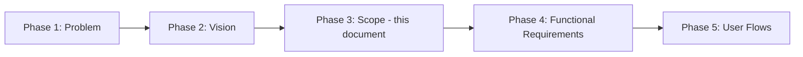
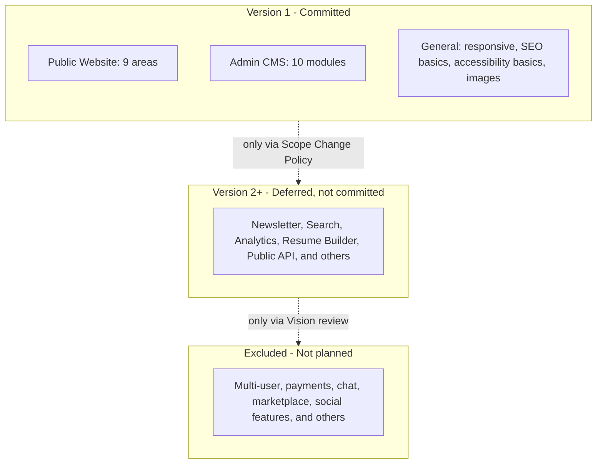
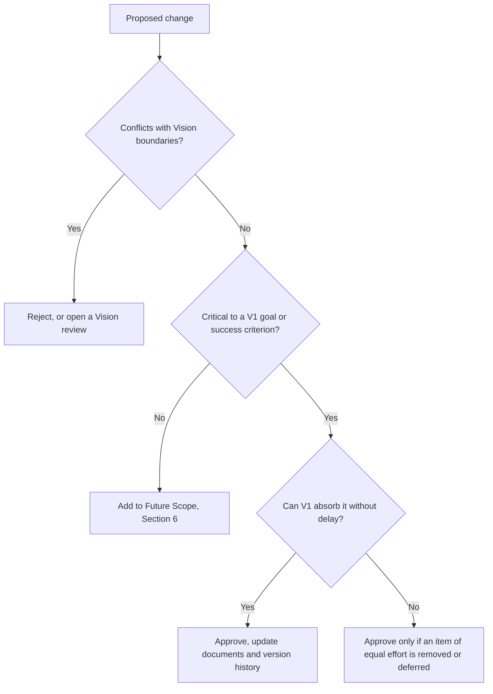

# Scope — Personal Portfolio Platform

## 1. Document Information

| Field             | Value                                                   |
| ----------------- | ------------------------------------------------------- |
| **Title**         | Scope — Personal Portfolio Platform                     |
| **Version**       | 1.0.0                                                   |
| **Status**        | Draft — Pending Review                                  |
| **Author**        | Muhammad Bux                                            |
| **Last Updated**  | 2026-10-19                                              |
| **Current Phase** | Phase 3 — Scope (Stage 1: Think)                        |
| **Depends On**    | `PROBLEM_STATEMENT.md` (Phase 1), `VISION.md` (Phase 2) |

---

## 2. Scope Overview

### 2.1 Why scope matters

Requirements describe how each capability should behave. Before that work begins, the project needs a firm answer to a prior question: which capabilities belong in the first release at all. Without that answer, requirements expand to fit every idea, and a solo project with limited time risks never reaching release.

### 2.2 Purpose of this document

This document defines the boundary of **Version 1**. It states:

- what Version 1 will include;
- what Version 1 will deliberately exclude, and why;
- which ideas are deferred to later versions;
- the constraints, assumptions, and dependencies that shape the boundary;
- how changes to the boundary will be handled.

It draws its direction from the problem in `PROBLEM_STATEMENT.md` and the objectives, principles, and product boundaries in `VISION.md`. It does not describe how anything will behave or be built.

---

## 3. Project Goals

Version 1 should achieve the following high-level goals. Each is traceable to the earlier phases.

| ID  | Goal                                                                                  | Traces To                                                               |
| --- | ------------------------------------------------------------------------------------- | ----------------------------------------------------------------------- |
| G-1 | Present a complete, credible professional profile that reviewers can evaluate quickly | Problem 4.3, 4.4; Vision O-1, O-2                                       |
| G-2 | Let the owner manage all public portfolio content without editing source code         | Problem 4.2, 4.5; Vision O-3, O-4                                       |
| G-3 | Provide visitors a way to contact the owner, and ensure no inquiry is lost            | Problem 4.7; Vision O-5                                                 |
| G-4 | Restrict owner-only functions to the owner                                            | Problem 4.6; Vision principle: security awareness                       |
| G-5 | Deliver a professional, consistent, usable experience across common devices           | Vision principles: professional over flashy, consistency, accessibility |
| G-6 | Provide a foundation that can grow without being rebuilt                              | Problem SC-8; Vision O-7                                                |
| G-7 | Leave a documented planning record as evidence of engineering practice                | Problem 4.6; Vision O-6                                                 |

---

## 4. In Scope (Version 1)

Items are listed by module. The table states **what** is included, not how it works or is built. Detailed behavior is defined in Phase 4.

### 4.1 Public Website

| Module             | Included in Version 1                                                           | Purpose                                  |
| ------------------ | ------------------------------------------------------------------------------- | ---------------------------------------- |
| **Home**           | Introductory presentation of the owner and entry points to the rest of the site | First impression and orientation         |
| **About**          | Professional background and personal summary                                    | Context on who the owner is              |
| **Skills**         | Presentation of the owner's skills                                              | Quick skills assessment                  |
| **Experience**     | Professional history                                                            | Evidence of work experience              |
| **Education**      | Academic history                                                                | Evidence of formal training              |
| **Certifications** | Professional certifications                                                     | Third-party validation                   |
| **Projects**       | Listing of projects with a detailed view of each                                | Primary evidence of ability              |
| **Blog**           | Published articles by the owner                                                 | Evidence of thinking and communication   |
| **Contact**        | A way for visitors to send a message to the owner                               | Conversion of interest into conversation |

### 4.2 Admin CMS

| Module                       | Included in Version 1                                                                  | Purpose                                                             |
| ---------------------------- | -------------------------------------------------------------------------------------- | ------------------------------------------------------------------- |
| **Authentication**           | Restricted access for the owner as the single administrator                            | Protect owner-only functions                                        |
| **Dashboard**                | Overview of the state of portfolio content and incoming messages                       | Orientation for the owner                                           |
| **Project Management**       | Create, view, update, and remove projects                                              | Keep project content current                                        |
| **Skills Management**        | Create, view, update, and remove skills                                                | Keep skills current                                                 |
| **Experience Management**    | Create, view, update, and remove experience entries                                    | Keep history current                                                |
| **Education Management**     | Create, view, update, and remove education entries                                     | Keep history current                                                |
| **Certification Management** | Create, view, update, and remove certifications                                        | Keep credentials current                                            |
| **Blog Management**          | Create, view, update, publish, and remove articles                                     | Maintain the writing record                                         |
| **Message Management**       | Review and manage messages received from visitors                                      | Ensure inquiries are not lost                                       |
| **Settings**                 | Management of site-wide and owner profile information that the public website displays | Keep Home, About, and general content editable without code changes |

### 4.3 General

| Area                             | Included in Version 1                                                     |
| -------------------------------- | ------------------------------------------------------------------------- |
| **Responsive design**            | Usable across common phone, tablet, and desktop screen sizes              |
| **SEO basics**                   | Fundamental search and sharing readiness for public pages                 |
| **Accessibility basics**         | Baseline accessibility practices for public and admin pages               |
| **Image management**             | Ability for the owner to add and replace images used in portfolio content |
| **Portfolio content management** | All public content categories above are manageable through the Admin CMS  |
| **Browser support**              | Current versions of modern browsers                                       |
| **Planning documentation**       | Phase documents maintained as part of the project                         |

### 4.4 Scope boundary at a glance

---

## 5. Out of Scope (Version 1)

The following are intentionally excluded. Reasons reference the problem and vision documents.

| Excluded Item                             | Reason                                                                                                                                                                                      |
| ----------------------------------------- | ------------------------------------------------------------------------------------------------------------------------------------------------------------------------------------------- |
| **Multi-user system**                     | The owner is the only author and administrator (Problem Assumptions; Vision Boundaries).                                                                                                    |
| **Team collaboration**                    | There is no team. Collaboration features serve no defined user.                                                                                                                             |
| **Payments**                              | No product or service is sold through the platform. The Vision rules out acting as a marketplace.                                                                                           |
| **Real-time chat**                        | Visitor contact is served by messages the owner reviews. Live chat adds an availability burden with little added value.                                                                     |
| **AI assistant**                          | Does not address a stated problem and risks distracting from clear, honest content.                                                                                                         |
| **Marketplace**                           | Explicitly excluded by Vision Product Boundaries.                                                                                                                                           |
| **Course or learning platform**           | Explicitly excluded by Vision Product Boundaries.                                                                                                                                           |
| **Public comments**                       | Would create moderation work and a new class of user who is not part of the defined audience. The blog exists for the owner's voice.                                                        |
| **Social network features**               | Explicitly excluded by Vision Product Boundaries.                                                                                                                                           |
| **Notifications**                         | Not needed to meet Version 1 goals. See Section 17 for the effect on message handling.                                                                                                      |
| **Mobile applications**                   | The responsive website serves mobile visitors. Separate apps would multiply the maintenance burden.                                                                                         |
| **Microservices**                         | An architectural choice with no demonstrated need at this scale. Architecture is decided in a later phase, and this exclusion records only that distributed complexity is not a scope goal. |
| **Multi-tenant capability**               | Contradicts the single-owner purpose.                                                                                                                                                       |
| **Visitor accounts or registration**      | Public content is viewable without registration (Problem Assumptions).                                                                                                                      |
| **Multi-language content**                | Content is primarily in English (Problem Assumptions). Deferred.                                                                                                                            |
| **Monetization of content**               | Not a goal of the product.                                                                                                                                                                  |
| **A general-purpose CMS for other users** | Excluded by Vision Product Boundaries.                                                                                                                                                      |

---

## 6. Future Scope (Version 2+)

These items are ideas, not commitments. Each draws on `VISION.md` Section 9 or related discussion and may be reconsidered through the policy in Section 14.

| Feature                        | Reason Deferred                                                                             | Business Value                                    |
| ------------------------------ | ------------------------------------------------------------------------------------------- | ------------------------------------------------- |
| **Newsletter**                 | Requires an audience and a publishing routine that do not yet exist                         | Sustains a relationship with interested readers   |
| **Testimonials**               | Depends on collecting third-party endorsements, which is a content effort outside Version 1 | Strengthens trust with clients and employers      |
| **Search**                     | Content volume at launch is small enough to browse                                          | Helps visitors find content as the platform grows |
| **Analytics**                  | Not required to prove the core outcomes; privacy handling needs separate consideration      | Shows how visitors engage and which content works |
| **Resume builder**             | Depends on stable, complete content first                                                   | One source of truth producing tailored résumés    |
| **Public API**                 | No external consumer exists yet                                                             | Allows profile data to be reused elsewhere        |
| **Multi-language support**     | Adds content and maintenance cost for a primarily English audience                          | Reaches additional audiences                      |
| **Theme customization**        | Visual flexibility is secondary to a consistent, professional look                          | Personalization without redesign                  |
| **Dark mode improvements**     | Refinement rather than core capability                                                      | Greater viewing comfort and polish                |
| **Advanced SEO**               | Basic SEO covers Version 1 needs                                                            | Increased discoverability                         |
| **Portfolio insights**         | Depends on analytics and sufficient visitor data                                            | Informed decisions about content                  |
| **Open-source showcase**       | Can initially be represented as projects                                                    | Presents public contributions in context          |
| **Awards and recognition**     | Can initially be presented within existing content areas                                    | Records external validation                       |
| **Speaking and events record** | Depends on the owner having such activity to present                                        | Presents community involvement                    |
| **Case-study library**         | Version 1 projects can carry detailed content; a dedicated library is an enhancement        | Deepens evidence of judgment                      |

---

## 7. Stakeholders

| Stakeholder                                           | Interest                                                          | Responsibility                                                                 |
| ----------------------------------------------------- | ----------------------------------------------------------------- | ------------------------------------------------------------------------------ |
| **Portfolio Owner (Admin)**                           | Accurate, current, credible portfolio; manageable upkeep          | Define and approve scope; author all content; deliver and maintain the project |
| **Hiring Engineer**                                   | Evidence of technical ability                                     | None in the project; their needs drive content priorities                      |
| **Tech Lead**                                         | Evidence of standards, reasoning, and communication               | None in the project; their needs drive content priorities                      |
| **Engineering Manager**                               | Signs of reliability, ownership, and growth                       | None in the project; their needs inform the overall impression                 |
| **Recruiter**                                         | Fast, consistent view of fit and a clear way to contact the owner | None in the project; their needs drive clarity and structure                   |
| **Freelance Client**                                  | Relevant work and a trustworthy way to reach out                  | None in the project; their needs drive presentation and contact                |
| **Reviewers of the planning record (peers, mentors)** | Quality of process and documentation                              | Optional feedback on documents and content quality                             |

The Portfolio Owner holds all decision authority for the project. Other stakeholders influence priorities but carry no project responsibilities.

---

## 8. Constraints

| Category                  | Constraint                                                                               |
| ------------------------- | ---------------------------------------------------------------------------------------- |
| **Team**                  | Solo developer responsible for planning, build, and maintenance                          |
| **Time**                  | Limited development time shared with job search and other commitments                    |
| **Purpose**               | Portfolio-focused; the project serves the owner's professional presentation              |
| **Educational objective** | The project must also teach and demonstrate real engineering practice                    |
| **Technology**            | MERN stack with TypeScript, as defined in the project brief                              |
| **Budget**                | Limited hosting and service budget; reliance on free or low-cost services where possible |
| **Browsers**              | Current versions of modern browsers                                                      |
| **Process**               | Phases are completed in order; no later phase starts before the earlier one is reviewed  |
| **Content**               | All content is authored by the owner and suitable for public viewing                     |

---

## 9. Assumptions

- The owner is the sole author and administrator.
- Visitors do not register or sign in to view public content.
- Public content is primarily in English.
- Hiring Engineers and Tech Leads remain the highest-priority audience when decisions conflict.
- The owner has enough project and professional material to populate every public area at launch.
- The owner can keep content current if updates are low effort.
- Version 1 will be released as a complete product rather than delivered module by module to the public.
- Version 1 volume (a modest number of projects, articles, and messages) does not require advanced content discovery.
- The listed external services remain available and affordable for the foreseeable future.
- The principles and product boundaries in `VISION.md` remain stable and apply to Version 1.

---

## 10. Dependencies

External dependencies are listed at a high level only.

| Dependency                 | Role at a High Level                                     | Status                                                                            |
| -------------------------- | -------------------------------------------------------- | --------------------------------------------------------------------------------- |
| **Cloudinary**             | Hosting and delivery of images used in content           | Planned                                                                           |
| **MongoDB Atlas**          | Hosted storage service for portfolio data                | Planned                                                                           |
| **Deployment platform**    | A place to make the application publicly available       | To be selected in a later phase                                                   |
| **Domain name**            | A public address for the portfolio                       | To be obtained                                                                    |
| **Email service**          | Possible need related to contact handling                | To be confirmed. Not required unless a later phase decides it is. See Section 17. |
| **Owner-authored content** | Text, images, and project material for every public area | Owner responsibility; a critical dependency                                       |

Of these, owner-authored content is the most likely to delay release. A complete platform with weak content would not meet the goals of this project.

---

## 11. Success Criteria for Version 1

Version 1 is complete when all of the following are true.

| ID    | Criterion                                                           | How It Is Judged                                                                                                            |
| ----- | ------------------------------------------------------------------- | --------------------------------------------------------------------------------------------------------------------------- |
| VS-1  | **All nine public areas exist and are populated** with real content | Manual review confirms each area has meaningful content                                                                     |
| VS-2  | **Content is manageable without editing source code**               | The owner can add, change, and remove content in every category through the Admin CMS, including Home and About information |
| VS-3  | **Only the owner can manage content**                               | Owner-only functions are inaccessible to unauthenticated visitors                                                           |
| VS-4  | **Recruiters can evaluate projects easily**                         | A first-time reviewer can identify the owner's focus and key projects in about two minutes (Problem SC-1; Vision M-1)       |
| VS-5  | **Each featured project communicates depth**                        | Featured projects state the problem, the owner's role, decisions, and outcome (Problem SC-2)                                |
| VS-6  | **Contact messages are retained and manageable**                    | Every message sent by a visitor is stored and reviewable by the owner (Problem SC-5)                                        |
| VS-7  | **The public site is responsive**                                   | Layout remains usable on common phone, tablet, and desktop sizes                                                            |
| VS-8  | **Accessibility and SEO basics are in place**                       | Public pages meet a defined baseline, to be set in Phase 4                                                                  |
| VS-9  | **Images can be added and replaced by the owner**                   | The owner can manage images through the Admin CMS                                                                           |
| VS-10 | **Planning documents are complete and consistent**                  | Phases 1 to 5 are reviewed and agree with one another (Problem SC-7)                                                        |
| VS-11 | **No excluded item has been built**                                 | Review confirms the release contains nothing from Sections 5 or 6                                                           |

---

## 12. Scope Boundaries

This document defines what Version 1 contains. It does **not** decide the following. Each belongs to a later phase.

| Not Decided Here                                               | Belongs To                        |
| -------------------------------------------------------------- | --------------------------------- |
| How each feature behaves in detail                             | Phase 4 — Functional Requirements |
| Non-functional targets, including accessibility and SEO levels | Phase 4 — Functional Requirements |
| User flows and journeys                                        | Phase 5 — User Flows              |
| Database schema                                                | Later design phase                |
| API contracts                                                  | Later design phase                |
| System architecture                                            | Later design phase                |
| UI design and wireframes                                       | Later design phase                |
| Authentication design                                          | Later design phase                |
| Folder and code structure                                      | Later design phase                |
| Implementation strategy                                        | Later design and delivery phases  |
| Testing strategy                                               | Later delivery phase              |
| Deployment plan                                                | Later delivery phase              |
| Sprint planning and tasks                                      | Later planning                    |

---

## 13. Risks Related to Scope

| ID   | Risk                                                                                       | Impact                                                        | Mitigation                                                                                                                   |
| ---- | ------------------------------------------------------------------------------------------ | ------------------------------------------------------------- | ---------------------------------------------------------------------------------------------------------------------------- |
| SR-1 | **Scope creep.** New ideas enter Version 1 informally.                                     | Delays release; unfinished or inconsistent product            | Apply the Scope Change Policy to every proposal; keep Section 6 as the home for deferred ideas                               |
| SR-2 | **Overengineering.** Capabilities are built beyond what Version 1 needs.                   | Slower delivery and higher maintenance cost                   | Judge each item against Section 3 goals; prefer the simpler option that meets the need                                       |
| SR-3 | **Adding unnecessary features.** Items drift in because they are enjoyable or fashionable. | Dilutes focus; contradicts the Vision principle of simplicity | Require a stated link to a goal and a stakeholder need                                                                       |
| SR-4 | **Delayed completion.** Version 1 is too large for the available time.                     | The portfolio is unavailable when it is needed                | Keep the committed list fixed; if time runs short, cut by the priority rule in Section 14 rather than extending the deadline |
| SR-5 | **Documentation drift.** Scope and later documents diverge.                                | Loss of credibility and confusion during build                | Update documents together when scope changes; note changes in version history                                                |
| SR-6 | **Content shortfall.** Modules exist but lack quality content.                             | Technically complete but unconvincing product                 | Treat content as a release dependency; set content standards before build                                                    |
| SR-7 | **Underestimated CMS breadth.** Ten admin modules are larger than they appear.             | Time pressure forces uneven quality                           | Keep each module's depth modest in Phase 4; consistency over richness                                                        |
| SR-8 | **Ambiguous inclusions.** A listed item is read more broadly than intended.                | Hidden scope growth                                           | Phase 4 must define each item's depth explicitly, and anything beyond it needs a scope change                                |
| SR-9 | **Dependency changes.** A listed external service changes terms or availability.           | Disruption to a committed capability                          | Keep dependency choices reviewable; record any change as a scope change                                                      |

---

## 14. Scope Change Policy

### 14.1 Principles

- Version 1 scope is fixed once this document is approved. Changes are exceptions and not routine.
- Every proposed change is evaluated against the Phase 1 problem, the Phase 2 vision, and the Version 1 goals.
- Nice-to-have items are moved to Version 2+ unless they are critical to a goal or to a success criterion.
- A scope change must not delay Version 1. If something is added, something of comparable effort is removed or deferred.
- Anything that conflicts with the Vision Product Boundaries requires a Vision review first, not a scope change.

### 14.2 Evaluation questions

1. Which goal or success criterion does this serve?
2. Which stakeholder benefits, and how does that stakeholder rank in the audience priority order?
3. What happens if it is deferred?
4. What is the effort relative to the remaining time?
5. What would be removed or deferred to make room?

### 14.3 Decision flow

### 14.4 Priority rule if time runs short

If Version 1 cannot be completed in the available time, content areas and modules are reduced in depth before any are removed, in this order of protection:

1. Projects, Experience, Skills, and Contact on the public site, and the content management needed to maintain them
2. Owner access protection and message management
3. Home, About, Education, and Certifications
4. Blog

Any such reduction is recorded as a scope change under this policy.

### 14.5 Record keeping

Each approved change is recorded with its date, reason, and the documents affected. This document's version number is updated accordingly.

---

## 15. Conclusion

A clear scope converts the vision into a deliverable. The problem and vision describe why the platform matters and where it is going; scope states what the first release must contain and what it will not. For a solo project with limited time, that distinction determines whether the project is finished.

Version 1 is defined as a complete public website for nine content areas, an owner-only management system for those areas and for incoming messages, and a baseline of responsiveness, accessibility, search readiness, and image handling. Everything else is either deferred with reasons or explicitly excluded.

This document prepares the project for **Phase 4 — Functional Requirements**. That phase will describe precisely what each included module must do, within the limits set here, and will not add modules that are not listed. If requirements work reveals a gap, the change policy in Section 14 applies.

---

## 16. Alignment with Previous Phases

This section records how this document relates to the earlier documents, as required to avoid silent changes. No earlier decision has been altered. The following points are clarifications.

| #   | Observation                                                                                                                                                                                                             | Earlier Reference                            | Treatment in This Document                                                                                                                                                                                                                                   |
| --- | ----------------------------------------------------------------------------------------------------------------------------------------------------------------------------------------------------------------------- | -------------------------------------------- | ------------------------------------------------------------------------------------------------------------------------------------------------------------------------------------------------------------------------------------------------------------ |
| A-1 | The Vision lists Search, Analytics, Newsletter, Résumé generator, Public API, Multi-language, Testimonials, Awards, Open-source showcase, and Dark mode improvements as ideas not committed to Version 1.               | `VISION.md` Section 9                        | Retained as Future Scope with reasons (Section 6).                                                                                                                                                                                                           |
| A-2 | The Vision's Product Boundaries exclude social networks, learning platforms, marketplaces, and general-purpose CMS use.                                                                                                 | `VISION.md` Section 10                       | Carried into Out of Scope (Section 5).                                                                                                                                                                                                                       |
| A-3 | The Vision includes technical writing as part of the platform's long-term direction, while its Product Boundaries state the product is not a competitor to blogging platforms.                                          | `VISION.md` Sections 7.3 and 10              | Not a conflict. The Blog is in scope as the owner's own writing. Comments and audience-building features stay out of scope.                                                                                                                                  |
| A-4 | The Problem Statement's criterion SC-3 requires every category of public content to be manageable without code changes. The Home and About areas are not listed with their own management module in the project brief.  | `PROBLEM_STATEMENT.md` SC-3                  | Resolved by making **Settings** responsible for site-wide and owner profile content shown on Home and About (Section 4.2). Phase 4 will define the exact content covered.                                                                                    |
| A-5 | The project brief excludes **Notifications**, while the dependency list includes an **Email service**, and the Problem Statement and Vision require that no inquiry be lost and that the owner respond in a timely way. | `PROBLEM_STATEMENT.md` SC-5; `VISION.md` M-5 | Not a conflict, but a tension. Version 1 guarantees that messages are **retained and reviewable** in the Admin CMS. Proactive alerts are excluded. The email service is listed as a dependency to be confirmed. See Section 17 for the decision this raises. |
| A-6 | The Problem Statement requires that owner-only functions be protected (SC-6) but does not name an authentication module.                                                                                                | `PROBLEM_STATEMENT.md` SC-6                  | Consistent. Authentication is listed as an Admin CMS module in scope. Only the need for protected access is stated, and design is deferred.                                                                                                                  |
| A-7 | The Problem Statement's constraints list the MERN stack. Section 5 mentions microservices as excluded.                                                                                                                  | `PROBLEM_STATEMENT.md` Section 15            | Consistent. The exclusion records only that distributed complexity is not a goal, and makes no architecture decision.                                                                                                                                        |

---

## 17. Open Decisions for the Owner

| #   | Decision Needed                                                          | Why It Matters                                                                                                          | Default if Not Decided                                                                           |
| --- | ------------------------------------------------------------------------ | ----------------------------------------------------------------------------------------------------------------------- | ------------------------------------------------------------------------------------------------ |
| D-1 | Should Version 1 send the owner an email when a message arrives?         | Prevents missed inquiries but conflicts with the exclusion of notifications and introduces the email service dependency | No. Version 1 retains messages for review in the Admin CMS only, and the owner checks regularly. |
| D-2 | Should Home and About content be managed in Settings, as assumed in A-4? | Ensures SC-3 can be met                                                                                                 | Yes                                                                                              |

These are to be settled before Phase 4 begins.
