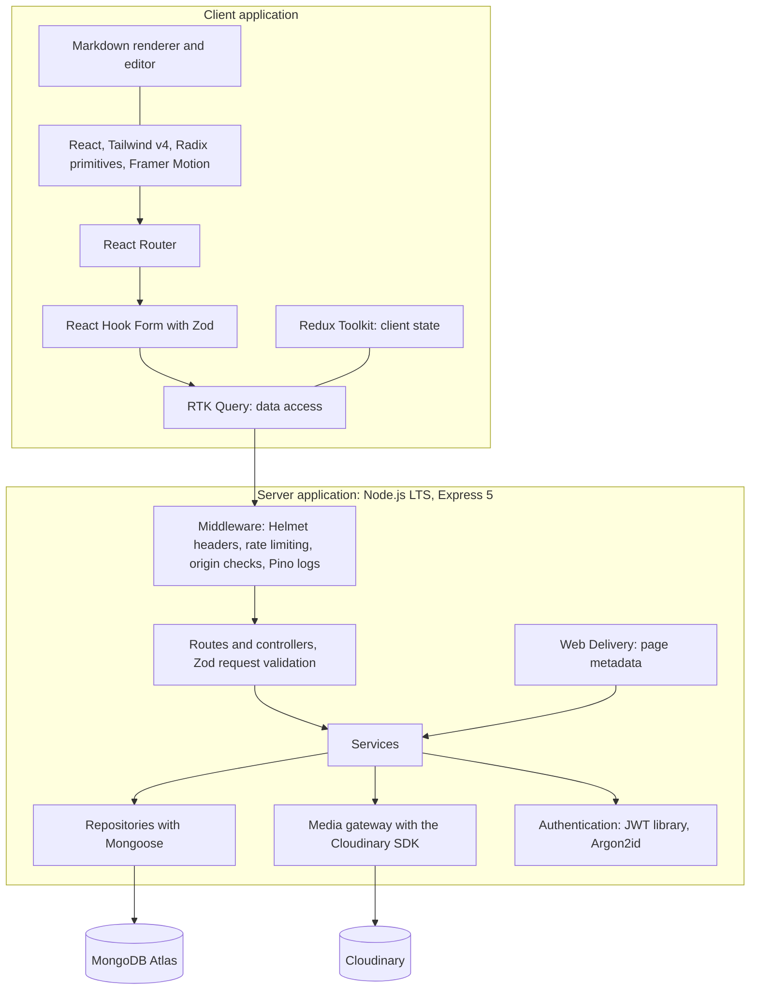

# Technical Decisions — Personal Portfolio Platform

## 1. Document Information

| Field | Value |
| --- | --- |
| **Title** | Technical Decisions — Personal Portfolio Platform |
| **Version** | 1.0.0 |
| **Status** | Draft — Pending Review |
| **Author** | Muhammad Bux |
| **Last Updated** | 2026-10-26 |
| **Current Phase** | Stage 2 — Design: Technical Decisions (final document of Stage 2) |
| **Depends On** | `PROBLEM_STATEMENT.md`, `VISION.md`, `SCOPE.md`, `FUNCTIONAL_REQUIREMENTS.md`, `USER_FLOWS.md`, `DATABASE_DESIGN.md`, `API_DESIGN.md`, `ARCHITECTURE_DESIGN.md` |

---

## 2. Introduction

### 2.1 Purpose

This document is the engineering decision log for Version 1. It records each significant technical choice, the situation that required it, the alternatives weighed, the option selected, and what that choice costs. It also settles the items that earlier documents explicitly deferred to this phase.

### 2.2 Why documenting decisions matters

- A choice without a recorded reason is easy to reverse by accident, and hard to defend when questioned.
- A solo developer has no teammate to ask later why something was done. The log is that teammate.
- Recording rejected alternatives prevents the same options from being re-argued without new information.
- For this project, the decision log is itself portfolio evidence of how technical judgment is exercised.

### 2.3 Relationship with previous documents

| Document | Relationship |
| --- | --- |
| `SCOPE.md` | Constraints (solo developer, limited time and budget, MERN, modern browsers) shape every decision |
| `FUNCTIONAL_REQUIREMENTS.md`, `USER_FLOWS.md` | Decisions must make required behavior achievable (validation, session, accessibility, SEO) |
| `DATABASE_DESIGN.md` | Decisions implement the data rules without changing them |
| `API_DESIGN.md` | The contract is fixed. Decisions here fill its open items (OI-1, OI-4) and, where needed, propose updates |
| `ARCHITECTURE_DESIGN.md` | Decisions realize the architecture decisions (ADR-01 to ADR-24) with specific tools and values |

The technology stack in the project brief is approved and is not reopened. Decisions TD-001 to TD-022 record *why* each approved technology fits this project, what it costs, and how it is to be used. Decisions TD-023 onward choose tools and values the approved stack leaves open.

### 2.3.1 Where earlier documents disagreed or deferred

`ARCHITECTURE_DESIGN.md` placed some items in "Technical Decisions" in one section and in "Delivery phase" in another (hosting, folder layout, testing tools). Section 14 explains how each was handled. In short: this document records requirements, principles, and values, and leaves vendor choice, concrete file layout, test tooling, and scripts to the Delivery and implementation phases.

### 2.4 A note on library choices and versions

This document names libraries where a choice is needed. These reflect the ecosystem as understood at the time of writing. Library names, maintenance status, and current major versions **must be verified before adoption** at the start of implementation. A choice here is a decision about the *kind* of tool and the *reasons* for it. If a named library has become unmaintained or has been superseded, the listed alternative or a successor is substituted, and this document is updated. No version numbers are fixed here. Versions are pinned at installation by lockfiles (TD-038).

### 2.5 Decision status values

| Status | Meaning |
| --- | --- |
| **Accepted** | Decided and binding for Version 1 |
| **Accepted, owner to confirm** | Decided as the default. Needs the owner's explicit confirmation (Section 14) |
| **Deferred** | Intentionally left to a later phase, with the reason stated |

---

## 3. Decision-Making Principles

| # | Principle | How It Is Applied |
| --- | --- | --- |
| DP-1 | **Maintainability over trends** | Choose tools a solo developer can keep working for years, not whatever is newest |
| DP-2 | **Simplicity over unnecessary complexity** | Prefer the smaller solution. Every added dependency or moving part needs a requirement behind it |
| DP-3 | **Production readiness** | A tool must be dependable in production: documented, stable, with predictable failure behavior |
| DP-4 | **Long-term support** | Prefer actively maintained projects with a clear upgrade path. Verify before adopting |
| DP-5 | **Community maturity** | Prefer widely used tools: problems are already solved and documented |
| DP-6 | **Developer productivity** | The solo developer's time is the scarcest resource. Prefer tools that remove work |
| DP-7 | **Learning value** | The project is also a learning vehicle (`SCOPE.md` Section 8). Learning value breaks ties but never overrides the above |
| DP-8 | **Security by default** | Prefer the option that is safe without extra effort |
| DP-9 | **Approved stack first** | Work within the approved stack. Change it only for a critical architectural reason, which has not occurred (Section 10.3) |
| DP-10 | **Fewer dependencies** | Do not add a package for trivial functionality. Each dependency is supply-chain exposure |
| DP-11 | **Reversible where possible** | Isolate choices behind boundaries (repositories, gateways, the data-access layer) so they can be replaced |
| DP-12 | **Respect approved documents** | A decision must not contradict an approved document. If one seems to, the conflict is explained and the earlier document is updated first |
| DP-13 | **Evidence over preference** | Reasons must relate to this project's requirements, not general taste |

---

## 4. Major Technical Decisions

### 4.1 Decision index

| ID | Decision | Status |
| --- | --- | --- |
| TD-001 | Single Git repository | Accepted |
| TD-002 | React | Accepted |
| TD-003 | TypeScript | Accepted |
| TD-004 | Vite | Accepted |
| TD-005 | Tailwind CSS v4 | Accepted |
| TD-006 | Redux Toolkit | Accepted |
| TD-007 | RTK Query | Accepted |
| TD-008 | React Hook Form | Accepted |
| TD-009 | Zod, on both client and server | Accepted |
| TD-010 | Framer Motion | Accepted |
| TD-011 | Node.js | Accepted |
| TD-012 | Express.js | Accepted |
| TD-013 | MongoDB | Accepted |
| TD-014 | Mongoose | Accepted |
| TD-015 | JWT authentication | Accepted |
| TD-016 | Refresh tokens with httpOnly cookies, and session lifetimes | Accepted, owner to confirm lifetimes |
| TD-017 | Cloudinary | Accepted |
| TD-018 | REST API | Accepted |
| TD-019 | Layered architecture | Accepted |
| TD-020 | Feature-based frontend organization | Accepted |
| TD-021 | Custom Admin CMS | Accepted |
| TD-022 | Production documentation approach | Accepted |
| TD-023 | Article content format: restricted Markdown | Accepted |
| TD-024 | Client routing: React Router | Accepted |
| TD-025 | Accessible UI primitives | Accepted |
| TD-026 | Password hashing: Argon2id | Accepted |
| TD-027 | Rate limiting: tool and values | Accepted, owner to confirm values |
| TD-028 | Logging: structured logs and retention | Accepted |
| TD-029 | Security headers, content security policy, and cross-origin stance | Accepted |
| TD-030 | Cross-site request protection details | Accepted |
| TD-031 | Image upload handling and processing policy | Accepted |
| TD-032 | Media organization and cleanup | Accepted, owner to confirm |
| TD-033 | Database indexes and uniqueness enforcement | Accepted |
| TD-034 | Fixed identifiers for single-record entities, and the operations tool | Accepted, owner to confirm |
| TD-035 | Public address generation | Accepted |
| TD-036 | Web Delivery: page metadata, not-found statuses, crawler rules | Accepted, sitemap owner to confirm |
| TD-037 | HTTP caching policy | Accepted |
| TD-038 | Package manager and dependency policy | Accepted |
| TD-039 | Code quality tooling | Accepted |
| TD-040 | Hosting requirements and platform class | Accepted. Vendor deferred |
| TD-041 | Backup and data protection requirements | Accepted. Procedure deferred |
| TD-042 | Monitoring and alerting | Accepted |
| TD-043 | Date and time conventions | Accepted |
| TD-044 | Fonts and static assets | Accepted |
| TD-045 | Browser support policy | Accepted |
| TD-046 | Configuration management | Accepted |
| TD-047 | Process lifecycle and graceful shutdown | Accepted |
| TD-048 | Testing tools | Accepted |
| TD-049 | Project layout, module template, aliases, and boundary rules | Accepted |

---

### 4.2 Foundation decisions (approved stack and structure)

#### TD-001 — Single Git repository

| Field | Detail |
| --- | --- |
| **Decision** | Keep all code and planning documents in one repository, with `client/` and `server/` as independent code areas |
| **Context** | One developer. Two applications that change together whenever the API contract changes. Documents are versioned alongside code |
| **Alternatives Considered** | (a) Separate repositories for client and server. (b) One repository with workspace tooling and shared packages. (c) Separate repositories plus a shared types package |
| **Selected Option** | One repository, two independent areas, no workspace tooling |
| **Reason for Selection** | A contract change and its code on both sides land in one commit, which keeps history coherent. There is one place to look, which suits a solo developer and a portfolio reviewer. Workspace tooling is justified only by shared code, which ADR-21 deliberately avoids |
| **Why Alternatives Were Rejected** | (a) Every contract change becomes two coordinated changes in two places. (b) Adds tooling for a benefit the project does not use. (c) Adds a third repository and a publishing workflow for a small amount of shared code |
| **Trade-offs** | No tooling-enforced boundary between areas, so discipline is required. Lockfiles and tool configuration exist twice. The history mixes client and server changes |
| **Long-Term Impact** | The areas are independent enough to split later. If shared code is ever needed, a third area can be added without moving the existing two |

#### TD-002 — React

| Field | Detail |
| --- | --- |
| **Decision** | Build the client as a React single-page application, using the current stable major version |
| **Context** | The client has a public area and an admin area, interactive forms, and a Markdown editor. Search visibility is required (FR-SEO) but content changes only through the owner |
| **Alternatives Considered** | Next.js (a React framework with server rendering), Vue, SvelteKit, Angular, Solid |
| **Selected Option** | React as a single-page application. Page metadata for search and sharing is supplied by Web Delivery (TD-036) |
| **Reason for Selection** | It is the approved stack. It has the largest ecosystem and the widest recognition among the target audience (hiring engineers). Mature accessibility primitives and form libraries exist. Current React supports page titles and metadata natively, which removes a dependency |
| **Why Alternatives Were Rejected** | Next.js would solve search visibility with server rendering, but it would pull routing, rendering, and part of the backend into the framework, overlapping with the approved Express API and the one-origin design (ADR-03, ADR-14). The SEO need is met within the approved stack, so the "critical architectural reason" test is not met (Section 10.3). The other frameworks would depart from the approved stack with no requirement driving it |
| **Trade-offs** | Page content is rendered in the browser, which some crawlers handle less well than metadata. React leaves many choices open (routing, state), which this document therefore has to make |
| **Long-Term Impact** | If search results show a real indexing problem, server rendering can be added at the Web Delivery boundary (Section 9) without replacing React |

#### TD-003 — TypeScript

| Field | Detail |
| --- | --- |
| **Decision** | Use TypeScript in strict mode on both client and server |
| **Context** | A written API contract with 70 endpoints and fixed field names. A solo developer who must be able to refactor safely |
| **Alternatives Considered** | JavaScript with JSDoc types. Plain JavaScript |
| **Selected Option** | TypeScript, strict, with no implicit untyped values |
| **Reason for Selection** | Mismatches with the contract show up when writing code, not in use. Refactoring is safer. It documents intent. It is part of the approved stack and a recognized professional signal |
| **Why Alternatives Were Rejected** | JSDoc typing is weaker and less commonly supported by tools. Plain JavaScript gives up the main protection against contract drift |
| **Trade-offs** | A build step. Types must be written on both sides, because no code is shared (ADR-21). Types vanish at runtime, so runtime validation is still required (TD-009) |
| **Long-Term Impact** | Strong refactoring support as the project grows. Types become the first line of contract conformance |

#### TD-004 — Vite

| Field | Detail |
| --- | --- |
| **Decision** | Use Vite as the client build tool and development server |
| **Context** | A single-page application whose built files are served by the Express server (ADR-03). Developers need fast feedback and one origin in development |
| **Alternatives Considered** | Create React App, custom Webpack, Parcel, a framework toolchain (Next.js), Rsbuild |
| **Selected Option** | Vite |
| **Reason for Selection** | It is the approved stack, and the current standard for React single-page applications. It is fast in development and produces fingerprinted, split bundles in production (needed by TD-037 and Section 17 of the architecture). Its development proxy keeps one origin in development, matching production |
| **Why Alternatives Were Rejected** | Create React App is no longer maintained. A hand-built Webpack setup costs more time for no gain here. Parcel and Rsbuild have smaller ecosystems. A framework toolchain is rejected with TD-002 |
| **Trade-offs** | Development and production builds differ slightly, so production-like checks are needed before release. Plugin compatibility must be checked on major upgrades |
| **Long-Term Impact** | Source code uses standard modules, so changing build tools later is low cost |

#### TD-005 — Tailwind CSS v4

| Field | Detail |
| --- | --- |
| **Decision** | Use Tailwind CSS v4 for styling, with all colors, type, and spacing defined as shared design tokens |
| **Context** | Consistency across public and admin areas (BR-015), a strict content security policy, accessibility requirements, and a single developer who needs to style quickly |
| **Alternatives Considered** | Bootstrap, CSS Modules, runtime CSS-in-JS (styled-components, Emotion), build-time CSS-in-JS, Sass |
| **Selected Option** | Tailwind v4, configured through design tokens. Reusable components wrap repeated utility combinations |
| **Reason for Selection** | It is the approved stack. Utilities plus tokens keep the visual language consistent and the generated CSS small. There is no styling runtime, which suits the content security policy (TD-029) and performance. Tokens centralize the look, leaving room for later theme work |
| **Why Alternatives Were Rejected** | Bootstrap imposes a recognizable look, which conflicts with the aim of distinct, professional presentation. CSS Modules lack a shared token system by default. Runtime CSS-in-JS adds runtime cost and complicates the content security policy. Sass offers no token or utility system |
| **Trade-offs** | Verbose markup. Requires recent browsers, in line with the constraint "current versions of modern browsers" (TD-045). Without discipline, ad hoc values undermine consistency, so values come from tokens and repeated patterns become components |
| **Long-Term Impact** | Dark mode and theme work, both deferred, become token changes rather than rewrites |

#### TD-006 — Redux Toolkit

| Field | Detail |
| --- | --- |
| **Decision** | Use Redux Toolkit for client-only state: session status, notifications, the pending edit snapshot, and the unsaved-changes flag |
| **Context** | RTK Query (TD-007) requires a store. Client-only state is small and well defined (`ARCHITECTURE_DESIGN.md` Section 6.4) |
| **Alternatives Considered** | React Context with reducers, Zustand, Jotai, no global state |
| **Selected Option** | Redux Toolkit, with a strict rule that server data is never copied into it |
| **Reason for Selection** | The store already exists for RTK Query, so a second state library would add a dependency for no gain. Its conventions are consistent and well understood, and its developer tools help debugging |
| **Why Alternatives Were Rejected** | Context re-renders broadly and would need its own conventions. Zustand and Jotai would add a second state system next to the store that RTK Query requires |
| **Trade-offs** | More ceremony than lighter libraries for very little state. The risk of misuse as a data cache is controlled by the rule above |
| **Long-Term Impact** | If client-only state stays this small, the store's role stays small. Growth in client state would be reviewed against the rule |

#### TD-007 — RTK Query

| Field | Detail |
| --- | --- |
| **Decision** | Use RTK Query as the single mechanism for all API access and server-state caching |
| **Context** | The client reads and changes data through 70 endpoints. Writes must refresh related reads. Public reads must not be served stale across page loads (BR-006). Session renewal must happen once, even when several requests fail together |
| **Alternatives Considered** | TanStack Query, SWR, hand-written fetching with hooks |
| **Selected Option** | RTK Query, with a wrapper around the base request layer for session renewal and error normalization |
| **Reason for Selection** | It is the approved stack and integrates with the store. Tag-based invalidation matches the architecture's rule that each write declares what it makes stale. Typed endpoint definitions keep the contract visible in one place |
| **Why Alternatives Were Rejected** | TanStack Query and SWR are capable, but add a second data library beside an existing store. Hand-written fetching rebuilds caching and invalidation by hand |
| **Trade-offs** | Tied to Redux. Slightly steeper to learn than lighter libraries. Cache lifetimes need explicit configuration so public data revalidates on page entry |
| **Long-Term Impact** | All API knowledge sits in the data-access layer, so contract changes touch one place |

#### TD-008 — React Hook Form

| Field | Detail |
| --- | --- |
| **Decision** | Use React Hook Form for every form |
| **Context** | About 20 forms, including long ones (project, article). Server errors arrive keyed by field path and must appear next to fields (FR-ERR-005). Forms must warn on unsaved changes |
| **Alternatives Considered** | Formik, React Final Form, TanStack Form, hand-managed form state |
| **Selected Option** | React Hook Form with Zod-based input rules |
| **Reason for Selection** | It is the approved stack. Uncontrolled inputs keep large forms fast. It supports setting errors on fields from server responses, tracking unsaved changes, and integrating with Zod |
| **Why Alternatives Were Rejected** | Formik is less actively developed and re-renders more. Hand-managed state repeats validation and error plumbing in every form |
| **Trade-offs** | The uncontrolled model takes learning. Custom inputs, such as the Markdown editor, need a controlled wrapper |
| **Long-Term Impact** | Forms follow one pattern, which keeps new forms cheap |

#### TD-009 — Zod, on both client and server

| Field | Detail |
| --- | --- |
| **Decision** | Use Zod for input rules on the client and for request and configuration validation on the server |
| **Context** | The technology context lists Zod for the client only. The server needs a validation approach, and ADR-21 rules out shared code. FR-VAL-016 requires the same checks however a request is sent |
| **Alternatives Considered** | Server: Joi, Yup, Valibot, class-validator, express-validator. Client: Yup, Valibot |
| **Selected Option** | Zod on both sides, with each side writing its own schemas from the contract. Server schemas reject unknown fields. Configuration is validated with Zod at startup (TD-046) |
| **Reason for Selection** | One library and one mental model across both sides. TypeScript types come from the schemas, so types and rules do not drift within a side. It supports the strict "unknown and read-only fields are rejected" rule |
| **Why Alternatives Were Rejected** | Joi and express-validator are server-only, adding a second library and a second way of working. class-validator relies on decorators and classes, which does not fit this design. Yup has weaker type inference |
| **Trade-offs** | Schemas still exist twice (ADR-21). Zod's errors must be translated into the API's detail codes (`REQUIRED`, `TOO_LONG`, and so on). Client bundle includes the library |
| **Long-Term Impact** | If drift between sides becomes a problem, the same library makes a later shared area easy (Section 9) |

#### TD-010 — Framer Motion

| Field | Detail |
| --- | --- |
| **Decision** | Use Framer Motion for a small, defined set of animations, applied through one wrapper |
| **Context** | The Vision principle "professional over flashy". The requirement that animation never be needed to understand content and that reduced motion is respected (FR-A11Y-008) |
| **Alternatives Considered** | CSS transitions only, React Spring, GSAP, Auto Animate |
| **Selected Option** | Framer Motion, limited to page and section transitions, list reveals, and dialog transitions, with a global setting that follows the visitor's reduced-motion preference |
| **Reason for Selection** | It is the approved stack. It handles exit animations and layout changes that CSS cannot do simply. A global reduced-motion setting delivers FR-A11Y-008 in one place |
| **Why Alternatives Were Rejected** | CSS alone cannot animate elements leaving the page cleanly. React Spring and GSAP add weight and a different model for no added need |
| **Trade-offs** | Added bundle weight. The temptation to over-animate, controlled by the defined pattern set and review against the Vision. The package is now distributed under the name Motion, so the installed name must be checked |
| **Long-Term Impact** | Animation stays easy to reduce or replace, because it is applied through one wrapper |

#### TD-011 — Node.js

| Field | Detail |
| --- | --- |
| **Decision** | Run the server on Node.js, using the current Active LTS line, pinned by a version file, and moved forward when that line leaves active support |
| **Context** | A TypeScript backend, a JavaScript runtime shared with the client toolchain, and hosting on a managed platform |
| **Alternatives Considered** | Deno, Bun, a different language and runtime |
| **Selected Option** | Node.js LTS |
| **Reason for Selection** | It is the approved stack, the most widely supported runtime, and available on every candidate hosting platform. LTS gives a predictable support window |
| **Why Alternatives Were Rejected** | Deno and Bun are viable, but have less hosting and library coverage, and gain nothing measurable here. A different language would split the project across two ecosystems |
| **Trade-offs** | LTS lines require periodic upgrades. Native packages, such as password hashing (TD-026), must build on the hosting platform |
| **Long-Term Impact** | A routine upgrade every year or two. The runtime is rarely the limiting factor at this scale |

#### TD-012 — Express.js

| Field | Detail |
| --- | --- |
| **Decision** | Use Express, on its current major version (5), as the HTTP framework |
| **Context** | A fixed middleware pipeline (`ARCHITECTURE_DESIGN.md` Section 7.3), thin controllers, and a central error handler |
| **Alternatives Considered** | Fastify, Koa, NestJS, Hono |
| **Selected Option** | Express 5 |
| **Reason for Selection** | It is the approved stack and the most familiar. Its pipeline model matches the architecture directly. Version 5 passes errors from asynchronous handlers to the error handler automatically, which makes the central error handling (ADR-19) simple and reliable |
| **Why Alternatives Were Rejected** | Fastify is faster, but performance is not a constraint at this scale, and its plugin model would add a learning cost. NestJS brings its own structure and dependency injection, which would duplicate this project's explicit layers. Koa and Hono have smaller middleware ecosystems for the items needed here |
| **Trade-offs** | Express is unopinionated, so structure depends on discipline and the architecture document. Version 5 is newer, so each middleware must be checked for compatibility |
| **Long-Term Impact** | Controllers are thin and contain no rules, so replacing the framework later would be contained to the edge |

#### TD-013 — MongoDB

| Field | Detail |
| --- | --- |
| **Decision** | Store all data in MongoDB, hosted on Atlas |
| **Context** | Nine self-contained entities with embedded structures and no cross-record references (`DATABASE_DESIGN.md`). Small volume. One owner |
| **Alternatives Considered** | PostgreSQL, SQLite, content as files in the repository, a managed key-value store |
| **Selected Option** | MongoDB on Atlas |
| **Reason for Selection** | It is the approved stack. The document model matches the design, in which records stand alone and contain their own lists. Content shapes can evolve without migrations. Atlas removes database operations from a solo developer |
| **Why Alternatives Were Rejected** | PostgreSQL would also work well, but its strengths (joins, foreign keys, reporting) are not needed while records do not reference one another. Changing is not justified by a critical reason. SQLite is hard to operate on managed hosting and with one server instance. Files in the repository cannot support a CMS |
| **Trade-offs** | No referential integrity from the database, which is acceptable because the design has no references. Multi-record transactions are not used (ADR-24). Case-insensitive uniqueness needs a specific index setting (TD-033). Backup quality depends on the chosen tier (TD-041) |
| **Long-Term Impact** | If relational needs appear (multiple authors, reporting), the repository layer limits the cost of change, though a data migration would still be significant |

#### TD-014 — Mongoose

| Field | Detail |
| --- | --- |
| **Decision** | Use Mongoose in the model layer only, inside repositories, in strict mode, with plain-object reads for query results |
| **Context** | The data layer must enforce the entity rules at the data level (`DATABASE_DESIGN.md` Section 8, `ARCHITECTURE_DESIGN.md` Section 7.5) |
| **Alternatives Considered** | The native MongoDB driver, Prisma, Typegoose |
| **Selected Option** | Mongoose, with schemas matching `DATABASE_DESIGN.md`, automatic created and updated times, and the internal version marker never exposed |
| **Reason for Selection** | It is the approved stack. Schema-level required fields, limits, and allowed values are the "data level" of the three-level validation model. Its TypeScript support is mature |
| **Why Alternatives Were Rejected** | The native driver would move all rules into hand-written code. Prisma's MongoDB support adds a generation step and constraints for no clear gain. Typegoose adds decorators and a layer over Mongoose |
| **Trade-offs** | An abstraction with magic (hooks, defaults) that must be used sparingly. Some type-safety gaps. Major upgrades can be disruptive. Business rules are kept out of schema hooks so they stay in services |
| **Long-Term Impact** | Repositories contain the blast radius. A change of library would affect only the data layer |

#### TD-015 — JWT authentication

| Field | Detail |
| --- | --- |
| **Decision** | Use signed JSON Web Tokens as the access credential and the renewal credential. Sign with a symmetric algorithm, with a separate secret for each credential type, and fix the permitted algorithm explicitly. Include only the admin identifier, issue time, expiry, and, for the renewal credential, the session start time. Check each credential's issue time against the User's `sessionsValidFrom` |
| **Context** | The approved stack uses JWT. There is one Admin. The server both issues and verifies credentials. `DATABASE_DESIGN.md` provides `sessionsValidFrom`, and no session entity (P-4) |
| **Alternatives Considered** | Server-side sessions with a session store. Opaque tokens. An external identity provider. Passkeys only |
| **Selected Option** | JWTs as described, using a maintained standards-based library such as `jose`, verified at implementation start |
| **Reason for Selection** | It is the approved choice. It needs no session store or new entity. Each request needs only one small lookup (the User record) to honor `sessionsValidFrom`. One trusted party issues and verifies, so a symmetric key is sufficient and simpler than a key pair |
| **Why Alternatives Were Rejected** | Server-side sessions allow per-session revocation, but need a session store and entity, which the data design deliberately avoids, and the approved stack is JWT. An external identity provider adds a third-party dependency, cost, and a new entry in the dependency list for a single user. Passkeys are not in the approved requirements |
| **Trade-offs** | Revocation is all-or-nothing through `sessionsValidFrom`, so sign-out ends all devices (A-14 in `ARCHITECTURE_DESIGN.md`). The signing secrets are critical and must be protected, kept distinct, and replaceable. JWT misuse is a known risk, mitigated by fixing the algorithm, validating every claim, and using short lifetimes |
| **Long-Term Impact** | A move to multiple administrators would need per-session records and role claims (Section 9). Changing the secret ends all sessions, which is acceptable for one Admin |

#### TD-016 — Refresh tokens with httpOnly cookies, and session lifetimes

| Field | Detail |
| --- | --- |
| **Decision** | Carry both credentials in cookies that scripts cannot read, restricted to secure connections and to this site only. Do not set a domain on them. Limit the renewal credential to the renewal address. Re-issue the renewal credential on every renewal. Set access lifetime to **15 minutes**, inactivity limit to **2 hours**, and absolute maximum session length to **24 hours**. The values are configuration |
| **Context** | FR-AUTH-005 requires that an active Admin is not interrupted, that an idle session ends, and that no session lasts forever. The values were deferred to this document (`API_DESIGN.md` OI-3) |
| **Alternatives Considered** | Credentials in browser storage sent as a header. Non-rotating renewal credentials. Renewal credential rotation with reuse detection. Longer (days) or shorter (minutes) windows |
| **Selected Option** | Cookie-based credentials with the lifetimes above. The renewal credential's expiry is the earlier of "inactivity limit after renewal" and "24 hours after session start" |
| **Reason for Selection** | Scripts cannot read the cookies, which limits damage from a page-script flaw. The 15-minute access life keeps exposure short. Renewals happen on activity, so long editing sessions continue. A 2-hour inactivity limit and a 24-hour cap suit an owner who uses the admin area in short bursts, and are conservative for a single-user site with private messages |
| **Why Alternatives Were Rejected** | Browser storage can be read by any script that runs on the page. Rotation with reuse detection needs per-token state, which the design avoids. Windows of days increase exposure with no benefit for infrequent use |
| **Trade-offs** | Cookie credentials require protection against cross-site requests (TD-030). Same-site cookies require the client and API to share a site (ADR-03). A visit longer than 24 hours, or a break of more than 2 hours, requires signing in again. Values may need tuning after real use |
| **Long-Term Impact** | Lifetimes are configuration and can be tuned without a code change. A multi-administrator design would add per-session records |

#### TD-017 — Cloudinary

| Field | Detail |
| --- | --- |
| **Decision** | Store images with Cloudinary, accessed only through the media gateway with the vendor's server SDK |
| **Context** | Images for projects, articles, the profile, and sharing. A 5 MB limit. Limited hosting budget. Public delivery by address |
| **Alternatives Considered** | Object storage with a separate CDN, local disk on the application server, storing images in the database |
| **Selected Option** | Cloudinary |
| **Reason for Selection** | It is the approved stack and listed in `SCOPE.md` dependencies. It stores, optimizes, and delivers images through a CDN, which removes work from a solo developer. It can limit image dimensions on upload and optimize format and quality on delivery (TD-031) |
| **Why Alternatives Were Rejected** | Object storage plus a CDN needs assembling and configuring several pieces. Local disk is lost with the host and does not scale. Database storage inflates the database and slows reads |
| **Trade-offs** | A third-party dependency with usage limits and possible costs. Addresses follow the vendor's format. Public images are reachable by anyone who has the address |
| **Long-Term Impact** | The gateway isolates the vendor. Stored data (`assetId`, `assetAddress`) is enough to migrate images elsewhere |

#### TD-018 — REST API

| Field | Detail |
| --- | --- |
| **Decision** | Expose resources as a versioned REST API, as set out in `API_DESIGN.md` |
| **Context** | Two first-party clients, a fixed set of resources, and a need for a documented, reviewable contract |
| **Alternatives Considered** | GraphQL, tRPC, RPC-style endpoints |
| **Selected Option** | REST over HTTP and JSON, versioned in the path |
| **Reason for Selection** | The data is naturally resource-shaped. HTTP caching and status codes carry meaning. The contract is language-independent and easy to read |
| **Why Alternatives Were Rejected** | GraphQL's flexible queries are not needed for fixed screens, and it adds server complexity. tRPC relies on shared types, which ADR-21 avoids, and it couples the clients tightly to the server's code. RPC-style endpoints lose the benefits of HTTP semantics |
| **Trade-offs** | Many endpoints (70). Some over- or under-fetching, reduced by summary list shapes and the aggregated Dashboard call |
| **Long-Term Impact** | Additive change under `/api/v1`. A different style could be added beside it if a need proved it (Section 9) |

#### TD-019 — Layered architecture

| Field | Detail |
| --- | --- |
| **Decision** | Implement the server as routes, controllers, services, repositories, and models, wired together by plain function and module composition, with no dependency injection framework |
| **Context** | `ARCHITECTURE_DESIGN.md` Section 7 |
| **Alternatives Considered** | Hexagonal or clean architecture with ports and adapters throughout. Logic inside route handlers. A dependency injection container |
| **Selected Option** | The five layers, with gateways for external services only |
| **Reason for Selection** | It gives each kind of code one place and makes each layer testable alone. It is the smallest structure that separates rules from HTTP and storage |
| **Why Alternatives Were Rejected** | Full hexagonal structure is more ceremony than a single-owner application needs. Logic in handlers puts rules where they cannot be tested or reused. A container adds a framework to learn for a small, explicit composition |
| **Trade-offs** | More files for simple operations. Layer discipline relies on review and on lint rules (TD-039) |
| **Long-Term Impact** | A new module follows the template. Layers can be tightened or loosened as the project grows |

#### TD-020 — Feature-based frontend organization

| Field | Detail |
| --- | --- |
| **Decision** | Organize client code by feature, with shared UI, data access, state, and utilities beneath them |
| **Context** | Nine public features and ten admin features, each with its own pages, forms, and data definitions |
| **Alternatives Considered** | Organizing by technical type (all components together, all hooks together). Atomic design |
| **Selected Option** | Feature slices over shared layers, with the dependency rules in `ARCHITECTURE_DESIGN.md` Section 6.1 |
| **Reason for Selection** | Everything a feature needs is found together, so changes stay local. It mirrors the module structure on the server, so the same names appear on both sides |
| **Why Alternatives Were Rejected** | Type-based layout scatters one feature across many places. Atomic design classifies components by size, not by purpose |
| **Trade-offs** | Deciding when something is shared takes judgment. Duplication can appear before extraction |
| **Long-Term Impact** | Features can be added or removed with little effect on others. The concrete layout is decided at implementation planning (Section 14, C-2) |

#### TD-021 — Custom Admin CMS

| Field | Detail |
| --- | --- |
| **Decision** | Build the content management area as part of the application |
| **Context** | The Problem Statement identifies the absence of owner-managed content as a core problem. The Vision calls the platform's own engineering evidence part of its value. The management needs are small and specific |
| **Alternatives Considered** | A headless CMS service or self-hosted product. Content as Markdown files in the repository. A website builder |
| **Selected Option** | A custom Admin CMS, limited to the modules in `SCOPE.md` |
| **Reason for Selection** | It is the approved scope. It demonstrates CMS design, authentication, and content lifecycle, which are the engineering evidence the project exists to provide. It gives full control over publishing rules, visibility, and the data model |
| **Why Alternatives Were Rejected** | A headless CMS would speed content management, but removes the thing being demonstrated, adds a dependency and its cost, and imposes its own data model and interface. Files in a repository cannot serve a non-developer workflow or support draft and publish states without tooling. Builders are the "template portfolios" the Problem Statement sets out to improve on |
| **Trade-offs** | Substantial effort. Security and maintenance are the owner's responsibility. Features stay deliberately minimal |
| **Long-Term Impact** | The Scope Change Policy and the Vision boundary ("not a CMS for everyone") keep it from turning into a general product |

#### TD-022 — Production documentation approach

| Field | Detail |
| --- | --- |
| **Decision** | Plan in phases with a reviewed document per phase, work contract-first, keep documents in the repository, and update the earlier document before changing anything that contradicts it |
| **Context** | The project must show professional practice (Vision O-6). A solo developer risks drift between intent and code (Problem Statement R-3) |
| **Alternatives Considered** | Code first with a README. A wiki or notes tool outside the repository. Short decision records only |
| **Selected Option** | The eight-document chain from Problem Statement to Technical Decisions, each with a consistency section, versioned with the code |
| **Reason for Selection** | Each document narrows the question for the next. Written contracts prevent drift. Versioning with code lets a code change and its document update be reviewed together |
| **Why Alternatives Were Rejected** | A README alone does not carry reasoning or boundaries. A wiki separates documents from code and invites staleness. Decision records alone lack the requirements and contract they depend on |
| **Trade-offs** | Time spent writing. A risk that documents go stale, mitigated by the rule below |
| **Long-Term Impact** | Documents change in the same change as code that affects them. Document headers carry version and status. New decisions are added here with the next identifier |

---

### 4.3 Decisions delegated by earlier documents

#### TD-023 — Article content format: restricted Markdown

| Field | Detail |
| --- | --- |
| **Decision** | Store article bodies as Markdown text, restricted to a defined subset, validated on the server and displayed through a renderer that never executes raw HTML |
| **Context** | `API_DESIGN.md` OI-1 and `DATABASE_DESIGN.md` C-13 left the format open. Requirements: one text field up to 100,000 characters, headings, paragraphs, lists, links, quotations, code excerpts, and images with text alternatives (FR-ADMIN-BLOG-002), safe display, and a way to list every image an article uses |
| **Alternatives Considered** | (a) HTML produced by a visual editor, sanitized. (b) A structured document model from a rich-text editor. (c) Markdown permitting raw HTML. (d) MDX |
| **Selected Option** | Markdown limited to: headings (levels 2 to 4, since the article title is the page's main heading), paragraphs, emphasis, lists, block quotes, links, inline and fenced code, and images. Raw HTML is not allowed. Link addresses must use web or email schemes. Image sources must be this article's media addresses |
| **Reason for Selection** | Safety by construction: with raw HTML removed from the format itself, there is no markup to sanitize. Image text alternatives are part of the syntax, and an image with an empty text alternative is, by convention, decorative, which maps to `isDecorative`. Parsing the body yields the exact list of images, satisfying the architecture's cleanup requirement. The text is compact, portable, and diff-friendly. The same subset can be checked on the server and rendered on the client |
| **Why Alternatives Were Rejected** | (a) Needs a sanitizer on both ends and a heavy editor, and a missed sanitization is an XSS flaw. (b) Needs a large editor dependency and a format specific to it, which is harder to validate and to move. (c) Reintroduces the sanitization problem. (d) Lets content execute components, which is the opposite of safe |
| **Trade-offs** | The author writes simple syntax instead of using a visual editor, softened by a toolbar and a live preview (see the editor note below). Tables and other advanced elements are not available, because the requirements do not list them. Code highlighting is not included, as it is not required. The server cannot tell a forgotten text alternative from a deliberate empty one, so enforcement relies on the upload endpoint, which requires one or an explicit "decorative" choice, and on the editor's insert step |
| **Long-Term Impact** | The subset can grow by decision. The parsed tree makes migration to another format possible. |

**Editor and renderer note (part of TD-023).** The admin editor is a plain accessible text area with a formatting toolbar and a preview that uses the public renderer. A full editing framework was considered and rejected: it adds weight to an admin-only area, introduces its own accessibility work, and is unnecessary for the content in scope. The Markdown parsing is done with one widely used parsing ecosystem on both sides. The renderer builds the page from the parsed tree and does not insert raw markup into the page.

**Contract consequences.** Section 14, C-4 lists the updates to `API_DESIGN.md` and `DATABASE_DESIGN.md`.

#### TD-024 — Client routing: React Router

| Field | Detail |
| --- | --- |
| **Decision** | Use React Router for client routing, with its data-router features for lazily loaded routes and for blocking navigation when a form has unsaved changes |
| **Context** | Distinct pages with their own addresses, a guarded admin area loaded on demand, and the unsaved-changes requirement (FR-ADMIN-GEN-002). React Router is not in the approved technology context, and a router is required |
| **Alternatives Considered** | TanStack Router, Wouter, a hand-built router |
| **Selected Option** | React Router |
| **Reason for Selection** | The most widely used router. Supports lazy route loading, guards, and navigation blocking directly. It needs no change to the approved stack |
| **Why Alternatives Were Rejected** | TanStack Router has stronger route typing, but a smaller ecosystem and a heavier learning cost. Wouter is small, but has limited blocking and data features. A hand-built router would reproduce those features by hand |
| **Trade-offs** | Larger than minimal routers. Its API has changed across major versions, so the installed version's documentation must be used |
| **Long-Term Impact** | Route definitions are in one place. If server rendering is ever adopted, the router supports it |

#### TD-025 — Accessible UI primitives

| Field | Detail |
| --- | --- |
| **Decision** | Use a headless accessible primitive library for dialogs, menus, and notifications, styled with the project's own tokens. Radix primitives are selected, with React Aria Components as the substitute if maintenance status disappoints at verification |
| **Context** | FR-A11Y requires keyboard access, visible focus, and correct dialog behavior. A confirmation dialog is used for every removal (BR-009). Focus trapping and screen-reader behavior are easy to get wrong |
| **Alternatives Considered** | Building each from scratch. The browser's native dialog element. A full component kit (for example, Material UI, Chakra). Headless UI. React Aria Components |
| **Selected Option** | Radix primitives, styled in-house |
| **Reason for Selection** | Behavior and accessibility come from tested primitives. Styling remains ours, so Tailwind tokens control the look. Dependence is limited to a few components |
| **Why Alternatives Were Rejected** | Building from scratch risks accessibility defects. A full kit imposes its look and conflicts with the token approach. The native dialog element is a reasonable option, but behavior varies and covers only dialogs. React Aria Components is strong, but has a larger API surface for the few components needed |
| **Trade-offs** | A dependency whose maintenance must be verified. Some components need extra styling work |
| **Long-Term Impact** | Components are wrapped in shared UI, so replacing the primitive library touches one layer |

#### TD-026 — Password hashing: Argon2id

| Field | Detail |
| --- | --- |
| **Decision** | Protect the Admin password with Argon2id, using parameters that meet current published guidance and are tuned to take a few hundred milliseconds on the production host. A password is never stored, logged, or returned |
| **Context** | `ARCHITECTURE_DESIGN.md` SA-9 requires a slow, adaptive method and left the choice here. Password length is validated before hashing (FR-VAL-013) |
| **Alternatives Considered** | bcrypt, scrypt, PBKDF2 |
| **Selected Option** | Argon2id, through a maintained library |
| **Reason for Selection** | It is the currently recommended algorithm. It resists both CPU and memory attacks. With one account and infrequent sign-ins, its cost is irrelevant to performance |
| **Why Alternatives Were Rejected** | bcrypt is acceptable but older, with a length limit. scrypt is sound and built into Node, but its parameters are harder to choose well. PBKDF2 is weaker against specialized hardware |
| **Trade-offs** | Libraries use native code, which must build on the hosting platform. If a native build is a problem, scrypt from Node's standard library is the documented fallback, and this document is updated |
| **Long-Term Impact** | Stored password data should carry its parameters so they can be raised later, and rehashed at the next sign-in |

#### TD-027 — Rate limiting: tool and values

| Field | Detail |
| --- | --- |
| **Decision** | Use an in-memory rate limiter in the middleware pipeline, with the values below, and trust the hosting platform's forwarded client address for a configured number of proxy steps |
| **Context** | `API_DESIGN.md` Section 15 left the values to this phase (OI-4). ADR-16 accepts in-memory state for one server instance. Limits apply per client |
| **Alternatives Considered** | A shared store (such as Redis) for limits. Limits at a separate gateway or the hosting platform alone. A heavier rate-limiting library |
| **Selected Option** | A small, widely used in-memory limiter. Values: public reads 120 per minute. Contact submission 5 per hour. Sign-in 10 attempts per 15 minutes per client, and in addition an account block of 15 minutes after 5 consecutive failures. Session renewal 20 per 15 minutes. Admin endpoints 120 per minute. Image upload 20 per 10 minutes. Duplicate-message window 60 seconds |
| **Reason for Selection** | In-memory counters need no new service. The values are generous for real use by one Admin and a modest audience, and strict where abuse is likely |
| **Why Alternatives Were Rejected** | A shared store adds a service and cost for a single instance. Platform-only limits cannot differ per route or protect the account-level block |
| **Trade-offs** | Counters reset when the server restarts, and are per instance. If more than one instance runs, a shared store is required first. A wrong proxy setting would make limits apply to the platform's address and not to the visitor, so it is a launch check |
| **Long-Term Impact** | Values are configuration, tuned from logs. Moving to a shared store is contained within one middleware |

#### TD-028 — Logging: structured logs and retention

| Field | Detail |
| --- | --- |
| **Decision** | Write structured JSON logs to standard output using Pino, with request identifiers, with sensitive fields redacted by rule, and keep them for at least 30 days where the platform allows |
| **Context** | `ARCHITECTURE_DESIGN.md` Section 15. Logs are the audit trail (ADR-17) and must contain no personal data |
| **Alternatives Considered** | Winston, Bunyan, console output, a hosted logging service |
| **Selected Option** | Pino with an HTTP request logging companion, and a redaction list covering credentials, cookies, message content, sender details, and article bodies |
| **Reason for Selection** | Fast, structured output with built-in redaction. Standard output fits platform log collection. No extra service |
| **Why Alternatives Were Rejected** | Winston is flexible, but heavier and slower. Console output is unstructured. A hosted logging service adds a dependency, cost, and a third party that would receive logs |
| **Trade-offs** | Retention and search depend on the platform's log features, which vary. Redaction is only as good as its list, so tests of it belong in Delivery |
| **Long-Term Impact** | Logs can be shipped to any collector later without code changes |

#### TD-029 — Security headers, content security policy, and cross-origin stance

| Field | Detail |
| --- | --- |
| **Decision** | Apply a standard hardened set of security headers with a maintained helper library. Use a strict content security policy: same-origin scripts and styles, no inline scripts, images from this site and the media service only, no framing. Do not enable cross-origin resource sharing. Require encrypted connections and tell browsers to remember it |
| **Context** | One origin serves everything (ADR-03), so no cross-origin access is needed. Article content and visitor messages are untrusted text (S-5) |
| **Alternatives Considered** | Selected headers by hand. A permissive policy. Cross-origin sharing for a separately hosted client |
| **Selected Option** | A maintained header library with a custom policy. Any relaxation is recorded as an exception with a reason |
| **Reason for Selection** | A strict policy limits the damage of any missed cross-site scripting flaw. No cross-origin sharing removes a class of misconfiguration. A library keeps the set current |
| **Why Alternatives Were Rejected** | Hand-built headers go stale. A permissive policy defeats its purpose. Cross-origin access exists only for a split deployment, which ADR-03 rejects |
| **Trade-offs** | A strict policy can block legitimate additions, such as third-party embeds or analytics, which must then be justified one by one. Fonts and images must come from allowed places (TD-044) |
| **Long-Term Impact** | New third-party features, such as analytics or embeds, are deliberately gated by the policy |

#### TD-030 — Cross-site request protection details

| Field | Detail |
| --- | --- |
| **Decision** | Refuse any request that changes data on a cookie-authenticated route unless its stated origin matches this site, and, where the browser supplies it, its fetch-site indicator says same-origin. Require a JSON or multipart content type. Do not require any token or special header from clients |
| **Context** | ADR-12 chose same-site cookies plus origin verification, closing `API_DESIGN.md` K-10 |
| **Alternatives Considered** | A per-session token sent in a header. A double-submit cookie. Same-site cookies alone |
| **Selected Option** | Three independent layers: same-site cookies (TD-016), origin and fetch-site checks, and content-type restrictions. A failed check returns `403 FORBIDDEN` |
| **Reason for Selection** | Each layer stops cross-site requests alone, and none needs client changes or a contract change. It needs no token storage or rotation |
| **Why Alternatives Were Rejected** | Token schemes add a contract element and client plumbing. Cookies alone leave no second layer |
| **Trade-offs** | Relies on modern browsers sending the checked headers, consistent with TD-045. A request without an origin is refused, which affects non-browser clients, of which there are none |
| **Long-Term Impact** | If the client is ever hosted separately, this must be replaced by a token scheme, and `API_DESIGN.md` updated |

#### TD-031 — Image upload handling and processing policy

| Field | Detail |
| --- | --- |
| **Decision** | Accept one image per request through a standard multipart parser, hold it in memory within the 5 MB limit, check its real type from its content, and reject it if it is not JPEG, PNG, or WebP. At the media service, limit the longest side on upload, optimize format and quality on delivery, and strip embedded metadata, including location data |
| **Context** | ADR-13 sends uploads through the API. FR-VAL-011 sets the types and size. Data minimization (P-7) |
| **Alternatives Considered** | Streaming directly to the media service. Disk buffering. Trusting file extensions. Direct browser-to-vendor uploads |
| **Selected Option** | A widely used multipart parser with memory storage and hard limits, plus content-based type detection. Maximum dimension on upload: 2400 pixels on the longest side. Automatic format and quality on delivery. Metadata removed |
| **Reason for Selection** | With one uploader and a 5 MB cap, memory buffering is simple and safe. Content checks stop disguised files. Dimension limits and automatic optimization cut transfer sizes with no change to the contract. Removing location metadata prevents accidental disclosure |
| **Why Alternatives Were Rejected** | Streaming saves memory that is not scarce here. Disk buffering leaves files on the server. Extensions are trivially wrong. Direct uploads were rejected in ADR-13 |
| **Trade-offs** | Memory use rises with concurrent uploads, bounded by the upload rate limit. Vendor behavior regarding metadata and optimization must be verified, since it affects privacy |
| **Long-Term Impact** | Responsive image sizes are a possible later improvement. The contract guarantees only an address, so they are not assumed |

#### TD-032 — Media organization and cleanup

| Field | Detail |
| --- | --- |
| **Decision** | Store each record's images in a destination named for that record, so that all of a record's images can be found and deleted together. After a removal or replacement, delete the old image with a few bounded retries after the response, and log any failure with the asset reference. Provide a cleanup action in the operations tool (TD-034) that finds stored images with no matching record |
| **Context** | `ARCHITECTURE_DESIGN.md` Section 13 and A-16. FR-MEDIA-005 requires removed images to stop being public. `DATABASE_DESIGN.md` needs every image of a record to be listable |
| **Alternatives Considered** | One flat destination, with deletion by individual reference only. A scheduled background job. A tracking list of assets in the database |
| **Selected Option** | Per-record destinations, post-response retries, and an owner-run cleanup action |
| **Reason for Selection** | Deleting by destination removes everything, including body images that were uploaded and never used. No new data or background process is needed |
| **Why Alternatives Were Rejected** | A flat destination needs exact tracking. A scheduled job is a new runtime concern (`ARCHITECTURE_DESIGN.md` Section 22). A tracking list is a data model change |
| **Trade-offs** | A failed deletion may leave a file reachable by direct address until cleanup, so FR-MEDIA-005 is met by the record ceasing to show it, not by guaranteed immediate deletion. This remains the gap described in A-16. Cleanup depends on the owner running it |
| **Long-Term Impact** | A scheduled cleanup is the natural next step if the gap matters, and appears in Section 9 |

#### TD-033 — Database indexes and uniqueness enforcement

| Field | Detail |
| --- | --- |
| **Decision** | Define indexes for the access patterns in `ARCHITECTURE_DESIGN.md` Section 17.3, and enforce uniqueness in the data layer using unique indexes |
| **Context** | `DATABASE_DESIGN.md` Section 14 and DV-008 to DV-011 left index choices to this phase. Constraints must hold under simultaneous requests |
| **Alternatives Considered** | Application-level checks only. An extra normalized key field for case-insensitive uniqueness. No indexes at this volume |
| **Selected Option** | See the table below. Case-insensitive uniqueness uses a unique index with a case-insensitive comparison rule. No extra fields are added to any entity |
| **Reason for Selection** | Application checks cannot prevent races between two requests. A comparison rule avoids storing a duplicate lowercase copy of data, which breaks the no-duplication principle (P-3). Indexes on the listed patterns are cheap at this volume and make behavior predictable |
| **Why Alternatives Were Rejected** | Application-only checks are unsafe. A normalized key would duplicate data. Omitting indexes risks slow lists as data grows and gives no uniqueness |
| **Trade-offs** | Queries that rely on the case-insensitive rule must use the same rule to use the index. A few more indexes to maintain |
| **Long-Term Impact** | Index needs are reviewed when a new access pattern appears |

| Entity | Index Purpose | Unique |
| --- | --- | --- |
| User | Sign-in identifier (email) | Yes |
| Project | Public address name | Yes |
| Project | Status with featured flag and first publication time, for the public list | No |
| Blog | Public address name | Yes |
| Blog | Status with first publication time, for the public list | No |
| Skill | Name within category, compared without regard to letter case | Yes |
| Experience | Start date | No |
| Education | Start date | No |
| Certification | Issue date | No |
| Message | Status with time received, for the filtered list | No |
| Message | Time received, for the full list | No |
| Message | Sender email with time received, for the duplicate window | No |
| Setting | Single record, enforced by its fixed identifier (TD-034) | Yes |

#### TD-034 — Fixed identifiers for single-record entities, and the operations tool

| Field | Detail |
| --- | --- |
| **Decision** | Give the single User and the single Setting record fixed, system-assigned identifiers, so a second record cannot exist. Provide a one-time operations tool, run by the owner outside the product, to create both records, reset the Admin password, and clean up media (TD-032). The tool refuses to create a second User or Setting, takes the password without displaying it, and never uses default credentials |
| **Context** | DV-010 and DV-011 require exactly one User and one Setting. `DATABASE_DESIGN.md` leaves creation to a later phase, and D-5 assumes that a lost password is handled outside the product. `ARCHITECTURE_DESIGN.md` Section 9.8 called for a one-time setup procedure |
| **Alternatives Considered** | A public setup page. An administrator created from environment values at startup. A manual database edit. A constant-valued field with a unique index |
| **Selected Option** | A command-line operations tool in the server area, run where the server's configuration is available |
| **Reason for Selection** | A fixed identifier enforces "exactly one" with no new field. A tool run by the owner has no network exposure and no unprotected window |
| **Why Alternatives Were Rejected** | A setup page is open to anyone until used. Startup creation leaves credentials in configuration. Manual edits are error-prone and skip the password hashing rules. A constant-valued field adds data that exists only to enforce a rule |
| **Trade-offs** | Needs the owner's access to the server environment. The fixed identifier is an interpretation of "generated when the record is created" (Section 14, C-6). Resetting the password through the tool depends on the owner keeping that access |
| **Long-Term Impact** | The tool also makes disaster recovery and moving between environments straightforward. It is not a product feature and appears in no requirement |

#### TD-035 — Public address generation

| Field | Detail |
| --- | --- |
| **Decision** | Generate `publicAddressName` with a small in-house routine: normalize the title, convert accented Latin letters to plain forms, lower-case, replace everything else with single hyphens, trim hyphens, and limit to 80 characters. On collision, append a short counter. Regenerate on title change until first publication, then fix it |
| **Context** | FR-PROJECT-007, FR-BLOG-005, FR-SEO-005, and BR-008. Titles are in English (`SCOPE.md` assumptions) |
| **Alternatives Considered** | A third-party slug library. Random or identifier-based addresses. Letting the Admin type the address |
| **Selected Option** | The in-house routine |
| **Reason for Selection** | The rules are few and fixed. A dependency is not justified for them (DP-10). Readable addresses satisfy FR-SEO-005 |
| **Why Alternatives Were Rejected** | A library adds supply-chain exposure for little code. Identifier addresses are not readable. Typed addresses add a field and a validation surface that no requirement asks for |
| **Trade-offs** | Titles that contain no Latin letters would produce empty results, so a fallback (the record's type plus a counter) is needed. This is acceptable for English content |
| **Long-Term Impact** | Multi-language support would require revisiting the routine |

#### TD-036 — Web Delivery: page metadata, not-found statuses, crawler rules

| Field | Detail |
| --- | --- |
| **Decision** | For each public page request, the server takes the built page shell, fills in the title, description, canonical address, and sharing image for that page from public data, with every inserted value escaped, and returns it. For project and article addresses, it checks that the record is published and returns a not-found status if not. For unknown addresses, it returns a not-found status. Admin pages are served with no-index markers. API responses carry a no-index header. Public crawler rules allow public pages and do not mention the admin address. A sitemap of published pages is included by default, pending owner confirmation |
| **Context** | ADR-14 and `API_DESIGN.md` K-11. FR-SEO-001 to 008, FR-SITE-004, and FR-AUTH-008 |
| **Alternatives Considered** | Client-only metadata. Full server rendering. Pre-rendering at build time. A pre-rendering service |
| **Selected Option** | Template filling at request time, using services directly (no calls to the server's own API) |
| **Reason for Selection** | Sharing previews and correct not-found statuses need the right first response, not client rendering. Content is published at any time, so build-time pre-rendering would need a rebuild on each publish. Full rendering and rendering services are heavier than the need |
| **Why Alternatives Were Rejected** | Client-only metadata fails sharing previews and returns success statuses for missing pages. Full rendering moves toward the framework option rejected in TD-002. Build-time pre-rendering cannot follow publishing. A rendering service adds a third party |
| **Trade-offs** | The server holds a list of public page patterns that mirrors the client's routes, so the two can drift. Page content itself is still client-rendered, so some crawlers may index it less completely than metadata. Values inserted into the page must be escaped without exception |
| **Long-Term Impact** | If indexing proves poor, server rendering is added at this boundary. The sitemap, if declined by the owner, is removed without other effect |

#### TD-037 — HTTP caching policy

| Field | Detail |
| --- | --- |
| **Decision** | Apply the cache rules below |
| **Context** | BR-006 requires changes to appear on the next load. `API_DESIGN.md` Section 8.9 forbids stale reuse. ADR-15 rules out a server-side cache |
| **Alternatives Considered** | Time-based caching of public responses. A server-side cache. No caching headers |
| **Selected Option** | See the table below |
| **Reason for Selection** | Revalidation keeps freshness and still saves transfer when nothing changed. Fingerprinted files can be cached indefinitely, because their names change when content changes |
| **Why Alternatives Were Rejected** | Time-based caching shows stale content. A server cache adds a staleness risk to solve a load problem that does not exist |
| **Trade-offs** | Every public view causes a cheap validation request. Acceptable at this scale |
| **Long-Term Impact** | A CDN could be added later without changing these rules, since they are expressed as standard cache rules |

| Response | Rule |
| --- | --- |
| Page shell | Always revalidated |
| Fingerprinted client files | Cached for a year, never revalidated |
| Public API reads | Revalidated on each use, with a validator so unchanged data is not resent |
| Admin and authentication responses | Never cached |
| Images at the media service | Cached by the vendor's delivery network |

#### TD-038 — Package manager and dependency policy

| Field | Detail |
| --- | --- |
| **Decision** | Use npm, with an independent package definition and lockfile in each area. Install from the lockfile only. Keep dependencies few. Review updates on a regular schedule. Check security advisories when updating |
| **Context** | Two areas with no shared packages (TD-001). A solo developer. Supply-chain risk is real for any project with many packages |
| **Alternatives Considered** | pnpm, Yarn, a workspace setup |
| **Selected Option** | npm in each area |
| **Reason for Selection** | It ships with Node, so there is nothing more to install, and it is well supported by hosting platforms. Without shared code, workspace features add nothing |
| **Why Alternatives Were Rejected** | pnpm and Yarn are good, but their advantages (disk use, workspaces) do not apply here |
| **Trade-offs** | Slower installs than some alternatives. Dependency hoisting is looser |
| **Long-Term Impact** | Policy for new dependencies: it must meet a stated requirement, be widely used and maintained, and not replace a few lines of code. Each addition is noted in this document |

##### Dependency and setup log (TD-038)

Each package is recorded here when it is first installed. Versions were verified against the npm registry on **2026-10-26**, and each area was installed from its lockfile, linted, type checked, tested, built, and run on **Node 24.22.1** (the line pinned by `.nvmrc`).

**Repository tooling (M1.4)**

| Package | Version | Reason |
| --- | --- | --- |
| `prettier` | 3.9.10 | Formatting for the whole repository (TD-039) |
| `husky` | 9.1.7 | Runs the pre-commit and pre-push hooks |
| `lint-staged` | 17.6.0 | Formats and lints only the staged files |

**Client**

| Package | Version | Milestone | Reason |
| --- | --- | --- | --- |
| `react`, `react-dom` | 19.3.1 | M1.2 | The approved UI library (TD-002) |
| `vite` | 8.3.5 | M1.2 | The approved build tool |
| `@vitejs/plugin-react` | 6.1.2 | M1.2 | React support in Vite |
| `typescript` | 6.0.3 | M1.2 | Strict type checking. The newest version typescript-eslint supports |
| `@types/react`, `@types/react-dom` | 19.3.0 | M1.2 | Types for React |
| `@types/node` | 24.19.2 | M1.2 | Types for `vite.config.ts`. Matches the pinned Node line |
| `eslint`, `@eslint/js` | 10.13.0, 10.0.1 | M1.4 | Linting. ESLint 9 is no longer supported, so version 10 is used |
| `typescript-eslint` | 8.72.0 | M1.4 | TypeScript lint rules |
| `eslint-plugin-jsx-a11y` | 6.10.2 | M1.4 | Accessibility rules (FR-A11Y). Its published ESLint peer range stops at 9, so `overrides` in `client/package.json` accepts ESLint 10. Rule detection was proven on ESLint 10 |
| `eslint-plugin-react-hooks`, `eslint-plugin-react-refresh` | 7.1.1, 0.5.7 | M1.4 | React rules from the Vite template, kept because they catch real defects |
| `globals` | 17.13.0 | M1.4 | Browser globals for lint |
| `eslint-plugin-boundaries` | 7.3.0 | M1.5 | Layer and feature dependency rules (TD-049) |
| `eslint-import-resolver-typescript` | 4.4.5 | M1.5 | Lets the boundary rules resolve `@/` imports |
| `vitest`, `@vitest/coverage-v8` | 5.0.5 | M1.4 | Test runner and coverage (TD-048) |
| `jsdom` | 30.1.3 | M1.4 | Browser environment for component tests |
| `@testing-library/react`, `@testing-library/jest-dom` | 16.3.3, 7.0.1 | M1.4 | Component tests and matchers |
| `jest-axe`, `@types/jest-axe` | 11.0.0, 3.5.9 | M1.4 | Accessibility assertions. jest-axe publishes no types of its own |

**Server**

| Package | Version | Milestone | Reason |
| --- | --- | --- | --- |
| `express` | 5.3.0 | M1.3 | The approved HTTP framework, current major (TD-012) |
| `@types/express` | 5.0.6 | M1.3 | Types for Express |
| `typescript` | 6.0.3 | M1.3 | Compiles the server to `dist/`. Same version as the client |
| `tsx` | 4.23.15 | M1.3 | Runs TypeScript directly in development |
| `nodemon` | 3.1.14 | M1.3 | Restarts the server when source files change |
| `@types/node` | 24.19.2 | M1.3 | Types for Node. Matches the pinned Node line |
| `eslint`, `@eslint/js`, `typescript-eslint`, `globals` | as client | M1.4 | Linting with TypeScript rules |
| `eslint-plugin-boundaries`, `eslint-import-resolver-typescript` | as client | M1.5 | Server layer rules (TD-049) |
| `vitest`, `@vitest/coverage-v8` | 5.0.5 | M1.4 | Test runner and coverage (TD-048) |

**Records and notes**

- **Server module system:** ES modules (`"type": "module"`, TypeScript `module` and `moduleResolution` set to `NodeNext`). Relative imports in source include the `.js` extension, and the compiled server starts with `node dist/index.js`. The `#` aliases resolve to `src` through the `source` condition in development and tests, and to `dist` at runtime.
- **Node version:** both areas and the repository root declare `"engines": { "node": ">=24 <25" }`, matching `.nvmrc` (TD-011). The pin moves forward when the owner decides to adopt the next Active LTS line, and `.nvmrc`, the three `engines` fields, and both `@types/node` ranges change together.
- **Deferred installs:** Supertest and Playwright are chosen in TD-048 and installed when first needed. `@testing-library/user-event` is installed with the first interaction test.
- **Versions behind the latest major:** none known at the verification date. TypeScript 7 exists but typescript-eslint 8.72 supports TypeScript below 6.1, so both areas stay on 6.0.

#### TD-039 — Code quality tooling

| Field | Detail |
| --- | --- |
| **Decision** | Use the TypeScript compiler in strict mode, ESLint with TypeScript rules and, on the client, accessibility rules, and Prettier for formatting. Add lint rules that enforce the layer and feature dependency rules of the architecture. Run these checks locally before each commit |
| **Context** | The architecture's dependency rules (`ARCHITECTURE_DESIGN.md` Sections 6.1 and 7.4) are only valuable if they are enforced. FR-A11Y applies to every component |
| **Alternatives Considered** | Reviews only. A different linter. No formatting standard |
| **Selected Option** | The tools above, with the layer rules written as import restrictions |
| **Reason for Selection** | Automatic checks keep structure from drifting, for a solo developer with no reviewer. Accessibility rules catch common faults early |
| **Why Alternatives Were Rejected** | Reviews alone depend on memory. Skipping formatting standards invites noise in changes |
| **Trade-offs** | Setup effort, and occasional rules that need justified exceptions |
| **Long-Term Impact** | Rules can be tightened as patterns settle. Continuous integration, which would run the same checks, is a Delivery matter |

#### TD-040 — Hosting requirements and platform class

| Field | Detail |
| --- | --- |
| **Decision** | Host as one long-running Node application serving both the client files and the API on one site, on a managed platform. Record the requirements below. Defer the choice of vendor to the Delivery phase |
| **Context** | ADR-03 and ADR-12 require one origin. ADR-16 assumes one instance with in-memory state. `SCOPE.md` limits the budget. Pricing and free-tier terms change often, and could not be verified for this document |
| **Alternatives Considered** | A split deployment (static client hosting plus a separate API host). Serverless functions. Self-managed virtual machine |
| **Selected Option** | A managed platform that runs a long-lived Node process |
| **Reason for Selection** | It keeps one origin, one release unit, and one place to configure. It supports in-memory limits, a persistent database connection, and the page metadata role of the server |
| **Why Alternatives Were Rejected** | A split deployment breaks the same-site requirement and complicates cookies and page metadata. Serverless functions conflict with the persistent connection and in-memory limits, and make the page metadata role awkward. A self-managed machine adds security and patching work a solo developer should not take on |
| **Trade-offs** | A managed platform costs money, and free tiers may sleep when idle, which would slow the first request after a pause. That must be weighed against the budget |
| **Long-Term Impact** | The requirements below make any compliant platform acceptable, and keep migration between platforms feasible |

| Requirement | Why |
| --- | --- |
| Runs a long-lived Node process on the Active LTS line | TD-011 |
| Serves the client and API from one site | ADR-03, ADR-12 |
| Encrypted connections on a custom domain | TD-029 |
| Environment-supplied configuration and secrets | TD-046 |
| Builds native packages, or accepts the documented fallback | TD-026 |
| Collects standard output logs and keeps them at least 30 days | TD-028 |
| Reports crashes and restarts automatically | TD-042 |
| Allows restart on a signal with a graceful stop | TD-047 |
| Passes the client's address in a trusted forwarded header | TD-027 |
| Does not sleep on idle, or the owner accepts the delay | Reviewer experience |
| Cost fits the limited budget | `SCOPE.md` Section 8 |

#### TD-041 — Backup and data protection requirements

| Field | Detail |
| --- | --- |
| **Decision** | Require restorable backups of the database with at least 7 days of retention. Require a restore to be tested once before launch. Treat the choice of database tier as dependent on this requirement, with a scheduled export held outside the platform as the fallback. The procedure is Delivery work |
| **Context** | `DATABASE_DESIGN.md` S-10: the database holds the owner's only copy of the portfolio. Atlas features vary by tier, and could not be verified for this document |
| **Alternatives Considered** | No backups. Manual exports only. Relying on the vendor's durability alone |
| **Selected Option** | Managed backups if the tier provides them, otherwise scheduled exports stored elsewhere |
| **Reason for Selection** | Replication protects against hardware failure, not against deletion or error, and removal in this product is permanent (BR-004) |
| **Why Alternatives Were Rejected** | None leave a way back from an error |
| **Trade-offs** | May affect the cost of the database tier. Backups contain visitor messages, so they carry the same protection as the live data |
| **Long-Term Impact** | A tested restore also makes environment moves routine. Change history (`DATABASE_DESIGN.md` Section 12) is the longer-term answer to accidental deletion |

#### TD-042 — Monitoring and alerting

| Field | Detail |
| --- | --- |
| **Decision** | Use an external availability check on an existing public endpoint, the platform's crash and restart alerts, and the structured logs. Do not adopt a third-party error-tracking service in Version 1 |
| **Context** | `ARCHITECTURE_DESIGN.md` Section 19.1 and A-10: no health endpoint was added, because the API contract allows only endpoints that an approved requirement needs |
| **Alternatives Considered** | A dedicated health endpoint. A hosted error-tracking and performance service. No monitoring |
| **Selected Option** | The public site settings endpoint as the availability target, plus the platform's own alerts |
| **Reason for Selection** | Meets the need with no contract change and no new third party. An error-tracking service would receive error context that could include personal data, and is a new dependency outside `SCOPE.md` |
| **Why Alternatives Were Rejected** | A health endpoint needs an API change first (A-10). An error-tracking service adds cost and privacy questions. No monitoring would leave outages unnoticed |
| **Trade-offs** | The availability check also exercises the database, which is useful, but cannot distinguish causes. Less insight into client-side errors |
| **Long-Term Impact** | A dedicated health endpoint or an error-tracking service can be added through the normal change process (Section 9) |

#### TD-043 — Date and time conventions

| Field | Detail |
| --- | --- |
| **Decision** | Store and transmit all timestamps in UTC. Treat calendar dates as dates with no time zone. Treat a certification as expired from the day after its expiry date, judged in UTC. Format dates for display on the client with the browser's built-in internationalization support, with no date library |
| **Context** | `API_DESIGN.md` Section 3.2 sets the formats. The server derives `isExpired` (FR-CERT-003) |
| **Alternatives Considered** | A date library. Local time zones for derivations. Storing dates as timestamps |
| **Selected Option** | The conventions above |
| **Reason for Selection** | One reference removes time zone ambiguity. Built-in formatting covers the needs and avoids a dependency |
| **Why Alternatives Were Rejected** | A library adds weight for formatting only. Local time derivations would give different results by server location. Calendar dates stored as timestamps invite off-by-one-day errors |
| **Trade-offs** | A certification may show as valid or expired a few hours differently from the owner's local day. Accepted as immaterial |
| **Long-Term Impact** | Consistent behavior regardless of host location |

#### TD-044 — Fonts and static assets

| Field | Detail |
| --- | --- |
| **Decision** | Self-host fonts, using a small number of families and weights, and request nothing from third-party font services |
| **Context** | The strict content security policy (TD-029), performance, and visitor privacy |
| **Alternatives Considered** | A third-party font service. System fonts only |
| **Selected Option** | Self-hosted fonts, with system fallbacks |
| **Reason for Selection** | No third party learns of each visit. The policy stays strict. Fonts can be fingerprinted and cached like other files |
| **Why Alternatives Were Rejected** | A font service adds a third-party request on every first visit and relaxes the policy. System fonts alone limit the presentation |
| **Trade-offs** | Fonts count toward the bundle size and must be chosen with care. Licensing must permit self-hosting |
| **Long-Term Impact** | Fonts are part of the design tokens, so changing them is simple |

#### TD-045 — Browser support policy

| Field | Detail |
| --- | --- |
| **Decision** | Support the current and previous major versions of the main evergreen desktop and mobile browsers. Do not support legacy browsers |
| **Context** | `SCOPE.md` constrains support to current versions of modern browsers. Tailwind v4 and the cross-site checks (TD-030) both assume recent browsers |
| **Alternatives Considered** | Broader legacy support. Current version only |
| **Selected Option** | Current and previous major versions |
| **Reason for Selection** | Matches the scope, and the tools chosen. The audience (engineers and recruiters) uses current browsers |
| **Why Alternatives Were Rejected** | Legacy support would require different tools and extra code for almost no audience. Current-only would break users who have not yet updated |
| **Trade-offs** | A small share of old browsers will see a degraded or broken site |
| **Long-Term Impact** | The policy moves forward with browser releases. Changing it is a scope change |

#### TD-046 — Configuration management

| Field | Detail |
| --- | --- |
| **Decision** | Supply configuration through environment values. Use Node's built-in environment file support for development, and the hosting platform's settings for production. Validate all configuration at startup with Zod, and refuse to start on any problem. Generate each secret from a cryptographically secure source, with a separate value per purpose and per environment |
| **Context** | `ARCHITECTURE_DESIGN.md` Section 14 and ADR-23 |
| **Alternatives Considered** | A configuration library. A dotenv package. Configuration files in the repository. Defaults for secrets |
| **Selected Option** | The approach above, with no default for any secret |
| **Reason for Selection** | Built-in support removes a dependency. Validation turns a silent misconfiguration into an immediate failure. Separate secrets limit the effect of any single leak |
| **Why Alternatives Were Rejected** | Files in the repository leak secrets. Defaults for secrets are a vulnerability waiting for a missed override. A library duplicates Zod |
| **Trade-offs** | Startup fails on small mistakes. Changing a signing secret ends all sessions |
| **Long-Term Impact** | A new setting is added in one place and validated automatically |

#### TD-047 — Process lifecycle and graceful shutdown

| Field | Detail |
| --- | --- |
| **Decision** | When the platform asks the server to stop, it stops accepting new requests, completes those in progress within a short limit, closes the database connection, then exits. Process supervision is left to the platform |
| **Context** | The platform restarts the process on each release and on failure. An upload or a publish should not be cut in half |
| **Alternatives Considered** | A process manager inside the application. Abrupt exit |
| **Selected Option** | Graceful shutdown on signal, with platform supervision |
| **Reason for Selection** | Avoids half-finished operations during releases. Needs no extra tool |
| **Why Alternatives Were Rejected** | A process manager duplicates the platform. Abrupt exit risks the partial failures that Section 13 of the architecture is designed to avoid |
| **Trade-offs** | A stuck request delays shutdown up to the limit |
| **Long-Term Impact** | A prerequisite for running more than one instance |

#### TD-048 — Testing tools

| Field | Detail |
| --- | --- |
| **Decision** | Use Vitest as the test runner in both areas. Use Testing Library with jest-dom and jest-axe for client components, including accessibility checks. Use Supertest for server HTTP tests and Playwright for end-to-end tests. Vitest, Testing Library, jest-dom, and jest-axe are installed now. Supertest and Playwright are installed by the milestone that first needs them |
| **Context** | `ARCHITECTURE_DESIGN.md` Section 23 left testing tools open, and Milestone 1.4 requires a runner before the first rule exists to test. The architecture's testability requirements stand: layers testable alone, external services behind gateways, and contract conformance checks at the API boundary. FR-A11Y applies to every component |
| **Alternatives Considered** | Jest and Mocha as runners. Cypress for end-to-end tests. Vitest browser mode. vitest-axe instead of jest-axe |
| **Selected Option** | Vitest 5 in both areas, with the jsdom environment on the client and the node environment on the server. Testing Library for React with jest-dom matchers. jest-axe with its published types, calling axe directly and asserting an empty violation list. Supertest for the server. Playwright for end-to-end work |
| **Reason for Selection** | Vitest shares Vite's configuration and transforms, so the client needs no second build setup, and it runs TypeScript and ES modules without extra configuration on the server. Testing Library tests behavior the way a visitor sees it. jest-axe wraps the axe engine and is maintained. Supertest tests the HTTP layer without opening a port. Playwright covers the full path through a real browser. Maintenance was checked on 2026-10-26 from the npm registry: Vitest 5.0.5 (published 2026-10-19), Testing Library React 16.3.3 (2026-08-27), jest-dom 7.0.1 (2026-08-09), jest-axe 11.0.0 (2026-07-26), Supertest 7.3.1 (2026-10-02), Playwright 1.64.1 (2026-10-25) |
| **Why Alternatives Were Rejected** | Jest needs extra transform setup for a Vite and ES module project. Mocha needs separate assertion and mocking libraries. Cypress overlaps Playwright. vitest-axe has not been published since 2025-01 and is at version 0.1 |
| **Trade-offs** | Vitest globals are enabled on the client because Testing Library's automatic cleanup needs them, and disabled on the server, where tests import what they use. Coverage uses the V8 provider, which is fast but less precise on branches than instrumentation. jsdom does not compute layout, so contrast and layout checks need Playwright |
| **Long-Term Impact** | Tests sit beside the code they test (TD-049). Each area has one smoke test that proves the runner works, to be removed when real tests exist. Continuous integration, which would run the same commands, is Milestone 6.1. Test strategy and coverage targets belong to the Delivery phase |

#### TD-049 — Project layout, module template, aliases, and boundary rules

| Field | Detail |
| --- | --- |
| **Decision** | Fix the concrete layout of both areas as below, enforce the dependency rules of `ARCHITECTURE_DESIGN.md` Sections 6.1 and 7.4 with lint, and name files in kebab-case. Folders are created only when they have content. The layout changes only by updating this entry and the lint rules together |
| **Context** | The architecture defines layers and rules but not folders (Sections 6.2 and 23, document update G-D1). TD-020 requires feature slices that mirror the server's modules. TD-039 requires the layer rules to be enforced |
| **Alternatives Considered** | Server folders by layer (all controllers together). Client folders by technical type. A lint-free convention enforced by review. Server path aliases through a compile-time rewriting tool |
| **Selected Option** | **Client** (`client/src`): `app/` (application shell), `routing/`, `layouts/`, `features/<public or admin>/<feature>/`, `shared-ui/`, `data-access/`, `state/`, `utils/`, `config/`, and `test/` (test setup and helpers only). `main.tsx` is the entry file. **Server** (`server/src`): `modules/<module>/`, `middleware/`, `gateways/` (the media gateway is `gateways/media/`), `utils/`, and `config/`, with `index.ts` as the entry file. **Module template, server**: each entity module `<name>` holds `<name>.routes.ts`, `<name>.controller.ts`, `<name>.service.ts`, `<name>.repository.ts`, `<name>.model.ts`, `<name>.mappers.ts` (public and admin response mappers, where both exist), and `<name>.schema.ts` (request validation). **Module template, client**: each feature holds `pages/`, `components/`, `forms/` (form definitions and input rules), `api/` (its data-access definitions), `types.ts`, and an `index.ts` that exports what routing needs. A feature adds only the parts it has. **Tests** sit beside the code as `<file>.test.ts` or `<file>.test.tsx`. **Aliases**: the client uses `@/` for `client/src/`, for example `@/shared-ui/button`. The server uses Node subpath imports, for example `#utils/greet` and `#modules/projects/projects.service`. **Boundary rules**: the client rules are the dependency table in Section 6.1, with each layer allowed only what the table lists, and a feature allowed to import only its own folder. The server rules are Section 7.4: routes reach controllers only, controllers reach services only, services reach their own module's repository and other modules' services, only repositories reach models, repositories reach only their own module's model, and only `gateways/media` may import the media SDK. **Environment templates**: `client/.env.example` and `server/.env.example`, names only |
| **Reason for Selection** | Feature and module folders keep everything for one area together and give the same names on both sides (TD-020). A suffix on each server file shows its layer in any file list and lets lint classify it. A kebab-case name avoids case-only differences between operating systems with case-insensitive files and the case-sensitive servers they deploy to, and satisfies TD Section 6, which asks for one file naming style. Aliases make the layer visible in every import and remove long relative paths. Node subpath imports are resolved by Node itself, by the compiler, by the development runner, and by Vitest, so compiled output needs no rewriting step and no extra package. Lint rules turn the written dependency rules into automatic checks, and each rule was proven by a deliberate violation that failed lint |
| **Why Alternatives Were Rejected** | Layer folders split one entity across many places and break the module template. Type-based client folders were rejected in TD-020. Review alone depends on memory. A rewriting tool adds a dependency and a build step for a problem Node already solves |
| **Trade-offs** | The suffix convention must be followed for lint to classify a file, and an unclassified file is not checked. The server alias map needs the `source` condition in the compiler, the development runner, and the test runner. Lint enforces boundaries between files and layers, not their contents. The boundary plugin is a young major version, so its configuration is pinned and re-verified when it is upgraded |
| **Long-Term Impact** | New features and modules follow the templates without new decisions. The client's `@/` alias and the server's `#` imports are the only alias forms. If a shared area between client and server is ever needed, this entry and ADR-21 change together |

---

## 5. Technology Comparison Tables

Each comparison judges the options for **this project**: one owner, a modest audience, a fixed contract, a limited budget, and a need to show professional practice. A tool that is better in general can still be wrong here.

### 5.1 React vs Next.js

| Criterion | React single-page application (chosen) | Next.js |
| --- | --- | --- |
| Fit with the approved stack | Exact | Replaces or overlaps the Express API and routing |
| Search visibility | Metadata supplied by the server. Content client-rendered | Server rendering built in |
| Architecture impact | None (ADR-03, ADR-14) | Alters the one-server, one-API design |
| Operational complexity | One Node server | Framework runtime, or two servers |
| Learning and complexity | Smaller surface | Large surface (rendering modes, caching, conventions) |
| Cost of reversal | Low | Higher once adopted |
| **Verdict for this project** | **Chosen.** Requirements are met without changing the approved architecture | Revisit only if indexing proves inadequate (Section 9) |

### 5.2 MongoDB vs PostgreSQL

| Criterion | MongoDB (chosen) | PostgreSQL |
| --- | --- | --- |
| Fit with the data design | Records are self-contained, with embedded lists | Would split lists into tables and join them |
| Relationships | None needed in Version 1 | Excellent when relationships exist |
| Integrity guarantees | Rules enforced in the model layer and indexes | Strong, built in |
| Content shape change | Easy | Needs migrations |
| Managed hosting for a small project | Mature, with a small tier | Mature, with several options |
| Approved stack | Yes | No |
| **Verdict for this project** | **Chosen.** Fits the design with no critical reason to change | A sound alternative if relationships grow |

### 5.3 REST vs GraphQL

| Criterion | REST (chosen) | GraphQL |
| --- | --- | --- |
| Query flexibility | Fixed shapes | Client-defined |
| Needed here | Fixed screens, fixed shapes | Not needed |
| Server complexity | Low | Higher (schema, resolvers, query cost control) |
| HTTP caching and status codes | Native | Reduced |
| Contract readability | Endpoint tables | Schema |
| Approved design | `API_DESIGN.md` | Not designed |
| **Verdict for this project** | **Chosen** | Reconsider if clients need many varied views |

### 5.4 Redux Toolkit vs Context API vs Zustand

| Criterion | Redux Toolkit (chosen) | Context API | Zustand |
| --- | --- | --- | --- |
| Already required by the stack | Yes (RTK Query) | No | No |
| Extra dependency | None | None | One |
| Re-render control | Selectors | Weak | Selectors |
| Developer tooling | Strong | Limited | Good |
| Ceremony for small state | Higher | Low | Low |
| **Verdict for this project** | **Chosen.** The store exists anyway | Causes broad re-renders as state grows | Adds a second state system beside the store |

### 5.5 RTK Query vs TanStack Query

| Criterion | RTK Query (chosen) | TanStack Query |
| --- | --- | --- |
| Integration with the store | Built in | Separate |
| Invalidation model | Tags | Query keys |
| Extra dependency | None beyond Redux Toolkit | One |
| Ecosystem and documentation | Good | Larger |
| Approved stack | Yes | No |
| **Verdict for this project** | **Chosen.** One library for state and data | A fine library, but a duplicate here |

### 5.6 Tailwind CSS vs Bootstrap

| Criterion | Tailwind v4 (chosen) | Bootstrap |
| --- | --- | --- |
| Distinctive look | Full control through tokens | Recognizable default look |
| Token system | Built in | Limited |
| Styling runtime | None | None |
| Prebuilt components | None. Built in-house | Many |
| Output size | Small, only what is used | Larger unless trimmed |
| Learning curve | Utility vocabulary | Familiar to many |
| **Verdict for this project** | **Chosen.** Distinct presentation and consistent tokens | Faster start, but a generic result |

### 5.7 Vite vs Create React App

| Criterion | Vite (chosen) | Create React App |
| --- | --- | --- |
| Maintenance | Active | Not maintained |
| Development speed | Fast | Slow |
| Production output | Fingerprinted, split | Fingerprinted, split |
| Configuration | Simple, extensible | Hidden, hard to extend |
| **Verdict for this project** | **Chosen** | Rejected as unmaintained |

### 5.8 Zod vs Yup

| Criterion | Zod (chosen) | Yup |
| --- | --- | --- |
| TypeScript inference | Strong | Weaker |
| Works on server and client | Yes | Yes |
| Rejecting unknown fields | Native strict mode | Possible but less direct |
| Form library support | Yes | Yes |
| Approved stack | Yes | No |
| **Verdict for this project** | **Chosen.** One library on both sides | Adequate, but weaker types |

### 5.9 Express vs Fastify

| Criterion | Express 5 (chosen) | Fastify |
| --- | --- | --- |
| Approved stack | Yes | No |
| Raw speed | Adequate | Higher |
| Built-in schema validation | No (Zod used) | Yes (its own system) |
| Middleware ecosystem | Largest | Large, plugin-based |
| Async error handling | Native in version 5 | Native |
| Familiarity | Highest | Lower |
| **Verdict for this project** | **Chosen.** Performance is not the constraint | A good choice for high-throughput services |

### 5.10 Session approach: signed credentials in cookies vs server-side sessions

| Criterion | Signed credentials in cookies (chosen) | Server-side sessions |
| --- | --- | --- |
| Approved stack | Yes | No |
| Needs a session store or entity | No | Yes (a data-model change) |
| Per-session revocation | No (all-or-nothing) | Yes |
| Per-request cost | One small lookup | One session lookup |
| Complexity | Moderate (two credentials, renewal) | Lower |
| **Verdict for this project** | **Chosen.** Approved, and the all-or-nothing limit is acceptable for one Admin | Preferable if multiple devices need independent sign-out |

### 5.11 Article format: Markdown vs sanitized HTML vs structured editor model

| Criterion | Restricted Markdown (chosen) | Sanitized HTML | Structured editor model |
| --- | --- | --- | --- |
| Safe by construction | Yes, no raw markup | No, depends on sanitizer | Depends on renderer |
| Image text alternatives | Native | Attribute | Field |
| Listing images for cleanup | Parse the text | Parse the markup | Walk the model |
| Editor weight | Light | Heavy | Heavy |
| Portability | High | Medium | Low (editor-specific) |
| Author experience | Syntax with a toolbar | Visual | Visual |
| **Verdict for this project** | **Chosen** | Sanitization errors would be security flaws | Heavy for the content in scope |

### 5.12 Password hashing

| Criterion | Argon2id (chosen) | bcrypt | scrypt |
| --- | --- | --- | --- |
| Current recommendation | Preferred | Acceptable | Acceptable |
| Memory-hard | Yes | No | Yes |
| Input length limit | None practical | Yes | None practical |
| Dependency | Native library | Native or pure library | Built into Node |
| **Verdict for this project** | **Chosen**, with scrypt as fallback | Older | Valid fallback |

### 5.13 Hosting classes

| Criterion | Managed long-running Node (chosen) | Split static plus API | Serverless functions | Self-managed machine |
| --- | --- | --- | --- | --- |
| One origin | Yes | No | Possible, with effort | Yes |
| Same-site cookies (ADR-12) | Yes | Needs extra setup | Possible | Yes |
| Page metadata role (ADR-14) | Natural | Awkward | Awkward | Natural |
| In-memory limits and persistent connection | Yes | n/a | No | Yes |
| Operational work | Low | Low to moderate | Low | High |
| **Verdict for this project** | **Chosen** | Conflicts with ADR-03 and ADR-12 | Conflicts with ADR-16 | Too much work for one person |

---

## 6. Engineering Standards

High-level standards. They say what must be true, not how to write it.

| Standard | Statement |
| --- | --- |
| **Type safety** | Strict type checking on both sides. No untyped escape hatches without a written reason. External input is typed only after validation, since types do not exist at runtime |
| **Consistent naming** | Fields match `DATABASE_DESIGN.md` and `API_DESIGN.md` exactly. Types and components use capitalized names. Functions and variables use lower camel case. Files use one naming style throughout. The same concept has the same name on client and server |
| **Modular design** | One module per entity on the server, one feature per area on the client. Modules do not reach into each other's internals |
| **Separation of concerns** | Rules live in services. HTTP knowledge stays in controllers. Queries stay in repositories. Presentation stays in the client. The server decides, the client displays |
| **Reusable components** | A pattern used in a second place moves to shared UI. Features do not copy shared behavior |
| **API consistency** | Every endpoint follows the contract's shapes, status codes, error codes, and naming. A change to behavior changes the contract first |
| **Error handling philosophy** | Expected failures are typed, named, and reported with a plain-language message and a stable code. Unexpected failures are logged in detail and shown generically. Nothing fails silently, and nothing is reported as success unless it happened |
| **Validation philosophy** | Distrust all input. Check shape at the edge, rules in services, and constraints in the data layer. Reject, do not repair. The client's checks are for convenience, and the server's are for safety |
| **Security** | Safe by default: protected admin routes, allow-listed outputs, no secrets in code, minimal personal data, no sensitive data in logs |
| **Accessibility** | Built into shared components. Every feature is checked against keyboard use, focus, labels, contrast, and reduced motion before it is complete |
| **Documentation** | Code explains how. Documents explain why and what. A change to a documented contract updates the document in the same change |
| **Dependencies** | Each new dependency is justified, noted in this document, and reviewed against DP-10 |
| **Source control** | Work in small, focused changes on short-lived branches, merged to a protected main branch. Commit messages state what and why in a consistent form |
| **Self-review** | Without a second reviewer, every change is reviewed against a written checklist: contract match, layer rules, validation, error handling, accessibility, and documentation |
| **Definition of done** | A feature is done when it meets its requirement's acceptance criteria, passes the quality checks, honors the standards above, and its documents are current |

---

## 7. Coding Philosophy

| Principle | Meaning in Practice |
| --- | --- |
| **Readability over cleverness** | Code is written to be read by the owner in a year. A clear, longer solution beats a compact, obscure one |
| **Consistency over personal preference** | One way to do each common thing. A pattern is changed everywhere or not at all |
| **Explicit over implicit** | Behavior is visible in the code. Avoid hidden defaults, hooks that change data silently, and surprising side effects |
| **Simplicity over premature optimization** | Build the simple version first. Optimize only when a measured problem exists. The expected load does not call for it |
| **Make illegal states hard** | Types, fixed value sets, and constraints make invalid data difficult to express |
| **Fail loudly and early** | Configuration errors stop startup. Invalid input is rejected at the edge. Problems appear where they occur |
| **Small units, single purpose** | Functions and modules do one thing, named for what they do |
| **Rules in one place** | A business rule has one home. A duplicated rule is a defect waiting |
| **Comments explain why** | The code says what. A comment says why, or records a trade-off |
| **Delete what is not needed** | Unused code, options, and dependencies are removed |
| **Contract first** | The contract is changed before the code that depends on it |
| **Respect the boundaries** | The layer and feature rules are followed even when a shortcut is faster |

---

## 8. Risks and Trade-offs

| Decision | Risk | Mitigation |
| --- | --- | --- |
| **Single repository (TD-001)** | Areas blur together without enforced boundaries. Unrelated history mixes | Import restrictions (TD-039). Commits scoped to one area where possible. Revisit if the areas drift |
| **React single-page application (TD-002, TD-036)** | Client-rendered content is indexed less well than server-rendered content | Server-supplied metadata and correct statuses. Monitor search indexing after launch. Server rendering is the documented next step (Section 9) |
| **Redux Toolkit (TD-006)** | Used as a data cache or for every small state | The rule that server data never enters it. Review any new slice |
| **RTK Query (TD-007)** | Stale public data breaks BR-006. Incorrect invalidation hides changes | Revalidate public reads on page entry. Each write declares what it makes stale. Check during acceptance |
| **MongoDB (TD-013)** | Weaker integrity guarantees than a relational database. Case-insensitive uniqueness depends on a specific index setting | No cross-record references by design. Unique indexes enforced in the data layer. Check the setting at launch |
| **Mongoose (TD-014)** | Hidden behavior from hooks and defaults. Data model drift between schema and design | Business rules kept out of hooks. Schemas reviewed against `DATABASE_DESIGN.md` |
| **JWT in cookies (TD-015, TD-016)** | Secret leak lets someone act as the Admin. No per-session revocation | Secrets only in configuration, distinct per purpose. Short access life. Sign-out and password change end sessions. Rotating a secret ends all sessions |
| **Cross-site protection without tokens (TD-030)** | Relies on browser behavior and a same-site deployment | Three independent layers. Supported browsers only. Replace with a token scheme if the client is ever hosted separately |
| **REST (TD-018)** | Many endpoints, with some over-fetching | Summary shapes and the aggregated Dashboard call. Additive evolution |
| **No shared code (ADR-21, TD-009)** | Types and rules drift between client and server | The contract is the single source and is changed first. Contract conformance checks (Delivery). Shared area if drift is seen |
| **Restricted Markdown (TD-023)** | Authors find syntax less convenient. A parser flaw lets unsafe content through. A forgotten text alternative cannot be told from a decorative image | Toolbar and preview. A safe renderer that never inserts raw markup, plus a strict content policy. Upload endpoint requires a choice. Editor prompts at insertion |
| **Single server instance and in-memory limits (ADR-16, TD-027)** | Limits reset on restart. Not valid with several instances | Values are generous for real use. A shared store is required before scaling out |
| **No server-side cache (ADR-15, TD-037)** | More database reads | Volume is small. Revalidation avoids resending data. A CDN or cache can be added with the freshness rule in mind |
| **Cloudinary (TD-017, TD-031)** | Quota or terms change. Public images reachable by address. A vendor outage blocks uploads | Gateway isolation. Limit on image size and dimensions. Uploads fail cleanly. The site continues to read existing images if uploads fail |
| **Image cleanup (TD-032)** | Deleted images remain reachable until cleanup | Bounded retries and logging. Owner-run cleanup. Scheduled cleanup is a future option |
| **Express 5 (TD-012)** | Middleware that has not been updated for the new major version | Check each middleware at selection. Fall back to the previous major if a critical one is incompatible |
| **Tailwind v4 (TD-005)** | Newer tool, ecosystem changing. Requires recent browsers | Use the documented defaults. Browser policy (TD-045) matches |
| **Native password hashing (TD-026)** | Native build failure on the host | Documented fallback to the standard library method |
| **Library maintenance (all)** | A library becomes unmaintained | Prefer widely used libraries. Isolate behind boundaries. Review dependencies regularly (TD-038) |
| **Supply chain (all)** | A compromised dependency | Few dependencies. Lockfile installs only. Advisory checks when updating |
| **Hosting (TD-040)** | Chosen platform sleeps, costs more, or lacks a requirement | Requirements table. Vendor selected against it in Delivery |
| **Backups (TD-041)** | Tier lacks backups, or restore is never tested | Fallback export. Restore test before launch |
| **Documentation approach (TD-022)** | Documents go stale and lose credibility | Update documents in the same change as code. Version and status in each header |
| **Custom CMS (TD-021)** | Scope grows into a general product | Scope Change Policy. Vision boundaries |
| **Solo developer (all)** | No second reviewer. Single point of failure | Written self-review checklist. Documentation. Automated checks. Operations tool and tested backups for recovery |

---

## 9. Future Re-evaluation

The following decisions may be revisited. Each has an explicit trigger so that a change is made for evidence and not preference. Any change that adds functionality goes through the Scope Change Policy (`SCOPE.md` Section 14) and updates the earlier documents first.

| Decision or Possibility | Revisit When | Likely Direction |
| --- | --- | --- |
| **Server rendering of page content** (TD-002, TD-036) | Search results show that client-rendered content is poorly or slowly indexed | Add rendering at the Web Delivery boundary, or adopt a rendering framework if the architecture is reopened |
| **Search engine or search service** | Content volume makes browsing difficult, and search is added to scope | A new capability, starting with a database text index. A separate service only if that is insufficient |
| **GraphQL** (TD-018) | Clients need many varied views of the same data that fixed shapes serve poorly | Add beside REST for the affected views, not as a replacement |
| **Microservices** | A part of the system needs independent scaling or ownership. Not expected for a single-owner portfolio | Extract that part only. No change to the rest |
| **Event-driven processing and background jobs** | Notifications, newsletters, scheduled cleanup, or analytics are approved | Add a job mechanism. Scheduled media cleanup would be the first use (TD-032) |
| **Shared package for types and rules** (ADR-21, TD-009) | A contract mismatch reaches users, or drift is found more than once | Add a third repository area for shared definitions |
| **Shared store for limits and sessions** (TD-027) | More than one server instance is needed | Add a shared store, behind the same middleware |
| **Per-session records** (TD-015) | Per-device sign-out is wanted, or more than one administrator exists | Add a session entity and update the data design |
| **Server-side cache or CDN** (TD-037) | Traffic grows to where reads are costly | Add a CDN with the same revalidation rules |
| **PostgreSQL** (TD-013) | Relationships between records, reporting, or multiple authors become central | Migrate through the repository layer, with a planned data migration |
| **Markdown subset** (TD-023) | Authors need tables, code highlighting, or other elements | Extend the subset by decision. Consider a structured model only if Markdown becomes limiting |
| **Third-party error tracking** (TD-042) | Client-side errors cannot be diagnosed from logs | Adopt one with data-minimizing settings, and update the dependency list |
| **Dedicated health endpoint** (TD-042) | Monitoring needs more than availability | Add through an API change |
| **Session lifetimes** (TD-016) | Real use shows too many sign-ins or too long an exposure | Adjust configuration |
| **Hosting platform** (TD-040) | Cost, reliability, or a requirement is not met | Migrate, since the requirements keep platforms interchangeable |
| **Animation library** (TD-010) | Bundle weight or use does not justify it | Replace with CSS transitions |
| **Accessible primitives library** (TD-025) | Maintenance concerns | Switch to the listed substitute inside shared UI |
| **Package manager** (TD-038) | Workspaces or shared packages are introduced | Move to a workspace-capable setup |
| **Testing tools** (TD-048) | A chosen tool is no longer maintained, or the Delivery phase sets a test strategy | Re-verify maintenance and record the change here |

---

## 10. Architecture Alignment

### 10.1 How decisions realize architecture decisions

| Architecture Decision | Realized By |
| --- | --- |
| ADR-01 Single repository | TD-001, TD-038 |
| ADR-02 One client, admin loaded on demand | TD-002, TD-004, TD-024 |
| ADR-03 One server and one origin | TD-040, TD-029, TD-044 |
| ADR-04, ADR-05 Layered backend and thin repositories | TD-019, TD-014, TD-039 |
| ADR-06 REST | TD-018, TD-012 |
| ADR-07 MongoDB, embedded structures | TD-013, TD-014, TD-033 |
| ADR-08 TypeScript | TD-003, TD-039 |
| ADR-09 RTK Query, Redux for client state only | TD-006, TD-007 |
| ADR-10 Client input rules, server authoritative | TD-008, TD-009 |
| ADR-11 Cookie session and `sessionsValidFrom` | TD-015, TD-016, TD-026 |
| ADR-12 Cross-site protection | TD-016, TD-030, TD-029 |
| ADR-13 Upload through the API | TD-017, TD-031, TD-032 |
| ADR-14 Web Delivery metadata | TD-036, TD-037 |
| ADR-15 No server cache | TD-037 |
| ADR-16 Single instance, in-memory limits | TD-027, TD-040 |
| ADR-17 Logs as audit trail | TD-028 |
| ADR-18, ADR-19 Mappers and typed errors | TD-012, TD-009 |
| ADR-20 Gateways | TD-017, TD-031 |
| ADR-21 No shared code | TD-001, TD-009, TD-038 |
| ADR-22 In-memory edit snapshot | TD-006, TD-024 |
| ADR-23 Fail-fast configuration | TD-046, TD-009 |
| ADR-24 Best-effort change tracking | TD-013 (no transactions) |

### 10.2 How decisions fill items the architecture left open

| Open Item | Settled By |
| --- | --- |
| Credential lifetimes | TD-016 |
| Article content format (`API_DESIGN.md` OI-1) | TD-023 |
| Exact limit values (`API_DESIGN.md` OI-4) | TD-027 |
| Index definitions | TD-033 |
| Password hashing method | TD-026 |
| Logging tool and retention | TD-028 |
| Server-side validation approach (A-18) | TD-009 |
| Setup procedure (A-12) | TD-034 |
| Hosting requirements | TD-040 |
| Sitemap (A-3) | TD-036, pending the owner |

### 10.3 The "critical reason" test for changing the approved stack

The brief allows changing the stack only for a critical architectural reason. None of the following was found to be critical:

- **Search visibility of a client-rendered application.** Met by server-supplied metadata and correct statuses (TD-036).
- **Relational integrity.** The design has no cross-record references (TD-013).
- **Revocation of individual sessions.** All-or-nothing revocation is adequate for one Admin (TD-015).
- **Server-side validation tooling.** Zod is added to the server, but nothing is replaced (TD-009).

The stack is therefore unchanged. Supplementary libraries beyond the listed context (a router, accessible primitives, a Markdown pipeline, logging, security headers, upload parsing, rate limiting, password hashing, and token handling) fill gaps and replace nothing. Section 14, C-14 records this.

### 10.4 Technology placement

---

## 11. Constraints

| Constraint | Source | Decisions It Influenced |
| --- | --- | --- |
| **Solo developer** | `SCOPE.md` Section 8 | Few dependencies (TD-038). Automated checks (TD-039). Managed services (TD-013, TD-017, TD-040). Written self-review (Section 6) |
| **Limited time** | `SCOPE.md` Section 8 | Simple structure (ADR-02, ADR-03). No shared package (TD-001). Markdown, not an editor framework (TD-023) |
| **Portfolio project** | `SCOPE.md` Section 8 | Custom CMS (TD-021). Documentation approach (TD-022). Recognizable, mainstream tools |
| **Educational objective** | `SCOPE.md` Section 8 | Approved stack kept. Learning value as a tie-breaker (DP-7) |
| **MERN stack with TypeScript** | `SCOPE.md` Section 8 | TD-002 to TD-014 |
| **Limited hosting budget** | `SCOPE.md` Section 8 | One server and one origin (TD-040). No error-tracking service (TD-042). No shared store or cache (TD-027, TD-037) |
| **Current versions of modern browsers** | `SCOPE.md` Section 8 | Tailwind v4 (TD-005). Browser policy (TD-045). Origin checks (TD-030) |
| **Phases in order** | `SCOPE.md` Section 8 | Contract-first (TD-022). No change to earlier documents without updating them (DP-12) |
| **No notifications, no email** | `SCOPE.md` Section 5, D-1 | No email service. No background jobs (TD-032, TD-042) |
| **Privacy of visitor messages** | `DATABASE_DESIGN.md` P-7 | No personal data in logs (TD-028). No third-party error tracking (TD-042). Backups protected (TD-041) |
| **Accessibility baseline** | `FUNCTIONAL_REQUIREMENTS.md` Section 9 | Accessible primitives (TD-025). Lint rules (TD-039). Motion handling (TD-010) |
| **Facts that could not be verified** | This document | Library versions and maintenance status, hosting and database tier terms. They are verification steps at the start of implementation (Section 2.4) |

---

## 12. Out of Scope

This document does not define:

| Excluded | Belongs To |
| --- | --- |
| Source code | Implementation |
| Concrete folder and file layout | Implementation planning |
| Database schema definitions | `DATABASE_DESIGN.md` and implementation |
| API implementation | Implementation, per `API_DESIGN.md` |
| Configuration files | Implementation |
| Container, deployment, and hosting setup, and the choice of hosting vendor | Delivery phase |
| CI/CD | Delivery phase |
| Test strategy and coverage targets (tools are chosen in TD-048) | Delivery phase |
| Visual design, wireframes, and the choice of fonts and colors | Design work |
| New features | Not permitted. Handled through the Scope Change Policy |

---

## 13. Conclusion

These decisions remove the remaining open questions that would otherwise have to be answered during coding. The approved stack is confirmed for this project, with each tool's reasons and costs recorded. The items earlier documents left for this phase now have answers: how long sessions last, what article bodies are made of, how limits are set, which indexes exist, how the first account is created, how passwords are protected, what is logged, and what the hosting platform must provide. Where a decision still needs the owner, or a vendor, or a later phase, it is marked.

The decision log also makes the project's reasoning reviewable. A reader can see why Next.js was not used, why Markdown was chosen over a visual editor, why the session design needs no new entity, and what each choice gives up. When circumstances change, Section 9 says what evidence should reopen a decision, so changes follow evidence.

With this document, **Stage 2 — Design** is complete: the data, the contract, the structure, and the tools are all defined. Implementation planning can begin from this point. It must follow the layer and feature rules, build to the contract, and record every new decision here with the next identifier. Section 14 lists the small updates to earlier documents that should be made before implementation relies on them.

---

## 14. Alignment with Previous Phases and Open Decisions

No earlier decision was changed, and no feature was added or removed. The items below record how conflicts between documents were handled, which earlier documents need small updates, and what needs the owner's confirmation.

### 14.1 Inconsistencies in earlier documents and how they were handled

| # | Matter | Handling |
| --- | --- | --- |
| C-1 | **Hosting platform.** `ARCHITECTURE_DESIGN.md` Section 23 assigns "hosting platform choice" to the Delivery phase, while Sections 4.4 and 24 assign it to Technical Decisions. The brief for this document excludes deployment | This document records the requirements and the platform class (TD-040), and leaves the vendor and scripts to Delivery. `ARCHITECTURE_DESIGN.md` Sections 4.4 and 24 now say vendor choice is a Delivery matter (applied in Milestone 1.5, document update G-D1) |
| C-2 | **Folder layout.** `ARCHITECTURE_DESIGN.md` Section 23 assigns it to Technical Decisions, while the brief for this document excludes folder implementation | Principles only here (TD-020, Section 6). The concrete layout is implementation planning, recorded as TD-049. `ARCHITECTURE_DESIGN.md` Section 23 now says so (applied in Milestone 1.5, document update G-D1) |
| C-3 | **Testing tools.** `ARCHITECTURE_DESIGN.md` Section 23 assigned them to Delivery | Chosen earlier, in Milestone 1.4 (TD-048), because the roadmap needs a runner before the first rule exists to test. Test strategy and coverage targets stay with Delivery |

### 14.2 Items needing updates to earlier documents

| # | Matter | Treatment | Update to Earlier Document |
| --- | --- | --- | --- |
| C-4 | **Article format (OI-1).** Resolved as restricted Markdown (TD-023). Images in an article are found by parsing the body and by the per-record media destination (TD-032) | Closes the open item. ADM-ART-11 and ADM-ART-12 can leave provisional status | `API_DESIGN.md` Sections 6.7, 7.7, and 22 (OI-1): state that `body` is restricted Markdown, and describe how images are referenced. `DATABASE_DESIGN.md` 6.7 and C-13: record the format |
| C-5 | **Text alternatives for images in the body.** The server cannot tell a forgotten text alternative from a deliberate empty one | Enforced at upload (one is required unless the image is declared decorative) and in the editor's insert step | Note the limit in `API_DESIGN.md` Section 7.10 |
| C-6 | **Fixed identifiers for single-record entities (TD-034).** `DATABASE_DESIGN.md` Section 6.0 says an identifier is "generated when the record is created" | Treated as consistent, because a fixed identifier is still assigned by the system once. It enforces DV-010 and DV-011 without an extra field | Clarify `DATABASE_DESIGN.md` Section 6.0 to allow system-assigned fixed identifiers for User and Setting |
| C-9 | **Closure of K-10 and session behavior.** Details in TD-016 and TD-030 | No contract change | `API_DESIGN.md` Sections 8.8 and 16 (K-10), 5.5, and `DATABASE_DESIGN.md` 6.1 (C-9), as already proposed in `ARCHITECTURE_DESIGN.md` A-2 and A-4 |
| C-11 | **Rate limit values (OI-4).** Set in TD-027 | `API_DESIGN.md` Section 15 stays indicative | Optionally record the values in `API_DESIGN.md` Section 15 |

### 14.3 Needing the owner's confirmation

| # | Matter | Default Applied |
| --- | --- | --- |
| C-7 | **Session lifetimes.** 15 minutes, 2 hours of inactivity, 24 hours maximum (TD-016) | As stated. Adjustable by configuration |
| C-8 | **Password reset by the owner through the operations tool.** Makes the "recovery handled outside the product" assumption (D-5) concrete (TD-034) | Provided. It is not a product feature and exposes no new interface |
| C-10 | **Sitemap.** Proposed in `ARCHITECTURE_DESIGN.md` A-3 | Included by default (TD-036). Removing it affects nothing else |
| C-12 | **Rate limit values** (TD-027) | As stated. Adjustable |
| C-13 | **Image cleanup gap** (TD-032, `ARCHITECTURE_DESIGN.md` A-16). A failed deletion can leave an image reachable by direct address until the owner runs the cleanup action | Accepted for Version 1 |

### 14.4 Matters of awareness

| # | Matter | Note |
| --- | --- | --- |
| C-14 | **Libraries beyond the technology context.** React Router, accessible primitives, a Markdown pipeline, Pino, a security header library, an upload parser, a rate limiter, an Argon2id library, a JWT library, a content-type detection library, and the Cloudinary SDK | None replaces a listed technology. They fill gaps the listed technologies leave. Names and maintenance status are verified at implementation start (Section 2.4) |
| C-15 | **Zod on the server.** The technology context lists Zod for the client | Used on the server too (TD-009). ADR-21 still holds: no shared code, so schemas are written on each side |
| C-16 | **Duplicate list of public routes.** The client router and Web Delivery both know the public page patterns (TD-036) | A drift risk. Both follow the contract and the route table, and a conformance check is a Delivery task |
| C-17 | **Facts not verified.** Current library versions, library maintenance status, hosting and database tier terms | Verified at the start of implementation. No decision depends on a specific price or version |
| C-18 | **Express 5 compatibility.** Newer major version | Each middleware is checked at selection. Fallback to the previous major version is documented (Section 8) |
| C-19 | **Skill uniqueness by index rule.** `DATABASE_DESIGN.md` DV-008 requires case- and space-insensitive uniqueness | Implemented as a unique index with a case-insensitive comparison rule (TD-033). Whitespace trimming is done before storage (DV-019) |
| C-20 | **No new endpoints.** The operations tool and the availability check add no API endpoints | Confirmed |

### 14.5 Pending decisions from `FUNCTIONAL_REQUIREMENTS.md`

| Decision | Effect on Technical Decisions |
| --- | --- |
| **D-3** Project publishing state | None on tool choices. If rejected, only the publish operation and index on status for projects change |
| **D-4** Featured projects | None on tool choices. The index in TD-033 simplifies |
| **D-5** Password recovery | If added as a product feature, it needs an email service, a new dependency, and changes to TD-034 |
| **D-6** Downloadable résumé | The upload policy (TD-031) and media organization (TD-032) would extend to a document type, and Web Delivery or the API would serve it |

### 14.6 Consistency confirmed

- No approved technology was replaced. No decision contradicts an architecture decision (ADR-01 to ADR-24).
- No decision adds a feature or an API endpoint. The operations tool is outside the product.
- Every item that earlier documents deferred to this phase is either decided or marked as deferred with a reason.
- No source code, configuration files, folder layouts, or deployment scripts appear in this document.