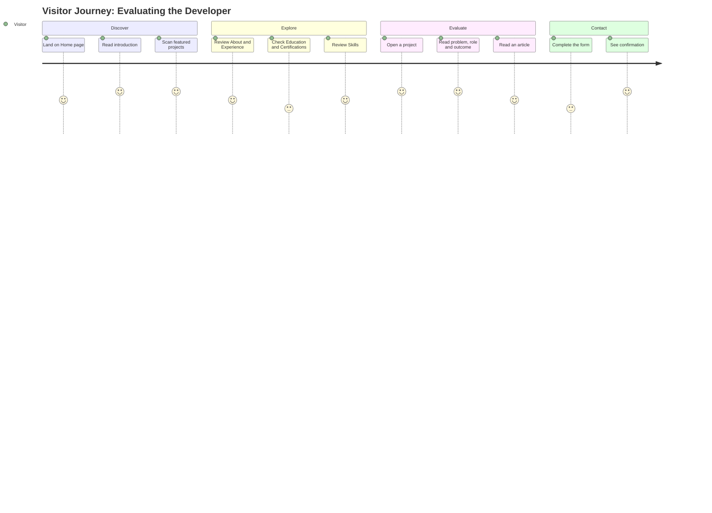
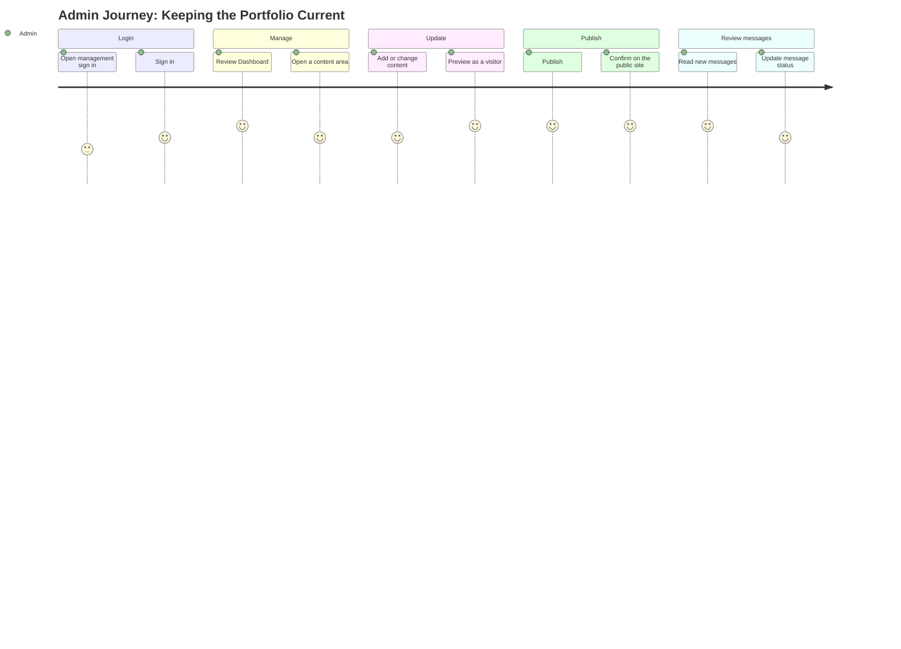
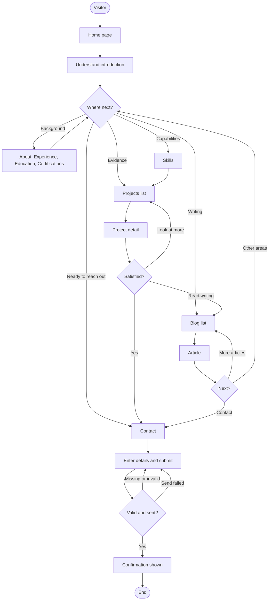
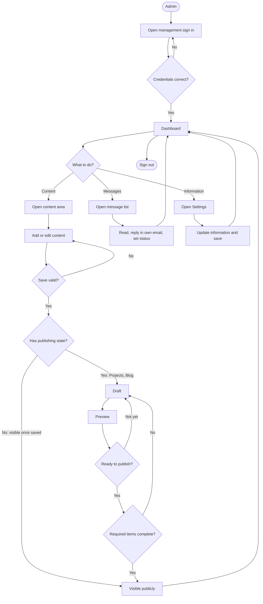
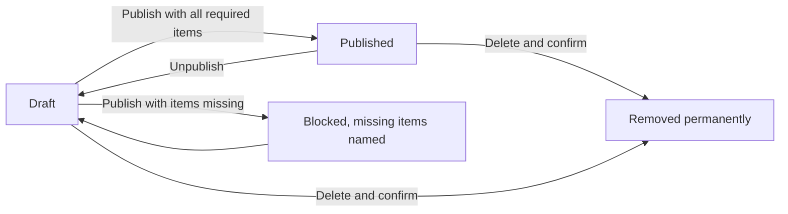

# User Flows — Personal Portfolio Platform

## 1. Document Information

| Field             | Value                                                                         |
| ----------------- | ----------------------------------------------------------------------------- |
| **Title**         | User Flows — Personal Portfolio Platform                                      |
| **Version**       | 1.0.0                                                                         |
| **Status**        | Draft — Pending Review                                                        |
| **Author**        | Muhammad Bux                                                                  |
| **Last Updated**  | 2026-10-19                                                                    |
| **Current Phase** | Phase 5 — User Flows (Stage 1: Think)                                         |
| **Depends On**    | `PROBLEM_STATEMENT.md`, `VISION.md`, `SCOPE.md`, `FUNCTIONAL_REQUIREMENTS.md` |

---

## 2. Introduction

### 2.1 Purpose

This document describes how the two user roles, Visitor and Admin, move through the Version 1 product to achieve real goals. For each journey it states why the user comes, the steps they take, the choices they face, what happens when things go wrong, and what a successful outcome looks like.

### 2.2 Requirements versus user flows

| Document                        | Describes                                            | Organized By       |
| ------------------------------- | ---------------------------------------------------- | ------------------ |
| `FUNCTIONAL_REQUIREMENTS.md`    | What the system must do, and the rules it follows    | Feature and module |
| `USER_FLOWS.md` (this document) | How a person uses those behaviors to complete a task | Goal and journey   |

A requirement can be met in isolation and still fail the user if the steps between requirements do not connect. Flows expose those gaps. This document introduces no feature that `FUNCTIONAL_REQUIREMENTS.md` does not already define. Each flow lists the requirements it relies on.

### 2.3 Why journeys matter before design

- They show which steps a design must make easy, and which can stay quiet.
- They reveal dead ends, such as an error with no way forward.
- They let the owner check the product against real tasks before any visual or technical design exists.
- They give Stage 2 (Design) a checklist: every flow must be possible in the design that follows.

### 2.4 Flow template

Each flow uses the same structure.

| Element                  | Meaning                                                         |
| ------------------------ | --------------------------------------------------------------- |
| **Flow name**            | A short, goal-oriented title                                    |
| **User**                 | Visitor or Admin                                                |
| **Goal**                 | What the user wants to achieve                                  |
| **Preconditions**        | What must already be true                                       |
| **Main steps**           | The expected path, in order                                     |
| **Alternative paths**    | Other routes that still lead to the goal, or deliberate choices |
| **Success outcome**      | What the user can do or know when finished                      |
| **Possible problems**    | What can go wrong and what the user should experience           |
| **Related requirements** | Requirements the flow relies on                                 |

---

## 3. User Types

| User        | Description                                                                                                                                                                                                 | Primary Goals                                                                                                                                                   |
| ----------- | ----------------------------------------------------------------------------------------------------------------------------------------------------------------------------------------------------------- | --------------------------------------------------------------------------------------------------------------------------------------------------------------- |
| **Visitor** | Any person viewing the public website. Not signed in and has no account. In practice this includes Hiring Engineers, Tech Leads, Engineering Managers, Recruiters, Freelance Clients, and general visitors. | Understand who the owner is. Judge professional credibility and technical ability. Review projects and writing. Contact the owner if interested.                |
| **Admin**   | The portfolio owner, the only person who can use the management area.                                                                                                                                       | Keep every part of the portfolio accurate and current. Publish and withdraw content. Maintain general portfolio information. Review and track visitor messages. |

### 3.1 Visitor motivations

All Visitors share the same capabilities. They differ in what they look for first, which affects the order in which they use the flows.

| Visitor Type        | Typically Starts With    | Typically Ends With                                       |
| ------------------- | ------------------------ | --------------------------------------------------------- |
| Hiring Engineer     | Projects, then Skills    | Contact, or leaving with questions for an interview       |
| Tech Lead           | Projects, then Blog      | Contact, or leaving with an opinion on technical judgment |
| Engineering Manager | About, Experience        | Projects, then Contact                                    |
| Recruiter           | Home, Experience, Skills | Contact                                                   |
| Freelance Client    | Home, Projects           | Contact                                                   |
| General Visitor     | Home                     | Varies                                                    |

---

## 4. Public Visitor User Flows

### Flow 1: Discover Portfolio

| Element                  | Detail                                                                                                                 |
| ------------------------ | ---------------------------------------------------------------------------------------------------------------------- |
| **User**                 | Visitor                                                                                                                |
| **Goal**                 | Understand who the owner is and decide where to look next.                                                             |
| **Preconditions**        | The website is available. The Admin has set the owner's name, headline, and introduction.                              |
| **Success outcome**      | Within about two minutes, the Visitor can state the owner's role focus and has reached the area most relevant to them. |
| **Related requirements** | FR-SITE-001, FR-SITE-002, FR-HOME-001 to 005, FR-SEO-001                                                               |

**Main steps**

1. The Visitor arrives at the Home page, from a link, a search result, a résumé, or a message from the owner.
2. The Visitor reads the owner's name, professional headline, and short introduction.
3. If an availability statement is set, the Visitor notes whether the owner is open to opportunities.
4. The Visitor scans the featured projects on the Home page.
5. The Visitor uses the navigation or the primary actions to move to the area that matches their purpose.

**Alternative paths**

- _Arriving on a deep page._ The Visitor follows a shared link straight to a project or article. They use the navigation to reach Home or any other area. No page is a dead end.
- _Wanting depth immediately._ The Visitor selects "view all projects" from the featured selection.
- _Ready to reach out._ The Visitor goes straight to Contact through the primary action.
- _No featured projects set._ The Home page shows the most recent projects instead.

**Possible problems**

| Problem                                | Experience Expected                                          |
| -------------------------------------- | ------------------------------------------------------------ |
| No profile image has been provided     | The page displays correctly without one.                     |
| The availability statement is empty    | Nothing is shown in its place.                               |
| The Visitor is unsure where to go next | Clear primary actions and consistent navigation are visible. |
| A page cannot be loaded                | A friendly message with a way to retry or navigate is shown. |

---

### Flow 2: View Professional Background

| Element                  | Detail                                                                                                                                                           |
| ------------------------ | ---------------------------------------------------------------------------------------------------------------------------------------------------------------- |
| **User**                 | Visitor                                                                                                                                                          |
| **Goal**                 | Evaluate the owner's professional credibility through their history.                                                                                             |
| **Preconditions**        | The Visitor knows the owner's name or has reached the site. Background content exists in the relevant areas.                                                     |
| **Success outcome**      | The Visitor understands the owner's career path, formal training, and credentials, and finds them consistent with other information they hold, such as a résumé. |
| **Related requirements** | FR-ABOUT-001 to 003, FR-EXP-001 to 004, FR-EDU-001 to 003, FR-CERT-001 to 003, FR-SITE-005                                                                       |

**Main steps**

1. The Visitor opens About and reads the personal introduction and professional background.
2. The Visitor follows the career pointer to Experience.
3. The Visitor reads entries from most recent to oldest, noting role, organization, period, responsibilities, and achievements.
4. The Visitor opens Education and reviews institutions, qualifications, and periods.
5. The Visitor opens Certifications and reviews each credential, its issuer, and its dates.
6. If a verification link is present, the Visitor may open it to confirm the credential with its issuer.
7. The Visitor forms a view on credibility and chooses the next step: Skills, Projects, or Contact.

**Alternative paths**

- _Starting from Experience._ A Recruiter goes directly to Experience from the navigation and may never open About.
- _Checking currency._ The Visitor looks for current roles, marked as "Present", and ongoing education, marked as in progress.
- _Checking validity._ The Visitor looks for expired certifications, which are visibly labeled.

**Possible problems**

| Problem                                        | Experience Expected                                            |
| ---------------------------------------------- | -------------------------------------------------------------- |
| An area has no published entries               | A neutral message is shown, not a blank page.                  |
| An optional detail was not provided            | It is simply absent, with no placeholder.                      |
| A verification link leads away from the site   | The link is clearly labeled and the Visitor can return.        |
| Dates or labels are inconsistent between areas | This should not occur, since formats are uniform across areas. |

---

### Flow 3: Explore Technical Skills

| Element                  | Detail                                                                                                    |
| ------------------------ | --------------------------------------------------------------------------------------------------------- |
| **User**                 | Visitor                                                                                                   |
| **Goal**                 | Understand the owner's technical capabilities.                                                            |
| **Preconditions**        | Skills have been added by the Admin.                                                                      |
| **Success outcome**      | The Visitor knows which technologies the owner works with, how they are grouped, and which are strongest. |
| **Related requirements** | FR-SKILL-001 to 004, FR-PROJECT-001, FR-PROJECT-002, FR-EXP-002                                           |

**Main steps**

1. The Visitor opens Skills.
2. The Visitor reviews the category headings, such as languages or tools.
3. Within each category, the Visitor reads the skills and any level indicated.
4. The Visitor notes the skills most relevant to their needs.
5. The Visitor opens Projects to see where those skills were used. The connection is made by matching the technologies listed on each project, and on Experience entries, to the skills in the list.
6. The Visitor decides whether the evidence supports the claims, and moves to Projects or Contact.

**Alternative paths**

- _Starting from a project._ The Visitor sees a technology on a project and then opens Skills to see how it is categorized.
- _Skipping levels._ If no level is shown for a skill, the Visitor relies on projects and experience for evidence.

**Possible problems**

| Problem                                      | Experience Expected                                                                          |
| -------------------------------------------- | -------------------------------------------------------------------------------------------- |
| The Visitor wants a skill that is not listed | They conclude it is not part of the owner's stated skills. No search exists in Version 1.    |
| A skill has no supporting project            | The Visitor can still see it, but cannot confirm it. This is a content matter for the Admin. |
| A category is empty                          | It is not shown.                                                                             |

---

### Flow 4: Explore Projects

This is the most important public flow. It carries the main evidence of technical ability.

| Element                  | Detail                                                                                                                                                                                               |
| ------------------------ | ---------------------------------------------------------------------------------------------------------------------------------------------------------------------------------------------------- |
| **User**                 | Visitor, especially a Hiring Engineer or Tech Lead                                                                                                                                                   |
| **Goal**                 | Evaluate the owner's technical work and decide whether to make contact.                                                                                                                              |
| **Preconditions**        | At least one project is published.                                                                                                                                                                   |
| **Success outcome**      | The Visitor understands what was built, the owner's role, key decisions, technologies, and outcome for at least one project, and has either reached out or left with specific points to raise later. |
| **Related requirements** | FR-PROJECT-001 to 007, FR-HOME-003, FR-SITE-004, BR-007, BR-010                                                                                                                                      |

**Main steps**

1. The Visitor opens Projects, from the Home page's featured work or from the navigation.
2. The Visitor browses the list. Featured projects appear first, followed by the rest, newest first. Each item shows a title, short summary, cover image, and technologies.
3. The Visitor selects a project that looks relevant.
4. The Visitor reads the problem or context, the owner's role, key decisions, and outcome.
5. The Visitor views the project images.
6. The Visitor checks the technologies used.
7. If provided, the Visitor opens the live project or the source code to verify the work.
8. The Visitor returns to the list and examines another project, or moves on.
9. The Visitor decides whether to contact the owner and, if so, goes to Contact.

**Alternative paths**

- _Arriving at a project directly._ The Visitor follows a stable shared address and starts at step 4.
- _Comparing projects._ The Visitor opens several projects in turn. Every project presents its information in the same order, which supports comparison.
- _Leaving to verify._ The Visitor follows an external link and later returns to the portfolio.
- _No contact yet._ The Visitor continues to Blog or Skills before deciding.

**Possible problems**

| Problem                                                                   | Experience Expected                                                  |
| ------------------------------------------------------------------------- | -------------------------------------------------------------------- |
| A project has no live link or source link                                 | Those links are not shown, and the rest of the detail is unaffected. |
| A project lacks an optional section, such as key decisions                | The section is omitted.                                              |
| A project has been unpublished or removed since the Visitor bookmarked it | The not-found page appears with navigation to other areas.           |
| No projects are published                                                 | A neutral message is shown.                                          |
| An external link no longer works                                          | This is outside the product. The Visitor can return and continue.    |

---

### Flow 5: Read Blog Content

| Element                  | Detail                                                                                                       |
| ------------------------ | ------------------------------------------------------------------------------------------------------------ |
| **User**                 | Visitor                                                                                                      |
| **Goal**                 | Learn from the owner's technical writing, and judge how the owner thinks and communicates.                   |
| **Preconditions**        | At least one article is published.                                                                           |
| **Success outcome**      | The Visitor reads an article to completion and either browses further, visits other areas, or makes contact. |
| **Related requirements** | FR-BLOG-001 to 007, FR-SEO-004, FR-A11Y-004                                                                  |

**Main steps**

1. The Visitor discovers an article, either by opening Blog from the navigation or by following a shared link or a search result.
2. From the Blog list, the Visitor scans titles, summaries, and dates and selects an article.
3. The Visitor reads the article, including headings, lists, code excerpts, and images as authored.
4. The Visitor notes the publication date, and a last-updated date if the article was changed after publication.
5. The Visitor returns to the list.
6. The Visitor opens another article, or moves to another area.

**Alternative paths**

- _Arriving from a shared link._ The Visitor starts at step 3 and uses the return path to reach the full list.
- _A long list._ The Visitor moves through the divided list to reach older articles.
- _Wanting to respond._ No commenting exists, so a Visitor with feedback goes to Contact.

**Possible problems**

| Problem                                    | Experience Expected                                                  |
| ------------------------------------------ | -------------------------------------------------------------------- |
| An article has been unpublished or removed | The not-found page appears with navigation.                          |
| No articles are published                  | A neutral message is shown.                                          |
| An older article is hard to find           | The Visitor browses the divided list. No search exists in Version 1. |

---

### Flow 6: Contact Developer

| Element                  | Detail                                                                          |
| ------------------------ | ------------------------------------------------------------------------------- |
| **User**                 | Visitor                                                                         |
| **Goal**                 | Send a message to the owner.                                                    |
| **Preconditions**        | The Visitor has reached the Contact area. No account is needed.                 |
| **Success outcome**      | The message is stored for the Admin, and the Visitor sees a clear confirmation. |
| **Related requirements** | FR-CONTACT-001 to 009, FR-VAL-001 to 005, FR-VAL-015, FR-ERR-001 to 003         |

**Main steps**

1. The Visitor opens Contact, from the navigation, the Home page action, or another area.
2. The Visitor reads the privacy notice and any alternative contact details shown.
3. The Visitor enters their name and email address, optionally a subject, and their message.
4. The Visitor submits the form.
5. The system accepts the message and shows a confirmation. The form is cleared.

**Alternative paths**

| Situation                           | What Happens                                                                                                                                                              |
| ----------------------------------- | ------------------------------------------------------------------------------------------------------------------------------------------------------------------------- |
| **Missing information**             | Submission is blocked. Each missing required field is identified next to the field. Entered text is kept. The Visitor completes the fields and resubmits.                 |
| **Invalid information**             | An email address in an invalid format, or a message that is too short or too long, is identified at its field with an explanation. The Visitor corrects it and resubmits. |
| **Submission failure**              | The Visitor is told the message could not be sent. Their text remains in the form, and they may retry.                                                                    |
| **Repeated submit action**          | A second submission of the same message is prevented while the first is processing. Only one message is stored.                                                           |
| **Preferring another channel**      | The Visitor uses the professional links or contact details shown in the Contact area instead of the form.                                                                 |
| **Automated or abusive submission** | It is not stored as a normal message. Legitimate Visitors are unaffected.                                                                                                 |

**Possible problems**

| Problem                                            | Experience Expected                                                                                                              |
| -------------------------------------------------- | -------------------------------------------------------------------------------------------------------------------------------- |
| The Visitor is unsure whether the message was sent | A confirmation appears only after the message has been stored. If it does not appear, the Visitor assumes it failed and retries. |
| The Visitor expects an automatic reply             | None is sent. The owner replies from their own email.                                                                            |
| The Visitor is concerned about their details       | The privacy notice before submission states how they are used.                                                                   |

---

## 5. Admin User Flows

All Admin flows other than Flow 7 assume the Admin is signed in. The product applies the same behaviors to every management area: confirmation before removal, clear feedback after every action, and warning before leaving unsaved changes (FR-ADMIN-GEN-001 to 003, BR-009).

### Flow 7: Admin Access

| Element                  | Detail                                                                                                                       |
| ------------------------ | ---------------------------------------------------------------------------------------------------------------------------- |
| **User**                 | Admin                                                                                                                        |
| **Goal**                 | Enter the management area.                                                                                                   |
| **Preconditions**        | The Admin has their credentials. The Admin knows how to reach the sign-in page, because the public site does not link to it. |
| **Success outcome**      | The Admin is signed in and sees the Dashboard.                                                                               |
| **Related requirements** | FR-AUTH-001 to 010, FR-DASH-001 to 005, FR-ERR-009                                                                           |

**Main steps**

1. The Admin opens the management sign-in page directly, for example from a saved bookmark.
2. The Admin enters their credentials.
3. The Admin submits.
4. The Admin arrives at the Dashboard, showing content counts, new messages, last-changed dates, pending drafts, and shortcuts.

**Alternative paths**

- _Returning after a session ended._ The Admin is told the session ended, signs in again, and returns to the Dashboard or the page they were on.
- _Opening a management page directly while signed out._ The Admin is taken to sign-in first.
- _Ending a session._ The Admin signs out from any management page. Management pages require signing in again afterward.
- _Changing the password._ While signed in, the Admin provides the current password and a new one that meets the strength rule (FR-AUTH-009).

**Possible problems**

| Problem                        | Experience Expected                                                                                |
| ------------------------------ | -------------------------------------------------------------------------------------------------- |
| Incorrect credentials          | A single general message appears that does not reveal which credential was wrong.                  |
| Several failed attempts        | Further attempts are temporarily blocked, with a clear message to try again later.                 |
| Access without being signed in | Access is denied and the person is directed to sign in. Nothing from the management area is shown. |
| Session ends during work       | The Admin is told and must sign in again.                                                          |
| Forgotten password             | Not handled by the product in Version 1 (see Section 13, N-6).                                     |

---

### Flow 8: Manage Projects

| Element                  | Detail                                                                                  |
| ------------------------ | --------------------------------------------------------------------------------------- |
| **User**                 | Admin                                                                                   |
| **Goal**                 | Keep the portfolio's projects accurate, complete, and well presented.                   |
| **Preconditions**        | The Admin is signed in.                                                                 |
| **Success outcome**      | Projects shown publicly are complete and current, and no unfinished project is visible. |
| **Related requirements** | FR-ADMIN-PROJECT-001 to 008, FR-MEDIA-001 to 005, BR-003 to 005, BR-016                 |

**Main steps: creating and publishing**

1. From the Dashboard, the Admin chooses to add a project.
2. The Admin enters the title, short summary, problem or context, role, key decisions, outcome, technologies, links, and period.
3. The Admin adds images, supplies a text alternative for each, and designates a cover image.
4. The Admin saves. The project is stored as a Draft and is not visible to Visitors.
5. The Admin previews the project as a Visitor would see it.
6. The Admin publishes. If required information is missing, publishing is blocked and the missing items are named.
7. The Admin optionally marks the project as featured.
8. The project appears publicly and the Admin sees confirmation.

**Main steps: reviewing, updating, and removing**

1. The Admin opens the project list, which shows title, status, featured marking, and last-changed date.
2. To update, the Admin opens a project, changes fields or images, and saves. A published project shows the change publicly.
3. To withdraw a project temporarily, the Admin unpublishes it. It returns to Draft.
4. To remove a project permanently, the Admin selects removal and confirms. The project and its images no longer appear anywhere.

**Alternative paths**

- _Saving early._ The Admin saves a project with only a title and returns later.
- _Previewing a published project_ before or after a change.
- _Rearranging prominence._ The Admin marks or unmarks projects as featured to change the Home page and list order.

**Possible problems**

| Problem                                | Experience Expected                                                                                       |
| -------------------------------------- | --------------------------------------------------------------------------------------------------------- |
| Publishing an incomplete project       | Blocked, with the missing items named.                                                                    |
| An unsupported or oversized image      | Rejected with an explanation. Other entered information is kept.                                          |
| Image saved without a text alternative | Blocked unless it is marked decorative.                                                                   |
| Invalid web address in a link field    | Rejected at the field with an explanation.                                                                |
| Accidental removal                     | Confirmation is requested first. Removal cannot be undone, so unpublishing is the reversible alternative. |
| Leaving a form with unsaved changes    | A warning is shown.                                                                                       |
| A save fails                           | The Admin is told and their entries remain available.                                                     |

---

### Flow 9: Manage Skills

| Element                  | Detail                                                                                |
| ------------------------ | ------------------------------------------------------------------------------------- |
| **User**                 | Admin                                                                                 |
| **Goal**                 | Keep the skills list accurate.                                                        |
| **Preconditions**        | The Admin is signed in.                                                               |
| **Success outcome**      | The public Skills area reflects the owner's current skills under sensible categories. |
| **Related requirements** | FR-ADMIN-SKILL-001 to 005, FR-SKILL-001 to 004                                        |

**Main steps**

1. The Admin opens Skills management and sees all skills grouped by category.
2. _Add:_ the Admin enters a name, picks an existing category or types a new one, and optionally sets a level. The Admin saves.
3. _Update:_ the Admin opens a skill, changes its name, category, or level, and saves.
4. _Remove:_ the Admin selects removal and confirms.
5. The Admin sees confirmation and, where relevant, checks the public Skills area.

**Alternative paths**

- _Creating a category_ by entering a new category name during an add or an edit.
- _Moving a skill_ between categories through an edit.

**Possible problems**

| Problem                                                    | Experience Expected              |
| ---------------------------------------------------------- | -------------------------------- |
| A skill with the same name already exists in that category | Rejected with an explanation.    |
| Required name is blank                                     | Blocked at the field.            |
| Removing a skill unintentionally                           | Confirmation is requested first. |

---

### Flow 10: Manage Experience

| Element                  | Detail                                                                             |
| ------------------------ | ---------------------------------------------------------------------------------- |
| **User**                 | Admin                                                                              |
| **Goal**                 | Keep the professional history accurate and current.                                |
| **Preconditions**        | The Admin is signed in.                                                            |
| **Success outcome**      | The public Experience area lists roles in the correct order with accurate details. |
| **Related requirements** | FR-ADMIN-EXP-001 to 005, FR-EXP-001 to 004                                         |

**Main steps**

1. The Admin opens Experience management and sees entries, most recent first.
2. _Add:_ the Admin enters role title, organization, start date, optional end date, optional location, summary, responsibilities, achievements, and technologies. The Admin saves.
3. _Update:_ the Admin opens an entry, changes details, and saves. For example, they add an end date when a role ends.
4. _Remove:_ the Admin selects removal and confirms.
5. The Admin sees confirmation. The public area is updated.

**Alternative paths**

- _Current role._ The Admin leaves the end date empty and the role is displayed as current.
- _Ending a role._ The Admin adds an end date to an existing current entry.

**Possible problems**

| Problem                          | Experience Expected              |
| -------------------------------- | -------------------------------- |
| End date earlier than start date | Rejected with an explanation.    |
| Required field missing           | Blocked at the field.            |
| Accidental removal               | Confirmation is requested first. |

---

### Flow 11: Manage Education

| Element                  | Detail                                                                  |
| ------------------------ | ----------------------------------------------------------------------- |
| **User**                 | Admin                                                                   |
| **Goal**                 | Keep the education record accurate.                                     |
| **Preconditions**        | The Admin is signed in.                                                 |
| **Success outcome**      | The public Education area shows the correct records, most recent first. |
| **Related requirements** | FR-ADMIN-EDU-001 to 004, FR-EDU-001 to 003                              |

**Main steps**

1. The Admin opens Education management and sees records, most recent first.
2. _Add:_ the Admin enters institution, qualification, field of study, start date, optional end date, and optional description. The Admin saves.
3. _Update:_ the Admin opens a record, changes information, and saves.
4. _Remove:_ the Admin selects removal and confirms.
5. The Admin sees confirmation.

**Alternative paths**

- _Ongoing study._ The Admin leaves the end date empty and the record is displayed as in progress.

**Possible problems**

| Problem                          | Experience Expected              |
| -------------------------------- | -------------------------------- |
| End date earlier than start date | Rejected with an explanation.    |
| Required field missing           | Blocked at the field.            |
| Accidental removal               | Confirmation is requested first. |

---

### Flow 12: Manage Certifications

| Element                  | Detail                                                                                      |
| ------------------------ | ------------------------------------------------------------------------------------------- |
| **User**                 | Admin                                                                                       |
| **Goal**                 | Keep credentials accurate and verifiable.                                                   |
| **Preconditions**        | The Admin is signed in.                                                                     |
| **Success outcome**      | The public Certifications area shows current credentials, with expired ones clearly marked. |
| **Related requirements** | FR-ADMIN-CERT-001 to 004, FR-CERT-001 to 003                                                |

**Main steps**

1. The Admin opens Certification management and sees certifications, most recently issued first.
2. _Add:_ the Admin enters name, issuing organization, issue date, and optionally an expiry date, a credential identifier, and a verification link. The Admin saves.
3. _Update:_ the Admin opens a certification, changes details, and saves. For example, they add a renewed expiry date.
4. _Remove:_ the Admin selects removal and confirms.
5. The Admin sees confirmation.

**Alternative paths**

- _No expiry._ The Admin leaves the expiry date empty and the certification is never marked expired.
- _Renewal._ The Admin updates the expiry date instead of adding a duplicate.

**Possible problems**

| Problem                             | Experience Expected              |
| ----------------------------------- | -------------------------------- |
| Expiry date earlier than issue date | Rejected with an explanation.    |
| Invalid verification link           | Rejected at the field.           |
| Accidental removal                  | Confirmation is requested first. |

---

### Flow 13: Manage Blog Content

| Element                  | Detail                                                                                                     |
| ------------------------ | ---------------------------------------------------------------------------------------------------------- |
| **User**                 | Admin                                                                                                      |
| **Goal**                 | Write and maintain articles, and control which are public.                                                 |
| **Preconditions**        | The Admin is signed in.                                                                                    |
| **Success outcome**      | Published articles are complete, correctly formatted, and visible, while unfinished articles stay private. |
| **Related requirements** | FR-ADMIN-BLOG-001 to 007, FR-MEDIA-001 to 005, BR-003 to 005, BR-016                                       |

**Main steps: writing and publishing**

1. The Admin chooses to create an article.
2. The Admin enters a title, short summary, and body, using headings, lists, links, quotations, code excerpts, and images with text alternatives. A cover image is optional.
3. The Admin saves. The article is stored as a Draft and is not visible to Visitors.
4. The Admin may return later to continue writing, since drafts may be incomplete.
5. The Admin previews the article as a Visitor would see it.
6. The Admin publishes. If the title, summary, or body is missing, publishing is blocked and the missing items are named.
7. The article appears publicly. Its publication date is set at this first publication.

**Main steps: maintaining**

1. _Edit:_ the Admin opens an article, changes it, and saves. If it is published, the public version updates and a last-updated date is recorded. The original publication date does not change.
2. _Withdraw:_ the Admin unpublishes the article. It returns to Draft and disappears publicly.
3. _Remove:_ the Admin selects removal and confirms. The article is permanently deleted.

**Alternative paths**

- _Draft review._ The Admin opens drafts from the Dashboard's pending drafts list and continues editing.
- _Correction of a published article._ The Admin edits and saves. The article's public address is unchanged.

**Possible problems**

| Problem                              | Experience Expected                                                          |
| ------------------------------------ | ---------------------------------------------------------------------------- |
| Publishing an incomplete article     | Blocked, with the missing items named.                                       |
| An unsupported or oversized image    | Rejected with an explanation.                                                |
| Navigating away with unsaved writing | A warning is shown.                                                          |
| Accidental removal                   | Confirmation is requested first. Unpublishing is the reversible alternative. |
| A save fails                         | The Admin is told and the writing remains available.                         |

---

### Flow 14: Manage Messages

| Element                  | Detail                                                                                                         |
| ------------------------ | -------------------------------------------------------------------------------------------------------------- |
| **User**                 | Admin                                                                                                          |
| **Goal**                 | Make sure no inquiry is missed, and track each one to completion.                                              |
| **Preconditions**        | The Admin is signed in. Visitors have sent at least one message.                                               |
| **Success outcome**      | Every message has been read and given an accurate status, and replies have been made in the Admin's own email. |
| **Related requirements** | FR-MSG-001 to 007, FR-DASH-002, FR-CONTACT-006                                                                 |

**Main steps**

1. The Admin signs in. The Dashboard shows the number of New messages and the most recent ones.
2. The Admin opens the message list. Messages appear newest first, with New messages visually distinct.
3. The Admin opens a message. It shows the sender's name, email address, subject, message, and date received. It becomes Read.
4. The Admin decides what to do. For a message needing a reply, the Admin uses the sender's address in their own email application. The product does not send replies.
5. After replying, the Admin marks the message Replied.
6. The Admin archives messages that need no further attention.

**Alternative paths**

- _Focusing on what is outstanding._ The Admin filters the list by status, for example New.
- _Deferring._ The Admin marks a message unread to return to it later.
- _Restoring._ The Admin restores an Archived message by changing its status.
- _Deleting._ The Admin permanently deletes a message after confirmation, for example an unwanted one.

**Possible problems**

| Problem                                          | Experience Expected                                                                                   |
| ------------------------------------------------ | ----------------------------------------------------------------------------------------------------- |
| No alert for new messages                        | The Admin must check the Dashboard. New messages are not lost, since they are retained until deleted. |
| The Admin forgets whether a message was answered | The status shows it.                                                                                  |
| Accidental deletion                              | Confirmation is requested first. Deletion cannot be undone, and archiving is the safe alternative.    |
| No messages                                      | An empty list is shown.                                                                               |

---

### Flow 15: Manage Portfolio Settings

| Element                  | Detail                                                                                        |
| ------------------------ | --------------------------------------------------------------------------------------------- |
| **User**                 | Admin                                                                                         |
| **Goal**                 | Keep general portfolio information accurate across the public site.                           |
| **Preconditions**        | The Admin is signed in.                                                                       |
| **Success outcome**      | Home, About, footer, Contact, and sharing information reflect the owner's current details.    |
| **Related requirements** | FR-SETTINGS-001 to 006, FR-HOME-001, FR-HOME-002, FR-ABOUT-001 to 003, FR-SEO-003, FR-SEO-004 |

**Main steps**

1. The Admin opens Settings.
2. The Admin reviews and updates the owner's name and headline.
3. The Admin edits the Home introduction and the About narrative and professional background.
4. The Admin adds, replaces, or removes the profile image, supplying a text alternative.
5. The Admin sets, changes, or clears the availability statement.
6. The Admin updates professional links and public contact details.
7. The Admin sets the site title, short description, and default sharing image.
8. The Admin saves and sees confirmation.
9. The Admin opens the public site to confirm that the changes appear.

**Alternative paths**

- _Routine review._ The Admin checks the Dashboard's last-changed dates, opens the relevant area, and updates what is out of date.
- _Clearing information._ The Admin empties an optional item, such as the availability statement, and it disappears from the public site.

**Possible problems**

| Problem                               | Experience Expected                                  |
| ------------------------------------- | ---------------------------------------------------- |
| Name or headline left blank           | Blocked at the field.                                |
| Invalid professional link             | Rejected at the field.                               |
| Image problems                        | Rejected with an explanation, as in Flow 8.          |
| Leaving with unsaved changes          | A warning is shown.                                  |
| Public information drifts out of date | The Dashboard's last-changed dates prompt the Admin. |

---

## 6. Complete User Journey Map

### 6.1 Summary

| Role        | Journey                                             |
| ----------- | --------------------------------------------------- |
| **Visitor** | Discover → Explore → Evaluate → Contact             |
| **Admin**   | Login → Manage → Update → Publish → Review Messages |

### 6.2 Visitor journey stages

| Stage        | Visitor Question                                | Flows | Desired Outcome                    |
| ------------ | ----------------------------------------------- | ----- | ---------------------------------- |
| **Discover** | Who is this person, and is this relevant to me? | 1     | A clear first impression           |
| **Explore**  | What is their background and what can they do?  | 2, 3  | A picture of experience and skills |
| **Evaluate** | Is the work good, and can I trust the claims?   | 4, 5  | Evidence of depth and judgment     |
| **Contact**  | Do I want to speak to them?                     | 6     | A message sent and confirmed       |

### 6.3 Admin journey stages

| Stage               | Admin Question                   | Flows       | Desired Outcome              |
| ------------------- | -------------------------------- | ----------- | ---------------------------- |
| **Login**           | Can I get in quickly and safely? | 7           | Access to the Dashboard      |
| **Manage**          | What needs attention?            | 8 to 15     | Content in the correct state |
| **Update**          | What has changed in my career?   | 8 to 13, 15 | Accurate, current content    |
| **Publish**         | Is it ready to be seen?          | 8, 13       | Complete content made public |
| **Review messages** | Has anyone contacted me?         | 14          | No inquiry missed            |

### 6.4 Journey maps

---

## 7. User Flow Diagrams

### 7.1 Public user journey

### 7.2 Admin journey

### 7.3 Publishing decision

---

## 8. Edge Cases

No technical solutions are discussed. Each case states only what the user should experience.

### 8.1 Visitor

| Situation                                                 | Expected Experience                                                                                                                                               | Related Requirements        |
| --------------------------------------------------------- | ----------------------------------------------------------------------------------------------------------------------------------------------------------------- | --------------------------- |
| **Cannot find specific information.**                     | Consistent navigation and uniform structure help the Visitor locate it. If it is absent, the Visitor concludes it is not provided. No search exists in Version 1. | FR-SITE-001, FR-SITE-005    |
| **Contact form incomplete.**                              | Submission is blocked and each missing field is identified, with entered text kept.                                                                               | FR-CONTACT-002, FR-VAL-015  |
| **Contact form invalid.**                                 | The problem is identified next to the field with an explanation.                                                                                                  | FR-CONTACT-002              |
| **Message cannot be sent.**                               | The Visitor is told, and text remains for retry.                                                                                                                  | FR-CONTACT-004              |
| **Double submission.**                                    | Only one message results.                                                                                                                                         | FR-CONTACT-005              |
| **Content unavailable.**                                  | A not-found page with navigation is shown for unpublished or removed content.                                                                                     | FR-SITE-004, FR-SITE-006    |
| **Area with no content.**                                 | A neutral message appears.                                                                                                                                        | FR-SITE-003                 |
| **Public content cannot be loaded.**                      | A friendly message with a way to retry or navigate.                                                                                                               | FR-ERR-007                  |
| **Optional information missing.**                         | It is omitted without placeholders.                                                                                                                               | BR-010                      |
| **Visitor uses a phone.**                                 | All public content and functions remain available.                                                                                                                | FR-RESP-003                 |
| **Visitor uses only a keyboard or assistive technology.** | All functions are usable and content is structured.                                                                                                               | FR-A11Y-001 to 010          |
| **Visitor arrives on an inner page.**                     | Navigation to every other area is present.                                                                                                                        | FR-SITE-001                 |
| **Shared link to content that was later edited.**         | The link still works.                                                                                                                                             | FR-PROJECT-007, FR-BLOG-005 |

### 8.2 Admin

| Situation                                        | Expected Experience                                                                                                                                                                         | Related Requirements     |
| ------------------------------------------------ | ------------------------------------------------------------------------------------------------------------------------------------------------------------------------------------------- | ------------------------ |
| **Invalid information.**                         | The action is blocked, problems are identified at the field, and entered data is kept.                                                                                                      | FR-VAL-015, FR-ERR-005   |
| **Accidental deletion.**                         | Confirmation is requested before removal. Removal cannot be undone, so the reversible alternatives (unpublishing for Projects and Blog, archiving for messages) are used where appropriate. | BR-004, BR-009           |
| **Empty content areas.**                         | The Dashboard shows zero counts, and the public site shows neutral messages.                                                                                                                | FR-DASH-001, FR-SITE-003 |
| **Incomplete content to publish.**               | Publishing is blocked and missing items are named.                                                                                                                                          | BR-005                   |
| **Leaving a form unsaved.**                      | A warning is shown.                                                                                                                                                                         | FR-ADMIN-GEN-002         |
| **Session ends during work.**                    | The Admin is told and must sign in again.                                                                                                                                                   | FR-AUTH-006, FR-ERR-009  |
| **Failed save.**                                 | The Admin is told and their entries remain.                                                                                                                                                 | FR-ERR-002, FR-ERR-003   |
| **Wrong credentials or repeated failures.**      | A general message appears, and later a temporary block.                                                                                                                                     | FR-AUTH-003, FR-AUTH-004 |
| **Duplicate skill.**                             | Rejected with an explanation.                                                                                                                                                               | FR-ADMIN-SKILL-004       |
| **Invalid period.**                              | An end date before a start date is rejected.                                                                                                                                                | FR-VAL-009               |
| **Image rejected.**                              | The Admin is told whether the type or size is the cause.                                                                                                                                    | FR-VAL-011               |
| **Image has no text alternative.**               | Blocked unless marked decorative.                                                                                                                                                           | FR-MEDIA-004             |
| **Messages go unchecked.**                       | They are retained. The Dashboard shows the number of New messages.                                                                                                                          | FR-MSG-007, FR-DASH-002  |
| **Content has not been updated in a long time.** | The Dashboard shows last-changed dates for each area.                                                                                                                                       | FR-DASH-003              |
| **Admin uses a phone.**                          | All functions can be completed, although complex editing is more convenient on larger screens.                                                                                              | FR-RESP-005              |

---

## 9. User Experience Principles

These principles guide the design stage. They apply `VISION.md` Section 6 to user journeys.

| Principle                       | What It Means for the Flows                                                                                                         |
| ------------------------------- | ----------------------------------------------------------------------------------------------------------------------------------- |
| **Simple navigation**           | Every area is reachable from every page. A Visitor always knows where they are and how to go back.                                  |
| **Clear information hierarchy** | The most important information, such as who the owner is and what they have built, comes first. Detail is available on request.     |
| **Minimal friction**            | Visitors never register. Contact needs only a few fields. The Admin reaches any task from the Dashboard in a small number of steps. |
| **Evidence over decoration**    | Project pages answer a reviewer's questions: the problem, the role, the decisions, and the outcome.                                 |
| **Professional presentation**   | Restraint and clarity. Nothing distracts from content.                                                                              |
| **Consistency**                 | Every project, article, and entry follows the same structure. Every management area works the same way.                             |
| **Accessibility**               | Every flow must be completable by keyboard and with assistive technology.                                                           |
| **Forgiveness**                 | Mistakes are caught before they cost anything: confirmations, warnings, preserved entries.                                          |
| **Honest feedback**             | The user always knows whether an action succeeded.                                                                                  |
| **Respect for time**            | A reviewer reaches an informed first impression in about two minutes. The Admin can complete a routine update in a few minutes.     |
| **Graceful emptiness**          | Missing optional information is omitted cleanly. Empty areas explain themselves.                                                    |
| **Works everywhere**            | Every flow works on phone, tablet, and desktop.                                                                                     |

---

## 10. Out of Scope

This document does not include:

| Excluded                                       | Belongs To                                                                      |
| ---------------------------------------------- | ------------------------------------------------------------------------------- |
| UI design and wireframes                       | Stage 2 — Design                                                                |
| Database design                                | Stage 2 — Design                                                                |
| API design                                     | Stage 2 — Design                                                                |
| Architecture                                   | Stage 2 — Design                                                                |
| Technical decisions and implementation details | Stage 2 — Design                                                                |
| Testing strategy                               | Later delivery phase                                                            |
| Deployment                                     | Later delivery phase                                                            |
| New features                                   | Not permitted. Handled through the Scope Change Policy in `SCOPE.md` Section 14 |

---

## 11. Conclusion

Problem, vision, scope, requirements, and flows now form a connected chain. The Problem Statement says what is wrong. The Vision says what better looks like. The Scope says what Version 1 includes. The Functional Requirements say what the system does. These flows show how real people use it to get things done.

Fifteen flows cover every public area and every management module in `SCOPE.md`. Each one has a starting point, a path, a successful outcome, and a defined response when something goes wrong. No flow needs a feature that is not already required, which suggests the requirements are sufficient for Version 1.

This completes **Stage 1 — Think**. Design can now begin with an agreed definition of the problem, direction, boundaries, behavior, and journeys. In **Stage 2 — Design**, every decision on structure, data, interfaces, and technology should be checked against these flows: if a design makes a flow impossible or harder, the design is wrong. If a flow cannot be supported without a new feature, the change policy in `SCOPE.md` Section 14 applies.

---

## 12. Traceability

| Flow                           | Primary Requirement Areas         | Scope Success Criteria Supported |
| ------------------------------ | --------------------------------- | -------------------------------- |
| 1 Discover Portfolio           | FR-SITE, FR-HOME, FR-SEO          | VS-1, VS-4                       |
| 2 View Professional Background | FR-ABOUT, FR-EXP, FR-EDU, FR-CERT | VS-1                             |
| 3 Explore Technical Skills     | FR-SKILL, FR-PROJECT              | VS-1, VS-4                       |
| 4 Explore Projects             | FR-PROJECT, FR-HOME-003           | VS-4, VS-5                       |
| 5 Read Blog Content            | FR-BLOG                           | VS-1                             |
| 6 Contact Developer            | FR-CONTACT, FR-VAL, FR-ERR        | VS-6                             |
| 7 Admin Access                 | FR-AUTH, FR-DASH                  | VS-3                             |
| 8 Manage Projects              | FR-ADMIN-PROJECT, FR-MEDIA        | VS-2, VS-5, VS-9                 |
| 9 Manage Skills                | FR-ADMIN-SKILL                    | VS-2                             |
| 10 Manage Experience           | FR-ADMIN-EXP                      | VS-2                             |
| 11 Manage Education            | FR-ADMIN-EDU                      | VS-2                             |
| 12 Manage Certifications       | FR-ADMIN-CERT                     | VS-2                             |
| 13 Manage Blog Content         | FR-ADMIN-BLOG, FR-MEDIA           | VS-2, VS-9                       |
| 14 Manage Messages             | FR-MSG, FR-DASH-002               | VS-6                             |
| 15 Manage Portfolio Settings   | FR-SETTINGS                       | VS-2                             |

---

## 13. Alignment with Previous Phases and Open Items

No earlier decision was changed, and no feature was added or removed. The items below record where the flows exposed an ambiguity or a tension in the earlier documents. Each should be reviewed before Stage 2.

### 13.1 Interpretations used

| #   | Matter                                                                                                                                               | Treatment in Flows                                                                                                                                                                                                             |
| --- | ---------------------------------------------------------------------------------------------------------------------------------------------------- | ------------------------------------------------------------------------------------------------------------------------------------------------------------------------------------------------------------------------------ |
| N-1 | **Skills to projects.** The brief for Flow 3 asks the Visitor to "connect skills with projects". No requirement links a skill to a project directly. | The Visitor makes the connection themselves by matching the technologies listed on projects and on Experience entries with the skills list. No new feature was added. If the owner wants direct links, this is a scope change. |
| N-2 | **Admin entry point.** FR-AUTH-008 forbids public links to the management area. "Open admin access" therefore cannot be a public button.             | The Admin is assumed to know the sign-in address, for example from a bookmark. The address itself is a Stage 2 matter.                                                                                                         |
| N-3 | **"Review project" step.** The brief lists review as part of Flow 8.                                                                                 | Mapped to the project list (FR-ADMIN-PROJECT-002) and Preview (FR-ADMIN-PROJECT-007).                                                                                                                                          |
| N-4 | **"Explore more content" on the Blog.**                                                                                                              | Satisfied by the return path and the divided list (FR-BLOG-003, FR-BLOG-006). No related-article or next-article feature exists in Version 1.                                                                                  |
| N-5 | **Replying to messages.**                                                                                                                            | The Admin leaves the product to reply (FR-MSG-005). The flow resumes when the Admin marks the message Replied.                                                                                                                 |
| N-6 | **Forgotten password.**                                                                                                                              | Flow 7 has no recovery path, matching decision D-5 in `FUNCTIONAL_REQUIREMENTS.md`, which assumed recovery is handled outside the product.                                                                                     |
| N-7 | **"General Visitors".** The brief lists them separately from the five named audiences.                                                               | Treated as Visitors. The two-role model in `FUNCTIONAL_REQUIREMENTS.md` Section 4 is unchanged.                                                                                                                                |

### 13.2 Gaps and tensions for the owner's attention

| #   | Observation                                                                                                                                                                                                                        | Why It Matters                                                                                | Suggested Handling                                                                                                                                    |
| --- | ---------------------------------------------------------------------------------------------------------------------------------------------------------------------------------------------------------------------------------- | --------------------------------------------------------------------------------------------- | ----------------------------------------------------------------------------------------------------------------------------------------------------- |
| G-1 | **Unsaved work and session expiry.** FR-AUTH-006 returns the Admin to sign-in after a session ends, and FR-ERR-003 preserves entries after a failed action. No requirement says whether form content typed before expiry survives. | An Admin could lose a long article draft.                                                     | Clarify in Stage 2 or in the Non-Functional Requirements work. Not a new feature, because it falls under existing "no lost work" intent (FR-ERR-003). |
| G-2 | **Finding information without search.** Search is deferred (`SCOPE.md` Section 6). Flows 3 and 5 depend on navigation alone.                                                                                                       | A Visitor with many articles may struggle.                                                    | Acceptable for Version 1 volumes (`SCOPE.md` Assumptions). Revisit if content grows.                                                                  |
| G-3 | **Timely replies.** Vision M-5 expects timely responses, but no alert is sent (decision D-1). Flow 14 relies on the Admin checking the Dashboard.                                                                                  | Inquiries may be answered late.                                                               | Already recorded as T-1 in `FUNCTIONAL_REQUIREMENTS.md`. Unchanged.                                                                                   |
| G-4 | **Irreversible removal.** Removal is permanent (BR-004). The reversible alternatives (unpublish for Projects and Blog, archive for messages) do not exist for skills, experience, education, and certifications.                   | Accidental removal of those records cannot be recovered. Confirmation is the only protection. | Retained as is. Not a new feature. Review if this proves a problem.                                                                                   |
| G-5 | **Pending Phase 4 decisions.** Decisions D-3 (project publishing state), D-4 (featured projects), D-5 (password recovery), and D-6 (downloadable résumé) are still awaiting the owner's confirmation.                              | Flows 4, 7, and 8 follow the Phase 4 interpretations.                                         | If any decision changes, the affected flows are updated together with the requirements.                                                               |
