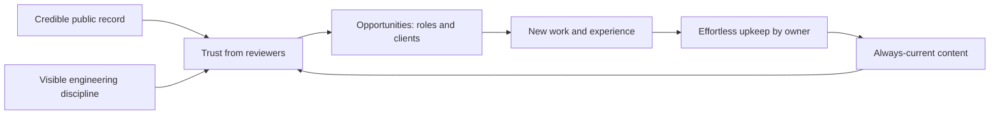

# Vision — Personal Portfolio Platform

## 1. Document Information

| Field | Value |
| --- | --- |
| **Title** | Vision — Personal Portfolio Platform |
| **Version** | 1.0.0 |
| **Status** | Draft — Pending Review |
| **Author** | Muhammad Bux |
| **Last Updated** | 2026-10-19 |
| **Current Phase** | Phase 2 — Vision (Stage 1: Think) |
| **Depends On** | Phase 1 — Problem Definition (`PROBLEM_STATEMENT.md`) |

---

## 2. Vision Statement

> To be the most credible and best-maintained public record of one developer's professional work: a living platform that lets any reviewer understand what the owner can do, and lets the owner keep that record accurate for years with minimal effort.

---

## 3. Product Vision

The Phase 1 problem was a portfolio that looks finished on launch day, then decays, and that shows little evidence of the engineering behind it. The vision is the opposite outcome.

In the long term, the platform is the single authoritative source of the owner's professional identity. Every public statement about the owner's skills, experience, education, certifications, projects, and writing originates here and stays current. Other professional channels point to it rather than competing with it.

A visitor arriving at the platform should reach an accurate judgment quickly. A recruiter should understand fit within minutes. An engineer should find enough substance to form a technical opinion. A client should see relevant work and an easy way to start a conversation.

For the owner, the platform is a long-lived asset rather than a project to be redone each job search. Adding a new project, role, or article should feel routine. The platform grows with the owner's career and remains useful across several stages of it.

Finally, the platform is itself evidence. How it was planned, documented, and maintained is part of what it communicates about the owner's professionalism.

The diagram shows the intended cycle: credibility and currency produce trust, trust produces opportunities, and opportunities produce new material that the platform absorbs easily.

---

## 4. Mission Statement

Every day, the platform exists to:

- Give each visitor an accurate, quickly understandable picture of the owner's professional ability.
- Let the owner keep that picture current without friction.
- Make it easy for the right people to get in touch.
- Reflect, in its own conduct, the standards of professional software work.

---

## 5. Core Objectives

| # | Objective | Why It Matters | Expected Outcome |
| --- | --- | --- | --- |
| O-1 | **Establish credibility with technical reviewers** | Hiring Engineers and Tech Leads are the most influential audience and the hardest to convince | Reviewers can find concrete evidence of depth, not only a list of tools |
| O-2 | **Enable fast evaluation for time-constrained reviewers** | Recruiters and managers screen many candidates and decide quickly | A reviewer reaches an informed first impression in minutes |
| O-3 | **Keep content continuously current** | Outdated information understates the owner and signals neglect | Updates become a routine, low-effort habit rather than an occasional project |
| O-4 | **Serve as a single source of truth** | Inconsistency across channels erodes trust | The portfolio is the reference all other profiles agree with |
| O-5 | **Convert interest into conversation** | A portfolio that cannot lead to contact has limited value | Interested visitors can reach the owner easily, and no inquiry is lost |
| O-6 | **Demonstrate professional engineering practice** | The portfolio's own quality is part of its argument | A senior reviewer judges the product and its documentation to reflect real-world standards |
| O-7 | **Remain useful over the long term** | Portfolios are typically abandoned after one job search | The platform stays relevant and valuable for years and across career stages |

---

## 6. Product Principles

These principles are expected to guide every later decision. When two choices conflict, the principle listed higher in the tie-break order below generally prevails.

| Principle | Meaning |
| --- | --- |
| **Content first** | The owner's work and words are the product. Presentation exists to make them clear, not to compete with them. |
| **Professional over flashy** | Restraint and clarity are preferred to novelty. Effects must never reduce credibility or comprehension. |
| **User-focused** | Decisions are judged by how they help the defined audience, in priority order, not by how interesting they are to build. |
| **Maintainable over quick hacks** | Short-term convenience that creates long-term burden is rejected. |
| **Simplicity where possible** | Complexity must be justified by a real need. A simpler solution that meets the need is preferred. |
| **Consistency** | The experience, tone, and standards should be coherent across the whole product. |
| **Accessibility** | The platform should be usable by as wide a range of people and conditions as practical. |
| **Performance awareness** | Visitors should not be made to wait. Speed is treated as part of professionalism. |
| **Security awareness** | The owner's content and private information are protected as a matter of course, not as an afterthought. |
| **Scalable thinking** | Growth in content and ambition is anticipated, without building for scale that is not needed. |

**Tie-break order when principles conflict:** security awareness, content first, user-focused, maintainable over quick hacks, simplicity, then the remaining principles.

---

## 7. Long-Term Vision

The following describes a plausible multi-year direction. It is directional, not a commitment.

### 7.1 Personal brand hub

The platform becomes the central place associated with the owner's name. People who hear about the owner through a referral, a talk, a repository, or an article land here to learn more.

### 7.2 Professional content management

The owner treats the platform as a personal content system. Everything professionally relevant is recorded once, kept accurate, and presented consistently wherever it appears.

### 7.3 Technical writing and knowledge sharing

Writing becomes a sustained part of the platform. Articles and notes show how the owner thinks, explain lessons learned, and build a reputation over time.

### 7.4 Depth through case studies

Projects evolve from short summaries into thoughtful accounts of problems, constraints, decisions, trade-offs, and results. These show judgment, which is harder to fake than output.

### 7.5 Growth of the portfolio itself

As the owner's career progresses, the platform accumulates roles, projects, certifications, and recognition. Older material is curated rather than discarded, so the record shows progression without becoming cluttered.

### 7.6 Professional presence beyond the page

The platform supports the owner's wider activity, such as talks, community contributions, and collaborations, giving them a durable home.

### 7.7 Flexible professional documents

Over time, the information held on the platform could support the owner's other professional materials, such as résumés tailored to different audiences, so that one source feeds many outputs.

### 7.8 Openness to future integration

The platform remains able to connect with external services and sources of professional activity when doing so strengthens the record, without compromising its principles.

---

## 8. Success Vision

Success is described from the perspective of each primary stakeholder.

| Stakeholder | What Success Looks Like |
| --- | --- |
| **Hiring Engineer** | Finds real evidence of ability within a short visit. Leaves with specific topics to probe in an interview and a clear sense that the owner builds carefully. |
| **Tech Lead** | Sees how the owner approaches problems and documents decisions. Concludes the owner would meet the team's standards and communicate well. |
| **Engineering Manager** | Sees consistency, ownership, and sustained effort. Reads the platform as a sign of reliability and growth. |
| **Recruiter** | Understands the owner's role focus, experience, and fit quickly, finds information consistent with other channels, and knows how to proceed. |
| **Freelance Client** | Recognizes relevant past work, trusts the presentation, and feels comfortable reaching out. |
| **Portfolio Owner** | Is proud to share the link anywhere. Updates the platform promptly after each new accomplishment. Trusts that it reflects their current best work and that no inquiry is missed. |

---

## 9. Future Expansion Opportunities

These are ideas for consideration. None is committed to Version 1, and each would be evaluated against the principles and boundaries in this document.

| Opportunity | Intent |
| --- | --- |
| Multi-language support | Reach audiences in additional languages |
| Newsletter | Maintain a relationship with an interested audience |
| Analytics | Understand how visitors engage, in a privacy-respecting way |
| Open-source showcase | Present contributions and public work in context |
| Testimonials | Add third-party voices to strengthen trust |
| Awards and recognition | Record external validation |
| Public API | Allow the owner's profile data to be reused elsewhere |
| Résumé generator | Produce tailored résumés from the same source of truth |
| Search | Help visitors find relevant content as the volume grows |
| Dark mode improvements | Refine comfort and polish of the viewing experience |
| Case-study library | Deepen project narratives |
| Speaking and events record | Present talks and community involvement |

---

## 10. Product Boundaries

The platform is intentionally **not** trying to become any of the following.

| Not This | Reason |
| --- | --- |
| **A social network** | It represents one person and does not host a community or user profiles |
| **A learning platform** | It may share knowledge through writing but does not teach through courses or tracked progress |
| **A marketplace** | It does not broker work, list services from others, or process transactions between parties |
| **A CMS product for everyone** | It is built for one owner; generalizing it would add complexity that serves no stated user |
| **A competitor to blogging platforms** | Writing supports the owner's credibility; it is not a goal in itself to compete for authors or readers |
| **A multi-user collaboration tool** | The owner is the only author and administrator |
| **A general-purpose website builder** | Its purpose is a specific, curated professional presence |
| **A showcase of effects over substance** | Visual novelty must never replace clarity and evidence |

---

## 11. Strategic Goals

| Horizon | Goals |
| --- | --- |
| **Short-term** (initial release and first months) | Present a complete, accurate professional profile that a reviewer can evaluate quickly. Establish content-quality standards. Make routine updates easy enough that the owner actually does them. Ensure visitor inquiries reach the owner reliably. Publish the planning documentation as visible evidence of process. |
| **Mid-term** (roughly the first one to two years) | Deepen project narratives into case studies. Build a steady body of technical writing. Refine the experience based on feedback from real reviewers. Use the platform as the primary reference in applications and outreach. Consider selected expansion opportunities that clearly support the objectives. |
| **Long-term** (several years) | Be the owner's lasting professional home across multiple career stages. Support a recognized personal brand built on consistent, credible work. Evolve gradually as the owner's goals change, while preserving the principles and boundaries stated here. |

---

## 12. Product Values

| Value | What It Means for This Product |
| --- | --- |
| **Quality** | Fewer things done well are preferred to many things done poorly. |
| **Trust** | Information is honest and verifiable. Nothing is exaggerated or left stale. |
| **Professionalism** | The product behaves as a real professional product would, from content to conduct. |
| **Simplicity** | Visitors and the owner should never have to work to understand or use the product. |
| **Reliability** | The platform is available and behaves predictably when someone needs it. |
| **Maintainability** | The product is designed to be sustained, not merely launched. |
| **Respect for visitors** | Visitor time, attention, and privacy are treated carefully. |
| **Continuous improvement** | The product is expected to improve steadily in response to feedback and the owner's growth. |

---

## 13. Vision Success Metrics

These are product-oriented indicators. Targets are initial and to be refined as real data becomes available.

| # | Metric | Indicator of Vision Being Achieved |
| --- | --- | --- |
| M-1 | **Time to first impression** | A first-time reviewer can state the owner's focus and strengths after a short visit, ideally within two minutes |
| M-2 | **Reviewer confidence** | Reviewers who give feedback report that the platform helped them evaluate the owner |
| M-3 | **Content freshness** | Most public content has been reviewed or updated within a defined recent period, and the owner adds new work soon after completing it |
| M-4 | **Update habit** | The owner makes content updates regularly, and the effort per update stays small |
| M-5 | **Inquiry handling** | Every visitor inquiry is received, and the owner responds within a self-defined timeframe |
| M-6 | **Source-of-truth consistency** | The platform agrees with the owner's other professional profiles |
| M-7 | **Interview relevance** | Interviewers refer to specific platform content in conversations |
| M-8 | **Opportunity flow** | The platform is cited in interview invitations or client enquiries |
| M-9 | **Depth of narrative** | A growing share of projects include full case-study-level accounts |
| M-10 | **Longevity** | The platform remains in active use and relevant beyond a single job search |

---

## 14. Assumptions

- The owner will remain the sole author and administrator.
- Hiring Engineers and Tech Leads remain the highest-priority audience.
- Reviewers value evidence of reasoning and process in addition to finished work.
- A credible, current portfolio materially improves the owner's job and client prospects.
- The owner will continue producing new work and writing worth presenting.
- Low-effort upkeep is the main factor determining whether content stays current.
- The owner's career goals will evolve, and the platform must be able to follow without being replaced.
- Professional norms around portfolios will change gradually rather than abruptly.
- Visitors will continue to value a personal, owned presence in addition to third-party profiles.
- The principles and boundaries in this document will remain broadly stable, with changes made deliberately.

---

## 15. Risks to the Vision

| ID | Risk | Impact | Mitigation |
| --- | --- | --- | --- |
| VR-1 | **Vision drift.** Ideas that do not serve the vision gradually enter the product. | The platform loses focus and credibility. | Evaluate every proposal against the principles and boundaries; record decisions and reasons. |
| VR-2 | **Ambition outpaces capacity.** The long-term vision exceeds what one person can maintain. | Content decays and the platform contradicts its own purpose. | Treat expansion ideas as optional; protect upkeep ahead of new directions. |
| VR-3 | **Content stagnation.** The owner stops adding new work or writing. | The platform becomes a snapshot of the past. | Keep updates low-effort; tie updates to routine milestones; curate rather than only add. |
| VR-4 | **Style over substance.** Visual polish is prioritized over evidence of ability. | Reviewers form a weak impression of the owner's depth. | Apply the content-first and professional-over-flashy principles in all decisions. |
| VR-5 | **Becoming a general product.** Expansion turns the platform into something for many users. | Complexity grows with no benefit to the actual audience. | Respect the product boundaries and revisit them only through explicit review. |
| VR-6 | **Audience mismatch.** The platform is shaped for one audience at the expense of the others. | Key reviewers cannot find what they need. | Keep the audience priority order explicit and test decisions against each stakeholder. |
| VR-7 | **Overstated or inaccurate content.** Claims are inflated or outdated. | Trust is damaged, which is difficult to recover. | Apply honest-content standards; review claims regularly. |
| VR-8 | **Shifting hiring norms.** Expectations of portfolios change. | Parts of the vision may become less relevant. | Review the vision periodically and update it with a recorded rationale. |
| VR-9 | **Loss of momentum.** Long-term vision is not matched by sustained effort. | The platform never reaches its intended maturity. | Define success in stages; celebrate and review progress at each horizon. |

---

## 16. Out of Scope

This document intentionally does **not** define the following. Each belongs to a later phase or document.

| Excluded Topic | Belongs To |
| --- | --- |
| Product scope and feature prioritization | Phase 3 — Scope |
| Functional and non-functional requirements | Phase 4 — Functional Requirements |
| User stories and user flows | Phase 5 — User Flows |
| Database design | Later design phase |
| API design | Later design phase |
| System architecture | Later design phase |
| UI design and wireframes | Later design phase |
| Authentication design | Later design phase |
| Folder and code structure | Later design phase |
| Development roadmap and tasks | Later planning |
| Testing strategy | Later delivery phase |
| Deployment and hosting | Later delivery phase |

---

## 17. Conclusion

This vision describes a platform that is credible to its readers, effortless for its owner to maintain, and consistent with the standards of professional software work. It names the outcomes the product exists to produce, the principles that should decide close calls, and the boundaries that keep it focused.

Every later phase should be checked against this document. Scope should include only what moves the platform toward the vision. Requirements should be traceable to its objectives. Design and engineering choices should be judged by its principles. When a proposal cannot be tied back to this document, that is a reason to question it.

Defining the vision before scope matters because scope is a set of choices about what to include and exclude, and those choices cannot be made well without a stated direction. Without one, scope tends to be set by what is easy, interesting, or fashionable. With one, each inclusion and exclusion can be justified.

The next step is **Phase 3 — Scope**, which will decide what the first version of the platform includes, guided by the problem in Phase 1 and the vision recorded here.